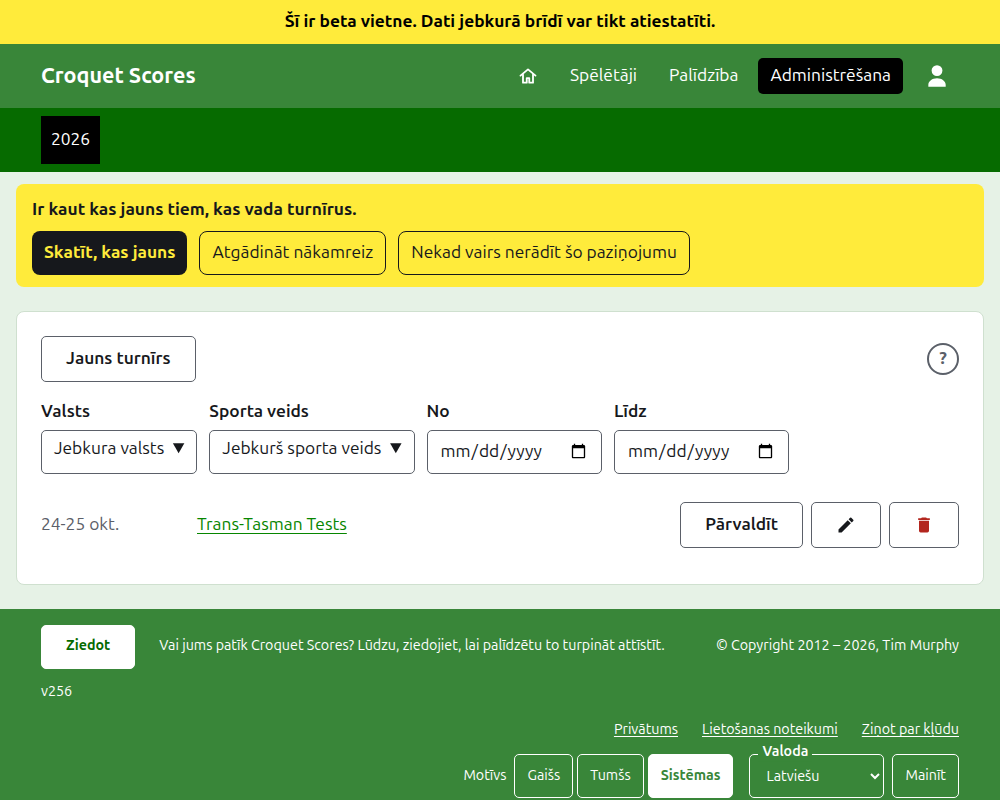
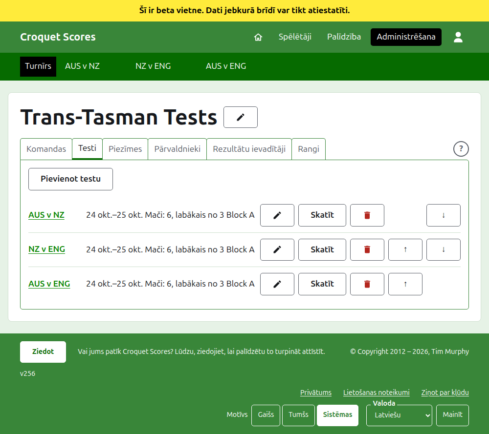

# Komandu turnīra vadīšana

Komandu turnīrs ir tāds, kurā tiekas komandas, nevis pa vienam pieteikti spēlētāji: testu sērija starp divām valstīm, Interstate Shield, pasaules komandu čempionāts. Tajā tiek izveidotas komandas ar to spēlētājiem, pievienoti testi starp komandām, un katra testa partijas tiek ievadītas, kad tās ir nospēlētas. Šī rokasgrāmata pavada pārvaldnieku no pierakstīšanās līdz turnīram, kura rezultāti ir pieejami sabiedrībai.

Tā ir pilnīga pati par sevi. Nekas tajā nav atkarīgs no rokasgrāmatas par standarta turnīru, kas ir rakstīta atsevišķi.

## Pirms sākat

Jums vajadzīgs konts. Noklikšķiniet [šeit](/account/register), lai reģistrētu kontu.

Viss, ko dara pārvaldnieks, tiek darīts vietnes administrēšanas sadaļā. Publiskās lapas, kurās spēlētāji un skatītāji seko turnīram, tiek veidotas no tā, ko glabā administrēšana, tāpēc nekas nav jāpublicē: ievadīts rezultāts publiskajās lapās ir uzreiz.

## Vārdi

**Komanda** ir puse, piemēram, Austrālija, ar nosaukumu, īsu nosaukumu, piemēram, "AUS", un karogu. Komandai ir savi **spēlētāji**, kas spēlē par to un ne par vienu citu. **Tests** ir sacensība starp divām komandām, ko sauc pēc to īsajiem nosaukumiem, piemēram, "AUS v ENG", un kas sastāv no vairākiem **mačiem** starp katras komandas spēlētāju, katrs mačs ir labākais no kāda skaita **partiju**. Testus var ielikt **grupās**, piemēram, "Block A", ja daudzas komandas spēlē savā starpā.

## Lapas pēc kārtas

1. [Turnīra izveide](creating-a-tournament.md): tā nosaukums, dienas, sporta veids, formāts un norises vieta.
2. [Komandas](teams.md): komandu pievienošana ar to īsajiem nosaukumiem un karogiem.
3. [Komandas spēlētāji](team-players.md): katras komandas spēlētāju ievadīšana komandas pašas lapā.
4. [Testi](tests.md): testu pievienošana starp komandām, to dienas, cik maču katrā ir un to grupas.
5. [Rezultāti](scores.md): testa partiju ievadīšana, labošana un kļūdaini ievadīto atlikšana malā.
6. [Piezīmes](notes.md): spēlētājiem pastāstīt to, kas viņiem jāzina, turnīram ritot.
7. [Pārvaldnieki un rezultātu ievadītāji](managers-and-scorers.md): turnīra vadīšanas dalīšana un iespēja kādam ievadīt rezultātus, nevarot mainīt neko citu.
8. [Rangi](rankings.md): fails, ko sūta pasaules rangiem, un kas jums vēl jāaizpilda.
9. [Turnīra maiņa, arhivēšana un atjaunošana](changing-and-archiving.md): turnīra informācijas labošana un turnīra atlikšana malā.
10. [Ko redz sabiedrība](what-the-public-sees.md): lapas, kurām seko jūsu spēlētāji, un kā tajās parādās tas, ko ievadāt.

## Kā iekārtota administrēšana

Administrēšanas pirmā lapa uzskaita turnīrus, kuros jums ir sava loma, pa vienam gadam.

Nospiežot turnīra nosaukumu vai **Pārvaldīt**, tiek atvērta tā lapa. Viss, kas jāvada, ir sešās cilnēs zem tā nosaukuma: **Komandas**, **Testi**, **Piezīmes**, **Pārvaldnieki**, **Rezultātu ievadītāji** un **Rangi**. Cilne **Rangi** ir tikai tad, ja turnīrs tiek ieskaitīts pasaules rangos. Lapa atveras cilnē Komandas, jo komandas ir pirmais, ko izveido.

Tumši zaļā josla zem galvenes ir paredzēta pārvietošanai starp lapām. Turnīra lapā un testa lapā tā ved uz turnīru, kā **Turnīrs**, un uz katru testu pēc tā nosaukuma. Komandas lapā tā ved uz turnīru un uz katru komandu pēc tās īsā nosaukuma, jo pārvaldnieks, atrodoties vienas komandas lapā, ievada spēlētājus pa komandām. Lapa, kurā esat, ir atzīmēta melnā krāsā. Kad cilnē Testi testi tiek pievienoti, mainīti, pārvietoti, arhivēti vai atjaunoti, josla tiem uzreiz seko.

## Kas ir spēkā visur

**Nekas netiek dzēsts pavisam, izņemot piezīmi.** Komandas, spēlētāji, testi, rezultāti un pats turnīrs tiek arhivēti, nevis dzēsti: atlikti malā, pārsvītroti un uzskaitīti zem sava virsraksta, ar **Atjaunot**, lai tos atgrieztu. Arhivēšana, atjaunošana un pārvietošana uz augšu un leju nekad neprasa apstiprinājumu, jo katru atsauc, nospiežot pretējo. Lietas, ko nevar atsaukt, piemēram, piezīmes dzēšana vai pārvaldnieka noņemšana, vispirms pajautā.

**Dialogs virs lapas neko nesaglabā, kamēr nenospiežat tā pogu.** Atcelt vai taustiņš Escape to aizver un atstāj visu, kā bija. Dialogi, kas pievieno lietas, piemēram, Pievienot komandu un Pievienot rezultātu, pēc katras pievienošanas paliek atvērti, lai sarakstu varētu ievadīt vienu pēc otra.

**Tas, kas tiek atteikts, tiek pateikts blakus laukam, uz kuru tas attiecas.** Nekas atteiktais netiek saglabāts, un tas, ko ievadījāt, paliek ievadīts, lai to varētu izlabot, nevis rakstīt no jauna.

**Palīdzība ir vienas nospiešanas attālumā.** Apaļa **?** ir tās lapas virsraksta joslā, kas izveido vai maina turnīru, cilņu rindas galā blakus **Jauns turnīrs** un katrā dialogā. Tā citā cilnē atver šīs rokasgrāmatas daļu, kas ir par to, ko redzat, lai tas, ko darījāt, paliktu saglabāts.

**Administrēšana darbojas telefonā.** Katra poga ir pietiekami liela, lai to nospiestu ar īkšķi, un nekas nav platāks par ekrānu.

Tālāk: [Turnīra izveide](creating-a-tournament.md).
