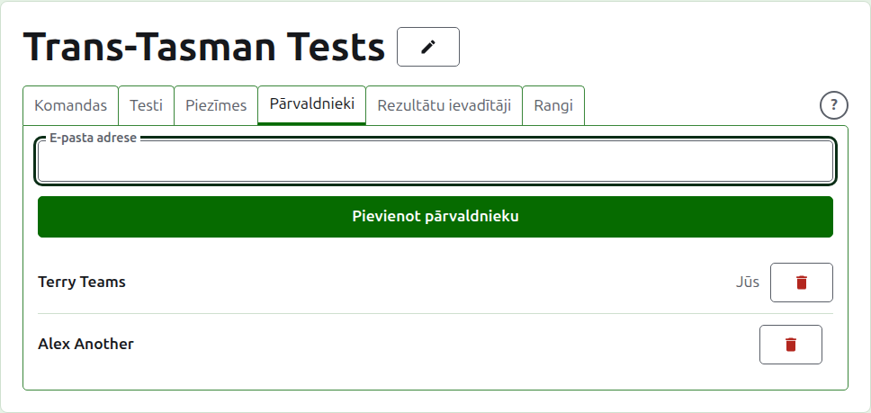
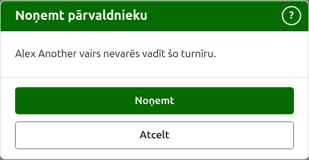
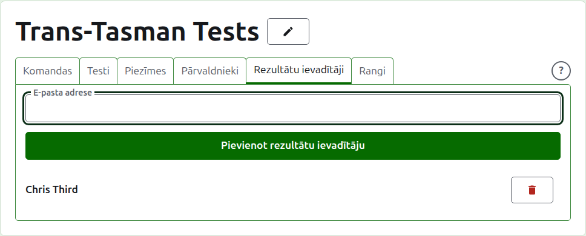
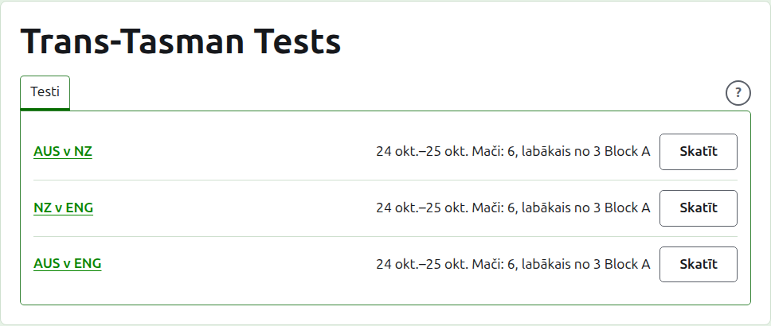

# Pārvaldnieki un rezultātu ievadītāji

Turnīram ir pārvaldnieki, kas var darīt visu, ko ar to var darīt, un var būt rezultātu ievadītāji, kas ievada tā rezultātus un neko citu. Tas, kurš izveidoja turnīru, ir tā pirmais pārvaldnieks.

## Pārvaldnieki {#managers}

Cilne **Pārvaldnieki** uzskaita, kas vada turnīru, tādā kārtībā, kādā viņi tika izveidoti, ar jūsu pašu vārdu atzīmētu kā jūsu. Tā ir vieta, kur turnīru dala vai nodod tālāk.

Kāds tiek padarīts par pārvaldnieku pēc savas e-pasta adreses. Ievadiet to laukā virs saraksta un nospiediet **Pievienot pārvaldnieku**. Adresei jāpieder reģistrētam un apstiprinātam kontam; adrese bez tāda tiek atteikta zem lauka, un vietne par to nesaka vairāk kā tikai to. Rezultātu ievadītājs, kas tiek padarīts par pārvaldnieku, vairs nav rezultātu ievadītājs.

**Noņemt** noņem pārvaldnieku. Nekas netiek paturēts par noņemto pārvaldnieku, tāpēc Noņemt vispirms jautā; ja viņu vajag atpakaļ, viņu atkal padara par pārvaldnieku pēc adreses. Turnīram vienmēr ir pārvaldnieks, tāpēc pēdējam netiek piedāvāts Noņemt.

Jūs varat noņemt arī sevi. Jautājums tad saka, ko tas nozīmē: jūs zaudējat savu ceļu atpakaļ uz turnīru, un neviens lapā to jūsu vietā nevar atsaukt. Cits pārvaldnieks var jūs atkal padarīt par pārvaldnieku.

## Rezultātu ievadītāji {#scorers}

Cilne **Rezultātu ievadītāji** ir cilne Pārvaldnieki rezultātu ievadītājiem, un darbojas tāpat: e-pasta adrese un **Pievienot rezultātu ievadītāju** virs saraksta un **Noņemt** pie katra.

Rezultātu ievadītājs redz turnīru savā sarakstā administrēšanā, ar **Rezultāti** tur, kur citiem ir Pārvaldīt, un viņam tiek piedāvāti tikai tā testi: nav komandu, piezīmju, pārvaldnieku, rezultātu ievadītāju vai rangu. Viņš nevar atvērt komandas lapu, jo tas, kas spēlē komandā, ir pārvaldnieku ziņā. Testa lapā viņš var ievadīt, labot, arhivēt, atjaunot un pārkārtot rezultātus tāpat kā pārvaldnieks.

Pārvaldnieku nepadara par rezultātu ievadītāju, jo pārvaldnieks jau var darīt visu, ko var rezultātu ievadītājs. Turnīram rezultātu ievadītājs nav vajadzīgs, tāpēc var noņemt katru, arī pēdējo.

Tālāk: [Rangi](rankings.md).
