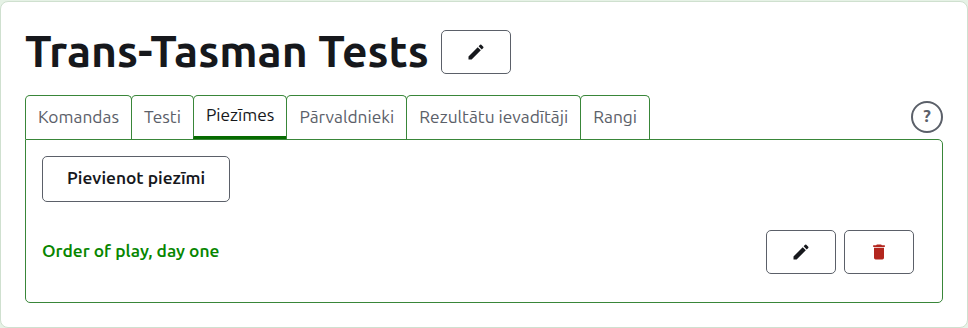
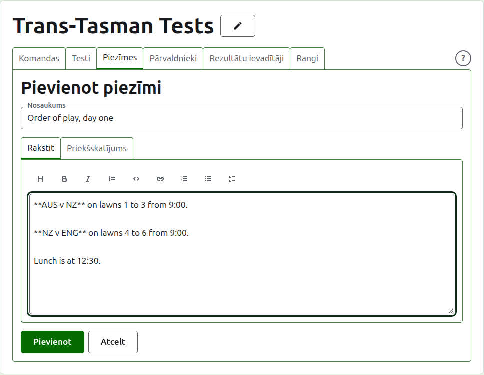
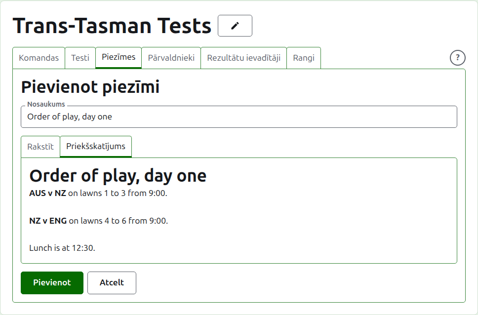
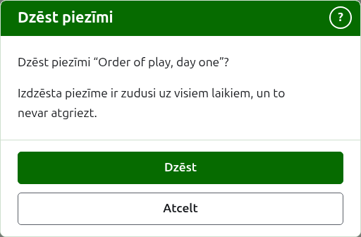

# Piezīmes

Turnīra lapas cilne **Piezīmes** ir vieta, kur tā pārvaldnieki raksta to, kas spēlētājiem jāzina, turnīram ritot: spēļu kārtību, izmaiņas laukumos, pusdienu laiku. Lasītāji tās atrod turnīra publiskajā Piezīmju lapā, un piezīme, ko viņi nav izlasījuši, tur ir atzīmēta ar sarkanu zvaigznīti, kas atzīmē arī sadaļu Piezīmes katrā turnīra lapā, līdz viņi to atver.

## Piezīmes rakstīšana

Nospiediet **Pievienot piezīmi** virs saraksta. Saraksta vietā parādās panelis, jo piezīme tiek rakstīta plaši un tai vajag vietu.

**Nosaukums** ir obligāts, un pēc tā piezīme tiek uzskaitīta. Tas ir vienkāršs teksts.

**Apraksts** tiek rakstīts Markdown valodā, un to var atstāt tukšu, ja nosaukums pasaka visu, kas sakāms. Rīkjosla virs lodziņa raksta Markdown jūsu vietā: Virsraksts, Treknraksts, Kursīvs, Citāts, Kods, Saite, Numurēts saraksts, Aizzīmju saraksts un Uzdevumu saraksts. Katrs darbojas ar to, kas ir atlasīts, vai katras atlasītās rindas sākumā, vai ieliek kursoru tur, kur jāliek vārdi.

Rindkopa no iepriekšējās tiek atdalīta ar pilnīgi tukšu rindu, lai piezīme lasītos kā rindkopas.

**Priekšskatījums** parāda piezīmi tā, kā lasītājs to redzēs tās lapā.

Nospiediet **Pievienot**. Piezīme tiek saglabāta, saraksts atgriežas ar to augšpusē, un tā uzreiz ir publiskajā Piezīmju lapā.

## Piezīmes labošana

Nospiediet piezīmes nosaukumu vai tās **Labot**, lai atvērtu paneli šai piezīmei. Nospiediet **Saglabāt**, lai saglabātu izmaiņu. Piezīme, kas labota pēc tam, kad lasītājs to izlasīja, viņam tiek atzīmēta atkal.

## Piezīmes dzēšana {#deleting-a-note}

Piezīmi, kas vairs neattiecas, dzēš. Izdzēsta piezīme ir zudusi uz visiem laikiem, tāpēc **Dzēst** vispirms jautā.

Tālāk: [Pārvaldnieki un rezultātu ievadītāji](managers-and-scorers.md).
