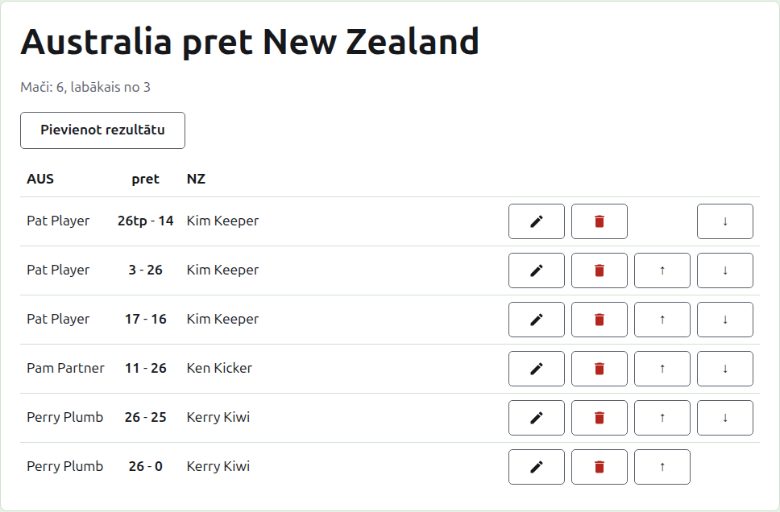
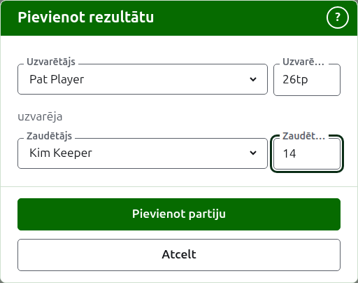

# Rezultāti

Testa lapa tiek atvērta no tā nosaukuma cilnē Testi vai no tumši zaļās joslas. Tās virsraksts ir komandu pilnie nosaukumi, piemēram, "Australia v New Zealand", ar to, cik maču tajā ir gaidāms un kāds ir katrs mačs, zem tā. Tās rezultāti ir pati lapa, bez cilnēm. Pārvaldnieks un rezultātu ievadītājs redz to pašu lapu, jo rezultātu ievadītājs ar rezultātu var darīt visu, ko pārvaldnieks.

## Kā rezultāti ir izkārtoti

Rezultāti ir izkārtoti pa komandām, nevis pēc tā, kurš uzvarēja, tabulā ar virsrakstu: pirmās komandas īsais nosaukums, "v" un otrās komandas īsais nosaukums. Katrs rezultāts ir rinda: pirmās komandas spēlētājs, tad abi rezultāti, pirmās komandas pirmais, piemēram, "26tp - 14", tad otrās komandas spēlētājs, lai kurš no viņiem uzvarēja. Arhivētie rezultāti zem tiem ir izkārtoti tāpat.

## Rezultāta ievadīšana {#entering-a-score}

Nospiediet **Pievienot rezultātu** virs saraksta. Dialogs lasās tā, kā rezultāts tiek izteikts skaļi: uzvarētājs un viņa rezultāts, tad "uzvarēja", tad zaudētājs un viņa rezultāts.

Uzvarētājs tiek izvēlēts no abu komandu lietošanā esošajiem spēlētājiem, zem katras komandas nosaukuma, pirmās komandas spēlētāji pirmie un katras komandas spēlētāji komandas kārtībā. Sākumā netiek izvēlēts neviens. Kad uzvarētājs ir izvēlēts, zaudētājs tiek piedāvāts tikai no otras komandas, jo partija starp diviem vienas komandas spēlētājiem nav partija starp komandām. Arhivēts spēlētājs netiek piedāvāts.

Rezultāts tiek ievadīts tā, kā rezultātu ievadītājs to pierakstīja: tā punktu skaits un viss, kas seko, ko saglabā un rāda, kā ievadīts, piemēram, "26tp" 26 vārtiņiem un trīskāršam peel. Skaitlis ir cipari, ar kuriem rezultāts sākas; rezultāts, kas nesākas ar ciparu, tiek atteikts.

Partija, kas uzvarēta ar vienādiem punktiem, piemēram, kad to aptur laika dēļ un izšķir citādi, saka, kurš uzvarēja, ar atzīmi aiz uzvarētāja rezultāta: "6w" uzvarēja "6". Atzīmes ir "w", "won" un "winner". Uzvarētāja rezultātam jābūt lielākam par zaudētāja vai atzīmētam, ja vien turnīrs nepieļauj neizšķirtus rezultātus, un tad vienādi punkti bez atzīmes tiek saglabāti kā neizšķirts.

Ja spēlētājus nevar nolasīt, dialogs to saka virs laukiem ar "Spēlētājus nevarēja nolasīt. Aizveriet šo dialogu un atveriet to vēlreiz.", nevis piedāvā nevienu. Rīkojieties, kā tas saka.

Nospiediet **Pievienot partiju**. Partija tiek pievienota, dialogs saka, kura, un lauki tiek iztukšoti nākamajai, jo rezultāti nāk kopā, nolasīti no dēļa sesijas beigās. Kad tie visi ir ievadīti, nospiediet **Atcelt**.

## Mači

Divi spēlētāji, kas tiekas, spēlē mačus, kuru formāts ir testa "labākais no". Partijas starp viņiem ir šī mača partijas, un partija starp diviem spēlētājiem, kuru mačs jau ir izšķirts, tiek atteikta: viens no viņiem ir uzvarējis vairāk partiju, nekā otrs vēl varētu uzvarēt, vai ir nospēlēta katra tā partija.

Mačs ir sācies, kad abiem tā spēlētājiem ir partija lietošanā. Tests nesāk vairāk maču, nekā tajā gaidāms: kad ir sākts tik, cik gaidāms, partija starp diviem spēlētājiem, kas nav tikušies, tiek atteikta, bet cita jau sāktā mača partija tiek pieņemta. Ja testā jābūt vairāk mačiem, mainiet to cilnē Testi, lai tos gaidītu.

## Rezultāta labošana {#correcting-a-score}

**Labot** atver to pašu dialogu šim rezultātam, ar nosaukumu Labot rezultātu, ar izvēlētiem tā spēlētājiem un rezultātiem, kā tie tika ievadīti. Tā spēlētājus var mainīt tāpat kā rezultātus, izvēloties kā pievienojot. Nospiediet **Saglabāt**, lai saglabātu labojumu un aizvērtu dialogu. Labojums saglabā iznākumu: uzvarēta partija paliek uzvarēta, un neizšķirta partija paliek neizšķirta. Partiju, kuras iznākums bija nepareizs, arhivē un ievada vēlreiz.

## Rezultātu sakārtošana

Rezultāti nāk tādā kārtībā, kādā tie tiek ievadīti, tāpēc katram lietošanā esošam rezultātam tiek piedāvāts **Uz augšu** un **Uz leju**, kas to apmaina ar blakus esošo rezultātu, lai sarakstu varētu sakārtot tādā kārtībā, kādā partijas tika spēlētas.

## Rezultāta arhivēšana

**Arhivēt** atliek rezultātu malā, lai tas nenozīmētu neko. Tas tiek uzskaitīts zem **Arhivētie rezultāti**, pārsvītrots, un tam tiek piedāvāts tikai **Atjaunot**. Neviens nejautā iepriekš, jo katrs atsauc otru. Katru testa rezultātu var arhivēt, jo testā nav kārtu, kas būtu atkarīgas viena no otras.

Rezultāts, kura spēlētājs pēc tam ir arhivēts, netiek atjaunots, kamēr nav atjaunots spēlētājs, un lapa to saka.

Tālāk: [Piezīmes](notes.md).
