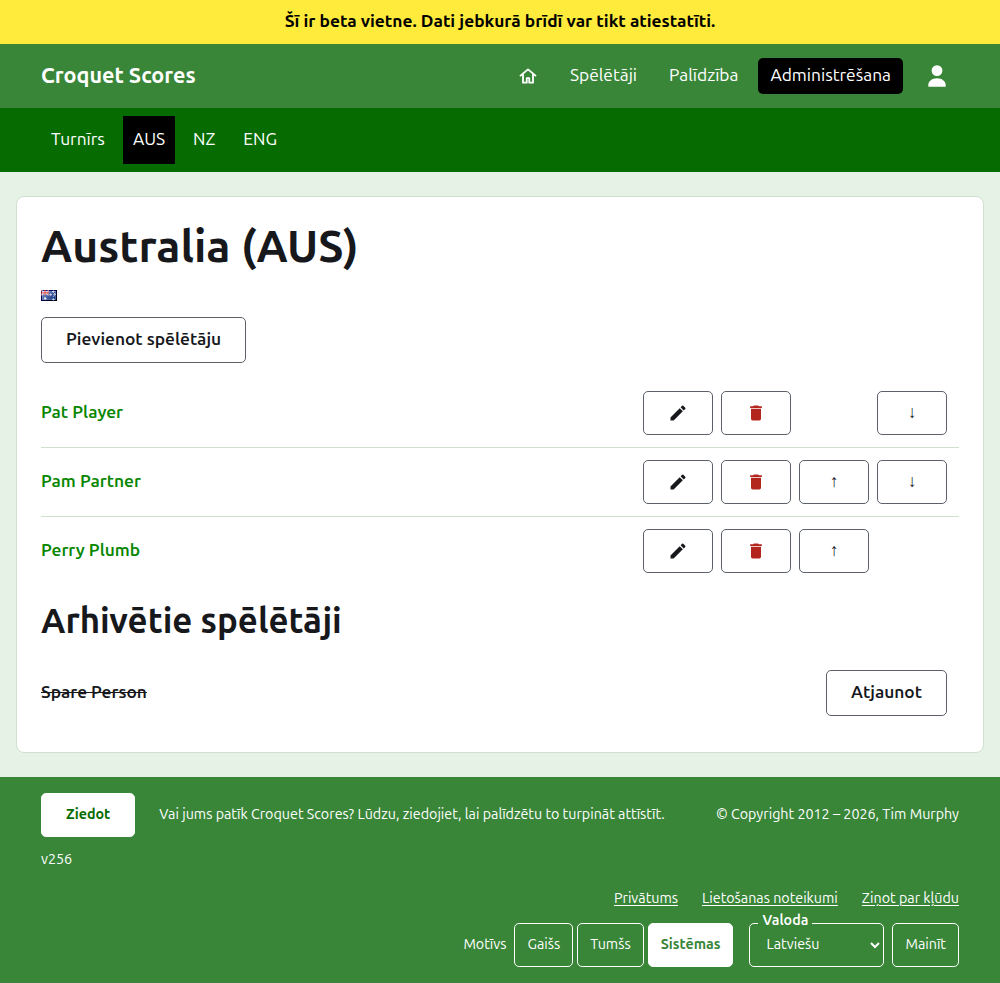
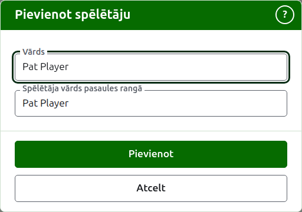

# Komandas spēlētāji

Komandas lapa tiek atvērta no tās nosaukuma vai tās **Skatīt** cilnē Komandas. Tās virsraksts ir komandas nosaukums ar tās īso nosaukumu iekavās un tās karogs, lai pārvaldnieks, kas nonācis pie nepareizas komandas, to redz uzreiz. Tai ir viena lieta, ko rādīt, komandas spēlētāji, tāpēc saraksts ir pati lapa.

Tumši zaļā josla komandas lapā ved uz turnīru un uz katru lietošanā esošo komandu pēc tās īsā nosaukuma, lai spēlētājus varētu ievadīt pa komandām, neatgriežoties cilnē Komandas.

Komandas spēlētājs pieder tikai šai komandai, pārstāv komandu un nes komandas karogu, nevis savu. Tas pats cilvēks, kas spēlē divās komandās vai divos turnīros, ir spēlētājs katrā.

## Spēlētāja pievienošana {#adding-a-player}

Nospiediet **Pievienot spēlētāju** virs saraksta. Virs lapas atveras dialogs.

**Vārds** ir obligāts, no 3 līdz 254 rakstzīmēm. Diviem spēlētājiem vienā komandā nevar būt vienāds vārds, lai kā tas būtu rakstīts ar lielajiem burtiem; spēlētājs citā komandā var to dalīt.

**Spēlētāja vārds pasaules rangā** ir vārds, ar kuru pasaules rangi spēlētāju pazīst. Tas tiek prasīts tikai Asociācijas kroketa vai Golfa kroketa turnīrā, abos sporta veidos, kuru spēlētājiem pasaules rangi tur sarakstu. Amerikāņu 6 vārtiņu kroketa spēlētājus rangi pazīst pēc viņu pašu vārdiem, tāpēc tur tas netiek prasīts, un katra spēlētāja pasaules ranga vārds vienmēr ir viņa vārds. Kamēr pievienojat spēlētāju, tas seko vārdam, kad to rakstāt, un pārstāj sekot, tiklīdz to ievadāt pats. Atstāts tukšs, tas tiek saglabāts kā spēlētāja vārds. Rakstot, tiek piedāvāti spēlētāji, kurus pasaules rangi pazīst un kuru vārdi tā sākas, un blakus pasaules ranga vārdam ķeksītis saka, ka rangi vārdu zina, un jautājuma zīme, ka nezina. Tas ir tikai padoms: vārds, ko rangi nezina, tiek saglabāts tikpat viegli kā tāds, ko zina.

Spēlētāju nekad nesauc par "Bye": vārds, kas ir "Bye", vai "Bye" ar skaitli, piemēram, "Bye 2", "Bye-2" vai "Bye (2)", tiek atteikts. Vārds, kas tikai sākas ar šo vārdu, kā "Bye / Bassett", pieder cilvēkam.

Nospiediet **Pievienot**. Spēlētājs tiek pievienots, dialogs to saka, un tā lauki tiek iztukšoti nākamajam, ar kursoru atpakaļ vārdā. Pievienojiet visu komandu šādi, tad nospiediet **Atcelt**, lai aizvērtu dialogu.

## Spēlētāja labošana {#correcting-a-player}

Nospiediet spēlētāja vārdu vai viņa **Labot**, lai atvērtu to pašu dialogu šim spēlētājam, ar nosaukumu Labot spēlētāju. Nospiediet **Saglabāt**, lai saglabātu izmaiņu. Spēlētājs, kura vārds tiek izlabots, patur savu pasaules ranga vārdu, izņemot Amerikāņu 6 vārtiņu kroketa, kur spēlētāja pasaules ranga vārds vienmēr ir viņa vārds.

## Kārtība

Spēlētāji tiek uzskaitīti komandas kārtībā, kādā tie tiek piedāvāti, kad tiek ievadīts testa rezultāts. **Uz augšu** un **Uz leju** pārvieto spēlētāju par vienu vietu komandas ietvaros.

## Spēlētāja arhivēšana

**Arhivēt** atliek spēlētāju malā: ievadīts kļūdas dēļ vai vairs nav komandā. Arhivēts spēlētājs tiek uzskaitīts zem **Arhivētie spēlētāji**, pārsvītrots, aiz lietošanā esošajiem spēlētājiem, un tam tiek piedāvāts tikai **Atjaunot**. Arhivēšana nekad nejautā iepriekš, jo komandas spēlētājs nav ievadīts nekur citur un atjaunošana visu atgriež.

Spēlētāju, kas ir nospēlējis jebkuru lietošanā esošu testa partiju, nevar arhivēt, jo partijas tad būtu pret kādu, kas vairs nav klāt, tāpēc šādam spēlētājam Arhivēt netiek piedāvāts. Spēlētāju, kura vienīgās partijas ir arhivētas, var.

Tālāk: [Testi](tests.md).
