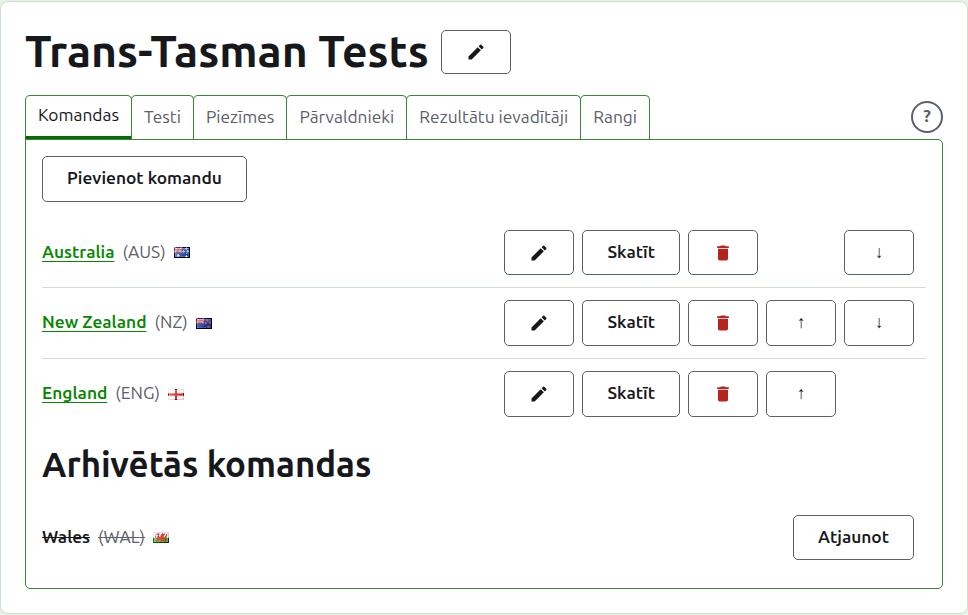
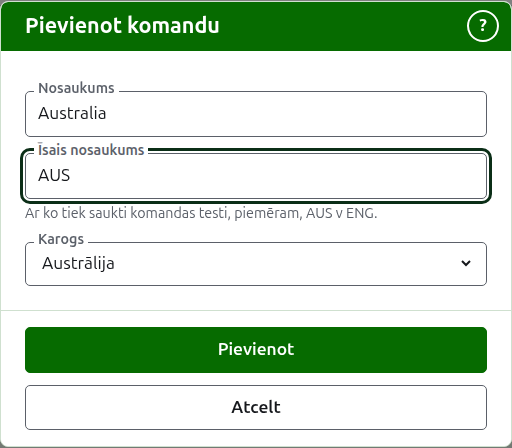
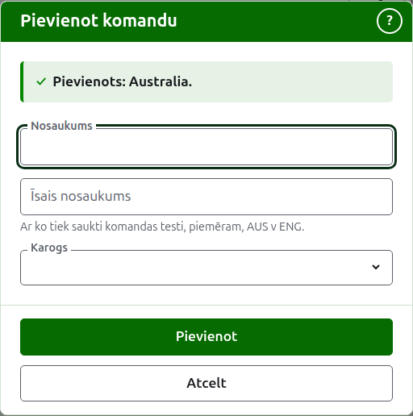
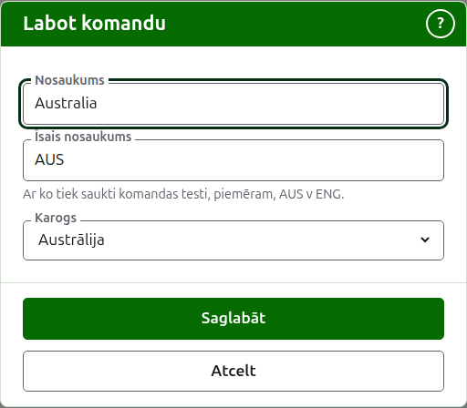

# Komandas

Turnīra lapas cilne **Komandas** ir vieta, kur tā komandas tiek pievienotas, labotas, sakārtotas un atliktas malā. Tā ir cilne, kurā lapa atveras, jo komandas ir pirmais, ko izveido. Tests ir starp divām komandām, tāpēc, pirms var pievienot jebkuru testu, vajadzīgas vismaz divas.

## Komandas pievienošana {#adding-a-team}

Nospiediet **Pievienot komandu** virs saraksta. Virs lapas atveras dialogs.

**Nosaukums** ir obligāts: komandas pilnais nosaukums, piemēram, "Australia", kas ir komandas lapas un publisko lapu tabulu virsraksts. Divām komandām vienā turnīrā nevar būt vienāds nosaukums.

**Īsais nosaukums** ir obligāts arī: ar to tiek saukti komandas testi, piemēram, "AUS v ENG", un tā tumši zaļā josla sauc komandu. Tajā ir ne vairāk kā 10 rakstzīmes un ne vairāk kā nosaukumā, jo īss nosaukums, kas ir garāks par nosaukumu, ko tas saīsina, ir abi, ierakstīti nepareizi apmainīti. Divām komandām arī nevar būt vienāds īsais nosaukums.

**Karogs** tiek rādīts blakus komandas nosaukumam visur, kur tas parādās. To var atstāt kā nevienu, kā klubam vai reģionam piederošai komandai.

Nospiediet **Pievienot**. Komanda tiek pievienota, dialogs to saka, un tā lauki tiek iztukšoti nākamajai. Pievienojiet visu sarakstu šādi, tad nospiediet **Atcelt**, lai aizvērtu dialogu. Atcelt nesaglabā neko, kas jau nebija pievienots.

## Komandas labošana {#correcting-a-team}

Nospiediet komandas **Labot**, lai atvērtu to pašu dialogu šai komandai, ar nosaukumu Labot komandu. Izlabojiet, kas nav pareizi, un nospiediet **Saglabāt**. Komanda, kuras īsais nosaukums mainās, visur tiek saukta jaunajā, tāpēc tās testi tiek pārdēvēti kopā ar to.

## Kārtība

Komandas tiek uzskaitītas turnīra kārtībā, kas ir kārtība, kādā tās tiek piedāvātas, kad tiek pievienots tests, kārtība, kādā tās ir tumši zaļajā joslā, un kārtība, kādā tās uzskaita publiskā Spēlētāju lapa. **Uz augšu** un **Uz leju**, bultiņas katras rindas galā, pārvieto komandu par vienu vietu.

## Pāreja uz komandu

Komandas nosaukums vai **Skatīt** atver komandas pašas lapu, kur tiek ievadīti tās spēlētāji. Skatiet [Komandas spēlētāji](team-players.md).

## Komandas arhivēšana

**Arhivēt** atliek komandu malā. Tās spēlētāji paliek ar to un atgriežas, kad tā tiek atjaunota, tāpēc arhivēšana nejautā iepriekš. Arhivēta komanda tiek uzskaitīta zem **Arhivētās komandas**, pārsvītrota, tai tiek piedāvāts tikai **Atjaunot**, un tās lapa ir slēgta, līdz tā tiek atjaunota.

Komandu, kas spēlē lietošanā esošā testā, nevar arhivēt, jo tests tad būtu pret komandu, kas vairs nav klāt, tāpēc šādai komandai Arhivēt netiek piedāvāts. Komandu, kuras vienīgie testi ir arhivēti, var.

Tālāk: [Komandas spēlētāji](team-players.md).
