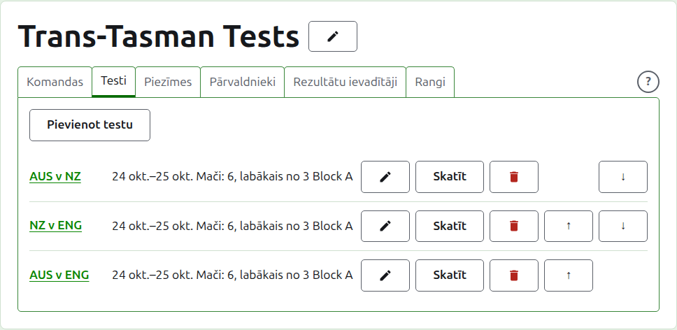
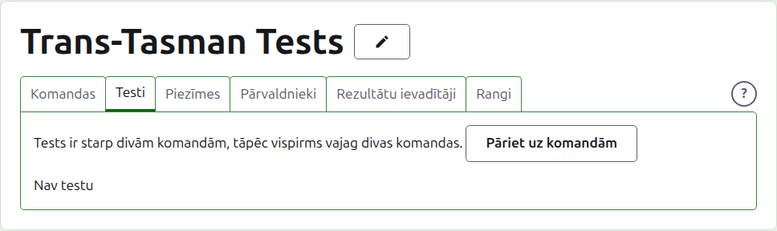
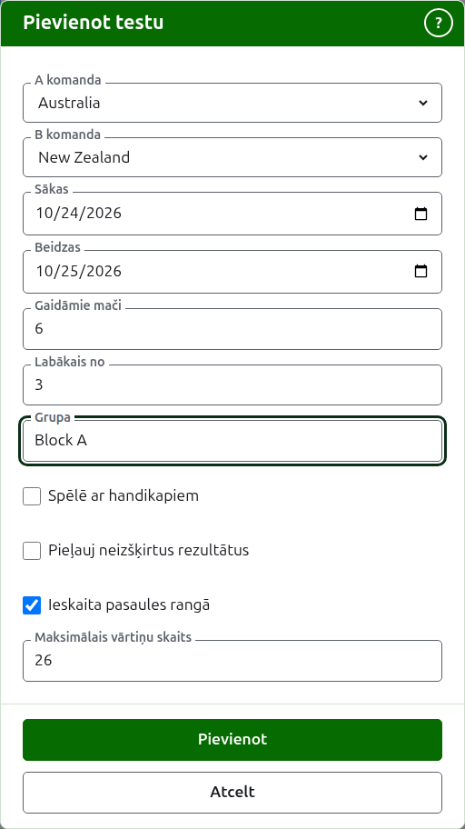
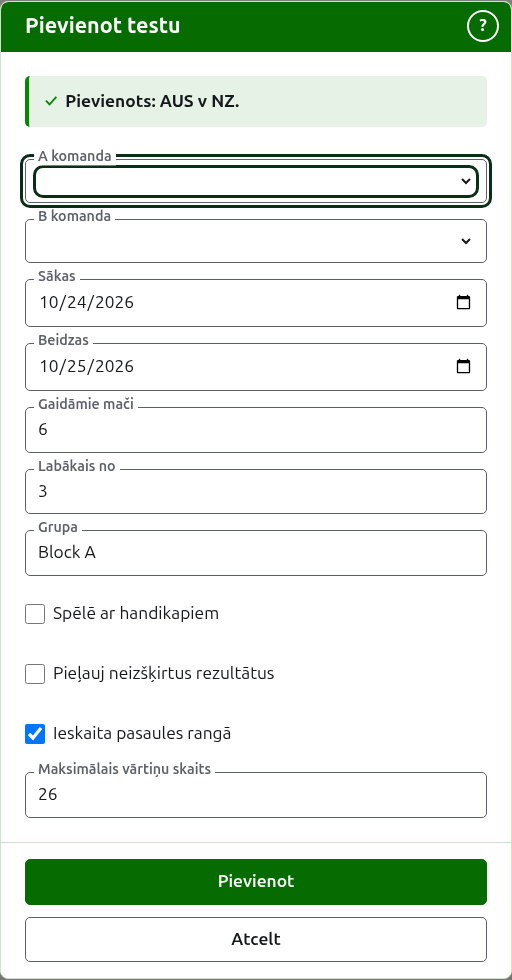
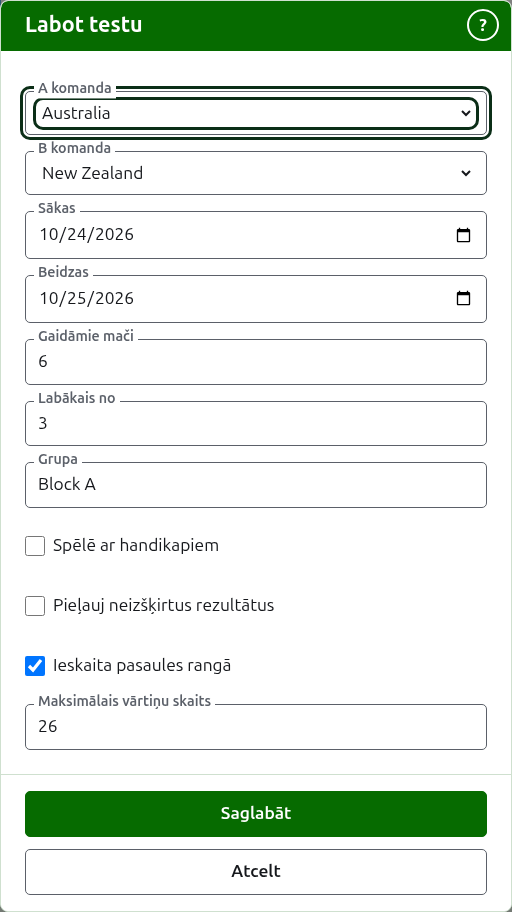

# Testi

Turnīra lapas cilne **Testi** ir vieta, kur testi starp tā komandām tiek pievienoti, mainīti, sakārtoti un atlikti malā. Tests ir viena no turnīra sacensībām: sacensība starp divām komandām, ko sauc pēc to īsajiem nosaukumiem, piemēram, "AUS v NZ", un ko spēlē kā vairākus maču starp katras komandas spēlētāju. Katram testam ir sava lapa, kur tiek ievadīti tā rezultāti.

Katrs tests saka savu nosaukumu, dienas, kad to spēlē, cik maču tajā ir gaidāms un kāds ir katrs mačs, piemēram, "6 mači, labākais no 3", un savu grupu, ja tas ir kādā.

## Vispirms divas komandas

Tests ir starp divām lietošanā esošām komandām, tāpēc, kamēr turnīrā to ir mazāk par divām, cilne to saka tur, kur būtu Pievienot testu, un ved uz cilni Komandas.

## Testa pievienošana {#adding-a-test}

Nospiediet **Pievienot testu** virs saraksta. Virs lapas atveras dialogs, kas lasās tādā kārtībā, kādā tests tiek teikts skaļi.

**A komanda** un **B komanda** katra tiek izvēlēta no turnīra lietošanā esošajām komandām, pēc nosaukuma, turnīra kārtībā. Sākumā netiek izvēlēta neviena, lai tests nekad netiktu pievienots starp komandām, ko neizvēlējāties. B komanda piedāvā katru komandu, izņemot to, kas izvēlēta kā A komanda, jo komanda nespēlē testu pati pret sevi. A komanda ir pirmā komanda: tās spēlētāji ir kreisajā pusē testa lapā un publiskajā lapā. Testam nav sava nosaukuma, ko ievadīt; to sauc pēc tā komandu īsajiem nosaukumiem.

**Sākas** un **Beidzas** ir dienas, kad tests tiek spēlēts, kas sākas turnīra pirmajā dienā. Tests tiek spēlēts turnīra robežās, tāpēc dienas pirms turnīra sākuma vai pēc tā beigām tiek atteiktas.

**Gaidāmie mači** ir tas, cik maču testā jābūt, ko pasākums iestata pirms tā sākuma, lai tas, kas lasa tā rezultātus, redzētu, cik tālu tas ir tizis. Tas ir vesels skaitlis no 1 uz augšu. Tas ir arī ierobežojums: kad ir sākts tik maču, cik testā gaidāms, partija, kas sāktu vēl vienu, tiek atteikta, bet jau sāktie mači tiek nospēlēti līdz galam. Testu, kurā jābūt vairāk, maina, lai tos gaidītu.

**Labākais no** ir tas, kāds ir katrs mačs. Tas var būt pāra skaitlis, jo mačs var tikt dalīts.

**Spēlē ar handikapiem**, **Pieļauj neizšķirtus rezultātus** un **Ieskaita pasaules rangā** tiek prasīti tāpat kā jebkurām sacensībām. Pēdējais tiek prasīts tikai tur, kur to var ieskaitīt: Asociācijas kroketa vai Golfa kroketa testam, kas nav ne spēlēts ar handikapiem, ne pieļauj neizšķirtus rezultātus. Sākumā tas ir atzīmēts.

**Maksimālais vārtiņu skaits** ir lielākais vārtiņu skaits, līdz kuram testā tiek spēlēta partija. Tas sākas ar sporta veida parasto, 26 vai 13 Golfa krokeram. Iztukšojiet to partijai, kas netiek spēlēta līdz vārtiņu skaitam. Tam jābūt veselam skaitlim, vismaz 1.

**Grupa** ir grupa, kurā tests ir, ja pasākums tiek spēlēts grupās, piemēram, "Block A". Tā nav obligāta: atstāts tukšs, tests nav nevienā. Testiem grupā ir sava lapa publiskajā vietnē, kas rāda, kā stāv grupas komandas. **Eire Cup** un **Interstate Shield** nav grupu, tāpēc dialogs tur to neprasa.

Nospiediet **Pievienot**. Tests tiek pievienots, dialogs saka, kurš, pēc tā nosaukuma, un komandas tiek iztukšotas nākamajam, bet dienas, gaidāmie mači, labākais no un grupa tiek atstāti, kādi bija: testi tiek pievienoti pa kārtai, starp komandām, kas tiekas tajā pašā dienā, tāpēc nākamais kārtas tests ir tikai tā divas komandas. Kad tie visi ir ievadīti, nospiediet **Atcelt**.

## Testa maiņa {#changing-a-test}

**Labot** atver to pašu dialogu testam, ar nosaukumu Labot testu, aizpildītu ar testa datiem. Nospiediet **Saglabāt**, lai saglabātu izmaiņu.

Tests ar lietošanā esošām partijām patur savas komandas: dialogs tās rāda, bet tās nevar mainīt. Pārējo var mainīt tajās robežās, kas jau nospēlēts: gaidāmie mači, kas ir mazāk par jau sāktajiem mačiem, tiek atteikti, tāpat kā labākais no, kas ir mazāk par lielāko partiju skaitu, ko spēlējuši jebkuri divi spēlētāji.

## Kārtība

Testi tiek uzskaitīti turnīra kārtībā, kādā tie parādās publiskajās lapās un tumši zaļajā joslā. **Uz augšu** un **Uz leju** pārvieto testu par vienu vietu.

## Pāreja uz testu

Testa nosaukums vai **Skatīt** atver tā lapu, kur tiek ievadīti tā rezultāti. Tumši zaļā josla uz to ved arī, no turnīra lapas vai jebkura cita testa lapas.

## Testa arhivēšana

**Arhivēt** atliek testu malā, un to atsauc **Atjaunot**, tāpēc neviens nejautā iepriekš. Arhivēts tests tiek uzskaitīts zem **Arhivētie testi**, pārsvītrots, tam tiek piedāvāts tikai Atjaunot, un tā nav publiskajās lapās.

Tests ar lietošanā esošām partijām ir ticis spēlēts, un to nevar arhivēt, kamēr nav arhivētas tā partijas. Testu, kura visas partijas ir arhivētas, var, jo arhivēta partija nenozīmē neko. Tests, kura komanda pēc tam ir arhivēta, netiek atjaunots, kamēr nav atjaunota komanda, un cilne to saka.

Tālāk: [Rezultāti](scores.md).
