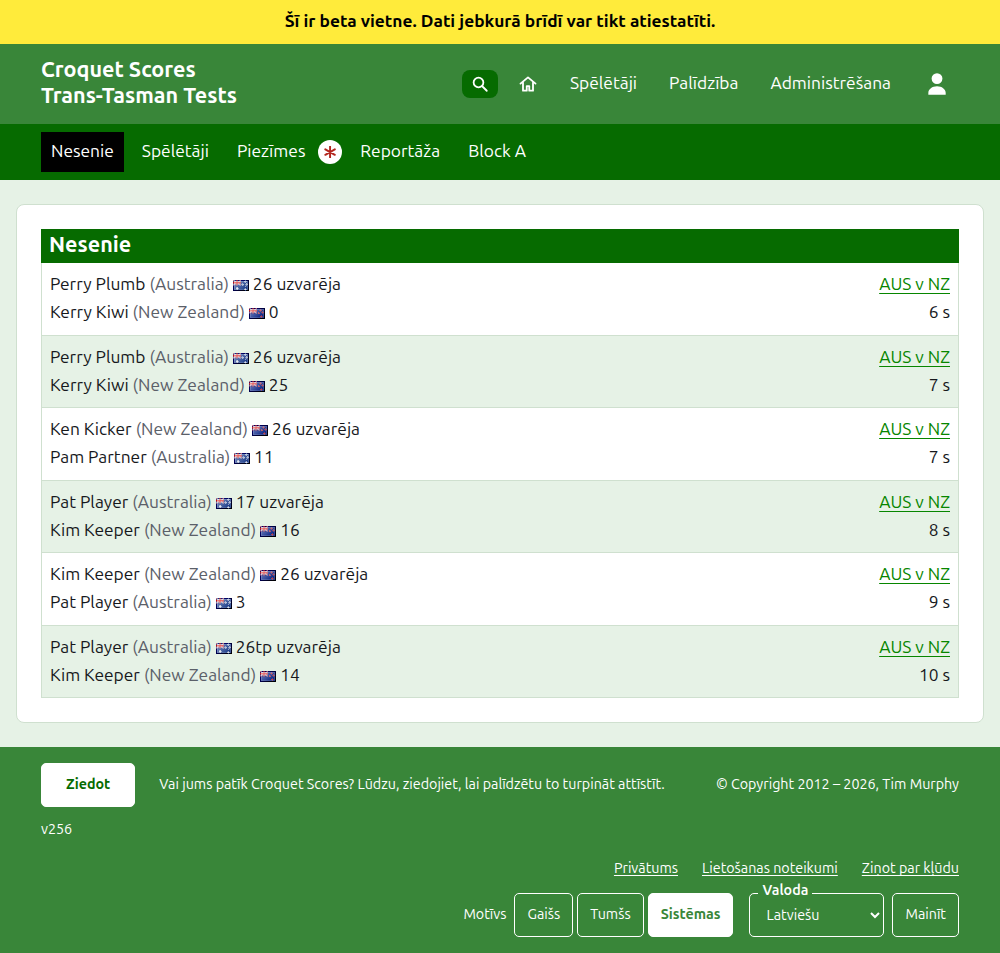
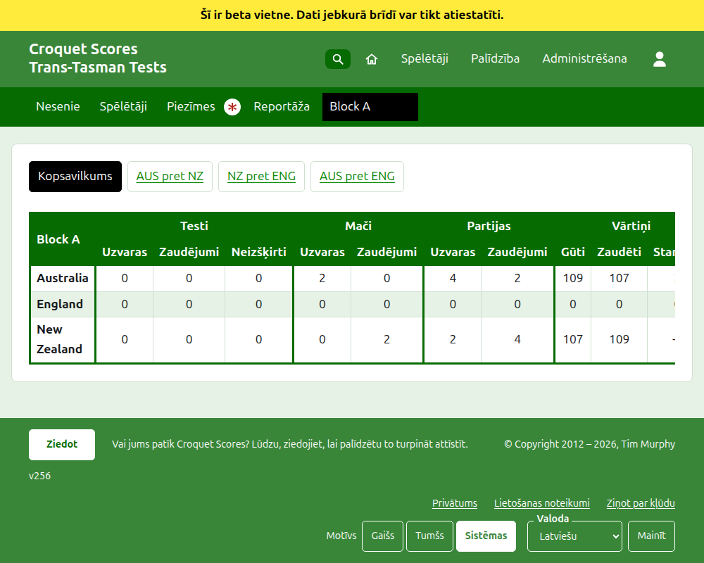
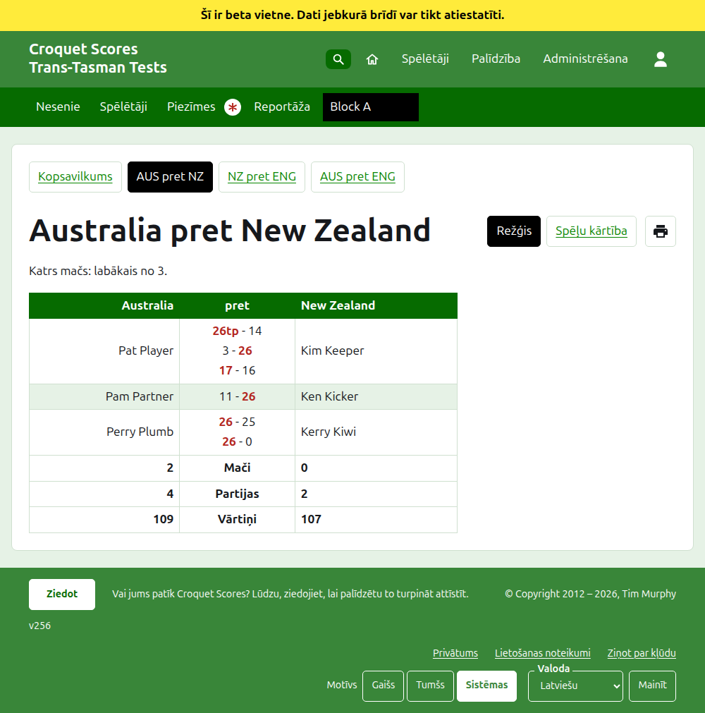
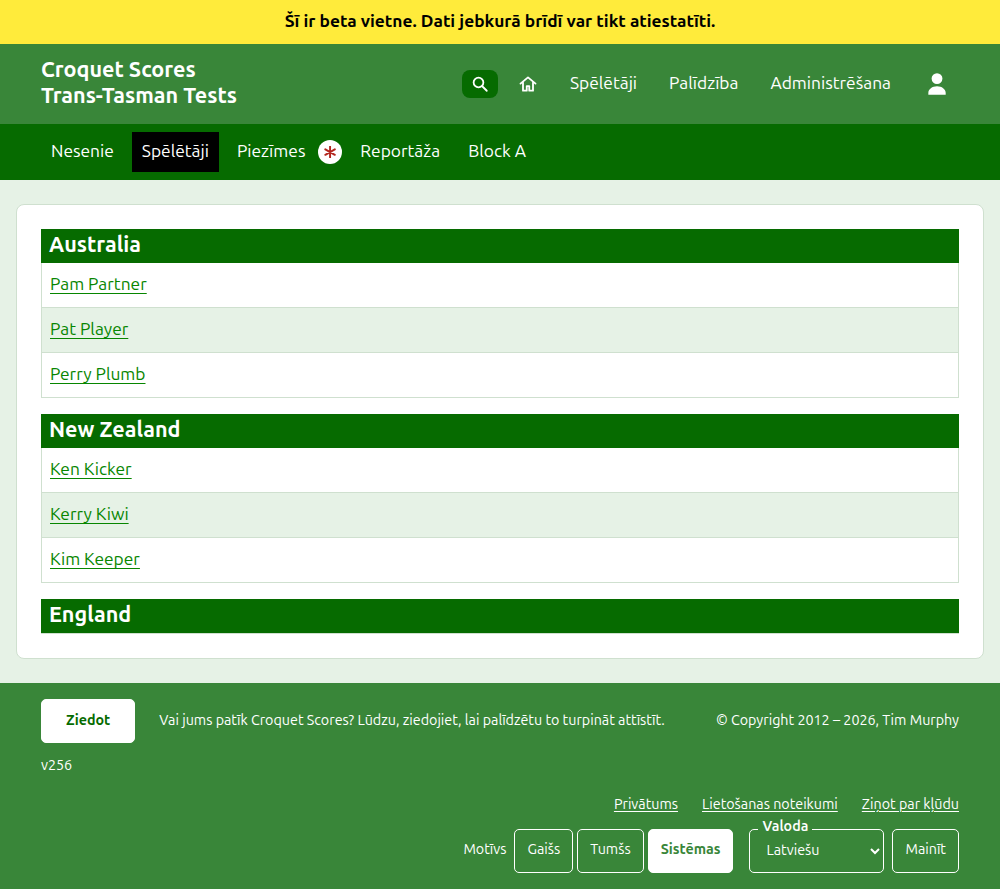

# Ko redz sabiedrība

Nekas netiek publicēts: publiskās lapas tiek veidotas no tā, ko glabā administrēšana, tāpēc ievadīts rezultāts tajās ir uzreiz. Tām nav vajadzīgs konts ne skripti, un tās ir izkārtotas telefonam.

## Turnīra lapa

Turnīra lapa ir pie tā gada, sporta veida un nosaukuma, piemēram, `/2026/ac/trans-tasman-tests`. Tās virsraksts ir turnīra nosaukums ar apakšvirsrakstu zem tā. Tā uzskaita katru lietošanā esošu partiju, nesen pievienotās pirmās, lai lasītājs, kas atgriežas, redz, kas noticis kopš tā laika. Katra partija saka uzvarētāju, viņa komandu un rezultātu, tad zaudētāju un viņa, ar testu, kurā tā tika spēlēta, un to, cik sen tā tika pievienota.

Tumši zaļā josla piedāvā turnīra sadaļas: **Nesenie**, kas ir šī lapa, **Kopsavilkums**, **Spēlētāji**, **Piezīmes** un **Reportāža**, tad testus. Tests tiek teikts kā tā komandu īsie nosaukumi ar "pret" starp tiem, piemēram, "AUS pret NZ". Grupā esošie testi netiek piedāvāti pa vienam: grupa ir viena sadaļa, nosaukta tā, kā grupa, tur, kur būtu tās pirmais tests. Piezīmes ir atzīmētas ar sarkanu zvaigznīti, kamēr ir piezīme, ko lasītājs nav izlasījis.

## Kopsavilkums

Turnīram, kura testi nav nevienā grupā, ir **Kopsavilkums**: viena tabula ar katru komandu, sakārtotu, ar testiem, ko tā ir uzvarējusi, zaudējusi un nospēlējusi neizšķirti, tās uzvarētajām un zaudētajām partijām un tās gūtajiem un zaudētajiem vārtiņiem un to starpību. Ja kāda testa mači ir labākais no vairāk nekā viena, uzvarētie un zaudētie mači nāk pēc testiem. Komandas tiek sakārtotas pēc uzvarētajiem testiem, tad pēc uzvarētajiem mačiem, tad pēc partiju starpības, tad pēc vārtiņu starpības un tad pēc turnīra kārtības. Testu, kurā komandas ir līdzīgas pēc maču skaita, izšķir pēc partiju starpības, tad pēc vārtiņu starpības, vai tas ir neizšķirts, ja turnīrā ir atzīmēts **Vienādi testi ir neizšķirti**. Kopsavilkums ir vieta, kur lasītājs meklē katru komandu kopumā.

**Interstate Shield** komandas tiek sakārtotas pēc uzvarētajiem testiem, tad pēc maču starpības uzvarēto maču vietā, tad pēc partiju starpības, tad pēc vārtiņu starpības. Komandas, kas joprojām ir vienādas, tiek sakārtotas pēc testiem, ko tās uzvarēja viena pret otru. Tā kopsavilkums rāda kolonnu **Starpība** zem Mači un zem Partijas, kā arī zem Vārtiņi, un Shield nekad netiek spēlēts grupās.

Turnīram ar testu grupā nav Kopsavilkuma. Katras grupas lapa tā vietā rāda, kā stāv šīs grupas komandas, jo viena komandu tabula pa grupām, kas nekad nav spēlējušas vienas ar otru, nesakārtotu neko.

## Grupa

Grupas lapa rāda, kā stāv grupas komandas, skaitot tikai grupas testus, kopsavilkuma tabulā. Virs tabulas, savā rindā, tā piedāvā **Kopsavilkums**, kas ir šī lapa, un katru grupas testu, kas ved uz testa lapu.

## Tests

Testa lapas virsraksts ir tā komandu pilnie nosaukumi, piemēram, "Australia pret New Zealand", un tā saka, kāds ir katrs mačs. Tās tabulas virsraksts ir abas komandas, pirmā kreisajā pusē. Katrs nospēlētais mačs ir rinda, tādā kārtībā, kādā tas sākās, ar pirmās komandas spēlētāju kreisajā pusē, otrās komandas labajā un mača partijām starp viņiem, katra pirmās puses rezultāts, tad otrās, uzvarētājs atzīmēts. Zem mačiem ir katras komandas partijas un vārtiņi un, ja katrs mačs ir labākais no vairāk nekā viena, tās uzvarētie mači, savā pusē.

Tests tiek rādīts divējādi, piedāvāts tā nosaukuma rindā: **Režģis**, kas ir šī tabula, un **Spēļu kārtība**, kas uzskaita katru testa partiju tabulā ar virsrakstiem **Partija** un **Datums**, sākumā vecākās pirmās. Nospiežot virsrakstu, tiek kārtots pēc tā, un vietne atceras, kā lasītājs pēdējo reizi kārtoja. Blakus skatiem ir drukāšanas poga, rādīta tur, kur skripti ir ieslēgti, kas izdrukā lapu bez joslām. Tests grupā virs sava virsraksta rindā piedāvā savas grupas Kopsavilkumu un testus, ar šo testu atzīmētu.

## Spēlētāji

Spēlētāju lapa uzskaita spēlētājus pa komandām: katra komanda zem sava nosaukuma virsraksta, turnīra komandu kārtībā, un tās spēlētāji zem tā alfabētiskā kārtībā.

## Piezīmes

Piezīmju lapas virsraksts ir **Pārvaldnieka piezīmes**, un tā saka "Vēl nav piezīmju.", kamēr to nav. Tā uzskaita turnīra piezīmes, nesen uzrakstītās pirmās, katra ved uz savu lapu un saka, cik sen tā tika uzrakstīta. Piezīme, ko lasītājs nav izlasījis, ir atzīmēta ar sarkanu zvaigznīti, līdz viņš to atver.

## Adreses, kas pārceļas

Turnīrs patur savu adresi, kad tā nosaukums tiek izlabots. Ja tas pārceļas, jo mainījies gads vai sporta veids, tā vecā adrese ved uz jauno, lai no agrāk paturēta saite joprojām darbotos. Arhivēta turnīra lapas netiek atrastas, līdz tas tiek atjaunots.
