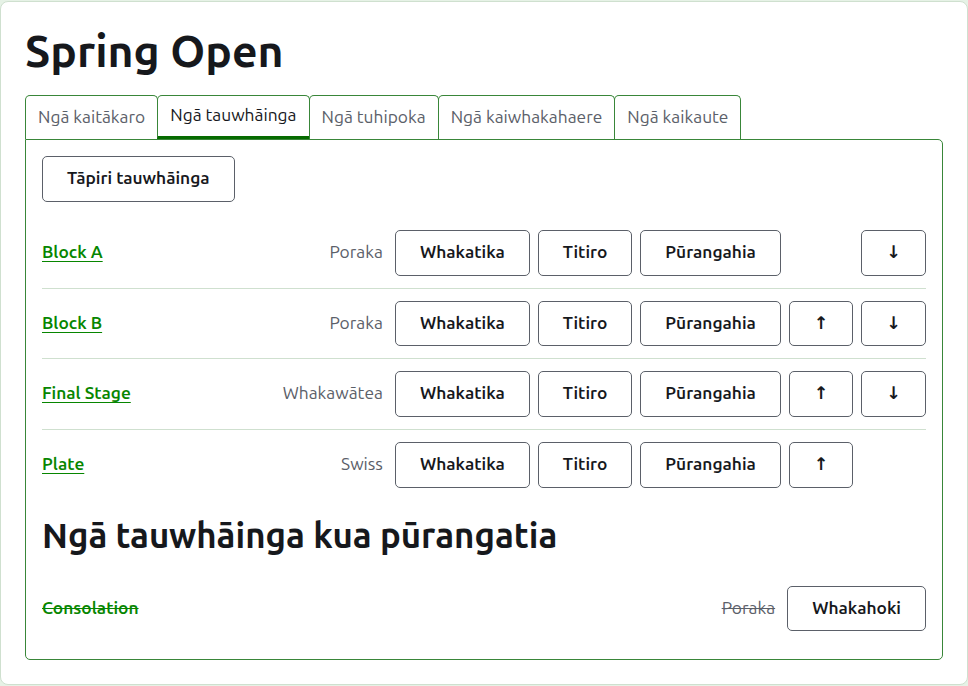
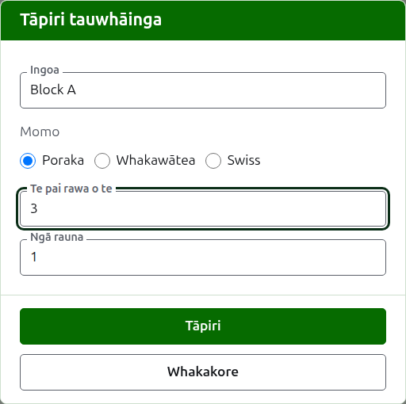
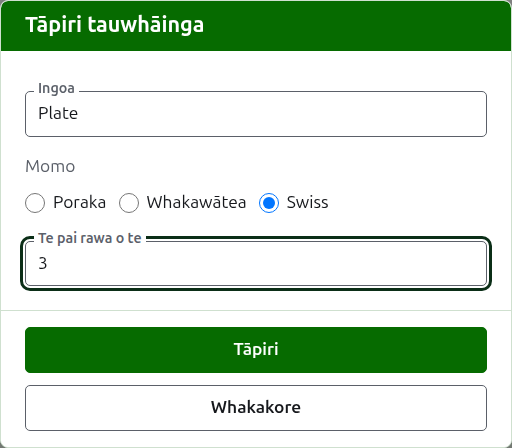
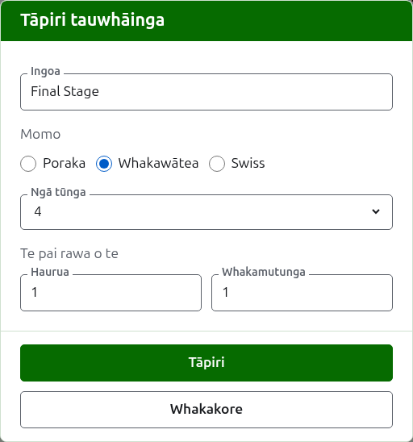

# Ngā tauwhāinga

Ko te ripa **Tauwhāinga** o te whārangi o tētahi whakataetae te wāhi e tāpiria ai ōna tauwhāinga, e whakaraupapatia ai, e whakatārewatia ai hoki. He poraka, he whakawātea, he Swiss rānei tētahi tauwhāinga. He whārangi motuhake tō ia tauwhāinga, ko te wāhi tērā e whakaurua ai ōna kaitākaro me ōna tākohu.

## Te tāpiri i tētahi tauwhāinga {#adding-a-competition}

Pēhia **Tāpiri tauwhāinga**, i runga i te rārangi. Ka tuwhera tētahi pouaka kōrero i runga i te whārangi, e pātai ana mō te ingoa o te tauwhāinga, tōna momo me te āhua o tōna momo.

**Ingoa** te mea e rapua ai e ngā kaitākaro i te whārangi o te whakataetae hei kimi i ā rātou kēmu. Kei waenga i te 1 me te 254 ngā tohu, ā, ka rawaka he pū kotahi, nā te mea he maha ngā wā e whakaingoatia ai tētahi poraka ki te kotahi. Kāore e taea e ngā tauwhāinga e rua o tētahi whakataetae te whai i te ingoa kotahi.

**Momo** he poraka, he whakawātea, he Swiss rānei. Ka tīmata te pouaka kōrero ki te poraka, ko te momo o te nuinga o ngā tauwhāinga.

### He poraka

Ka pātai te poraka i te **Pai rawa o te** o ia tukinga, me te maha o **Ngā rauna** e tākarohia ai.

**Pai rawa o te** ka tīmata ki te 1. Ka toa i te pai rawa o te 3 te tangata e toa ana i ngā kēmu e rua. Ka taea he tau e wehea ana ki te rua, nā te mea i roto i te poraka ka raupapatia te kaitākaro mā ngā kēmu e toa ai ia, ā, ko te tukinga o ngā kēmu e rua i toa ai tētahi i tētahi he tākohu pērā i ētahi atu.

**Ngā rauna** te maha o ngā wā e tūtaki ai ia takirua kaitākaro o te poraka, me tētahi tukinga i ia rauna. Ka tīmata ki te 1, ā, ko te 1 te mea e hiahiatia ana e te nuinga o ngā poraka: ka tākaro ia kaitākaro i ia kaitākaro atu i te kotahi. Whakarahia anake mō tētahi poraka e tūtaki anō ai rātou, pēnei i te double round robin, ka tākaro ia takirua i ngā tukinga e rua ki te 2.

### He Swiss

Ka pātai te Swiss i te **Pai rawa o te** anake o ia tukinga, ka tīmata ki te 1, pērā i te poraka. Ka toa i te pai rawa o te 3 te tangata e toa ana i ngā kēmu e rua. Ka taea he tau e wehea ana ki te rua, nā te mea i roto i te Swiss ka raupapatia te kaitākaro mā ngā kēmu e toa ai ia, ā, ko te tukinga o ngā kēmu e rua i toa ai tētahi i tētahi he tākohu pērā i ētahi atu.

### He whakawātea

Ka pātai te whakawātea i te maha o **Ngā tūnga** o tōna tūtohi, me te pai rawa o te aha o ia rauna. Ka tukuna ngā tūnga hei 2, 4, 8, 16, 32, 64 me 128, nā te mea kāore e taea e tētahi atu tau te haurua i ia rauna ki te whakamutunga, ā, ka tīmata te pouaka kōrero ki te 8. Ko ngā tūnga e toe ana i muri i te whakauru kaitākaro ka whakakīia ki ngā Bye, ka tāpiria ki te wāhi e whakaurua ai ngā kaitākaro.

He rite te maha o ngā rauna o tētahi tūtohi ki te maha e hiahiatia ana hei haurua i ōna tūnga ki te kotahi, nō reira e toru ngā rauna o tētahi tūtohi e 8 ngā tūnga. Ka pātai te pouaka kōrero i te pai rawa o te aha o ia rauna, ā-tahi i raro i **Ngā pai rawa o te**, i te raupapa e tākarohia ai. Ko ngā mea whakamutunga e toru e whakaingoatia ana pēnei i te kōrero mō ngā rauna o tētahi tūtohi, **Hauwhā-whakamutunga**, **Hawhe-whakamutunga** me **Whakamutunga**, ā, ko ērā i mua i a rātou mā tō rātou tau, ko Rauna 1 te tuatahi. Ina kōwhiria he tūnga maha ake, ka tāpiria ētahi rauna ki te tīmatanga o te tūtohi, ā, ina kōwhiria he torutoru ake, ka tangohia i te tīmatanga, nō reira ko te mea i tuhia mō te whakamutunga ko te whakamutunga tonu. Ko ia rauna te pai rawa o tētahi tau kēmu e kore e wehea ki te rua, nā te mea me whai toa te tukinga o tētahi whakawātea.

### Te āhua o te tākaro me te kaute

Ka pātai ia momo katoa i ēnei mea e toru i raro i tōna āhua.

**Ka tākarohia me ngā whakaiti.** Tīkina tēnei mō tētahi tauwhāinga e tākarohia ana me ngā whakaiti.

**Ka whakaaetia ngā hua taurite.** Tīkina tēnei ina taea e tētahi kēmu te mutu me te kore he toa o tētahi o ngā kaitākaro. Kāore te nuinga o ngā tauwhāinga e whakaae. Ina tīkina, ka mau tonu hei taurite tētahi tākohu i whakaurua me ngā tohu ōrite, ā, kāore he tohu; ina kāore i tīkina, me kī te kēmu i whai ngā tohu ōrite ko wai te toa mā te tohu i muri i te tākohu a te toa, pēnei i te "6w". He toa tonu tā te tukinga o tētahi whakawātea, nō reira kāore te kēmu taurite e whakatau i tētahi.

**Ka kaute ki ngā whakarārangi o te ao.** Ka pātaihia anake ina taea te kaute: he tauwhāinga Association Croquet, Golf Croquet rānei kāore i tākarohia ki te hanikapa, kāore hoki e whakaae ki ngā taurite. Kua tīkina i te tīmatanga, nō reira me tango te tīki mō tētahi tauwhāinga kāore e kaute.

### Te tāpiri i ētahi maha i te wā kotahi

Pēhia **Tāpiri**. Ka tāpiritia te tauwhāinga, ka kī te pouaka kōrero i tērā, ā, ka whakakorea te ingoa mō tētahi atu, ka waiho te momo me tōna āhua pēnei i mua: he rite te nuinga o ngā tauwhāinga ka tāpiria ngātahi, nō reira ko "Block B" i muri i a "Block A" te ingoa anake. Pēhia **Whakakore** hei kati i te pouaka kōrero ina oti katoa te tāpiri.

## Te whakarerekē i tētahi tauwhāinga {#changing-a-competition}

Ka whakatuwheratia e **Whakatika** te pouaka kōrero ōrite ki runga i te tauwhāinga, ko Whakatika tauwhāinga tōna taitara, me tōna ingoa, tōna āhua, me tōna tākaro me tōna kaute pēnei i tā rātou. Kāore e pātaihia tōna momo, nā te mea kāore e meinga tētahi poraka hei whakawātea mā te whakarerekē: ka whakatāpuia tētahi tauwhāinga o te momo hē, ka tāpiria anō. Pēhia **Penapena** hei penapena i te huringa, ā, hei kati i te pouaka kōrero.

He kaitākaro kei te tūtohi o tētahi whakawātea whai kēmu, ā, ka neke rātou i tētahi huringa o ōna tūnga, nō reira ka whakahēngia i muri i te whakauru o tētahi kēmu. Ka taea tonu te whakarerekē i te pai rawa o ōna rauna.

## Te raupapa

Ka rārangitia ngā tauwhāinga i te raupapa o te whakataetae, ko te raupapa tērā e puta ai ki ngā whārangi tūmatanui me te pae kākāriki pōuri. Ka nuku **Whakarunga** me **Whakararo** i tētahi tauwhāinga kotahi te tūnga.

## Te haere ki tētahi tauwhāinga

Ka whakatuwheratia e te ingoa o tētahi tauwhāinga, e **Tirohia** rānei, tōna whārangi, ko te wāhi tērā e whakaurua ai ōna kaitākaro me ōna tākohu. Ka arahi hoki te pae kākāriki pōuri i raro i te pane ki reira, mai i tētahi whārangi o te whakataetae.

## Te whakatāpui i tētahi tauwhāinga

Ka whakatārewatia e **Whakatāpui** tētahi tauwhāinga, ahakoa he kēmu tōna kāore rānei, ā, ka mau tonu ngā kēmu ki a ia ka hoki mai ina whakahokia. Ka rārangitia tētahi tauwhāinga kua whakatāpuia i raro i **Ngā tauwhāinga kua whakatāpuia**, ka rārangi mā roto, ko **Whakahokia mai** anake tāna e tuku ai, ā, kāore ia i ngā whārangi tūmatanui. Kāore te whakatāpui e pātai i te tuatahi, nā te mea ka whakakorea e te whakahoki.

E whai ake nei: [Te whakauru kaitākaro ki tētahi tauwhāinga](entering-players-in-a-competition.md).
