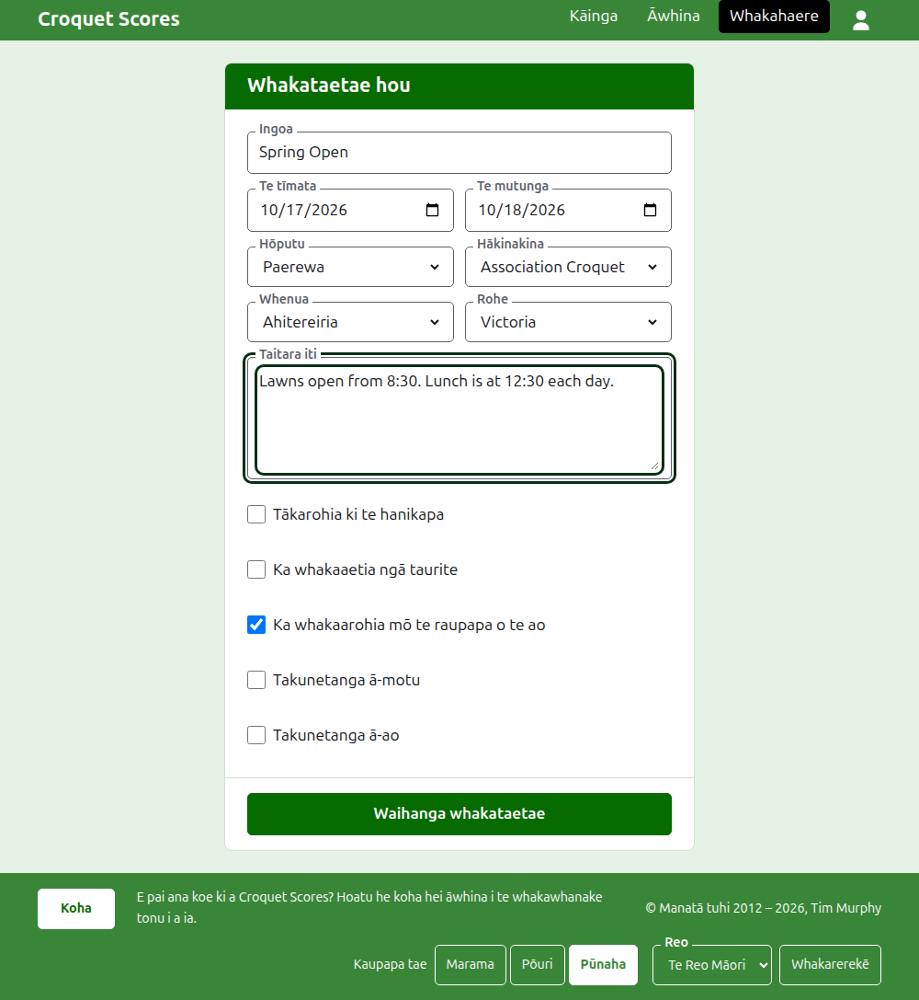

# Te waihanga i tētahi whakataetae

Pēhia **Whakataetae hou** i runga i te rārangi whakataetae i te Kaiwhakahaere. Kei runga i te rārangi, kaua kei raro, kia kore ai e tīpakohia atu i te mata o te waea pūkoro e tētahi rārangi roa.

Ka pātai te puka mō ngā mea katoa e tīmata ai tētahi whakataetae. Mō tētahi whakataetae o te momo noa, he ingoa, e rua ngā rā me tētahi whenua anake te mea e toe ana: ko ngā mea katoa atu kua whakatauhia mōu, ā, ka taea te whakarerekē.

## Ngā mea e pātai ai te puka

**Ingoa.** Te mea e rapua ai e ngā kaipānui hei kimi i te whakataetae, pēnei i te "Spring Open". Kei waenga i te 3 me te 254 ngā tohu. Ka whakahēngia he ingoa kei te pū iti katoa, kei te pū rahi katoa rānei, nā te mea ka rite ki te hapa i ia whārangi e whakaaturia ai. Ka taea e ngā whakataetae e rua te whai i te ingoa kotahi, nā te mea ka tākarohia taua whakataetae kotahi i ia tau.

**Te tīmatanga** me **Te mutunga.** Ngā rā e haere ai te whakataetae. Kāore e taea e tētahi whakataetae te mutu i mua i tōna tīmata, ā, kāore e taea te tīmata, te mutu rānei i muri i te mutunga o te tau e whai ake nei. Nō te tau e tīmata ai tētahi whakataetae, ko taua tau hoki kei tōna wāhitau, nō reira ko tētahi e haere ana i te tau hou ka rārangitia i te tau e tīmata ai.

**Hōputu.** Kōwhiria **Paerewa** mō tētahi whakataetae e tākarohia ana i waenga i ngā kaitākaro. Ko ērā atu hōputu mō ngā whakataetae e tākarohia ana i waenga i ngā tīma, he aratohu motuhake tā rātou.

**Hākinakina.** Ngā hākinakina e tuku ana te pae tukutuku, i tōna raupapa: Association Croquet, Golf Croquet, American 6 Wicket me Ricochet i Croquet Scores. Kāore a Gateball Scores e pātai i te hākinakina, i te hōputu rānei, nā te mea he whakataetae paerewa gateball ia whakataetae i reira.

**Whenua** me **Rohe.** Te wāhi e tākarohia ai te whakataetae. Ka pātaihia he rohe ina wehea anake te whenua i kōwhiria e koe ki ngā rohe, pēnei i ngā kāwanatanga o Ahitereiria; ko te whenua ko ia anake tōna rohe kotahi, kāore e pātai i tētahi. Kāore e hiahiatia te kōwhiri i tētahi rohe ahakoa e tukuna ana tētahi.

**Taitara iti.** Ko te mea katoa e hiahia ana koe kia mōhio ngā kaipānui, kāore nei he āpure mōna ake: te wāhi e tū ai te waka, te wā o te tina, ko wai hei waea atu. Ka whakaaturia i raro i te ingoa o te whakataetae i ia whārangi tūmatanui. Ka tuhia ki te Markdown, nō reira ka taea te whakarahi i tētahi kupu mā te whetūrangi i ōna taha e rua, ā, te hanga rārangi mā te tohu rārangi i te tīmatanga o ia rārangi. Tae atu ki te 2000 ngā tohu, ā, ka taea te waiho hei kau.

Mā ia tauwhāinga e kī, ina tāpiria, me pēhea tōna tākaro me tōna kaute: ahakoa me ngā whakaiti, me ngā hua taurite, me te whakarārangi o te ao.

**Takunetanga ā-motu** me **Takunetanga ā-ao.** Ka taea e tētahi whakataetae te noho hei tētahi, hei tētahi atu, hei kore rānei, engari kāore e taea te rua: ina tīkina tētahi ka tangohia te tīki o tērā atu.

## Te waihanga

Pēhia **Waihanga whakataetae**. Ka kawea koe ki te whārangi o te whakataetae i te Kaiwhakahaere, ko te wāhi tērā e whakahaerehia ai, ā, ko koe tōna kaiwhakahaere tuatahi. Ka rārangitia i te Kaiwhakahaere i raro i te tau e tīmata ai.

Ka hangaia te wāhitau tūmatanui o te whakataetae mai i tōna tau, tōna hākinakina me tōna ingoa, pēnei i te `/2026/ac/spring-open`. Ka mau tonu i a ia taua wāhitau ina whakatikaina tōna ingoa i muri mai, kia kitea tonu ai e te hononga kua tukuna kē; ka neke anake ina rerekē te tau e tīmata ai, tōna hākinakina rānei.

## Mēnā ka whakahēngia tētahi mea

Ko te mea e whakahēngia ka kīia i raro i te āpure e pā ana ki a ia, ā, ka noho tonu ngā mea i tuhia e koe. Kāore he mea e penapenahia kia whakaaetia ra anō ngā āpure katoa. Ko ngā mea e nui ake te whakahē ko te ingoa kua tuhia ki te pū iti katoa, te mutunga i mua i te tīmatanga, me te whenua kāore i kōwhiria.

E whai ake nei: [Ngā kaitākaro](players.md).
