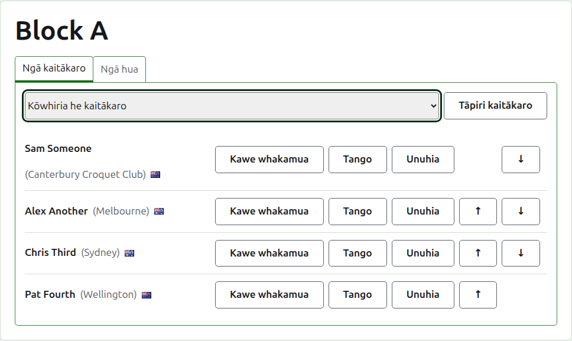
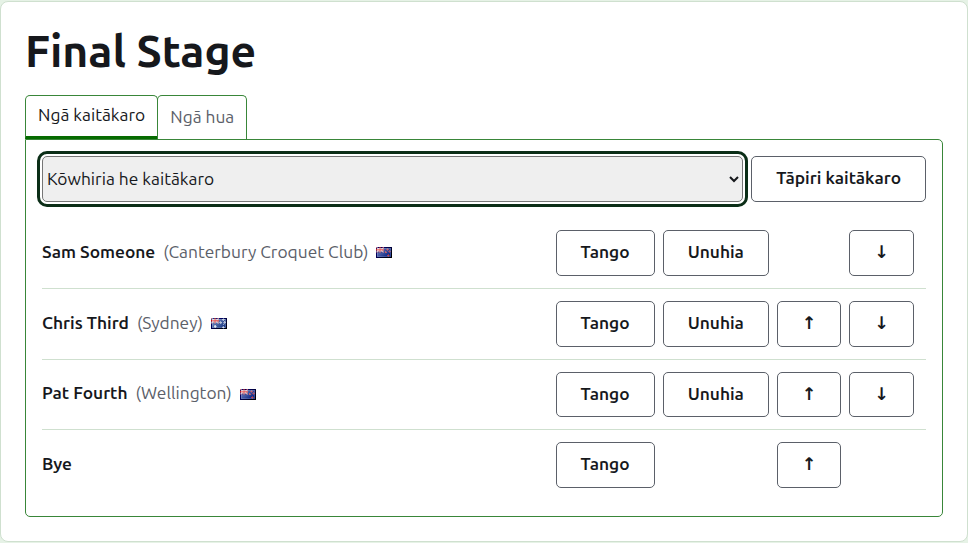
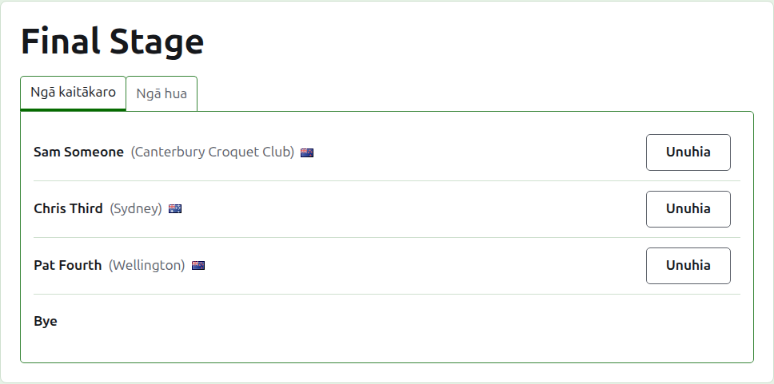
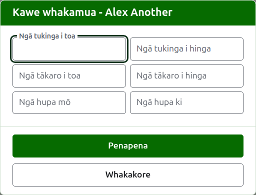
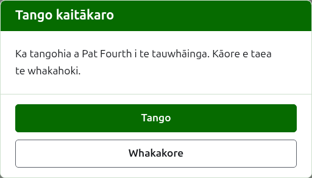
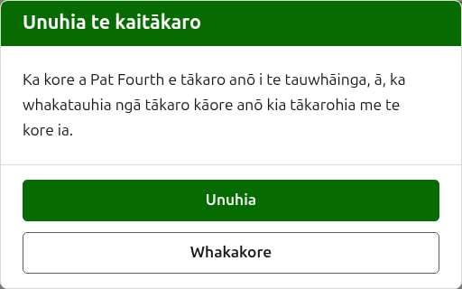
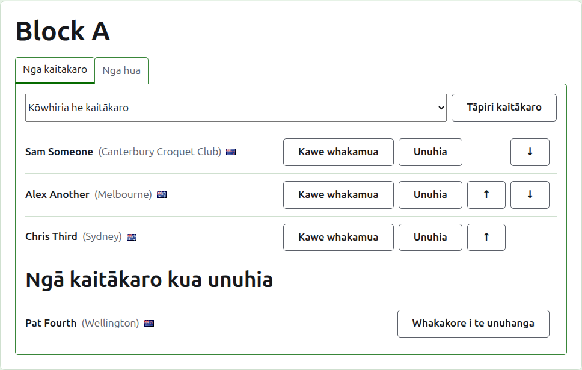

# Te whakauru kaitākaro ki tētahi tauwhāinga

Ka whakatuwherahia te whārangi o tētahi tauwhāinga mai i tōna ingoa i te ripa Tauwhāinga, mai i te pae kākāriki pōuri rānei. Ko te ingoa o te tauwhāinga tōna pane, me ngā ripa e rua i raro: **Kaitākaro** me **Ngā tākohu**. Ka tuwhera ki Ngā kaitākaro, nā te mea ka whakaurua ngā kaitākaro i mua i te kēmu tahi.

He kaitākaro o te whakataetae te kaitākaro i tētahi tauwhāinga, nō reira ka whakaurua mā te kōwhiri i a rātou, kaua mā te tuhi. Ko ngā mea katoa e pā ana ki a rātou, haunga tō rātou tūnga i te tauwhāinga me ngā mea e kawea whakamua ana e rātou ki roto, ka whakarerekētia i te ripa Kaitākaro o te whakataetae.

## Te tāpiri i tētahi kaitākaro

I runga i te rārangi, ka tuku tētahi rārangi taka iho i ngā kaitākaro katoa o te whakataetae kāore anō kia uru ki te tauwhāinga, i te raupapa o te whakataetae. Kōwhiria tētahi, ka pēhi i **Tāpiri kaitākaro**. Ka whakanohoia te kaitākaro ki te raupapa o te whakataetae i waenga i ērā kua whakaurua kē, kāore te rārangi taka iho e tuku anō i a ia, ā, ka hoki te tohu ki te rārangi taka iho kia kōwhiria ai te kaitākaro e whai ake nei mā te papapātuhi. Ina kei te tauwhāinga ngā kaitākaro katoa o te whakataetae, kāore te rārangi taka iho e whakaaturia, ā, ka kī te ripa i tērā.

Kāore ngā kaitākaro kua whakatāpuia o te whakataetae e tukuna.

## Ngā Bye i tētahi whakawātea {#byes-in-a-knockout}

Ka tākarohia anake tētahi whakawātea ina oti te whakakī i ngā tūnga katoa o tōna tūtohi, ā, ko ngā tūnga e toe ana i ōna kaitākaro ka whakakīia ki ngā Bye. Nō reira i tētahi whakawātea ka tuku te rārangi taka iho i a **Bye** i te tuatahi, i mua i ngā kaitākaro, ā, ka tuku tonu ahakoa te maha o ngā Bye ka tāpiria, nā te mea tērā pea he maha ngā mea e hiahiatia ana e tētahi tūtohi.

Ka whakanohoia tētahi Bye ki te tūtohi pēnei i tētahi kaitākaro: ka taea te whakapiki, te whakaheke me te tango, engari kāore e taea te unu, nā te mea kāore ia e tākaro i tētahi mea. Ka whakahēngia tētahi kaitākaro e whakaurua ana ki tētahi whakawātea kua kī katoa ōna tūnga, ā, ka kī te ripa i tērā i raro i te rārangi taka iho.

Ko te raupapa o ngā kaitākaro o tētahi whakawātea tōna tūtohi. Ka tūtaki ngā tūnga tuatahi e rua i te tukinga tuatahi, ngā tūnga e rua e whai ake nei i te tukinga e whai ake nei, me pēnā tonu. Whakanohoia ngā kaitākaro ki te raupapa e tākarohia ai te tūtohi i mua i te whakauru i tētahi tākohu, nā te mea ina whai kēmu e whakamahia ana te whakawātea, ka mau tonu ōna kaitākaro: kāore e taea te tāpiri, te tango, te neke rānei i tētahi. Ka taea tonu e tētahi kaitākaro te unu.

## Te raupapa

Ka rārangitia ngā kaitākaro i te raupapa o te tauwhāinga, ko te raupapa tērā e tūtohitia ai tētahi whakawātea, e rārangitia ai hoki tētahi poraka i tōna whārangi tūmatanui. Ka nuku **Whakarunga** me **Whakararo** i tētahi kaitākaro kotahi te tūnga.

## Te kawe whakamua {#carry-forward}

Ka kī te **Kawea whakamua** i te mea e kawe mai ana tētahi kaitākaro ki tētahi tauwhāinga mai i te tākaro kāore i kautehia e koe: ngā tākohu o tētahi wāhanga o mua, o ngā kēmu rānei i tākarohia i mua i te kautenga o te tauwhāinga ki konei. Ka tukuna i roto i te poraka me te Swiss, he tūnga tō rāua e kaute ai, ā, kāore i te whakawātea.

Ka pātai te pouaka kōrero mō ngā tatau e ono: ngā tukinga i toa me te hinga, ngā kēmu i toa me te hinga, me ngā hupa mō me ki. He mea kōwhiri ia tatau. Ko te tatau ka waiho hei kau kāore he mea e kawea whakamua, ehara tērā i te ōrite ki te kawe whakamua i te 0, kia kite ai te tangata ka whakarerekē i muri mai i te āhua i waihotia ai. Pēhia **Penapena** hei penapena i te ono katoa.

## Te tango i tētahi kaitākaro {#removing-a-player}

Ka tango **Tango** i tētahi kaitākaro i whakaurua hētia. Ka noho tonu ia hei kaitākaro o te whakataetae, ā, ka tukuna anō e te rārangi taka iho, engari kāore he mea e penapenahia mō tōna tūnga i te tauwhāinga, nō reira ka pātai a Tango i te tuatahi.

Kāore e taea te tango i tētahi kaitākaro he kēmu ōna e whakamahia ana i te tauwhāinga, nā te mea ka tū aua kēmu ki tētahi kua kore nei i reira, ā, kāore a Tango e tukuna ki a ia. Ka taea te tango i tētahi kaitākaro he whakatāpuia anake ōna kēmu, ā, ka haere tahi ōna tākohu kua whakatāpuia i a ia.

## Te unu i tētahi kaitākaro {#withdrawing-a-player}

Mō te kaitākaro e kore e tākaro anō i te tauwhāinga te **Unuhia**. Ka noho tonu ia ki roto, me ngā kēmu i tākarohia e ia, ā, ka rārangitia i raro i **Ngā kaitākaro kua unuhia** i muri i ērā e tākaro tonu ana. I tētahi whakawātea, ka haere tonu tana hoa tauwhāinga i tētahi tukinga kāore anō kia whakatauhia.

Ka pātai a Unuhia i te tuatahi, nā te mea ka huri i te putanga o te tauwhāinga: ka whakatauhia ngā kēmu kāore anō kia tākarohia e te kaitākaro me te kore ia.

Ko **Whakahokia mai** anake tāna e tuku ai i te kaitākaro kua unuhia, ka whakahoki i a ia ki waenga i ērā e tākaro ana, i muri i ērā i noho, me te kore e pātai.

E whai ake nei: [Ngā tākohu](scores.md).
