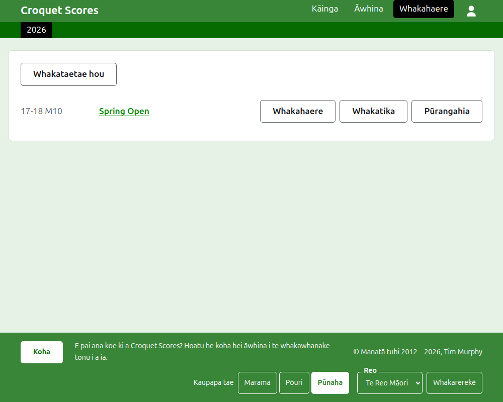
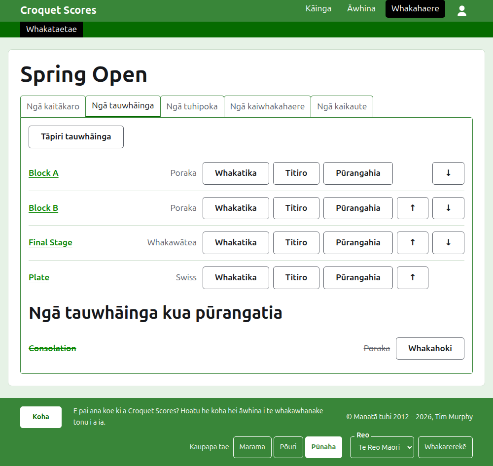

# Te whakahaere i tētahi whakataetae paerewa

He whakataetae paerewa tērā e tākarohia ana i waenga i ngā kaitākaro ka whakaurua takitahi: he mutunga wiki a te karapu, he whakataetae tuwhera, he whakataetae toa. Ka whakaurua ōna kaitākaro ki ngā poraka, ki ngā whakawātea me ngā Swiss, ā, ka puta ōna hua i te wā e tākarohia ana. Ka arahi tēnei aratohu i te kaiwhakahaere mai i te takiuru ki tētahi whakataetae e wātea ana ōna hua ki te marea.

E tū motuhake ana. Kāore he mea i roto e whakawhirinaki ana ki te aratohu mō tētahi whakataetae ā-kapa, he mea tuhi motuhake tērā.

## I mua i te tīmata

Me whai pūkete koe. Pāwhiria [konei](/account/register) hei rēhita i tētahi pūkete.

Ko ngā mahi katoa a te kaiwhakahaere ka mahia i te wāhanga Whakahaere o te pae tukutuku. Ko ngā whārangi tūmatanui, e whai ai ngā kaitākaro me ngā kaimātaki i te whakataetae, he mea tā mai i ngā mea e puritia ana e te Whakahaere, nō reira kāore he mea e whakaputaina: ka puta tonu ki ngā whārangi tūmatanui tētahi hua ka whakaurua.

## Ngā whārangi i te raupapa

1. [Te waihanga i tētahi whakataetae](creating-a-tournament.md): tōna ingoa, ōna rā, tōna hākinakina, te wāhi e tākarohia ai, me te mea e kaute ai ia.
2. [Ngā kaitākaro](players.md): te whakauru i ngā kaitākaro o te whakataetae, te whakatika i a rātou, me te whakatārewa i ērā i whakaurua hētia.
3. [Ngā tauwhāinga](competitions.md): te tāpiri i ngā poraka, i ngā whakawātea me ngā Swiss, me te whakaraupapa i a rātou.
4. [Te whakauru kaitākaro ki tētahi tauwhāinga](entering-players-in-a-competition.md): ko wai ka tākaro i ia tauwhāinga, ngā Bye i tētahi whakawātea, ngā kawe whakamua, te tango me te unu.
5. [Ngā hua](scores.md): te whakauru i ngā hua, te whakatika i a rātou, me te whakatārewa i ērā i whakaurua hētia.
6. [Ngā tuhipoka](notes.md): te whakamōhio atu ki ngā kaitākaro i ngā mea e hiahiatia ana e rātou i te haere o te whakataetae.
7. [Ngā kaiwhakahaere me ngā kaikaute](managers-and-scorers.md): te tohatoha i te whakahaere o te whakataetae, me te tuku i tētahi kia whakauru hua ahakoa kāore e taea e ia te whakarerekē i tētahi atu mea.
8. [Te whakarerekē, te pūranga me te whakahoki i tētahi whakataetae](changing-and-archiving.md): te whakatika i ngā taipitopito o te whakataetae, me te whakatārewa i tētahi whakataetae.
9. [Tā te marea e kite ai](what-the-public-sees.md): ngā whārangi e whāia ana e ō kaitākaro, me te āhua e puta ai ki runga i a rātou ngā mea e whakaurua ana e koe.

## Te whakatakotoranga o te Whakahaere

Ko te kuaha o mua o te Whakahaere ka rārangi i ngā whakataetae e whai wāhi ana koe, kotahi te tau i te wā kotahi.

Ina pēhia te ingoa o tētahi whakataetae, **Whakahaere** rānei, ka tuwhera tōna whārangi. Ko ngā mea katoa hei whakahaere kei roto i ngā ripa e rima i raro i tōna ingoa: **Ngā kaitākaro**, **Ngā tauwhāinga**, **Ngā tuhipoka**, **Ngā kaiwhakahaere** me **Ngā kaikaute**. Ka tuwhera te whārangi ki Ngā kaitākaro, nā te mea ko te whakauru kaitākaro te mea tuatahi ka whakaurua.

Ko te pae kākāriki pōuri i raro i te pane hei neke i waenga i ngā whārangi. Ka arahi ki te whakataetae, ko **Whakataetae**, me ia tauwhāinga o te whakataetae mā tōna ingoa, kia taea ai te haere mai i te whakataetae ki tētahi tauwhāinga, me te neke i waenga i ngā tauwhāinga, me te kore e hoki i te ripa Ngā tauwhāinga. Ko te whārangi e noho ana koe ki runga kua tohua ki te mangu.

## Ngā mea e tika ana ki ngā wāhi katoa

**Kāore he mea e mukua rawatia haunga te tuhipoka.** Ko ngā kaitākaro, ngā tauwhāinga, ngā hua me te whakataetae ake ka pūrangatia, ehara i te muku: ka whakatārewatia, ka rārangi mā roto, ā, ka rārangitia i raro i tētahi pane mā rātou, me **Whakahoki** hei whakahoki mai i a rātou. Kāore te pūranga, te whakahoki me te piki me te heke e pātai kia whakaūngia, nā te mea ka whakakorea ia tētahi ina pēhia tērā atu. Ko ngā mea kāore e taea te whakakore, pēnei i te tango i tētahi kaitākaro i tētahi tauwhāinga, i te muku rānei i tētahi tuhipoka, ka pātai i te tuatahi.

**Kāore he mea e penapenahia e te pouaka kōrero i runga i te whārangi kia pēhia ra anō tāna paopao.** Ka katia ia e te Whakakore, e te pātuhi Escape rānei, ā, ka waiho ngā mea katoa pēnei i mua. Ko ngā pouaka kōrero e tāpiri ana i ngā mea, pēnei i a Tāpiri kaitākaro me Tāpiri hua, ka noho tuwhera i muri i te tāpiri o ia mea, kia taea ai te tuhi i tētahi rārangi, tētahi i muri i tētahi.

**Ko te mea e whakahēngia ka kīia i te taha o te āpure e pā ana ki a ia.** Kāore he mea i whakahēngia e penapenahia, ā, ka noho tonu ngā mea i tuhia e koe, kia taea ai te whakatika, kaua te tuhi anō.

**Ka mahi te Whakahaere i runga i te waea pūkoro.** He rahi tonu ia paopao hei pēhi mā te kōmaru, ā, kāore he mea e whānui ake ana i te mata.

E whai ake nei: [Te waihanga i tētahi whakataetae](creating-a-tournament.md).
