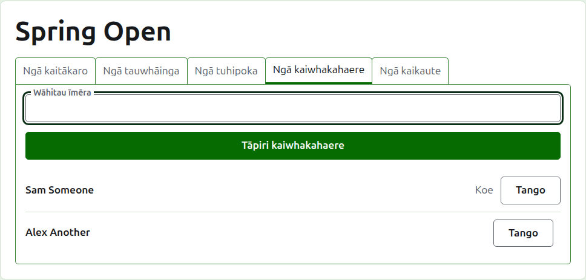
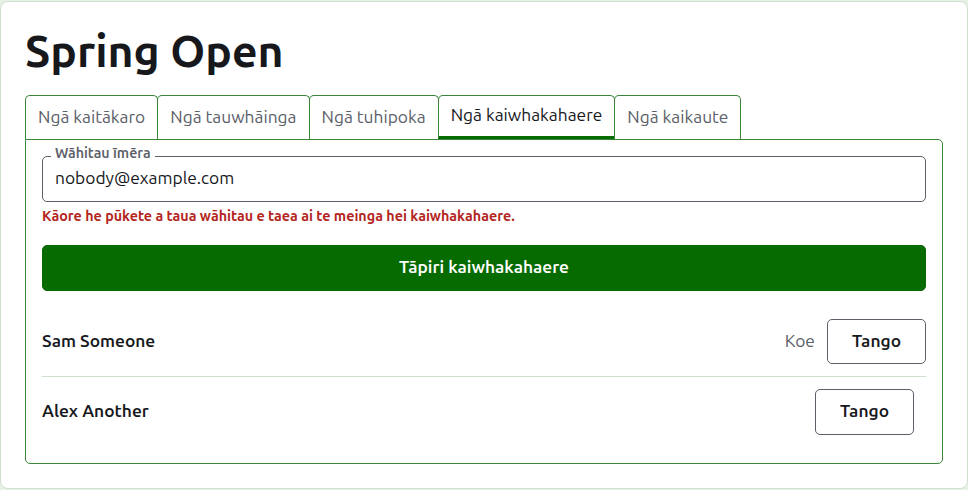
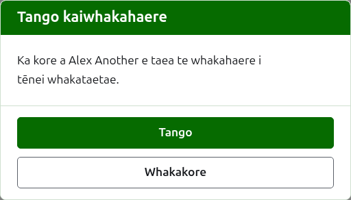
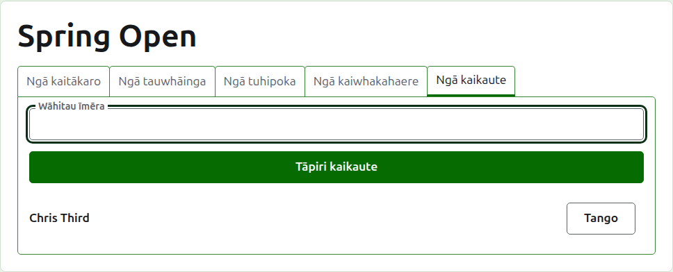
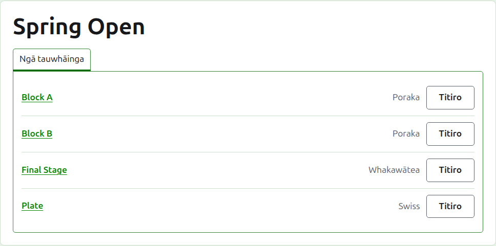

# Ngā kaiwhakahaere me ngā kaikaute

He kaiwhakahaere tā tētahi whakataetae, ka taea e rātou ngā mea katoa e taea ana te mahi ki a ia, ā, tērā pea he kaikaute tāna, ka whakauru i ōna hua, ā, kāore atu. Ko te tangata nāna i waihanga te whakataetae tōna kaiwhakahaere tuatahi.

## Ngā kaiwhakahaere

Ka rārangitia e te ripa **Ngā kaiwhakahaere** ko wai kei te whakahaere i te whakataetae, i te raupapa i meinga ai rātou, ā, kua tohua tō ingoa ake hei mea nōu. Ko te wāhi tēnei e tohatohahia ai tētahi whakataetae, e tukuna ai rānei ki tētahi atu.

Ka meinga tētahi hei kaiwhakahaere mā tōna wāhitau īmēra. Tuhia ki te āpure i runga i te rārangi, ka pēhi i **Tāpiri kaiwhakahaere**. Me whai te wāhitau i tētahi pūkete kua rēhitatia, kua whakaūngia hoki; ka whakahēngia tētahi wāhitau kāore he pūkete i raro i te āpure, ā, kāore te pae e kī atu i tua atu i tērā. Ka kore te kaikaute kua meinga hei kaiwhakahaere e noho hei kaikaute.

Ka tango **Tango** i tētahi kaiwhakahaere. Kāore he mea e penapenahia mō te kaiwhakahaere kua tangohia, nō reira ka pātai a Tango i te tuatahi; ka meinga anō ia hei kaiwhakahaere mā tōna wāhitau mēnā e hiahiatia ana kia hoki mai. He kaiwhakahaere tonu tā tētahi whakataetae, nō reira kāore a Tango e tukuna ki te whakamutunga.

Ka taea e koe te tango i a koe ake. Ka kī te pātai i te tikanga o tērā: ka ngaro tō ake huarahi hoki ki te whakataetae, ā, kāore tētahi i te whārangi e taea te whakakore mōu. Ka taea e tētahi atu kaiwhakahaere te mea anō koe hei kaiwhakahaere.

## Ngā kaikaute

Ko te ripa **Ngā kaikaute** te ripa Ngā kaiwhakahaere mō ngā kaikaute, ā, he ōrite tana mahi: he wāhitau īmēra me **Tāpiri kaikaute** i runga i te rārangi, me **Tango** i ia mea.

Ka kite te kaikaute i te whakataetae i tōna ake rārangi i te Whakahaere, me **Ngā hua** hei whakakapi mō Whakahaere, ā, ka tukuna ki a ia ōna tauwhāinga anake: kāore he kaitākaro, tuhipoka, kaiwhakahaere, kaikaute, raupapa rānei. I te whārangi o tētahi tauwhāinga ka kite ia i te ripa Ngā hua anake, ka taea e ia te whakauru, te whakatika, te pūranga me te whakahoki i ngā hua pēnei i te kaiwhakahaere. Ko ngā kaiwhakahaere anake e kī ai ko wai ka tākaro i tētahi tauwhāinga.

Kāore te kaiwhakahaere e meinga hei kaikaute, nā te mea ka taea e te kaiwhakahaere ngā mea katoa e taea ana e te kaikaute. Kāore tētahi whakataetae e hiahia kaikaute, nō reira ka taea te tango i ngā kaikaute katoa, tae atu ki te whakamutunga o rātou.

E whai ake nei: [Ngā raupapa](rankings.md).
