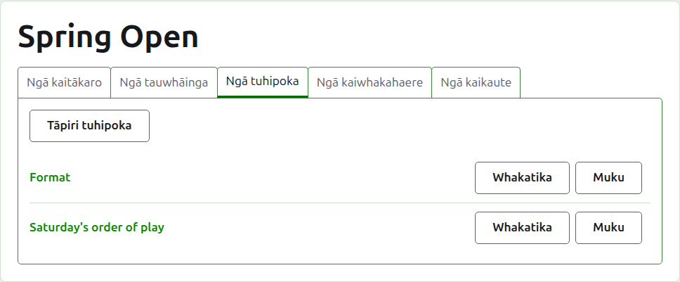
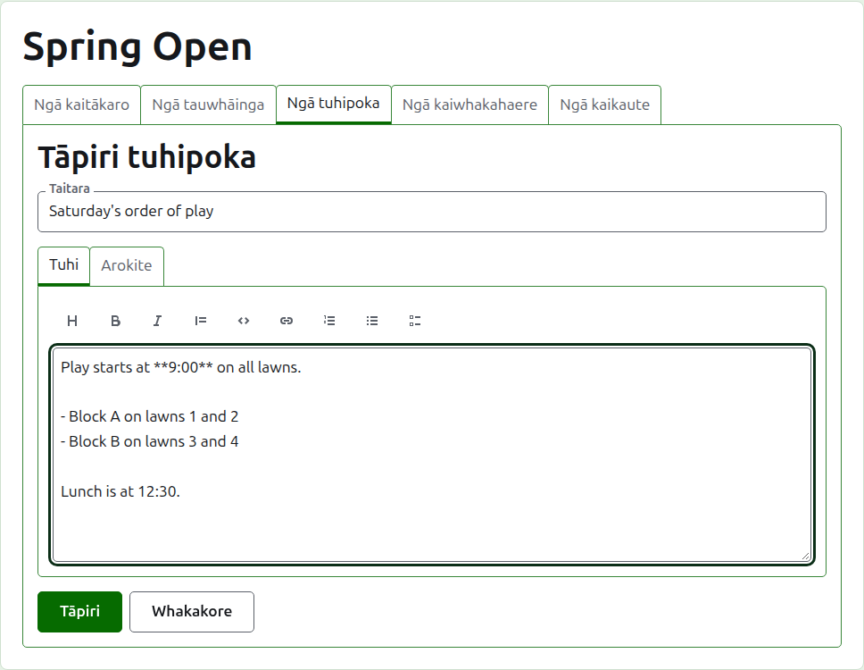
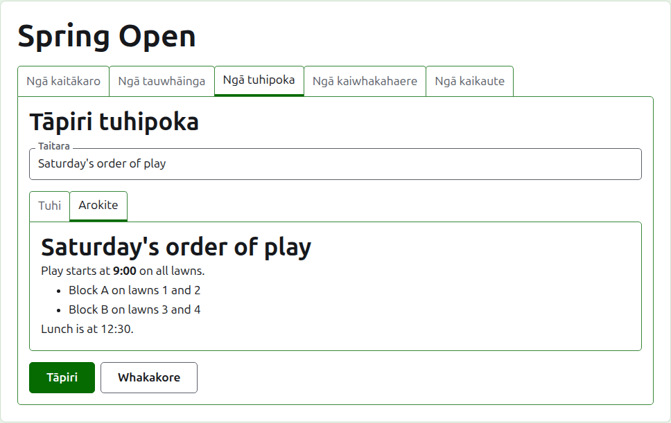
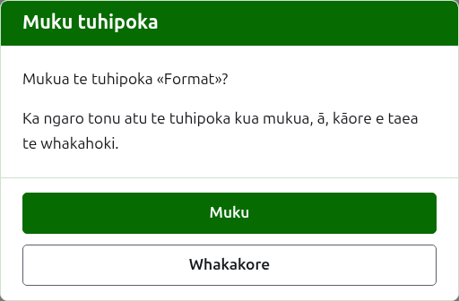

# Ngā tuhinga

Ko te ripa **Ngā tuhinga** o te whārangi o tētahi whakataetae te wāhi e tuhi ai ōna kaiwhakahaere i ngā mea e hiahiatia ana e ngā kaitākaro i te haere o te whakataetae: te hōputu, te huringa o te raupapa tākaro, te wā o te tina. Ka kitea e ngā kaipānui i te whārangi tūmatanui Ngā tuhinga o te whakataetae, ā, ka tohua i reira tētahi tuhinga kāore anō kia pānuitia e rātou ki te tohu whetū whero, e tohu ana hoki i te wāhanga Ngā tuhinga i ia whārangi o te whakataetae kia tuwheratia ra anō e rātou.

## Te tuhi i tētahi tuhinga

Pēhia **Tāpiri tuhinga**, i runga i te rārangi. Ka whakakapia te rārangi e tētahi papa, nā te mea ka tuhia tētahi tuhinga kia roa, ā, me whai wāhi.

E hiahiatia ana te **Taitara**, ko ia hoki te mea e rārangitia ai te tuhinga. He tuhinga noa.

Ka tuhia te **Whakaahuatanga** ki te Markdown, ā, ka taea te waiho hei kau ina oti i te taitara te katoa o te kōrero. Ka tuhi te pae taputapu i runga i te pouaka i te Markdown mōu: Pane, Rarahi, Tītaha, Kupu tāpiri, Waehere, Hononga, Rārangi tau, Rārangi kōpae me Rārangi mahi. Ka mahi ia i runga i te mea kua kōwhiria, i te tīmatanga rānei o ia rārangi kua kōwhiria, ka whakanoho rānei i te tohu ki te wāhi e haere ai ngā kupu.

Ka whakaatu te **Arokite** i te tuhinga pēnei i tā te kaipānui e kite ai i tōna whārangi.

Pēhia **Tāpiri**. Ka penapenahia te tuhinga, ka hoki mai te rārangi me ia kei runga, ā, kei te whārangi tūmatanui Ngā tuhinga tonu.

## Te whakatika i tētahi tuhinga

Pēhia te taitara o tētahi tuhinga, tōna **Whakatika** rānei, hei whakatuwhera i te papa ki taua tuhinga. Pēhia **Penapena** hei penapena i te huringa. Ka tohua anō mō te kaipānui tētahi tuhinga kua whakatikaina i muri i tōna pānuitanga e ia.

## Te muku i tētahi tuhinga

Ka mukua tētahi tuhinga kua kore e whai pānga. Ka ngaro tonu atu te tuhinga kua mukua, nō reira ka pātai a **Muku** i te tuatahi.

E whai ake nei: [Ngā kaiwhakahaere me ngā kaitākohu](managers-and-scorers.md).
