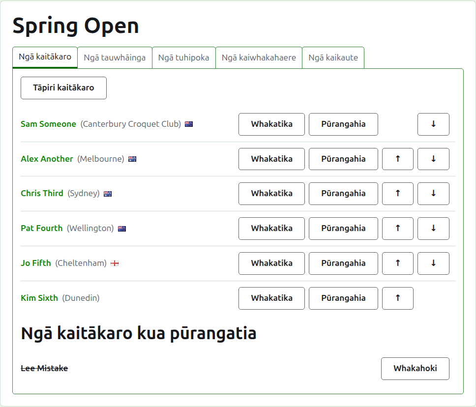
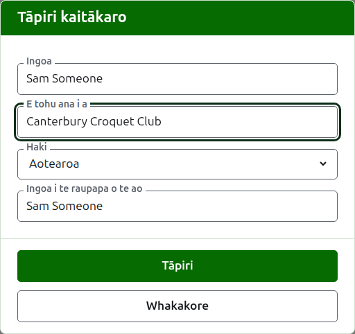
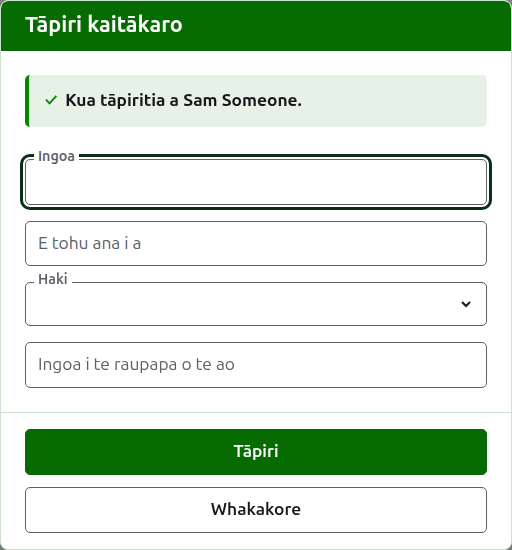
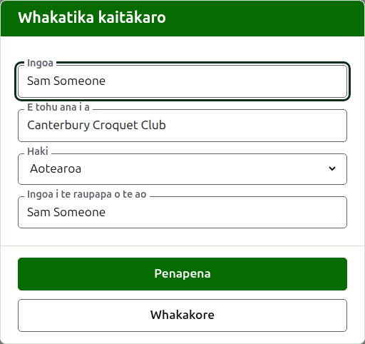
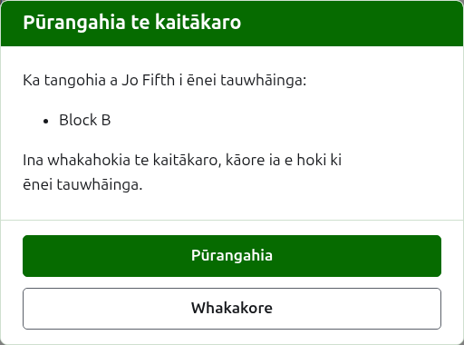

# Ngā kaitākaro

Ko te ripa **Kaitākaro** o te whārangi o tētahi whakataetae te wāhi e whakaurua ai, e whakatikaina ai, e whakaraupapatia ai, e whakatārewatia ai hoki ōna kaitākaro. Ko te ripa tērā e tuwhera ai te whārangi, nā te mea ko te whakauru kaitākaro te mea tuatahi ka mahia ki tētahi whakataetae.

Ka whakaurua ngā kaitākaro ki konei kotahi, ki roto i te whakataetae. Ko ngā tauwhāinga ka tākaro ai ia kaitākaro ka kōwhiria i muri mai, i te whārangi o ia tauwhāinga, mai i ngā kaitākaro kua whakaurua ki konei. Tirohia [Te whakauru kaitākaro ki tētahi tauwhāinga](entering-players-in-a-competition.md).



## Te tāpiri i ngā kaitākaro {#add-a-player}

Pēhia **Tāpiri kaitākaro**, i runga i te rārangi. Ka tuwhera tētahi pouaka kōrero i runga i te whārangi.



E hiahiatia ana te **Ingoa**. Ko te ingoa o te kaitākaro tērā e whakaaturia ai i ia whārangi, kei waenga i te 3 me te 254 ngā tohu. Kāore e taea e ngā kaitākaro e rua o tētahi whakataetae te whai i te ingoa kotahi, ahakoa pēhea te whakamahi i ngā pū rahi; ina he ingoa kotahi tā ngā kaitākaro e rua, wehea rāua i te ingoa ake, pēnei i te "Andrew Hobbs (2)".

Ko **E māngai ana i** te mea e tākaro ai te kaitākaro, he mea tuhi pēnei i tā te kaipānui e kī ai: he karapu, he rohe, he whenua rānei, pēnei i te "Canterbury Croquet Club". Ka whakaaturia i roto i ngā taiaho i muri i te ingoa. Ka taea te waiho hei kau.

Ko **Haki** te haki e whakaaturia ana i te taha o te ingoa o te kaitākaro. Ka taea te waiho hei kore, ko te nuinga o ngā kaitākaro tērā. He mea motuhake te mea e tohu ana te kaitākaro me te haki e kapohia ana e ia, nā te mea ka taea e te kaitākaro te tākaro mō tētahi karapu i tētahi whenua, ā, te kapo i te haki o tētahi atu.

Ko **Ingoa kaitākaro whakarārangi o te ao** te ingoa e mōhiotia ai te kaitākaro e te whakarārangi o te ao. Ka pātaihia anake i tētahi whakataetae Association Croquet, Golf Croquet rānei, ngā hākinakina e rua he rārangi kaitākaro tā te whakarārangi o te ao mō rāua. E mōhiotia ana ngā kaitākaro American 6 Wicket e te raupapa mā tō rātou ake ingoa, nō reira kāore e pātaihia i reira, ā, ko te ingoa o te kaitākaro tonu tōna ingoa i te whakarārangi o te ao. Ina tāpiria e koe tētahi kaitākaro, ka whai ia i te ingoa i a koe e tuhi ana, nā te mea e mōhiotia ana te nuinga o ngā kaitākaro e te raupapa mā tō rātou ake ingoa, ā, ka mutu tana whai ina tuhi koe ki roto. Ina waiho hei kau, ka penapenahia hei ingoa o te kaitākaro.

Ina tuhi koe i tētahi ingoa, ka tukuna ngā kaitākaro e mōhiotia ana e te whakarārangi o te ao he rite te tīmatanga o ō rātou ingoa, kia taea ai e koe te tango i tētahi ingoa pēnei i tā te raupapa e tuhi ai, kaua te tuhi katoa. I te taha o te ingoa i te whakarārangi o te ao, ka kī tētahi tohu tīki e mōhio ana te raupapa ki te ingoa, ā, ka kī tētahi tohu pātai kāore: tērā pea kua hē te tuhi o te ingoa, he hou rānei te kaitākaro ki te raupapa. He tohutohu anake tēnei. Ka penapenahia tētahi ingoa kāore e mōhiotia e te raupapa pēnei i tētahi e mōhiotia ana.

Pēhia **Tāpiri**. Ka tāpiritia te kaitākaro, ka kī te pouaka kōrero i tērā, ā, ka whakakorea ōna āpure mō te kaitākaro e whai ake nei, ka hoki te tohu ki te ingoa. Tāpiria te rārangi katoa pēnei, kātahi ka pēhi i **Whakakore** hei kati i te pouaka kōrero. Kāore a Whakakore e penapena i tētahi mea kāore anō kia tāpiritia.



Kāore tētahi kaitākaro e kīia ko "Bye". Ka tāpiria ngā Bye o tētahi whakawātea ki te whakawātea ake, ahakoa kei hea ngā kaitākaro e whakaurua ana, nō reira ka whakahēngia he ingoa ko "bye" tōna kupu tuatahi, ā, ka whakamārama te pouaka kōrero he aha ai. Ko "bye" te kupu Ingarihi e whakahēngia ana e te pae.

## Te tāpiri i ngā kaitākaro maha {#adding-multiple-players}

Hei tāpiri i tētahi rārangi katoa i te wā kotahi, pēhia **Tāpiri kaitākaro maha**, i te taha o **Tāpiri kaitākaro**. Ka tuwhera tētahi pouaka kōrero i runga i te whārangi, he pouaka kotahi tōna, ka whakaae ki ētahi rārangi kuputuhi maha. Ka taea e koe te kape i te rārangi i tētahi pepa tauriterite ka whakapiri ki te pouaka.

**Ko te rārangi tuatahi te ingoa o ngā āpure**, he mea wehe ki te piko, ki te ripa rānei: **Name**, me tētahi o **Representing**, **Flag**, **Handicap** me **WorldRankingPlayerName**, ahakoa te raupapa. Ka tuhia aua ingoa ki te reo Ingarihi, ahakoa te reo o te pae. Me noho tonu a **Name** hei tētahi. **Ko ia rārangi i muri i tērā he kaitākaro**, he uara mō ia āpure i te raupapa kotahi, he mea wehe i te ara kotahi. Ki te kore he uara a tētahi kaitākaro mō tētahi āpure, waihoki hei kau, engari me mau tonu te piko, te ripa rānei. Hei tauira, ki te whakamahi i te piko:

```
Name,Representing,Flag
Sam Someone,Canterbury Croquet Club,New Zealand
Alex Another,,England
```

- **Ingoa, E māngai ana i me Ingoa kaitākaro whakarārangi o te ao** he rite ngā ture ki tā te tāpiri i te kaitākaro kotahi (tirohia [Te tāpiri i ngā kaitākaro](players.md#add-a-player)). Kei waenga i te 3 me te 254 ngā tohu o te ingoa, kāore ia e noho ana i te whakataetae, ahakoa pēhea te whakamahi i ngā pū rahi, ā, ehara ia i te "Bye".
- **Haki** te ingoa o te whenua, o te wāhi rānei, i tō reo, pēnei i tā te rārangi i te pouaka kōrero Tāpiri kaitākaro e tuku ai, pēnei i a Aotearoa.
- **Haihaingā** he tohu, tae atu ki te rua mati me te hautau kotahi mati, pēnei i te 4, +4, -1.5 rānei.
- Ko te kaitākaro kāore he **Ingoa kaitākaro whakarārangi o te ao** tōna, ka mōhiotia mā tōna ingoa, pēnei i a ia ina tāpiritia takitahi.
- **Ngā piko, ngā ripa rānei.** Ka wehea ngā pūtau i kapea mai i tētahi pepa tauriterite ki ngā ripa, ā, ko te rārangi i tuhia ā-ringa ka wehea ki ngā piko i te nuinga o te wā. Ka taea tētahi. Mehemea he ripa kei te rārangi tuatahi, ka pānuitia te rārangi katoa ki ngā ripa, ki te kore ka pānuitia ki ngā piko.
- Ko te uara he tohu wehe tōna, ka tuhia ki ngā tohu kupu rua, pēnei i tā te pepa tauriterite e tuhi ai: "Smith, John" i tētahi rārangi kua wehea ki ngā piko. Ko te tohu kupu i roto i te uara ka tuhia e rua nei.
- Ka tangohia ngā mokowā i ngā pito o ia uara, ā, ka warewaretia tētahi rārangi kāore he mea i runga.
- Kia 500 anake ngā kaitākaro i tētahi rārangi. Tāpirihia ngā toenga i tētahi atu rārangi.

Pēhia **Tāpiri**. Ka tirohia te rārangi katoa i mua i te penapena i tētahi wāhi, nō reira ki te he tētahi mea o te rārangi, kāore he kaitākaro e tāpiritia. Ka whakaaturia te he i raro i te pouaka, i te rārangi e noho ana ia, ka tatau i te rārangi tuatahi hei rārangi 1. Ka rārangitia ngā he katoa, ehara i te mea tuatahi anake, ā, ka noho tonu tāu i tuhi ai kia taea ai e koe te whakatika. Ina penapenahia te rārangi, ka kati te pouaka kōrero, ā, ka rārangitia ngā kaitākaro hou i te ripa Ngā kaitākaro, i te raupapa i tuhia ai e koe. Kāore i pēnei i a **Tāpiri kaitākaro**, e noho tuwhera ana mō te kaitākaro e whai ake nei, kāore he whai ake: ko te rārangi te whai ake.

Ko te **?** i te pae taitara o te pouaka kōrero te arahi ki konei.

## Te whakatika i tētahi kaitākaro {#correcting-a-player}

Pēhia te ingoa o tētahi kaitākaro, tōna **Whakatika** rānei, hei whakatuwhera i te pouaka kōrero ōrite ki runga i taua kaitākaro, ko Whakatika kaitākaro tōna taitara. Whakarerekētia te mea e hē ana, ka pēhi i **Penapena**, ka penapena i te huringa, ā, ka kati i te pouaka kōrero. Ka mau tonu i te kaitākaro kua whakatikaina tōna ingoa te ingoa i te whakarārangi o te ao i a ia, nā te mea e mōhio tonu ana te raupapa ki a ia mā tērā. I American 6 Wicket, ko te ingoa o te kaitākaro tonu tōna ingoa i te whakarārangi o te ao, nō reira ka whakatikaina anō tērā ina whakatikaina tōna ingoa.



Ka whakatikaina i konei te kaitākaro i ngā wāhi katoa: i ia tauwhāinga e uru ana ia, me ia whārangi tūmatanui.

## Te whakaraupapa i ngā kaitākaro

Ka rārangitia ngā kaitākaro i te raupapa o te whakataetae, ko te raupapa tērā e tukuna ai rātou ina whakaurua ki ngā tauwhāinga, ko te raupapa hoki e tūtohitia ai tētahi whakawātea. Ka nuku **Whakarunga** me **Whakararo**, ngā pere i te pito o ia rārangi, i tētahi kaitākaro kotahi te tūnga. Kāore a Piki e tukuna ki te kaitākaro tuatahi, kāore hoki a Heke ki te whakamutunga.

## Te whakatāpui i tētahi kaitākaro {#archiving-a-player}

Ka whakatārewatia e **Whakatāpui** tētahi kaitākaro: i whakaurua hētia, i unuhia rānei i te whakataetae katoa. Ka rārangitia tētahi kaitākaro kua whakatāpuia i raro i **Ngā kaitākaro kua whakatāpuia**, ka rārangi mā roto, i muri i ngā kaitākaro e whakamahia ana, ā, ko **Whakahokia mai** anake tāna e tuku ai. Kāore tētahi kaitākaro kua whakatāpuia i tētahi tauwhāinga, ā, kāore ia i tētahi whārangi tūmatanui.

Kāore e taea te whakatāpui i tētahi kaitākaro kua tākaro i tētahi kēmu, nā te mea ka tū aua kēmu ki tētahi kua kore nei i reira, nō reira kāore a Whakatāpui e tukuna ki taua kaitākaro. Ka taea mō tētahi kaitākaro he whakatāpuia anake ōna kēmu.

Kāore te whakatāpui i tētahi kaitākaro kāore i tētahi tauwhāinga e pātai i te tuatahi, nā te mea ka whakahokia ngā mea katoa e te whakahoki. Ka pātai te whakatāpui i tētahi kaitākaro kei tētahi tauwhāinga i te tuatahi, nā te mea ka tangohia ia i ia tauwhāinga e uru ana ia e te whakatāpui, ā, kāore te whakahoki e whakahoki i a ia ki reira.



E whai ake nei: [Ngā tauwhāinga](competitions.md).
