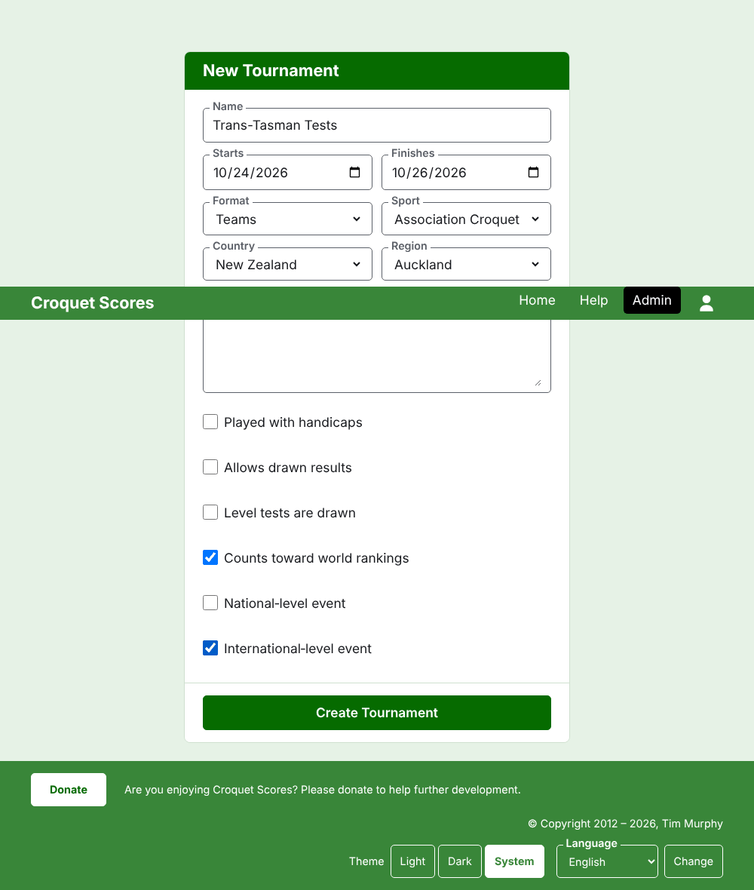
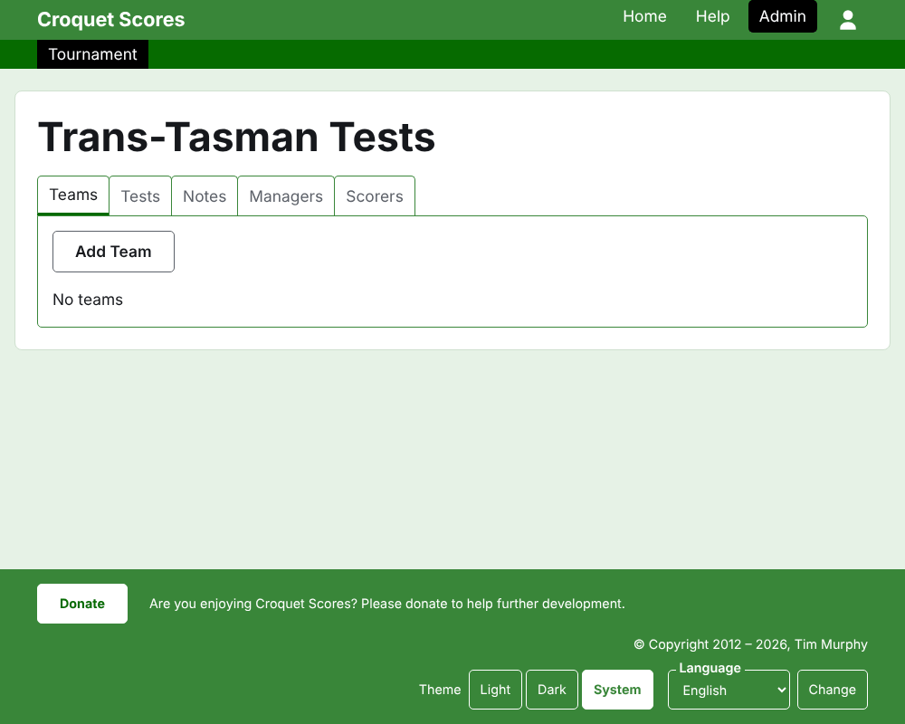

# Te waihanga i tētahi whakataetae

Pēhia **Whakataetae hou** i runga i te rārangi whakataetae i te Whakahaere. Kei runga i te rārangi, kaua kei raro, kia kore ai e tīpakohia atu i te mata o te waea pūkoro e tētahi rārangi roa.

Ka pātai te puka mō ngā mea katoa e tīmata ai tētahi whakataetae. Ko te mea nui rawa i konei ko te **Hōputu**, ko ia hoki te mea e meinga ai tētahi whakataetae hei whakataetae ā-kapa.

## Ngā mea e pātai ai te puka

**Ingoa.** Te mea e rapua ai e ngā kaipānui hei kimi i te whakataetae, pēnei i te "Trans-Tasman Tests". Kei waenga i te 3 me te 254 ngā tohu. Ka whakahēngia he ingoa kei te pū iti katoa, kei te pū rahi katoa rānei, nā te mea ka rite ki te hapa i ia whārangi e whakaaturia ai. Ka taea e ngā whakataetae e rua te whai i te ingoa kotahi, nā te mea ka tākarohia taua whakataetae kotahi i ia tau.

**Te tīmata** me **Te mutunga.** Ngā rā e haere ai te whakataetae. Ka tākarohia ia Test i roto i a rāua, nō reira whakaritea kia kapi te kaupapa katoa. Kāore e taea e tētahi whakataetae te mutu i mua i tōna tīmata, ā, kāore e taea te tīmata, te mutu rānei i muri i te mutunga o te tau e whai ake nei. Nō te tau e tīmata ai tētahi whakataetae, ko taua tau hoki kei tōna wāhitau.

**Hōputu.** Kōwhiria tētahi o ngā hōputu e tākarohia ana e ngā kapa:

- Ko **Ā-kapa** te hōputu whānui mō tētahi kaupapa i waenga i ngā kapa.
- Ko **Eire Cup**, **Interstate Shield** me **GC World Team Championship** he kaupapa motuhake, ia mea he hōputu mōna ake kia whakahaerehia pēnei i te whakahaerenga o taua kaupapa.

Ko Paerewa te hōputu kotahi kāore e tākarohia ana e ngā kapa, ā, ehara i te mea e hiahia ana koe i konei. Kāore a Gateball Scores e tuku hōputu, nā te mea he whakataetae paerewa gateball ia whakataetae i reira; ka waihangatia tētahi whakataetae ā-kapa i Croquet Scores.

**Hākinakina.** Ngā hākinakina e tuku ana te pae tukutuku, i tōna raupapa: Association Croquet, Golf Croquet, American 6 Wicket me Ricochet.

**Whenua** me **Rohe.** Te wāhi e tākarohia ai te whakataetae. Ka pātaihia he rohe ina wehea anake te whenua i kōwhiria e koe ki ngā rohe, pēnei i ngā kāwanatanga o Ahitereiria, ā, kāore e hiahiatia te kōwhiri ahakoa tērā.

**Taitara iti.** Ko te mea katoa e hiahia ana koe kia mōhio ngā kaipānui, kāore nei he āpure mōna ake: te wāhi e tū ai te waka, te wā o te tina, ko wai hei waea atu. Ka whakaaturia i raro i te ingoa o te whakataetae i ia whārangi tūmatanui. Ka tuhia ki te Markdown, nō reira ka taea te whakarahi i tētahi kupu mā te whetūrangi i ōna taha e rua, ā, te hanga rārangi mā te tohu rārangi i te tīmatanga o ia rārangi. Tae atu ki te 2000 ngā tohu, ā, ka taea te waiho hei kau.

**Tākarohia ki te hanikapa.** Tīkina tēnei mō tētahi kaupapa hanikapa.

**Ka whakaaetia ngā taurite.** Tīkina tēnei ina taea e tētahi tākaro te mutu me te kore he toa o tētahi o ngā kaitākaro. Ina tīkina, ka mau tonu hei taurite tētahi hua i whakaurua me ngā tohu ōrite, ā, kāore he tohu; ina kāore i tīkina, me kī te tākaro i whai ngā tohu ōrite ko wai te toa mā te tohu i muri i te hua a te toa, pēnei i te "6w".

**He taurite ngā Test ōrite.** Ka pātaihia anake ina kōwhiria he hōputu e tākarohia ana e ngā kapa. Ka toa tētahi Test i te kapa e toa ake ana i ōna tukinga, ā, ko tētahi e ōrite ana i ngā tukinga ka whakatauhia mā ngā tapeke tākaro, kātahi mā ngā tapeke hupa, ki te kore e tīkina tēnei, ā, ina tīkina, ka taurite tētahi Test e ōrite ana i ngā tukinga, pērā i tā ētahi whakataetae kapa. Kāore i tīkina i te tīmatanga mō Ā-kapa, ā, kua tīkina mō te GC World Team Championship, he taurite tonu tana Test ōrite.

**Ka whakaarohia mō te raupapa o te ao.** Ka pātaihia anake ina taea te kaute: he whakataetae Association Croquet, Golf Croquet rānei kāore i tākarohia ki te hanikapa, kāore hoki e whakaae ki ngā taurite. Kua tīkina i te tīmatanga.

**Takunetanga ā-motu** me **Takunetanga ā-ao.** Ka taea e tētahi whakataetae te noho hei tētahi, hei tētahi atu, hei kore rānei, engari kāore e taea te rua: ina tīkina tētahi ka tangohia te tīki o tērā atu.

## Te waihanga

Pēhia **Waihanga whakataetae**. Ka kawea koe ki te whārangi o te whakataetae i te Whakahaere, kua tuwhera ki tōna ripa Ngā kapa, ā, ko koe tōna kaiwhakahaere tuatahi. Ka rārangitia i te Whakahaere i raro i te tau e tīmata ai.

Ka hangaia te wāhitau tūmatanui o te whakataetae mai i tōna tau, tōna hākinakina me tōna ingoa, pēnei i te `/2026/ac/trans-tasman-tests`. Ka mau tonu i a ia taua wāhitau ina whakatikaina tōna ingoa i muri mai, kia kitea tonu ai e te hononga kua tukuna kē; ka neke anake ina rerekē te tau e tīmata ai, tōna hākinakina rānei.

## Mēnā ka whakahēngia tētahi mea

Ko te mea e whakahēngia ka kīia i raro i te āpure e pā ana ki a ia, ā, ka noho tonu ngā mea i tuhia e koe. Kāore he mea e penapenahia kia whakaetia ra anō ngā āpure katoa. Ko ngā mea e nui ake te whakahē ko te ingoa kua tuhia ki te pū iti katoa, te mutunga i mua i te tīmatanga, me te whenua kāore i kōwhiria.

E whai ake nei: [Ngā kapa](teams.md).
