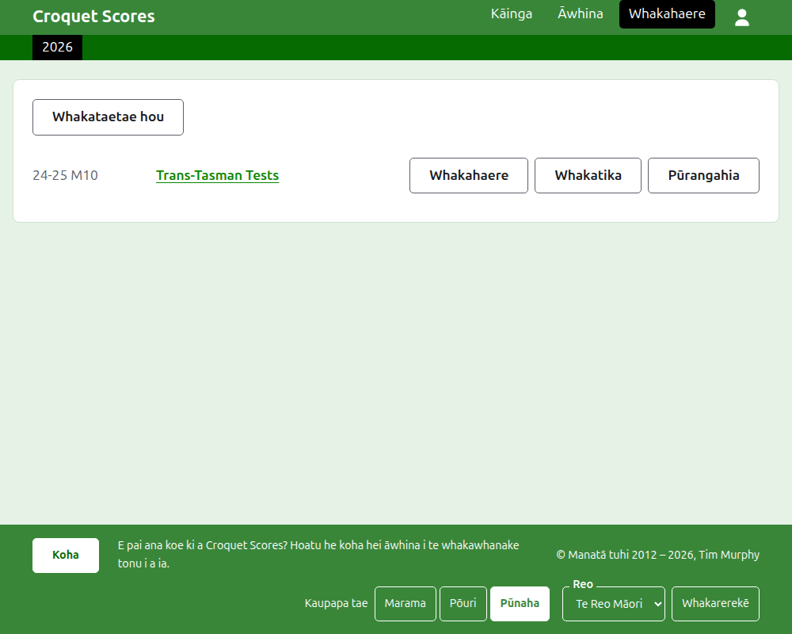
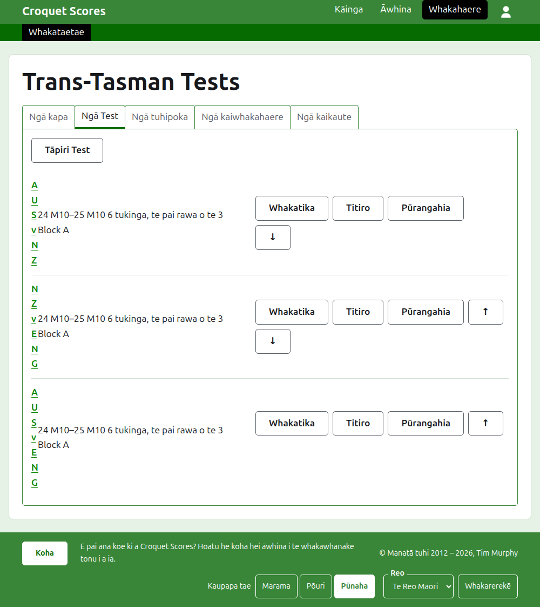

# Te whakahaere i tētahi whakataetae ā-tīma

He whakataetae ā-tīma tērā e tūtaki ai ngā taha, kaua ngā kaitākaro ka whakaurua takitahi: he raupapa whakamātau i waenga i ngā whenua e rua, he interstate shield, he whakataetae toa tīma o te ao. Ka whakaritea ōna tīma me ō rātou kaitākaro, ka tāpiria ngā whakamātau i waenga i ngā tīma, ā, ka puta ngā kēmu o ia whakamātau i te wā e tākarohia ana. Ka arahi tēnei aratohu i te kaiwhakahaere mai i te takiuru ki tētahi whakataetae e wātea ana ōna tākohu ki te marea.

E tū motuhake ana. Kāore he mea i roto e whakawhirinaki ana ki te aratohu mō tētahi whakataetae paerewa, he mea tuhi motuhake tērā.

## I mua i te tīmata

Me whai pūkete koe. Pāwhiria [konei](/account/register) hei rēhita i tētahi pūkete.

Ko ngā mahi katoa a te kaiwhakahaere ka mahia i te wāhanga Kaiwhakahaere o te pae tukutuku. Ko ngā whārangi tūmatanui, e whai ai ngā kaitākaro me ngā kaimātaki i te whakataetae, he mea tā mai i ngā mea e puritia ana e te Kaiwhakahaere, nō reira kāore he mea e whakaputaina: ka puta tonu ki ngā whārangi tūmatanui tētahi tākohu ka whakaurua.

## Ngā kupu

Ko te **tīma** he taha, pēnei i a Ahitereiria, he ingoa tōna, he ingoa poto pēnei i te "AUS", me tētahi haki. He **kaitākaro** ake tā te tīma, e tākaro ana mōna, ā, mō tētahi atu kore. Ko te **whakamātau** he whakataetae i waenga i ngā tīma e rua, e kīia ana mā ō rāua ingoa poto, pēnei i te "AUS v ENG", he mea hanga mai i te maha o ngā **tukinga** i waenga i tētahi kaitākaro o ia tīma, ko ia tukinga te pai rawa o te maha o ngā **kēmu**. Ka taea te whakatakoto i ngā whakamātau ki ngā **rōpū**, pēnei i te "Block A", ina tākaro te tini o ngā tīma i waenga i a rātou anō.

## Ngā whārangi i te raupapa

1. [Te waihanga i tētahi whakataetae](creating-a-tournament.md): tōna ingoa, ōna rā, tōna hākinakina, tōna hōputu, me te wāhi e tākarohia ai.
2. [Ngā tīma](teams.md): te tāpiri i ngā tīma, me ō rātou ingoa poto me ō rātou haki.
3. [Ngā kaitākaro o te tīma](team-players.md): te whakauru i ngā kaitākaro o ia tīma ki te whārangi ake o te tīma.
4. [Ngā whakamātau](tests.md): te tāpiri i ngā whakamātau i waenga i ngā tīma, ō rātou rā, te maha o ngā tukinga a ia mea, me ō rātou rōpū.
5. [Ngā tākohu](scores.md): te whakauru i ngā kēmu o tētahi whakamātau, te whakatika i a rātou, me te whakatārewa i ērā i whakaurua hētia.
6. [Ngā tuhinga](notes.md): te whakamōhio atu ki ngā kaitākaro i ngā mea e hiahiatia ana e rātou i te haere o te whakataetae.
7. [Ngā kaiwhakahaere me ngā kaitākohu](managers-and-scorers.md): te tohatoha i te whakahaere o te whakataetae, me te tuku i tētahi kia whakauru tākohu ahakoa kāore e taea e ia te whakarerekē i tētahi atu mea.
8. [Ngā raupapa](rankings.md): te kōnae e tukuna ai ki te whakarārangi o te ao, me ngā mea ka waiho māu e whakakī.
9. [Te whakarerekē, te whakatāpui me te whakahoki i tētahi whakataetae](changing-and-archiving.md): te whakatika i ngā taipitopito o te whakataetae, me te whakatārewa i tētahi whakataetae.
10. [Tā te marea e kite ai](what-the-public-sees.md): ngā whārangi e whāia ana e ō kaitākaro, me te āhua e puta ai ki runga i a rātou ngā mea e whakaurua ana e koe.

## Te whakatakotoranga o te Kaiwhakahaere

Ko te kuaha o mua o te Kaiwhakahaere ka rārangi i ngā whakataetae e whai wāhi ana koe, kotahi te tau i te wā kotahi.

Ina pēhia te ingoa o tētahi whakataetae, **Whakahaere** rānei, ka tuwhera tōna whārangi. Ko ngā mea katoa hei whakahaere kei roto i ngā ripa e ono i raro i tōna ingoa: **Tīma**, **Whakamātau**, **Ngā tuhinga**, **Kaiwhakahaere**, **Kaitākohu** me **Whakarārangi**. Ka tuwhera te whārangi ki Ngā tīma, nā te mea ko ngā tīma te mea tuatahi ka whakaritea.

Ko te pae kākāriki pōuri i raro i te pane hei neke i waenga i ngā whārangi. I te whārangi o te whakataetae me te whārangi o tētahi whakamātau ka arahi ki te whakataetae, ko **Whakataetae**, me ia whakamātau mā tōna ingoa. I te whārangi o tētahi tīma ka arahi ki te whakataetae me ia tīma mā tōna ingoa poto, nā te mea e whakauru kaitākaro ana te kaiwhakahaere i te whārangi o tētahi tīma, tīma ki te tīma. Ko te whārangi e noho ana koe ki runga kua tohua ki te mangu.

## Ngā mea e tika ana ki ngā wāhi katoa

**Kāore he mea e mukua rawatia haunga te tuhinga.** Ko ngā tīma, ngā kaitākaro, ngā whakamātau, ngā tākohu me te whakataetae ake ka whakatāpuia, ehara i te muku: ka whakatārewatia, ka rārangi mā roto, ā, ka rārangitia i raro i tētahi pane mā rātou, me **Whakahokia mai** hei whakahoki mai i a rātou. Kāore te whakatāpui, te whakahoki me te piki me te heke e pātai kia whakaūngia, nā te mea ka whakakorea ia tētahi ina pēhia tērā atu. Ko ngā mea kāore e taea te whakakore, pēnei i te muku i tētahi tuhinga, i te tango rānei i tētahi kaiwhakahaere, ka pātai i te tuatahi.

**Kāore he mea e penapenahia e te pouaka kōrero i runga i te whārangi kia pēhia ra anō tāna paopao.** Ka katia ia e te Whakakore, e te pātuhi Escape rānei, ā, ka waiho ngā mea katoa pēnei i mua. Ko ngā pouaka kōrero e tāpiri ana i ngā mea, pēnei i a Tāpiri tīma me Tāpiri tākohu, ka noho tuwhera i muri i te tāpiri o ia mea, kia taea ai te tuhi i tētahi rārangi, tētahi i muri i tētahi.

**Ko te mea e whakahēngia ka kīia i te taha o te āpure e pā ana ki a ia.** Kāore he mea i whakahēngia e penapenahia, ā, ka noho tonu ngā mea i tuhia e koe, kia taea ai te whakatika, kaua te tuhi anō.

**Ka mahi te Kaiwhakahaere i runga i te waea pūkoro.** He rahi tonu ia paopao hei pēhi mā te kōmaru, ā, kāore he mea e whānui ake ana i te mata.

E whai ake nei: [Te waihanga i tētahi whakataetae](creating-a-tournament.md).
