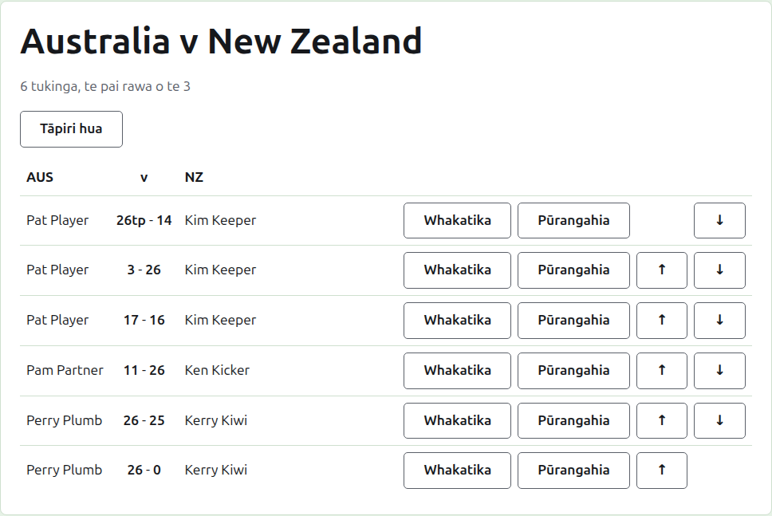
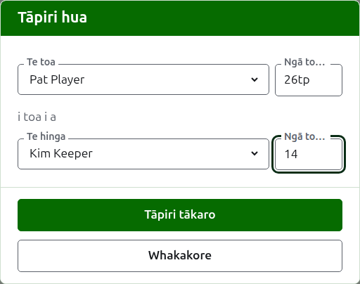

# Ngā tākohu

Ka whakatuwheratia te whārangi o tētahi whakamātau mai i tōna ingoa i te ripa Whakamātau, mai i te pae kākāriki pōuri rānei. Ko ngā ingoa katoa o ōna tīma tōna pane, pēnei i a "Australia v New Zealand", me te maha o ngā tukinga e tūmanakohia ana mōna me te pai rawa o te aha o ia mea i raro. Ko ōna tākohu te whārangi, kāore he ripa. He whārangi ōrite tā te kaiwhakahaere me te kaitākohu e kite ai, nā te mea ka taea e te kaitākohu ngā mea katoa ki tētahi tākohu e taea ana e te kaiwhakahaere.

## Te whakatakoto o ngā tākohu

Ka whakatakotoria ngā tākohu mā te tīma, kaua mā te toa, ki tētahi tēpu e whai pane ana i te ingoa poto o te tīma tuatahi, "v", me te mea o te tīma tuarua. He rārangi ia tākohu: te kaitākaro o te tīma tuatahi, kātahi ko ngā tākohu e rua me tā te tīma tuatahi i te tuatahi, pēnei i te "26tp - 14", kātahi ko te kaitākaro o te tīma tuarua, ko wai ake o rāua i toa. Ka whakatakotoria ngā tākohu kua whakatāpuia i te ara ōrite i raro.

## Te whakauru i tētahi tākohu

Pēhia **Tāpiri tākohu**, i runga i te rārangi. Ka pānuitia te pouaka kōrero pēnei i te kī reo nui i tētahi tākohu: te toa me tana tākohu, kātahi ko "i toa i a", kātahi ko te hinga me tana tākohu.

Ka kōwhiria te toa mai i ngā kaitākaro o ngā tīma e rua e whakamahia ana, i raro i te ingoa o ia tīma, ko ngā kaitākaro o te tīma tuatahi i te tuatahi, ā, ko ō ia tīma i te raupapa o te tīma. Kāore tētahi e kōwhiria i te tīmatanga. Ina kōwhiria te toa, ka tukuna te hinga mai i te tīma tērā atu anake, nā te mea ehara te kēmu i waenga i ngā kaitākaro e rua o te tīma kotahi i te kēmu i waenga i ngā tīma. Kāore te kaitākaro kua whakatāpuia e tukuna.

Ka tuhia tētahi tākohu pēnei i tā te kaitākohu i tuhi ai: te maha o ōna tohu, me te mea e whai ana, ka mau tonu, ka whakaaturia pēnei i te tuhinga, pēnei i te "26tp" mō te 26 hupa me te peel toru. Ko te tau ko ngā tau takitahi e tīmata ai te tākohu; ka whakahēngia tētahi tākohu kāore e tīmata ki te tau takitahi.

Ko tētahi kēmu i toa i runga i ngā tohu ōrite, pēnei ina mutu i te wā, ā, ka whakatauhia i tētahi atu huarahi, ka kī ko wai te toa mā te tohu i muri i te tākohu a te toa: ka toa te "6w" i te "6". Ko ngā tohu ko "w", "won" me "winner". Me nui ake te tākohu a te toa i tā te hinga, me tohu rānei, ina kāore te whakataetae e whakaae ki ngā taurite, ā, ina whakaae, ka mau tonu hei taurite ngā tohu ōrite me te kore tohu.

Pēhia **Tāpiri kēmu**. Ka tāpiritia te kēmu, ka kī te pouaka kōrero ko tēhea, ā, ka whakakorea ngā āpure mō te mea e whai ake nei, nā te mea ka tae mai ngā tākohu ā-rōpū, he mea pānui i te papa i te mutunga o tētahi wā tākaro. Pēhia **Whakakore** ina oti katoa te whakauru.

## Ngā tukinga

Ka tākaro ngā kaitākaro e rua ka tūtaki i tētahi tukinga o te pai rawa o te aha o te whakamātau. Ko ngā kēmu i waenga i a rāua ngā kēmu o taua tukinga, ā, ka whakahēngia tētahi kēmu i waenga i ngā kaitākaro e rua kua whakatauhia kē te tukinga: kua toa tētahi o rāua i ngā kēmu maha ake i ērā e taea ana e tētahi atu te toa, kua tākarohia rānei ngā kēmu katoa.

Ka tīmata tētahi tukinga ina whai kēmu e whakamahia ana ōna kaitākaro e rua. Kāore tētahi whakamātau e tīmata i ngā tukinga maha ake i ērā e tūmanakohia ana: ina tīmata te maha o ngā tukinga e tūmanakohia ana, ka whakahēngia he kēmu i waenga i ngā kaitākaro e rua kāore anō kia tūtaki, ā, ka whakaaetia tētahi atu kēmu o tētahi tukinga kua tīmata kē. Ina maha ake ngā tukinga ka whai te whakamātau, whakarerekētia ki te ripa Whakamātau kia tūmanako i ērā.

## Te whakatika i tētahi tākohu

Ka whakatuwheratia e **Whakatika** te pouaka kōrero ōrite ki runga i taua tākohu, ko Whakatika tākohu tōna taitara, kua kōwhiria ōna kaitākaro, ā, kei a ia ōna tākohu pēnei i tā rātou i tuhi ai. Ka taea te whakarerekē i ōna kaitākaro me ōna tākohu, ka kōwhiria pēnei i te wā e tāpiri ana. Pēhia **Penapena** hei penapena i te whakatika, ā, hei kati i te pouaka kōrero. Ka mau tonu te tākohu i te whakatika: ka noho tonu te kēmu i toa hei toa, ā, ka noho tonu te kēmu taurite hei taurite. Ka whakatāpuia te kēmu he hē te tākohu, ka whakauru anō.

## Te whakaraupapa i ngā tākohu

Ka tae mai ngā tākohu i te raupapa i whakaurua ai, nō reira ka tuku ia tākohu e whakamahia ana i a **Whakarunga** me **Whakararo**, ka whakawhiti i a ia me te tākohu e piri ana, kia taea ai te whakanoho i te rārangi ki te raupapa i tākarohia ai ngā kēmu.

## Te whakatāpui i tētahi tākohu

Ka whakatārewatia e **Whakatāpui** tētahi tākohu kia kore ai e kaute. Ka rārangitia i raro i **Ngā tākohu kua whakatāpuia**, ka rārangi mā roto, ā, ko **Whakahokia mai** anake tāna e tuku ai. Kāore tētahi e pātai i te tuatahi, nā te mea ka whakakorea e tētahi tērā atu. Ka taea te whakatāpui i ia tākohu o tētahi whakamātau, nā te mea kāore he rauna a te whakamātau e whakawhirinaki ana tētahi ki tētahi.

Kāore e whakahokia he tākohu kua whakatāpuia kē tōna kaitākaro i muri mai, kia whakahokia ra anō te kaitākaro, ā, ka kī te whārangi i tērā.

E whai ake nei: [Ngā tuhinga](notes.md).
