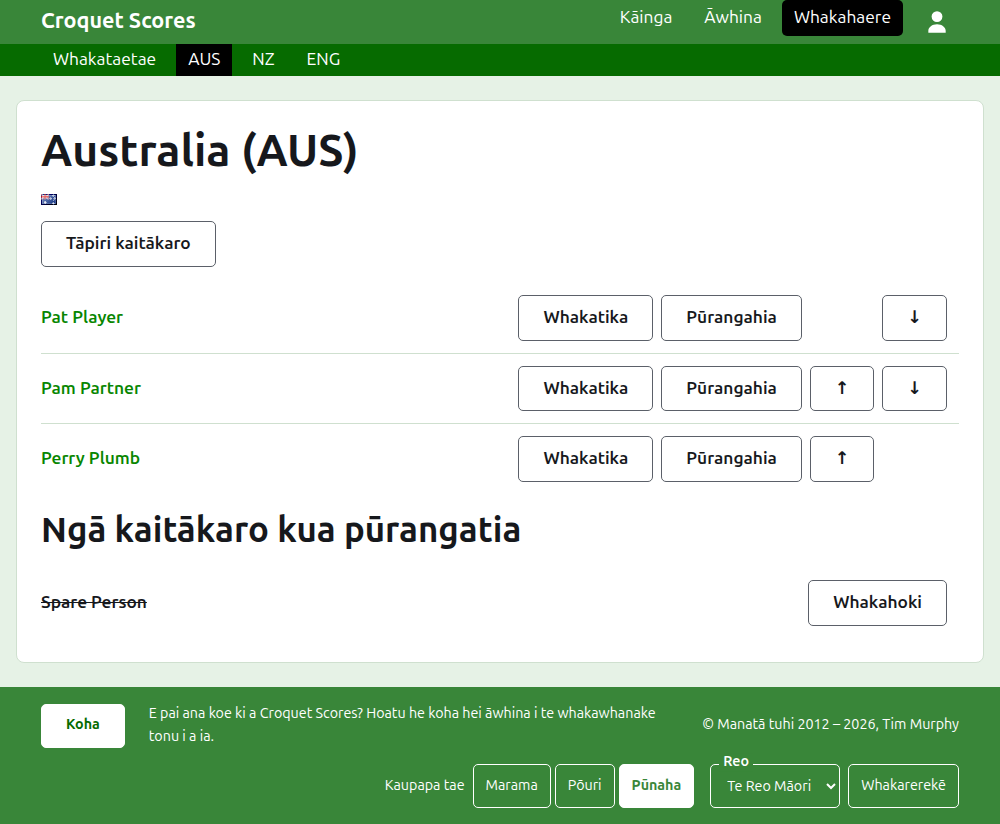
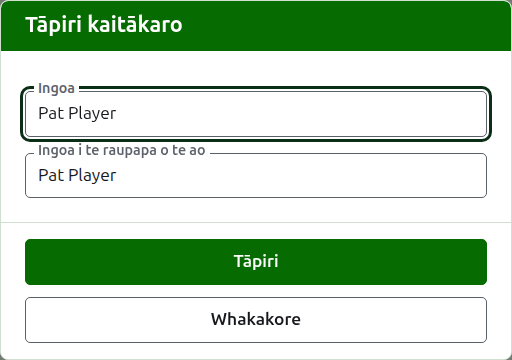

# Ngā kaitākaro o te tīma

Ka whakatuwherahia te whārangi o tētahi tīma mai i tōna ingoa, mai i tōna **Tirohia** rānei, i te ripa Tīma. Ko te ingoa o te tīma tōna pane, me tōna ingoa poto i roto i ngā taiaho, me tōna haki, kia kite tonu te kaiwhakahaere kua tae ia ki te tīma hē. Kotahi anake te mea hei whakaatu, ko ngā kaitākaro o te tīma, nō reira ko te rārangi te whārangi.

Ka arahi te pae kākāriki pōuri i te whārangi o tētahi tīma ki te whakataetae me ia tīma e whakamahia ana mā tōna ingoa poto, kia whakaurua ai ngā kaitākaro tīma ki te tīma me te kore e hoki ki te ripa Tīma.

Nō te tīma anake tētahi kaitākaro i tētahi tīma, ka tohu i te tīma, ā, ka kapo i te haki o te tīma, kaua tētahi o ōna ake. Ko te tangata kotahi e tākaro ana mō ngā tīma e rua, i ngā whakataetae e rua rānei, he kaitākaro i ia tētahi.

## Te tāpiri i tētahi kaitākaro {#adding-a-player}

Pēhia **Tāpiri kaitākaro**, i runga i te rārangi. Ka tuwhera tētahi pouaka kōrero i runga i te whārangi.

E hiahiatia ana te **Ingoa**, kei waenga i te 3 me te 254 ngā tohu. Kāore e taea e ngā kaitākaro e rua o tētahi tīma te whai i te ingoa kotahi, ahakoa pēhea te whakamahi i ngā pū rahi; ka taea e tētahi kaitākaro o tētahi atu tīma te whai i taua ingoa.

Ko **Ingoa kaitākaro whakarārangi o te ao** te ingoa e mōhiotia ai te kaitākaro e te whakarārangi o te ao. Ka pātaihia anake i tētahi whakataetae Association Croquet, Golf Croquet rānei, ngā hākinakina e rua he rārangi kaitākaro tā te whakarārangi o te ao mō rāua. E mōhiotia ana ngā kaitākaro American 6 Wicket e te raupapa mā tō rātou ake ingoa, nō reira kāore e pātaihia i reira, ā, ko te ingoa o te kaitākaro tonu tōna ingoa i te whakarārangi o te ao. Ina tāpiria e koe tētahi kaitākaro, ka whai ia i te ingoa i a koe e tuhi ana, ā, ka mutu tana whai ina tuhi koe ki roto. Ina waiho hei kau, ka penapenahia hei ingoa o te kaitākaro. I a koe e tuhi ana, ka tukuna ngā kaitākaro e mōhiotia ana e te whakarārangi o te ao he rite te tīmatanga o ō rātou ingoa, ā, i te taha o te ingoa i te whakarārangi o te ao, ka kī tētahi tohu tīki e mōhio ana te raupapa ki te ingoa, ā, ka kī tētahi tohu pātai kāore. He tohutohu anake tēnei: ka penapenahia tētahi ingoa kāore e mōhiotia e te raupapa pēnei i tētahi e mōhiotia ana.

Kāore tētahi kaitākaro e kīia ko "Bye": ka whakahēngia he ingoa ko "bye" tōna kupu tuatahi. Ko "bye" te kupu Ingarihi e whakahēngia ana e te pae.

Pēhia **Tāpiri**. Ka tāpiritia te kaitākaro, ka kī te pouaka kōrero i tērā, ā, ka whakakorea ōna āpure mō te kaitākaro e whai ake nei, ka hoki te tohu ki te ingoa. Tāpiria te tīma katoa pēnei, kātahi ka pēhi i **Whakakore** hei kati i te pouaka kōrero.

## Te whakatika i tētahi kaitākaro {#correcting-a-player}

Pēhia te ingoa o tētahi kaitākaro, tōna **Whakatika** rānei, hei whakatuwhera i te pouaka kōrero ōrite ki runga i taua kaitākaro, ko Whakatika kaitākaro tōna taitara. Pēhia **Penapena** hei penapena i te huringa. Ka mau tonu i te kaitākaro kua whakatikaina tōna ingoa te ingoa i te whakarārangi o te ao i a ia, haunga i American 6 Wicket, ko te ingoa o te kaitākaro tonu tōna ingoa i te whakarārangi o te ao.

## Te raupapa

Ka rārangitia ngā kaitākaro i te raupapa o te tīma, ko te raupapa tērā e tukuna ai rātou ina whakauruhia te tākohu o tētahi whakamātau. Ka nuku **Whakarunga** me **Whakararo** i tētahi kaitākaro kotahi te tūnga i roto i te tīma.

## Te whakatāpui i tētahi kaitākaro

Ka whakatārewatia e **Whakatāpui** tētahi kaitākaro: i whakaurua hētia, kua wehe rānei i te tīma. Ka rārangitia tētahi kaitākaro kua whakatāpuia i raro i **Ngā kaitākaro kua whakatāpuia**, ka rārangi mā roto, i muri i ngā kaitākaro e whakamahia ana, ā, ko **Whakahokia mai** anake tāna e tuku ai. Kāore te whakatāpui e pātai i te tuatahi, nā te mea kāore tētahi kaitākaro i tētahi tīma i whakaurua ki tētahi atu mea, ā, ka whakahokia ngā mea katoa e te whakahoki.

Kāore e taea te whakatāpui i tētahi kaitākaro kua tākaro i tētahi kēmu e whakamahia ana i tētahi whakamātau, nā te mea ka tū aua kēmu ki tētahi kua kore nei i reira, nō reira kāore a Whakatāpui e tukuna ki taua kaitākaro. Ka taea mō tētahi kaitākaro he whakatāpuia anake ōna kēmu.

E whai ake nei: [Ngā whakamātau](tests.md).
