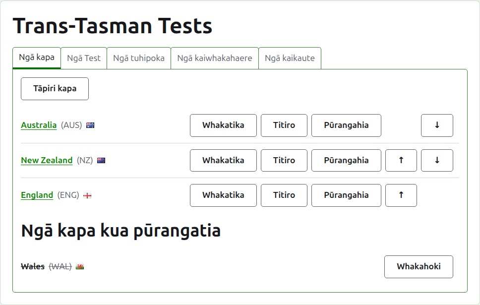
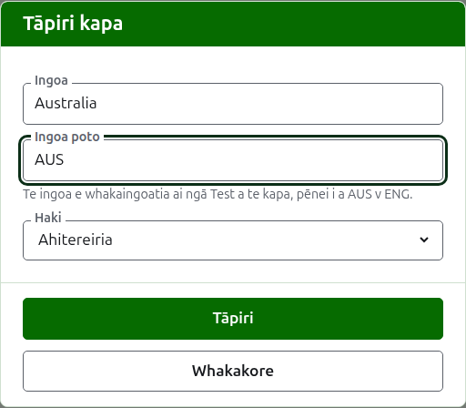
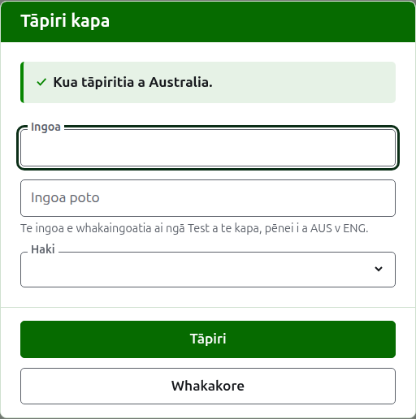
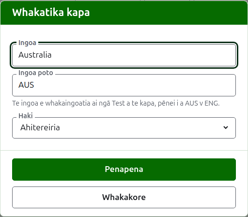

# Ngā tīma

Ko te ripa **Tīma** o te whārangi o tētahi whakataetae te wāhi e tāpiria ai, e whakatikaina ai, e whakaraupapatia ai, e whakatārewatia ai hoki ōna tīma. Ko te ripa tērā e tuwhera ai te whārangi, nā te mea ko ngā tīma te mea tuatahi ka whakaritea. He whakamātau i waenga i ngā tīma e rua, nō reira me rua neke atu i mua i te tāpiri i tētahi whakamātau.

## Te tāpiri i tētahi tīma {#adding-a-team}

Pēhia **Tāpiri tīma**, i runga i te rārangi. Ka tuwhera tētahi pouaka kōrero i runga i te whārangi.

E hiahiatia ana te **Ingoa**: te ingoa katoa o te tīma, pēnei i a "Australia", ko ia te pane o te whārangi o te tīma me ngā tēpu o ngā whārangi tūmatanui. Kāore e taea e ngā tīma e rua o tētahi whakataetae te whai i te ingoa kotahi.

E hiahiatia ana hoki te **Ingoa poto**: te mea e whakaingoatia ai ngā whakamātau a te tīma, pēnei i te "AUS v ENG", ā, te mea e kī ai te pae kākāriki pōuri i te tīma. Tae atu ki te 10 ngā tohu, ā, kāore e roa ake i te ingoa, nā te mea ko te ingoa poto e roa ake ana i te ingoa e whakapotohia ana, he mea tuhi hē te tahuri o ngā mea e rua. Kāore hoki e taea e ngā tīma e rua te whai i te ingoa poto kotahi.

Ko **Haki** te haki e whakaaturia ana i te taha o te ingoa o te tīma ki ngā wāhi katoa e puta ai. Ka taea te waiho hei kore, pēnei mō te tīma o tētahi karapu, o tētahi rohe rānei.

Pēhia **Tāpiri**. Ka tāpiritia te tīma, ka kī te pouaka kōrero i tērā, ā, ka whakakorea ōna āpure mō te tīma e whai ake nei. Tāpiria te rārangi katoa pēnei, kātahi ka pēhi i **Whakakore** hei kati i te pouaka kōrero. Kāore a Whakakore e penapena i tētahi mea kāore anō kia tāpiritia.

## Te whakatika i tētahi tīma {#correcting-a-team}

Pēhia te **Whakatika** a tētahi tīma hei whakatuwhera i te pouaka kōrero ōrite ki runga i taua tīma, ko Whakatika tīma tōna taitara. Whakarerekētia te mea e hē ana, ka pēhi i **Penapena**. Ka kīia te tīma kua rerekē tōna ingoa poto mā te mea hou ki ngā wāhi katoa, nō reira ka whakaingoatia anōtia ōna whakamātau i a ia.

## Te raupapa

Ka rārangitia ngā tīma i te raupapa o te whakataetae, ko te raupapa tērā e tukuna ai rātou ina tāpiria tētahi whakamātau, ko te raupapa hoki o te pae kākāriki pōuri, ko te raupapa hoki e rārangitia ai rātou e te whārangi tūmatanui Ngā kaitākaro. Ka nuku **Whakarunga** me **Whakararo**, ngā pere i te pito o ia rārangi, i tētahi tīma kotahi te tūnga.

## Te haere ki tētahi tīma

Ka whakatuwheratia e te ingoa o tētahi tīma, e **Tirohia** rānei, te whārangi ake o te tīma, ko te wāhi tērā e whakaurua ai ōna kaitākaro. Tirohia [Ngā kaitākaro o te tīma](team-players.md).

## Te whakatāpui i tētahi tīma

Ka whakatārewatia e **Whakatāpui** tētahi tīma. Ka noho tonu ōna kaitākaro ki a ia, ā, ka hoki mai ina whakahokia, nō reira kāore te whakatāpui e pātai i te tuatahi. Ka rārangitia tētahi tīma kua whakatāpuia i raro i **Ngā tīma kua whakatāpuia**, ka rārangi mā roto, ko **Whakahokia mai** anake tāna e tuku ai, ā, ka katia tōna whārangi kia whakahokia ra anō.

Kāore e taea te whakatāpui i tētahi tīma e tākaro ana i tētahi whakamātau e whakamahia ana, nā te mea ka tū taua whakamātau ki tētahi tīma kua kore nei i reira, nō reira kāore a Whakatāpui e tukuna ki taua tīma. Ka taea mō tētahi tīma he whakatāpuia anake ōna whakamātau.

E whai ake nei: [Ngā kaitākaro o te tīma](team-players.md).
