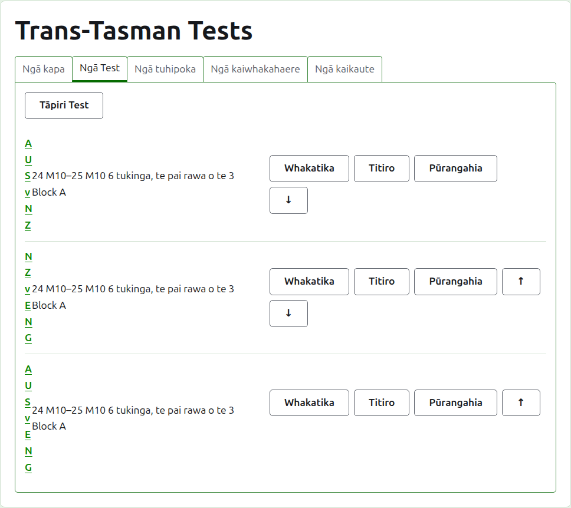
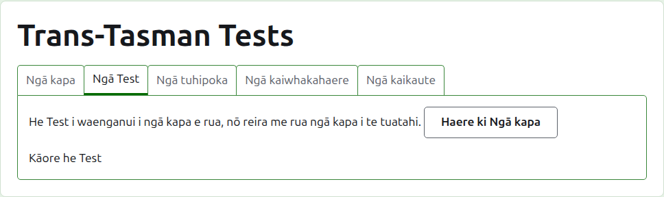
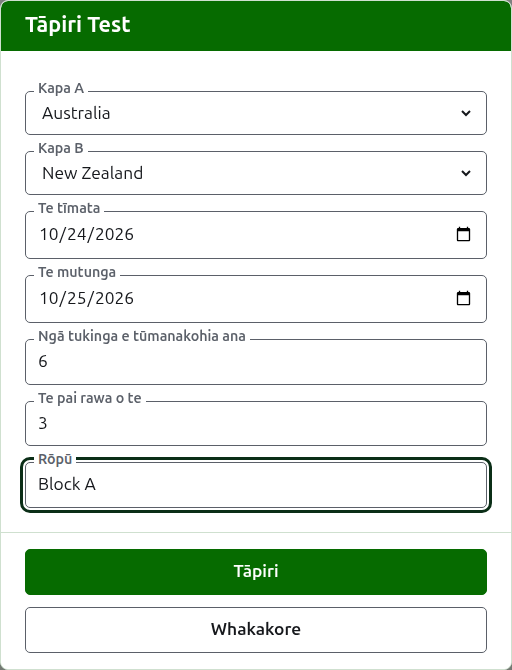
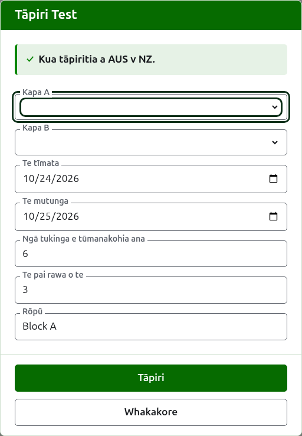
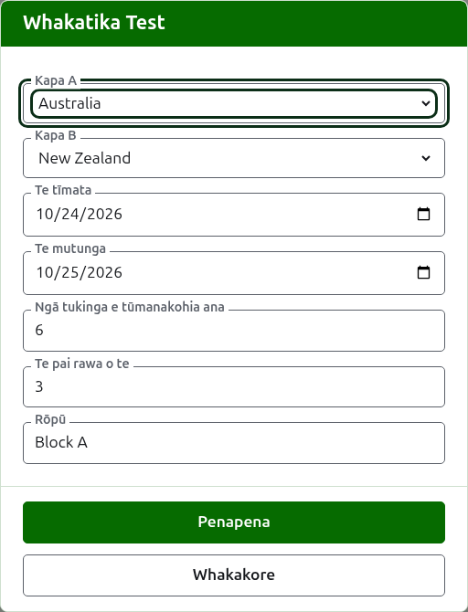

# Ngā whakamātau

Ko te ripa **Ngā whakamātau** o te whārangi o tētahi whakataetae te wāhi e tāpiria ai, e whakarerekētia ai, e whakaraupapatia ai, e whakatārewatia ai hoki ngā whakamātau i waenga i ōna tīma. He tauwhāinga o te whakataetae te whakamātau: he whakataetae i waenga i ngā tīma e rua, e kīia ana mā ō rāua ingoa poto, pēnei i te "AUS v NZ", he mea tākaro hei maha ngā tukinga i waenga i tētahi kaitākaro o ia tīma. He whārangi motuhake tō ia whakamātau, ko te wāhi tērā e whakaurua ai ōna tākohu.

Ka kī ia whakamātau i tōna ingoa, ngā rā e tākarohia ai, te maha o ngā tukinga e tūmanakohia ana mōna me te pai rawa o te aha o ia mea, pēnei i te "6 tukinga, te pai rawa o te 3", me tōna rōpū ina kei tētahi.

## Me rua ngā tīma i te tuatahi

He whakamātau i waenga i ngā tīma e rua e whakamahia ana, nō reira ina iti iho i te rua ngā tīma o te whakataetae ka kī te ripa i tērā ki te wāhi e noho ai a Tāpiri whakamātau, ā, ka arahi ki te ripa Tīma.

## Te tāpiri i tētahi whakamātau

Pēhia **Tāpiri whakamātau**, i runga i te rārangi. Ka tuwhera tētahi pouaka kōrero i runga i te whārangi, e pānuitia ana i te raupapa e kī reo nui ai tētahi whakamātau.

Ka kōwhiria **Tīma A** me **Tīma B** mai i ngā tīma o te whakataetae e whakamahia ana, mā te ingoa, i te raupapa o te whakataetae. Kāore tētahi e kōwhiria i te tīmatanga, kia kore ai e tāpiria tētahi whakamātau i waenga i ngā tīma kāore i kōwhiria e koe. Ka tuku a Tīma B i ngā tīma katoa haunga te mea i kōwhiria hei Tīma A, nā te mea kāore te tīma e tākaro i tētahi whakamātau ki a ia ake. Ko Tīma A te tīma tuatahi: kei te taha mauī ōna kaitākaro i te whārangi o te whakamātau me te whārangi tūmatanui. Kāore he ingoa ake a tētahi whakamātau hei tuhi; ka kīia mā ngā ingoa poto o ōna tīma.

Ko **Te tīmatanga** me **Te mutunga** ngā rā e tākarohia ai te whakamātau, ka tīmata i te rā tuatahi o te whakataetae. Ka tākarohia tētahi whakamātau i roto i tōna whakataetae, nō reira ka whakahēngia ngā rā i mua i te tīmata o te whakataetae, i muri rānei i tōna mutunga.

Ko **Ngā tukinga e tūmanakohia ana** te maha o ngā tukinga e whai ai te whakamātau, he mea whakatau e te kaupapa i mua i tōna tīmata, kia kite ai te tangata e pānui ana i ōna tākohu i te wāhi e tae ai. He tau tōpū mai i te 1 ki runga. He tepe hoki: ina tīmata te maha o ngā tukinga e tūmanakohia ana e te whakamātau, ka whakahēngia he kēmu ka tīmata i tētahi atu, ā, ka tākarohia tonutia ngā tukinga kua tīmata kē. Ko te whakamātau e whai ana ki te maha ake ka whakarerekētia kia tūmanako i ērā.

Ko **Pai rawa o te** te mea e pai rawa ai ia tukinga. Ka taea he tau e wehea ana ki te rua, nā te mea ka taea e tētahi tukinga te tohatoha.

Ka pātaihia **Ka tākarohia me ngā whakaiti**, **Ka whakaaetia ngā hua taurite** me **Ka kaute ki ngā whakarārangi o te ao** pēnei i tērā o tētahi tauwhāinga. Ka pātaihia anake te whakamutunga ina taea te kaute: he whakamātau Association Croquet, Golf Croquet rānei kāore i tākarohia ki te hanikapa, kāore hoki e whakaae ki ngā taurite. Kua tīkina i te tīmatanga.

Ko **Rōpū** te rōpū e noho ai te whakamātau, ina tākarohia te kaupapa ki ngā rōpū, pēnei i te "Block A". He mea kōwhiri: ina waiho hei kau, kāore te whakamātau i tētahi. He whārangi motuhake tā ngā whakamātau o tētahi rōpū i te pae tūmatanui, e whakaatu ana i te tūnga o ngā tīma o te rōpū. Kāore he rōpū o te **Eire Cup** me te **Interstate Shield**, no reira kāore te pouaka kōrero e pātai mō tētahi.

Pēhia **Tāpiri**. Ka tāpiritia te whakamātau, ka kī te pouaka kōrero ko tēhea mā tōna ingoa, ā, ka whakakorea ngā tīma mō te mea e whai ake nei, ka waiho ngā rā, ngā tukinga e tūmanakohia ana, te pai rawa o te aha me te rōpū pēnei i mua: ka tāpiria ngā whakamātau i te rauna kotahi i te wā, i waenga i ngā tīma e tūtaki ana i te rā kotahi, nō reira ko ngā tīma e rua anake te whakamātau e whai ake nei o te rauna. Pēhia **Whakakore** ina oti katoa te whakauru.

## Te whakarerekē i tētahi whakamātau

Ka whakatuwheratia e **Whakatika** te pouaka kōrero ōrite ki runga i te whakamātau, ko Whakatika whakamātau tōna taitara, ka tīmata pēnei i te whakamātau. Pēhia **Penapena** hei penapena i te huringa.

Ka mau tonu i tētahi whakamātau he kēmu ōna e whakamahia ana ōna tīma: ka whakaaturia e te pouaka kōrero, engari kāore e taea te whakarerekē. Ka taea te whakarerekē i te toenga, i roto i te mea kua tākarohia: ka whakahēngia ngā tukinga e tūmanakohia ana he iti iho i ngā tukinga kua tīmata kē, pērā hoki te pai rawa o te aha he iti iho i te nui rawa o ngā kēmu kua tākarohia e ngā kaitākaro e rua.

## Te raupapa

Ka rārangitia ngā whakamātau i te raupapa o te whakataetae, ko te raupapa tērā e puta ai ki ngā whārangi tūmatanui me te pae kākāriki pōuri. Ka nuku **Whakarunga** me **Whakararo** i tētahi whakamātau kotahi te tūnga.

## Te haere ki tētahi whakamātau

Ka whakatuwheratia e te ingoa o tētahi whakamātau, e **Tirohia** rānei, tōna whārangi, ko te wāhi tērā e whakaurua ai ōna tākohu. Ka arahi hoki te pae kākāriki pōuri ki reira, mai i te whārangi o te whakataetae, o tētahi atu whakamātau rānei.

## Te whakatāpui i tētahi whakamātau

Ka whakatārewatia e **Whakatāpui** tētahi whakamātau, ā, ka whakakorea e **Whakahokia mai**, nō reira kāore tētahi e pātai i te tuatahi. Ka rārangitia tētahi whakamātau kua whakatāpuia i raro i **Ngā whakamātau kua whakatāpuia**, ka rārangi mā roto, ko Whakahoki anake tāna e tuku ai, ā, kāore ia i ngā whārangi tūmatanui.

Kua tākarohia tētahi whakamātau he kēmu ōna e whakamahia ana, ā, kāore e taea te whakatāpui kia whakatāpuia ōna kēmu. Ka taea mō tētahi whakamātau he whakatāpuia katoa ōna kēmu, nā te mea kāore e kaute tētahi kēmu kua whakatāpuia. Kāore tētahi whakamātau e whakahokia mēnā kua whakatāpuia tētahi o ōna tīma i muri mai, kia whakahokia ra anō te tīma, ā, ka kī te ripa i tērā.

E whai ake nei: [Ngā tākohu](scores.md).
