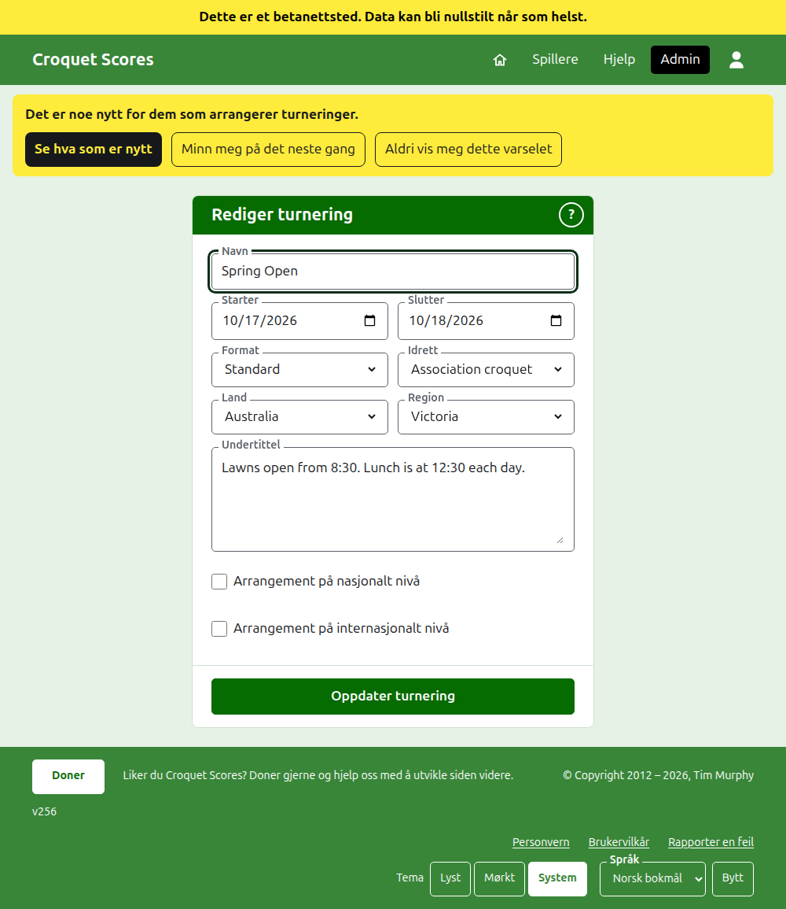
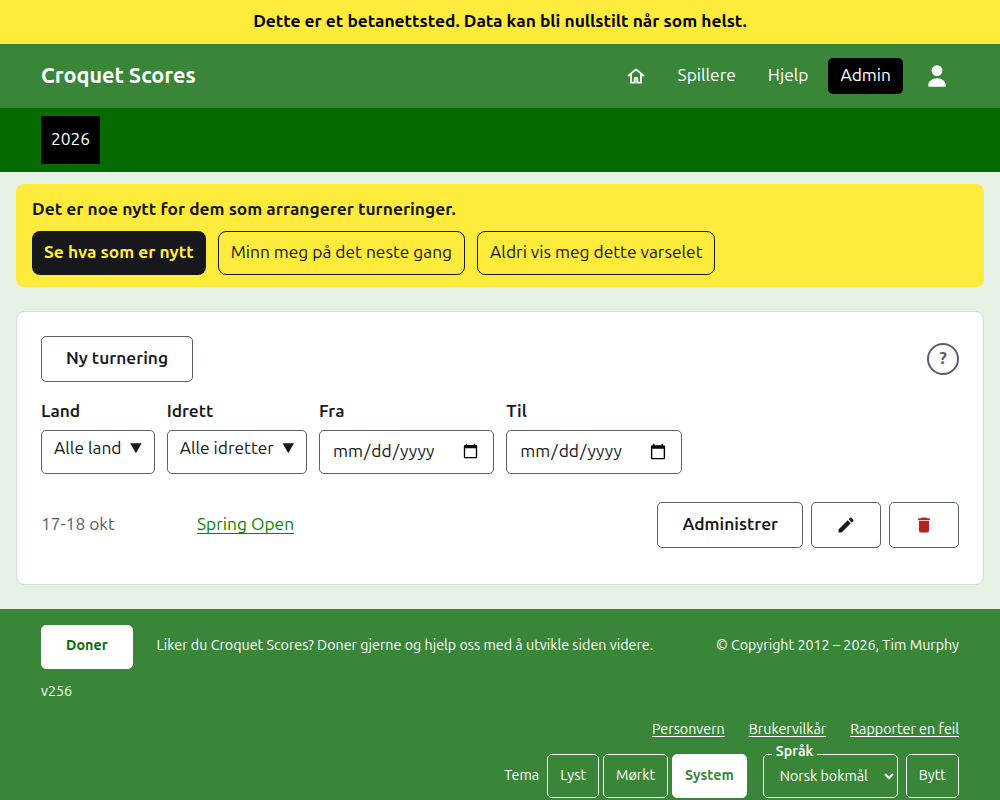
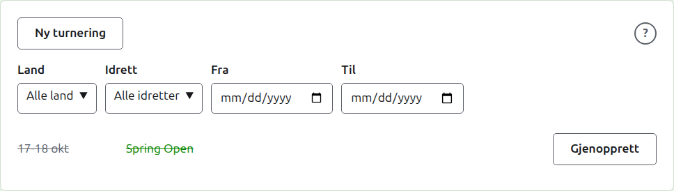

# Å endre, arkivere og gjenopprette en turnering

## Å endre turneringens detaljer

I listen over turneringer i admin, trykk på **Rediger** for turneringen. Skjemaet er det som opprettet den, begynt som turneringen er. Endre det som er galt og trykk på **Oppdater turnering**.

Når turneringen har en spiller eller en konkurranse, arkiverte regnet med, kan ikke formatet dens endres til et spilt av lag, som har lag og tester i stedet.

En turnering beholder adressen sin når navnet rettes, slik at en lenke noen allerede har sendt, fortsatt finner den. Den flyttes bare når året den starter i, eller idretten, endres, og da fører den gamle adressen til den nye. Å lagre tar deg til turneringen der den finnes nå.

Bare en leder kan endre en turnering. En poengfører, eller noen andre, får beskjed om det heller enn å få se skjemaet.

## Listen over turneringer

Admin viser ett år om gangen, med det inneværende først, nyeste turnering først. Årene du har en turnering i, er faner i den mørkegrønne linjen, nyeste først; der det er flere enn det er plass til på en telefon, står de eldste i en nedtrekksliste ytterst i raden. Året står i adressen, så et år kan lenkes til.

Over listen begrenser **Land**, **Region**, **Idrett**, **Fra** og **Til** den etter hvert som de velges, uten noen knapp å trykke på. Bare valg som ville gi noe i listen, tilbys, og en region tilbys når et land er valgt. **Fra** og **Til** er dager: listen er over turneringene som starter fra den ene til den andre, begge medregnet, og begge må velges for at den skal begrenses etter dager. Det som er valgt, står i adressen, så en begrenset liste kan lenkes til; å velge et annet år fjerner det. Et år med mer enn hundre turneringer står hundre til en side, med **Forrige** og **Neste** under. En nasjonal eller internasjonal turnering settes med fet skrift langs raden.

## Å arkivere en turnering

**Arkiver** på en turnering i listen setter den til side. Den står fortsatt i listen, strøket over og etter turneringene i bruk, men den tilbyr bare **Gjenopprett**: siden dens i admin, og de offentlige sidene dens, er stengt til den gjenopprettes. Å arkivere spør ikke først, siden å gjenopprette angrer det.

Neste: [Hva publikum ser](what-the-public-sees.md).
