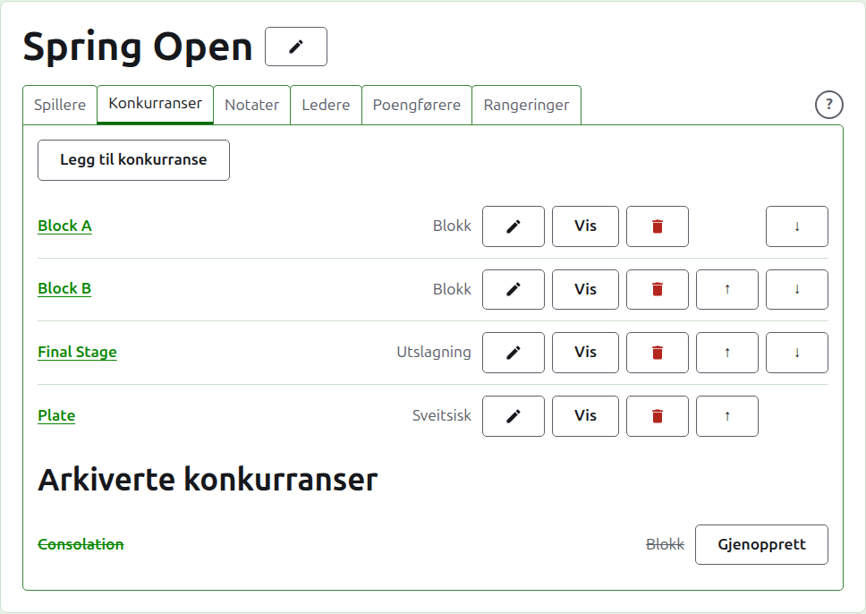
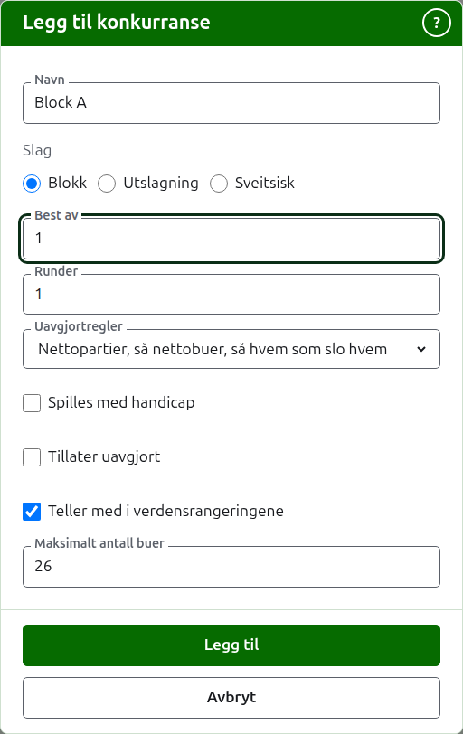
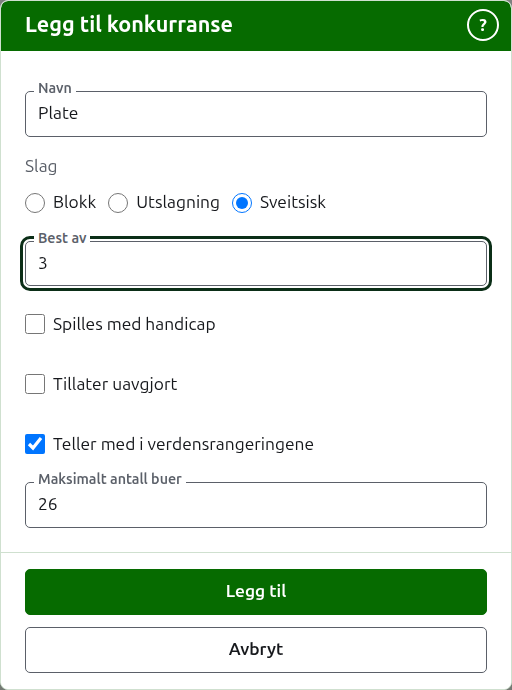
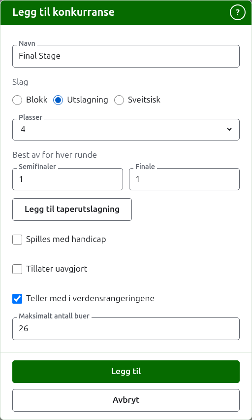

# Konkurranser

Fanen **Konkurranser** på en turnerings side er der konkurransene legges til, settes i rekkefølge og settes til side. En konkurranse er en blokk, en utslagning eller en sveitsisk. Hver har en egen side, der spillerne meldes på og resultatene legges inn.

## Å legge til en konkurranse {#adding-a-competition}

Trykk på **Legg til konkurranse**, over listen. En dialog åpnes over siden og spør om konkurransens navn, dens slag og formen slaget har.

**Navn** er det spillerne leter etter på turneringens side for å finne partiene sine. Det er mellom 1 og 254 tegn, og en enkelt bokstav holder, siden en blokk ofte kalles det. To konkurranser i én turnering kan ikke ha samme navn.

**Slag** er en blokk, en utslagning eller en sveitsisk. Dialogen begynner på en blokk, som de fleste konkurranser er.

### En blokk

En blokk spør hva hver kamp er **best av**, hvor mange **runder** den spilles over, og hvordan spillere likt på vunne kamper skilles av **Uavgjortregler**.

**Best av** begynner på 1. Best av 3 vinnes av den som vinner to partier. Det kan være et partall, siden en spiller i en blokk rangeres etter partiene de vinner, og en kamp på to partier delt én hver er et resultat som alle andre.

**Runder** er hvor mange ganger hvert par av spillere i blokken møtes, med en kamp i hver runde. Det begynner på 1, og 1 er nesten alltid det en blokk vil ha: hver spiller spiller mot hver annen én gang. Øk det bare for en blokk der de møtes igjen, som en dobbel serie, der 2 lar hvert par spille to kamper.

**Uavgjortregler** er hvordan spillere som har vunnet samme andel av kampene sine, skilles. Det finnes tre måter, og blokker i én turnering kan bruke ulike, siden reglementene er ulike. **Nettopartier, så nettobuer, så hvem som slo hvem** er slik blokker alltid har vært rangert, og er der en ny blokk begynner: spillere likt på vunne kamper skilles av nettopartiene sine, de som fortsatt er like, av nettobuene sine, og de som fortsatt er like, av hvem som slo hvem blant dem. Der hver kamp er ett enkelt parti, utelates nettopartier. **Hvem som slo hvem** ser bare på kampene de like spillerne spilte mot hverandre. **Annet** er for reglement nettstedet ikke kjenner, og skiller ingen. Spillere som ikke kan skilles, deler en plassering, vist som =2, og siden sier under rutenettet hvordan spillere som er like, skilles.

### En sveitsisk

En sveitsisk spør bare hva hver kamp er **best av**, som begynner på 1, akkurat som en blokk. Best av 3 vinnes av den som vinner to partier. Det kan være et partall, siden en spiller i en sveitsisk rangeres etter partiene de vinner, og en kamp på to partier delt én hver er et resultat som alle andre.

### En utslagning

En utslagning spør hvor mange **plasser** trekningen har, og hva hver runde er best av. Plassene tilbys som 2, 4, 8, 16, 32, 64 og 128, siden et hvilket som helst annet tall ikke kunne halveres runde for runde til en finale, og dialogen begynner på 8. Plasser som er til overs når spillerne er lagt inn, fylles med byes, som legges til der spillerne legges til.

En trekning har så mange runder som det trengs for å halvere plassene til én, så en trekning på 8 plasser har tre runder. Dialogen spør hva hver er best av, samlet under **Best av for hver runde**, i den rekkefølgen de spilles. De tre siste navngis slik en treknings runder omtales, **Kvartfinaler**, **Semifinaler** og **Finale**, og de før dem med nummeret sitt, Runde 1 først. Å velge flere plasser legger til runder i begynnelsen av trekningen, og å velge færre tar dem bort fra begynnelsen, slik at det som ble skrevet for finalen, fortsatt er finalens. Hver runde er best av et oddetall partier, siden en kamp i en utslagning må ha en vinner.

### En taperutslagning {#losers-knockout}

En utslagning kan sende dem som taper en runde videre til en utslagning for seg, en taperutslagning. Under **Best av for hver runde** i en utslagning, trykk på **Legg til taperutslagning**. En dialog spør etter **Tapere av**, runden hvis tapere spiller videre, blant hver runde unntatt finalen, og etter **Navn på taperutslagning**. Trykk på **Legg til** for å sette den i listen under knappen, der **Fjern** tar den ut igjen. Den legges til sammen med utslagningen når den legges til, og hvis en av dem avvises, legges ingen av dem til.

En taperutslagning har en plass for hver kamp i den runden, og hver runde i den er best av 1, som **Rediger** kan endre. Spillerne settes inn etter hvert som kampene i den runden avgjøres, i den rekkefølgen de ble trukket i, så fanen **Spillere** bare viser dem. Hvis et parti rettes eller settes til side, flyttes eller tas taperen ut igjen, med mindre de har spilt videre.

En utslagnings side har en tredje fane, **Tapere**, etter Spillere og Resultater, som viser utslagningene som tar taperne dens, hver med en lenke til siden sin. **Legg til taperutslagning** er der også, og spør om de samme to tingene; her legges en taperutslagning til med en gang. Bare en utslagning har fanen, og en poengfører tilbys den ikke.

På en utslagning som allerede er lagt til, viser **Rediger** den samme knappen, og taperutslagningen legges til med en gang, slik den gjøres fra fanen Tapere. En utslagning hvis tapere en annen i bruk tar, kan ikke arkiveres eller få plassene endret: arkiver taperutslagningen først.

### Hvordan den spilles og telles

Hvert slag spør om de samme fire tingene under formen sin.

**Spilles med handicap.** Kryss av for dette for en konkurranse spilt med handicap.

**Tillater uavgjort.** Kryss av for dette der et parti kan ende uten at noen av spillerne er vinneren. De fleste konkurranser tillater det ikke. Der det er avkrysset, beholdes et resultat lagt inn med like poeng og uten merke som uavgjort; der det ikke er det, må et parti med like poeng si hvem som vant det med et merke etter vinnerens poengsum, som «6w». En kamp i en utslagning har alltid en vinner, så et uavgjort parti avgjør ikke en.

**Teller med i verdensrangeringene.** Spørres det bare om der det kan telles: en konkurranse i Association croquet eller Golfcroquet som verken spilles med handicap eller tillater uavgjort. Det er avkrysset til å begynne med, så fjern avkryssingen for en konkurranse som ikke skal telle.

**Maksimalt antall buer.** Det høyeste antallet buer et parti i konkurransen spilles til, et helt tall på minst 1. Det begynner på det vanlige for idretten, 26, eller 13 i Golfcroquet, så endre det for en konkurranse spilt kortere, som en blokk med partier på 14 buer. Tøm det for en konkurranse hvis partier ikke spilles til et antall buer. En konkurranse spilt til et annet enn det vanlige antallet sier det på sin offentlige side, som «Spilt til 14 buer».

### Å legge til flere på én gang

Trykk på **Legg til**. Konkurransen legges til, dialogen sier fra om det, og navnet tømmes for neste, mens slaget og formen blir som de var: konkurranser som legges til sammen, er stort sett like, så «Blokk B» etter «Blokk A» er bare navnet. Trykk på **Avbryt** for å lukke dialogen når alle er inne.

## Å endre en konkurranse {#changing-a-competition}

**Rediger** åpner den samme dialogen på konkurransen, med tittelen Rediger konkurranse, med navnet, formen og hvordan den spilles og telles som de er. Slaget spørres det ikke om, siden en blokk ikke gjøres til en utslagning ved å endre den: en konkurranse av feil slag arkiveres og legges til på nytt. Trykk på **Lagre** for å beholde endringen og lukke dialogen.

En utslagning som har et parti, har spillere plassert i trekningen, og en endring av plassene ville flytte dem, så den avvises når et parti er lagt inn. Rundenes best av kan fortsatt endres.

## Rekkefølge

Konkurransene står i turneringens rekkefølge, som er rekkefølgen de kommer i på de offentlige sidene og i den mørkegrønne linjen. **Opp** og **Ned** flytter en konkurranse ett sted.

## Å gå til en konkurranse

En konkurranses navn, eller **Vis**, åpner siden dens, der spillerne meldes på og resultatene legges inn. Den mørkegrønne linjen under toppen fører dit også, fra hvilken som helst side i turneringen.

## Å arkivere en konkurranse

**Arkiver** setter en konkurranse til side, enten den har partier eller ikke, som beholdes sammen med den og kommer tilbake når den gjenopprettes. En arkivert konkurranse står under **Arkiverte konkurranser**, strøket over, tilbyr bare **Gjenopprett**, og er ikke på de offentlige sidene. Å arkivere spør ikke først, siden å gjenopprette angrer det.

Neste: [Å melde spillere på en konkurranse](entering-players-in-a-competition.md).
