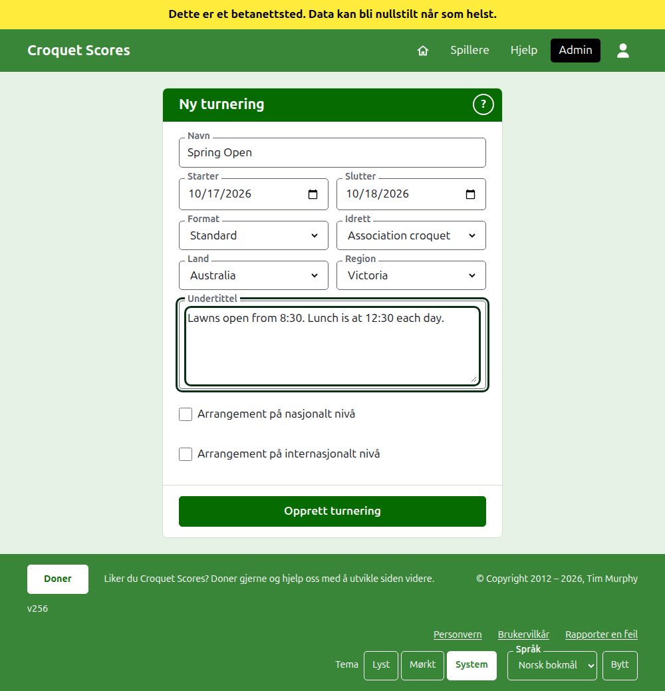

# Opprette en turnering

Trykk på **Ny turnering** over listen over turneringer i admin. Den ligger over listen heller enn under, slik at en lang liste ikke skyver den ut av skjermen på en telefon.

Skjemaet spør om alt en turnering begynner med. En turnering av vanlig slag er et navn, to dager og et land unna: alt annet er avgjort for deg og kan endres.

## Hva skjemaet spør om

**Navn.** Det leserne leter etter for å finne turneringen, som «Spring Open». Det er mellom 3 og 254 tegn. Et navn helt med små bokstaver, eller helt med store, avvises, siden det ville se ut som en feil på hver side det vises på. To turneringer kan ha samme navn, siden den samme turneringen spilles hvert år.

**Starter** og **Slutter.** Dagene turneringen varer. En turnering kan ikke slutte før den starter, og kan ikke starte eller slutte senere enn utgangen av neste år. En turnering hører til året den starter i, som også er året i adressen, så en som varer over nyttår, står oppført i året den starter.

**Format.** Velg **Standard** for en turnering spilt mellom spillere. De andre formatene er for turneringer spilt mellom lag, som har en egen veiledning.

**Idrett.** Idrettene nettstedet tilbyr, i rekkefølgen dens: Association croquet, Golfcroquet, Amerikansk 6-buers croquet og Ricochet på Croquet Scores. **Idrett**, **Land** og **Region** er nedtrekkslister: velg fra listen, eller skriv begynnelsen av et navn for å hoppe til det. Gateball Scores spør verken om idrett eller format, siden hver turnering der er en standardturnering i gateball.

**Land** og **Region.** Hvor turneringen spilles. Landene de fleste turneringer spilles i, står først. En region spørres det bare om der landet du velger er delt inn i regioner, som Australias delstater; et land som er én region for seg, spør ikke om noen. En region trenger ikke velges, selv der en tilbys.

**Undertittel.** Alt du vil at leserne skal vite som ikke har et eget felt: hvor man kan parkere, når lunsjen er, hvem man skal ringe. Den vises under turneringens navn på hver offentlig side. Den skrives i Markdown, så et ord kan gjøres fet med stjerner rundt og en liste lages med en bindestrek først på hver linje. Den kan være opptil 2000 tegn, og kan stå tom.

Hvordan konkurransene spilles og telles, om det er med handicap, med uavgjort, og til verdensrangeringene, bestemmer hver konkurranse når den legges til.

**Arrangement på nasjonalt nivå** og **Arrangement på internasjonalt nivå.** En turnering kan være det ene, det andre, eller ingen av dem, men aldri begge: å krysse av for det ene fjerner avkryssingen for det andre. En turnering som er avkrysset som noen av dem, settes med fet skrift, langs hele raden, i listene over turneringer.

## Å opprette den

Trykk på **Opprett turnering**. Du føres til turneringens side i admin, der den drives fra, og du er dens første leder. Den står oppført i admin under året den starter i.

Turneringens offentlige adresse lages av året, idretten og navnet, som `/2026/ac/spring-open`. Den beholder adressen når navnet rettes senere, slik at en lenke som allerede er sendt, fortsatt finner den; den flyttes bare når året den starter i, eller idretten, endres.

## Hvis noe avvises

Det som avvises, sies under feltet det gjelder, og det du skrev, blir stående. Ingenting beholdes før hvert felt er godtatt. Det som oftest avvises, er et navn skrevet helt med små bokstaver, en slutt før starten, og et land som ikke er valgt.

Neste: [Spillere](players.md).
