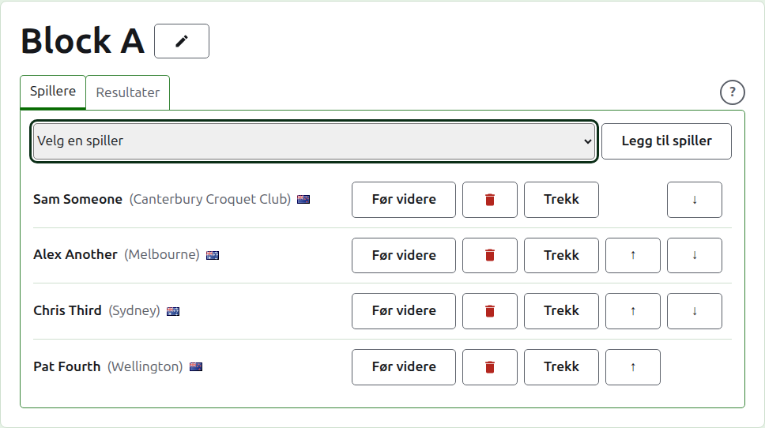
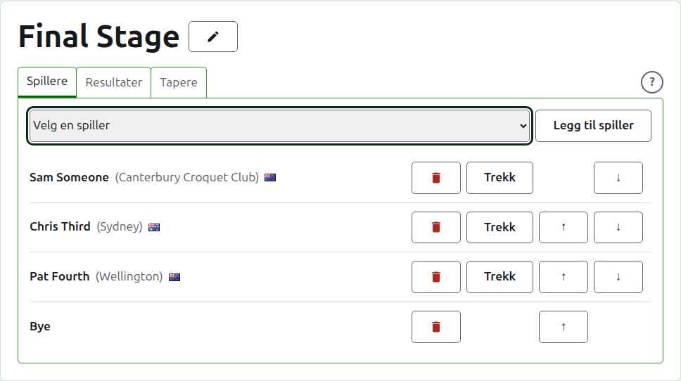
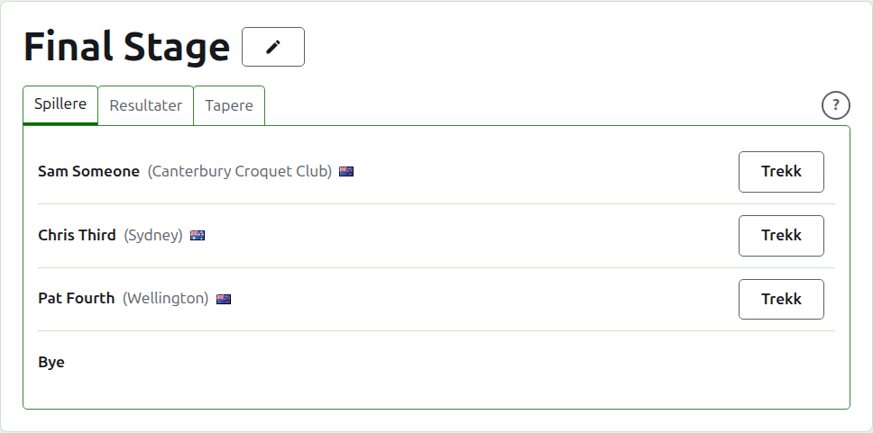
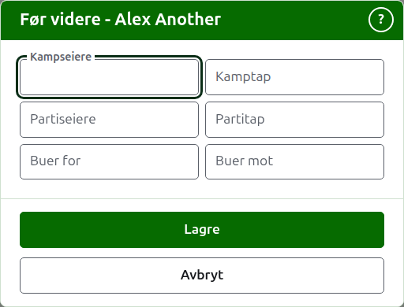
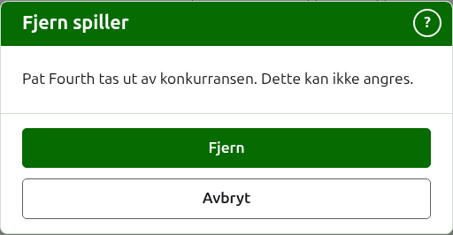
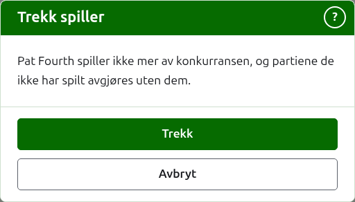
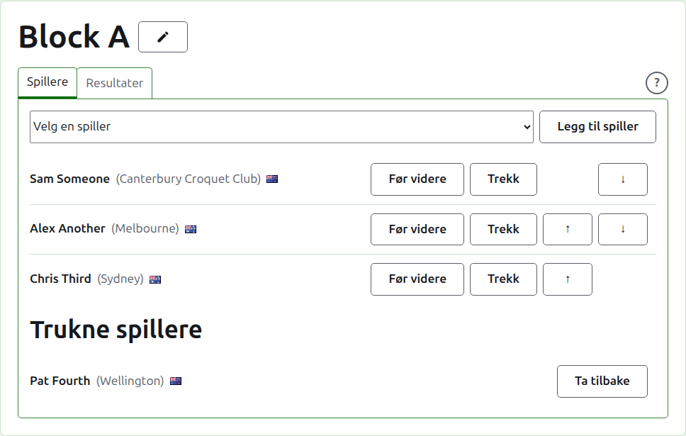

# Å melde spillere på en konkurranse

En konkurranses side åpnes fra navnet på fanen Konkurranser, eller fra den mørkegrønne linjen. Den har konkurransens navn som overskrift, med to faner under: **Spillere** og **Resultater**. En utslagning har en tredje, **Tapere**, som er beskrevet under [En taperutslagning](competitions.md#losers-knockout). Den åpner på Spillere, siden spillerne meldes på før noe spilles.

En spiller i en konkurranse er en av turneringens spillere, så de meldes på ved å velges heller enn å skrives inn. Alt om dem bortsett fra plassen deres i konkurransen, og det de fører videre inn i den, endres på turneringens fane Spillere.

## Å legge til en spiller

Over listen tilbyr en nedtrekksliste hver spiller i turneringen som ikke allerede er i konkurransen, i turneringens rekkefølge. Velg en og trykk på **Legg til spiller**. Spilleren settes inn i turneringens rekkefølge blant dem som allerede er lagt inn, nedtrekkslisten tilbyr dem ikke lenger, og markøren går tilbake til nedtrekkslisten slik at den neste kan velges fra tastaturet. Der hver spiller i turneringen er i konkurransen, vises ikke nedtrekkslisten, og fanen sier det.

Arkiverte spillere i turneringen tilbys ikke.

## Byes i en utslagning {#byes-in-a-knockout}

En utslagning spilles først når hver plass i trekningen er fylt, og plassene spillerne lar stå igjen, fylles med byes. Så i en utslagning tilbyr nedtrekkslisten **Bye** først, før spillerne, og fortsetter å tilby den uansett hvor mange byes som legges til, siden en trekning kan trenge flere.

En bye plasseres i trekningen som en spiller: den kan flyttes opp og ned og fjernes, men den kan ikke trekke seg, siden den ikke spiller noe. En spiller som meldes på i en utslagning der hver plass er fylt, avvises, og fanen sier det under nedtrekkslisten.

Rekkefølgen på en utslagnings spillere er trekningen. De to første plassene møtes i den første kampen, de neste to i den neste, og så videre. Sett spillerne i den rekkefølgen trekningen skal spilles i før noe resultat legges inn, siden spillerne er faste når utslagningen har et parti i bruk: ingen kan legges til, fjernes eller flyttes. En spiller kan fortsatt trekke seg.

## Spillerne i en taperutslagning

Spillerne i en taperutslagning meldes ikke på for hånd. De settes inn etter hvert som kampene hvis tapere den tar, avgjøres, så fanen **Spillere** bare lister dem, og sier hvorfor.

## Rekkefølge

Spillerne står i konkurransens rekkefølge, som er rekkefølgen en utslagning trekkes i og en blokk står i på sin offentlige side. **Opp** og **Ned** flytter en spiller ett sted.

## Å føre videre {#carry-forward}

**Før videre** sier hva en spiller tar med seg inn i en konkurranse fra spill som ikke ble ført her: resultatene fra et tidligere trinn, eller fra partier spilt før konkurransen ble ført her. Det tilbys i en blokk og en sveitsisk, som har tabeller for det å telle i, og ikke i en utslagning.

Dialogen spør om seks tall: kamper vunnet og tapt, partier vunnet og tapt, og buer for og mot. Hvert tall er valgfritt. Et tall som står tomt, fører ingenting videre, som ikke er det samme som å føre videre 0, slik at den som endrer det senere, ser det som det ble stående. Trykk på **Lagre** for å beholde alle seks.

## Å fjerne en spiller {#removing-a-player}

**Fjern** tar ut en spiller som er lagt inn ved en feil. De er fortsatt en av turneringens spillere, og tilbys igjen i nedtrekkslisten, men ingenting beholdes av plassen deres i konkurransen, så Fjern spør først.

En spiller som har et parti i bruk i konkurransen, kan ikke fjernes, siden partiene da ville være mot noen som ikke lenger er der, og tilbys ikke Fjern. En spiller hvis eneste partier er arkivert, kan fjernes, og de arkiverte resultatene deres går med dem.

## Å trekke en spiller {#withdrawing-a-player}

**Trekk** er for en spiller som ikke vil spille mer av konkurransen. De blir værende i den, med partiene de har spilt, og står under **Trukne spillere** etter dem som fortsatt spiller. I en utslagning går motstanderen deres videre i en kamp som ikke er avgjort ennå.

Trekk spør først, siden det endrer utfallet av konkurransen: partiene spilleren ikke har spilt, avgjøres uten dem.

En trukket spiller tilbyr bare **Ta tilbake**, som setter dem tilbake blant dem som spiller, etter dem som ble, uten å spørre.

Neste: [Resultater](scores.md).
