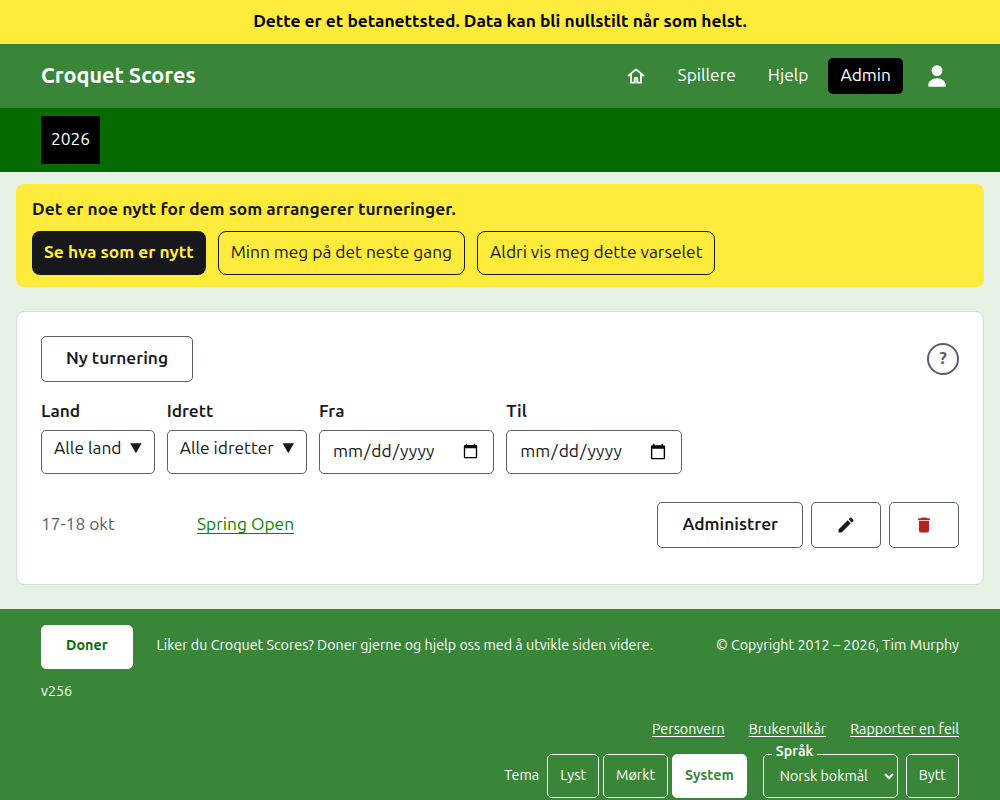
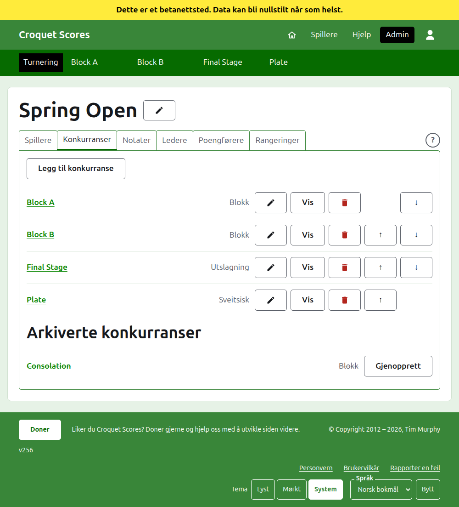

# Slik driver du en standardturnering

En standardturnering er en turnering spilt mellom spillere som meldes på én og én: en klubbhelg, en åpen turnering, et mesterskap. Spillerne settes inn i blokker, utslagninger og sveitsiske konkurranser, og resultatene legges inn etter hvert som partiene spilles. Denne veiledningen tar en leder fra innlogging til en turnering der resultatene er tilgjengelige for publikum.

Den står på egne ben. Ingenting i den avhenger av veiledningen for en turnering spilt av lag, som er skrevet for seg.

## Før du begynner

Du trenger en konto. Klikk [her](/account/register) for å registrere en konto.

Alt en leder gjør, gjøres i admin-delen av nettstedet. De offentlige sidene, der spillere og tilskuere følger turneringen, tegnes ut fra det admin holder, så ingenting må publiseres: et resultat som er lagt inn, står på de offentlige sidene med en gang.

## Sidene i rekkefølge

1. [Opprette en turnering](creating-a-tournament.md): navnet, dagene, idretten, hvor den spilles, og om den er et nasjonalt eller et internasjonalt arrangement.
2. [Spillere](players.md): å legge inn turneringens spillere, rette dem, og sette til side dem som er lagt inn ved en feil.
3. [Konkurranser](competitions.md): å legge til blokker, utslagninger og sveitsiske konkurranser, og sette dem i rekkefølge.
4. [Å melde spillere på en konkurranse](entering-players-in-a-competition.md): hvem som spiller i hver konkurranse, byes i en utslagning, å føre videre, fjerne og trekke.
5. [Resultater](scores.md): å legge inn resultater, rette dem, og sette til side dem som er lagt inn ved en feil.
6. [Notater](notes.md): å fortelle spillerne det de trenger å vite mens turneringen pågår.
7. [Ledere og poengførere](managers-and-scorers.md): å dele på driften av turneringen, og la noen legge inn resultater uten å kunne endre noe annet.
8. [Rangeringer](rankings.md): filen verdensrangeringene sendes, og det som gjenstår for deg å fylle ut.
9. [Å endre, arkivere og gjenopprette en turnering](changing-and-archiving.md): å rette turneringens detaljer, og sette en turnering til side.
10. [Hva publikum ser](what-the-public-sees.md): sidene spillerne dine følger, og hvordan det du legger inn vises på dem.

## Hvordan admin er lagt opp

Admins inngangsside viser turneringene du har en rolle i, ett år om gangen.

Å trykke på en turnerings navn, eller **Administrer**, åpner siden dens. Alt som skal drives, ligger i seks faner under navnet: **Spillere**, **Konkurranser**, **Notater**, **Ledere**, **Poengførere** og **Rangeringer**. Siden åpner på Spillere, siden spillerne er det første som legges inn. Ytterst i raden av faner, og i tittellinjen på en dialog, er et rundt **?** som åpner hjelpen for det du ser på, i en annen fane slik at du beholder plassen din. Det er ett ved siden av **Ny turnering** også.

Den mørkegrønne linjen under toppen er til for å bevege seg mellom sider. Den fører til turneringen, som **Turnering**, og til hver av konkurransene med navn, slik at du kan gå fra turneringen til en konkurranse og mellom konkurranser uten å gå tilbake gjennom fanen Konkurranser. Siden du er på, er markert med svart.

## Ting som gjelder overalt

**Ingenting slettes helt, bortsett fra et notat.** Spillere, konkurranser, resultater og selve turneringen arkiveres heller enn slettes: satt til side, strøket over, og oppført under en egen overskrift, med **Gjenopprett** for å hente dem tilbake. Å arkivere, gjenopprette og flytte opp og ned ber deg aldri om bekreftelse, fordi hver av dem angres ved å trykke den andre veien. Det som ikke kan angres, som å fjerne en spiller fra en konkurranse eller slette et notat, spør først.

**En dialog over siden beholder ingenting før du trykker på knappen dens.** Avbryt, eller Escape-tasten, lukker den og lar alt stå som det var. Dialoger som legger til ting, som Legg til spiller og Legg til resultat, blir stående åpne etter hver gang noe er lagt til, slik at en liste kan skrives inn én etter én.

**Det som avvises, sies ved siden av feltet det gjelder.** Ingenting som avvises, beholdes, og det du skrev, blir stående, slik at det kan rettes heller enn skrives på nytt.

**Admin fungerer på en telefon.** Hver knapp er stor nok til å trykkes med tommelen, og ingenting er bredere enn skjermen.

Neste: [Opprette en turnering](creating-a-tournament.md).
