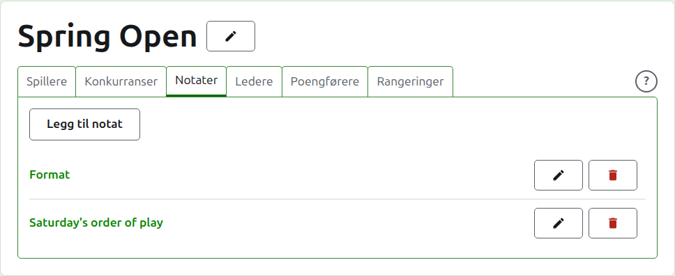
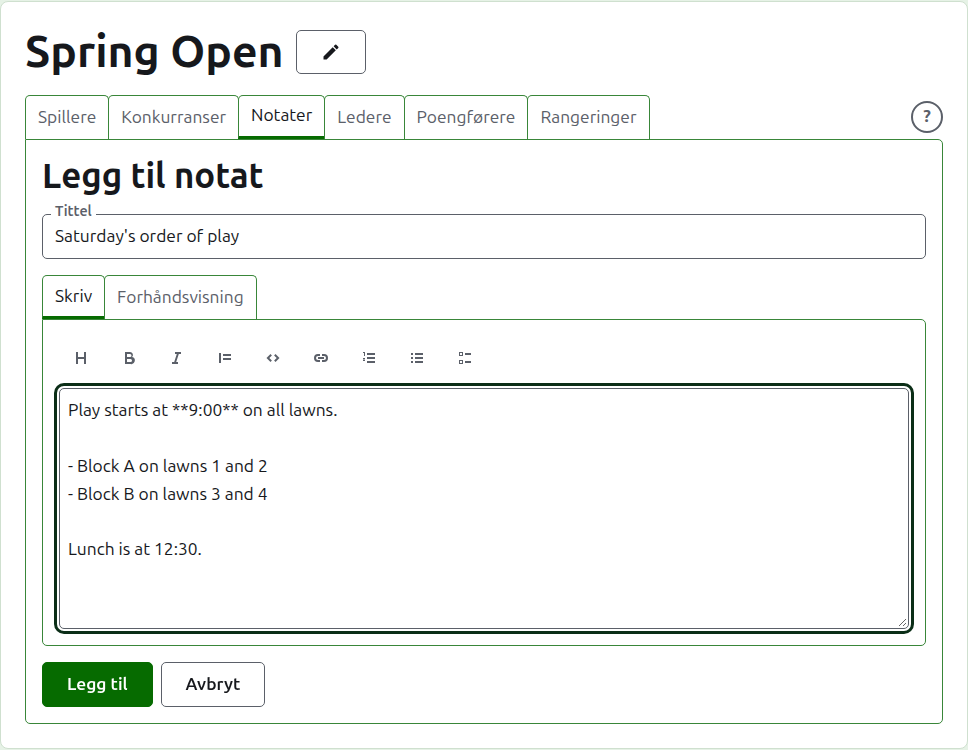
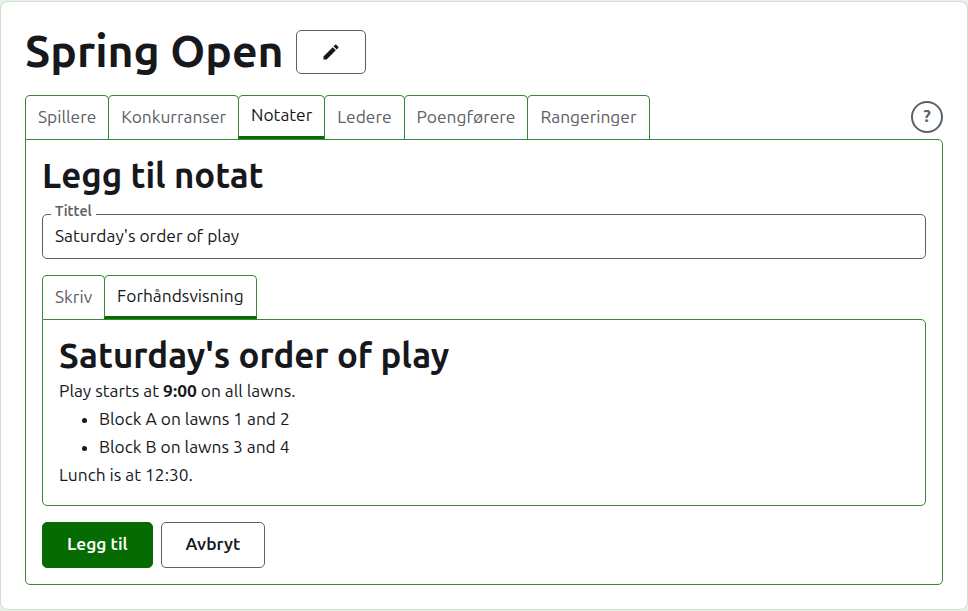
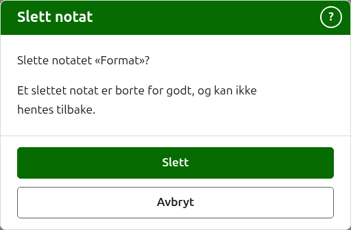

# Notater

Fanen **Notater** på en turnerings side er der lederne skriver det spillerne trenger å vite mens turneringen pågår: formatet, en endring i spilleorden, tidspunktet for lunsj. Leserne finner dem på turneringens offentlige Notater-side, med overskriften Lederens notater, og et notat de ikke har lest, er markert der med en rød stjerne, som også markerer avsnittet Notater på hver side i turneringen til de åpner det.

## Å skrive et notat

Trykk på **Legg til notat**, over listen. Et panel tar listens plass, siden et notat skrives i lengden og trenger plassen.

**Tittel** er påkrevd, og er det notatet står oppført under. Den er ren tekst.

**Beskrivelse** skrives i Markdown og kan stå tom der tittelen sier alt som skal sies. Verktøylinjen over boksen skriver Markdown for deg: Overskrift, Fet, Kursiv, Sitat, Kode, Lenke, Nummerert liste, Punktliste og Oppgaveliste. Hver virker på det som er markert, eller først på hver markert linje, eller setter markøren der ordene skal stå.

En blank linje mellom to avsnitt skiller dem, og en leser ser en full blank linje mellom dem. **Forhåndsvisning** viser notatet slik en leser vil se det på siden sin.

Trykk på **Legg til**. Notatet beholdes, listen kommer tilbake med det øverst, og det står på den offentlige Notater-siden med en gang.

## Å redigere et notat

Trykk på et notats tittel, eller **Rediger** for det, for å åpne panelet på notatet. Trykk på **Lagre** for å beholde endringen. Et notat som er redigert siden en leser leste det, markeres for dem igjen.

## Å slette et notat {#deleting-a-note}

Et notat som ikke lenger gjelder, slettes. Et slettet notat er borte for godt, så **Slett** spør først.

Neste: [Ledere og poengførere](managers-and-scorers.md).
