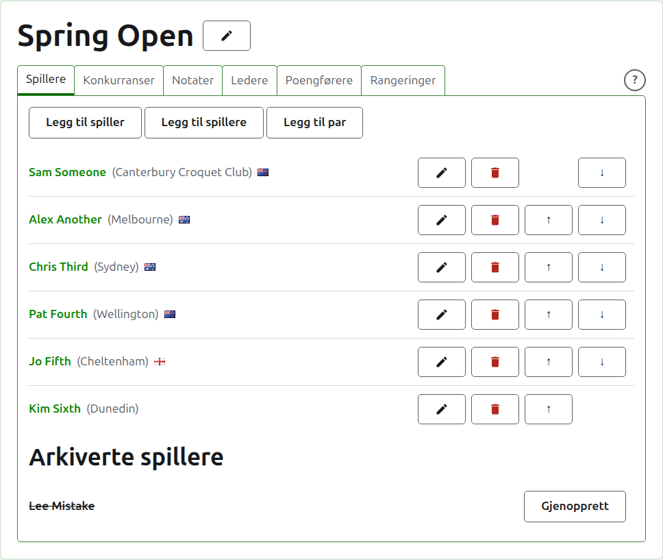
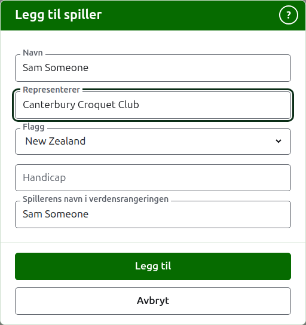
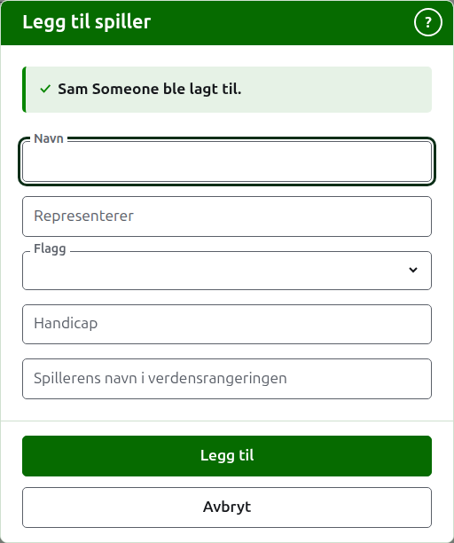
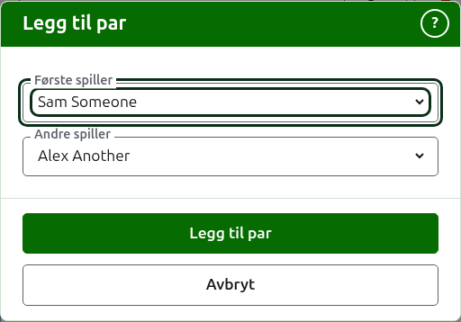
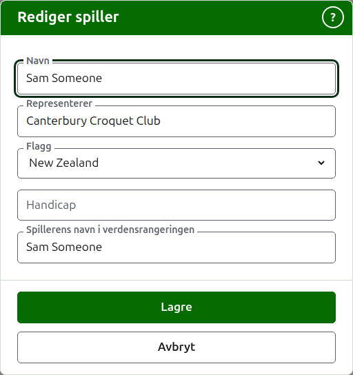
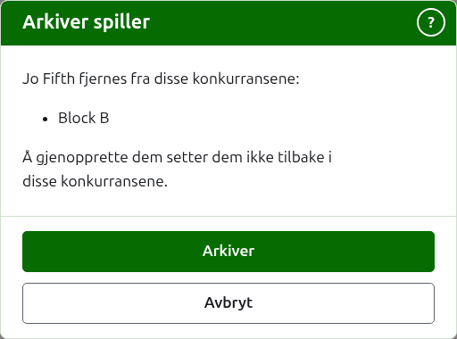

# Spillere

Fanen **Spillere** på en turnerings side er der spillerne legges inn, rettes, settes i rekkefølge og settes til side. Det er fanen siden åpner på, siden å legge inn spillerne er det første som gjøres med en turnering.

Spillere legges inn her én gang, i turneringen. Hvilke konkurranser hver enkelt spiller i, velges etterpå, på hver konkurranses egen side, blant spillerne som er lagt inn her. Se [Å melde spillere på en konkurranse](entering-players-in-a-competition.md).



## Legg til en spiller {#add-a-player}

Trykk på **Legg til spiller**, over listen. En dialog åpnes over siden.



**Navn** er påkrevd. Det er spillerens navn slik det vises på hver side, mellom 3 og 254 tegn. To spillere i én turnering kan ikke ha samme navn, uansett hvordan det skrives med store og små bokstaver; der to spillere virkelig har samme navn, skille dem fra hverandre i selve navnet, som «Andrew Hobbs (2)».

**Representerer** er det spilleren spiller for, skrevet slik en leser ville sagt det: en klubb, en region eller et land, som «Canterbury Croquet Club». Det vises i parentes etter navnet. Det kan stå tomt. Mens du skriver, tilbys det spillere i en hvilken som helst turnering på nettstedet er lagt til som representerende, der et ord i det begynner med det du skrev, slik at en klubb skrives slik den er skrevet før; tabulatortasten tar den som vises etter markøren.

**Flagg** er flagget som vises ved siden av spillerens navn. Det er en nedtrekksliste over stedene med navn, ingen først, så stedene de fleste turneringer spilles i; skriv begynnelsen av et navn for å hoppe til det. Det kan stå på ingen, som de fleste spillere har. Det en spiller representerer og hvilket flagg de fører, holdes fra hverandre, siden en spiller kan spille for en klubb i ett land og føre flagget til et annet.

**Handicap** er spillerens handicap, hvis de har ett: et fortegn, opptil to sifre og en brøk på ett siffer, som 4, +4 eller -1.5. Det beholdes slik du skriver det, og vises i parentes sammen med det spilleren representerer, etter det. Det kan stå tomt.

**Spillerens navn i verdensrangeringen** er navnet verdensrangeringene kjenner spilleren under. Det spørres det bare om i en turnering i Association croquet eller Golfcroquet, de to idrettene verdensrangeringene fører en spillerliste for. Spillerne i Amerikansk 6-buers croquet er kjent for rangeringene under sine egne navn, så det spørres ikke om der, og hver spillers verdensrangeringsnavn er alltid navnet deres. Mens du legger til en spiller, følger det navnet mens du skriver det, siden de fleste spillere er kjent for rangeringene under sitt eget navn, og slutter å følge når du skriver i det. Står det tomt, beholdes det som spillerens navn.

Mens du skriver et navn, tilbys spillerne verdensrangeringene kjenner med navn som begynner slik, slik at du kan ta et navn slik rangeringene staver det heller enn å skrive det ut. Ved siden av verdensrangeringsnavnet sier et hakemerke at rangeringene kjenner navnet, og et spørsmålstegn at de ikke gjør det: navnet kan være feilstavet, eller spilleren kan være ny i rangeringene. Det er bare et råd. Et navn rangeringene ikke kjenner, beholdes like gjerne som et de kjenner.

Trykk på **Legg til**. Spilleren legges til, dialogen sier fra om det, og feltene tømmes for neste spiller, med markøren tilbake i navnet. Legg til hele listen på denne måten, og trykk deretter på **Avbryt** for å lukke dialogen. Avbryt beholder ikke noe som ikke allerede er lagt til.



En spiller heter aldri «Bye». En utslagnings byes legges til i selve utslagningen, uansett hvor spillerne meldes på, så et navn som er «Bye», eller «Bye» med et tall, som «Bye 2», «Bye-2» eller «Bye (2)», avvises, og dialogen forklarer hvorfor. Det er det engelske ordet «Bye» som avvises, uansett språk.

## Å legge til flere spillere {#adding-multiple-players}

For å legge til en hel liste på én gang, trykk på **Legg til spillere**, ved siden av **Legg til spiller**. En dialog åpnes over siden med én boks, som tar flere linjer tekst. Du kan kopiere listen fra et regneark og lime den inn i boksen.

**Den første linjen navngir feltene** (en liste hvis første linje ikke navngir noen, avvises, med «First row must be field names»), atskilt med komma eller tabulatorer: **Name**, og hvilke som helst av **Representing**, **Flag**, **Handicap** og **WorldRankingPlayerName**, i vilkårlig rekkefølge. Disse navnene skrives på engelsk, uansett hvilket språk nettstedet er på. **Name** må være ett av dem. **Hver linje etter den er en spiller**, med en verdi for hvert felt i samme rekkefølge, atskilt på samme måte. En spiller uten noe for et felt lar det stå tomt, men beholder kommaet eller tabulatoren. For eksempel, med komma:

```
Name,Representing,Flag
Sam Someone,Canterbury Croquet Club,New Zealand
Alex Another,,England
```

- **Name, Representing og WorldRankingPlayerName** holdes til de samme reglene som når du legger til én spiller (se [Legg til en spiller](players.md#add-a-player)). Et navn er mellom 3 og 254 tegn, er ikke allerede i turneringen, uansett hvordan det skrives med store og små bokstaver, og er ikke «Bye».
- **Flag** er navnet på landet eller stedet, på ditt språk, slik listen i dialogen Legg til spiller tilbyr det, som Norge.
- **Handicap** er et fortegn, opptil to sifre og en brøk på ett siffer, som 4, +4 eller -1.5.
- En spiller uten **WorldRankingPlayerName** er kjent under navnet sitt, slik de er når de legges til én og én.
- **Komma eller tabulatorer.** Celler kopiert fra et regneark er atskilt med tabulatorer, og en liste skrevet for hånd er vanligvis atskilt med komma. Begge deler fungerer. Hvis den første linjen har en tabulator i seg, leses hele listen med tabulatorer, og ellers med komma.
- En verdi med skilletegnet i seg skrives i doble anførselstegn, slik et regneark skriver den: «Smith, John» i en liste atskilt med komma. Et anførselstegn inni en verdi skrives to ganger.
- Hver verdi får mellomrommene i endene fjernet, og en linje uten noe på seg overses.
- En liste kan ha høyst 500 spillere. Legg til resten i en annen liste.

Trykk på **Legg til**. Hele listen sjekkes før noe av den beholdes, så en liste med noe galt i seg legger til ingen. Det som er galt, sies under boksen, på linjen det står på, og den første linjen regnes som linje 1. Hver feil står i listen, ikke bare den første, og det du skrev, blir stående slik at du kan rette det. Når listen er beholdt, lukkes dialogen og fanen Spillere viser de nye spillerne, i den rekkefølgen du skrev dem. I motsetning til **Legg til spiller**, som blir åpen for neste spiller, er det ingen neste: listen var neste.

**?** i dialogens tittellinje fører hit. Både denne dialogen og Legg til spiller blir stående i vinduet uansett hvor siden er rullet til.

## Å legge til et par {#adding-a-pair}

I en dobbeltturnering er et par en spiller for seg. Det finnes to måter å legge til et på.

- **Med Legg til spiller.** Legg til paret som om det var én spiller, og skriv navnet med et og-tegn mellom de to, som «Joe Blow & Jane Doe». I en turnering bare for dobbel er dette den raskeste måten, siden ingen legges inn to ganger.
- **Med Legg til par.** Lag paret av to spillere som allerede er lagt inn, slik det er beskrevet under. Hvis de fleste av singelspillerne dine også spiller dobbel, er dette den raskeste måten, siden spillerne allerede er der å velge mellom.

Det er bedre å holde singel og dobbel i hver sin turnering.

Trykk på **Legg til par**, ved siden av **Legg til spiller**. Den tilbys der det er to spillere å velge mellom. En dialog åpnes med **Første spiller** og **Andre spiller**, hver valgt blant spillerne i bruk. Den andre listen utelater spilleren som ble valgt først, siden en spiller ikke kan pares med seg selv. Trykk på **Legg til par** for å lage paret. Dialogen blir stående åpen, sier hvilket par som ble lagt til, og tømmer begge valgene slik at neste par kan lages, slik **Legg til spiller** gjør. Paret vises med én gang i listen bak dialogen. Trykk på **Avbryt** når du har laget alle du trenger.



Paret får navn etter de to spillerne, i den rekkefølgen du valgte dem: «Sam Someone & Alex Another». Der begge har samme etternavn, får det de to fornavnene og det ene etternavnet: «Peter & Rosie Landrebe». Etternavnet er det siste ordet i et navn, sammen med de små ordene foran det (som i «van der Berg») og en generasjon etter det (som i «Smith Jr»). En generasjon alene er ikke et etternavn.

Paret representerer det spillerne representerer. Der bare én av dem representerer noe, representerer paret det. Der begge representerer det samme, representerer paret det én gang. Der de representerer ulike ting, representerer paret begge, den første og så den andre, som «Canterbury Croquet Club / Melbourne».

De to spillerne blir som de er, og kan fortsatt legges inn i egne konkurranser. Ingenting knytter paret til dem etterpå: hvis du retter eller arkiverer en av dem, beholder paret navnet og representasjonen det ble laget med, og rettes for seg. Paret listes sammen med de andre spillerne, legges inn i konkurranser som hver av dem og rettes eller arkiveres som hver av dem. Et par med et navn turneringen allerede har, avvises: de samme to spillerne i samme rekkefølge kan ikke gjøres til et par to ganger. De samme to i omvendt rekkefølge er et annet navn og et annet par.

## Å rette en spiller {#correcting-a-player}

Trykk på en spillers navn, eller **Rediger** for dem, for å åpne den samme dialogen på spilleren, med tittelen Rediger spiller. Endre det som er galt og trykk på **Lagre**, som beholder endringen og lukker dialogen. En spiller hvis navn rettes, beholder verdensrangeringsnavnet de hadde, siden rangeringene fortsatt kjenner dem under det. I Amerikansk 6-buers croquet er en spillers verdensrangeringsnavn alltid navnet deres, så å rette navnet retter det også.



En spiller som rettes her, rettes overalt: i hver konkurranse de er med i, og på hver offentlig side.

## Å sette spillerne i rekkefølge

Spillerne står i turneringens rekkefølge, som er rekkefølgen de tilbys i når de meldes på konkurranser, og rekkefølgen en utslagning trekkes i. **Opp** og **Ned**, pilene ytterst i hver rad, flytter en spiller ett sted. Den første spilleren tilbys ikke Opp, og den siste tilbys ikke Ned.

## Å arkivere en spiller {#archiving-a-player}

**Arkiver** setter en spiller til side: lagt inn ved en feil, eller trukket fra hele turneringen. En arkivert spiller står under **Arkiverte spillere**, strøket over, etter spillerne som er i bruk, og tilbyr bare **Gjenopprett**. En arkivert spiller er ikke med i noen konkurranse og vises på ingen offentlig side.

En spiller som har spilt et parti, kan ikke arkiveres, siden partiene da ville være mot noen som ikke lenger er der, så en slik spiller tilbys ikke Arkiver. En spiller hvis eneste partier er arkivert, kan arkiveres.

Å arkivere en spiller som ikke er med i noen konkurranse, spør ikke først, siden å gjenopprette dem setter alt tilbake. Å arkivere en spiller som er med i en konkurranse, spør først, fordi arkivering fjerner dem fra hver konkurranse de er med i, og å gjenopprette dem setter dem ikke tilbake.



Neste: [Konkurranser](competitions.md).
