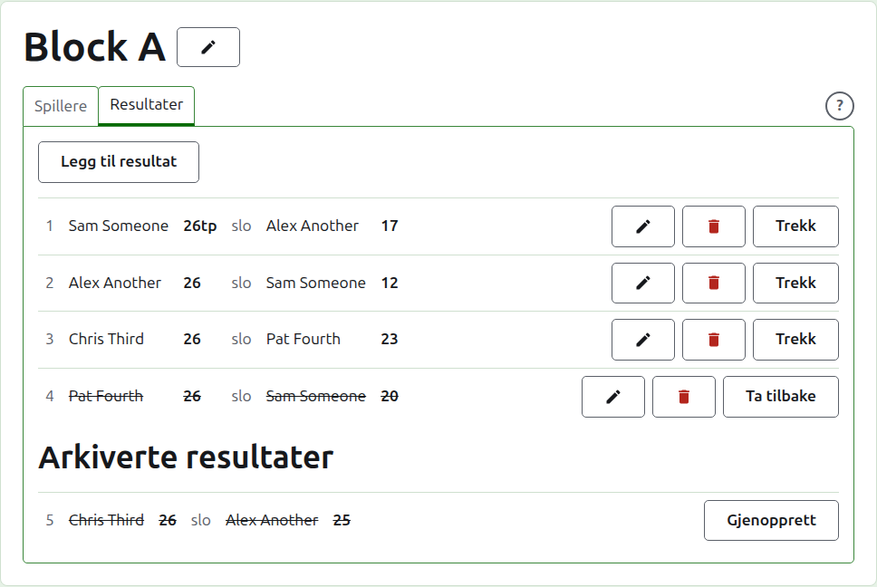
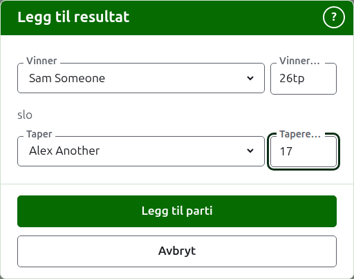
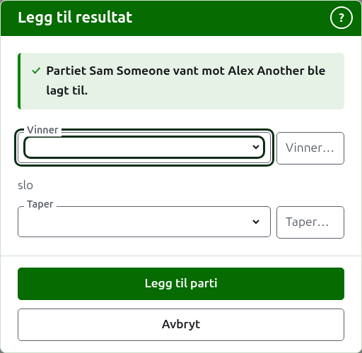
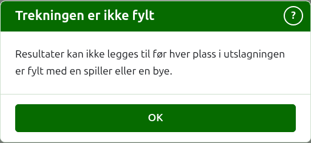
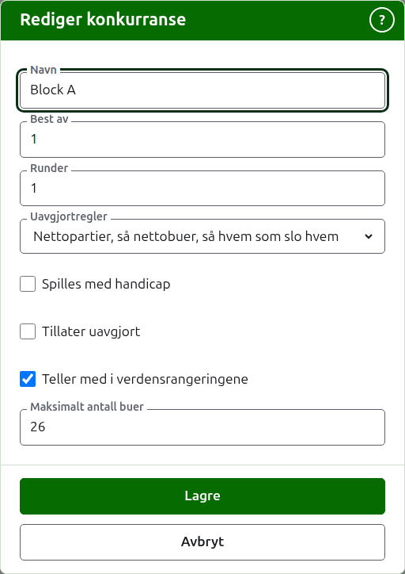

# Resultater

Fanen **Resultater** på en konkurranses side er der partiene legges inn, rettes og settes til side. En poengfører ser bare denne fanen, og kan gjøre alt på den som en leder kan.

## Å legge inn et resultat {#entering-a-score}

Trykk på **Legg til resultat**, over listen. Dialogen leses som et resultat sies høyt: vinneren og poengsummen deres, så «slo», så taperen og poengsummen deres.

Vinneren og taperen velges hver for seg blant konkurransens spillere som spiller, i konkurransens rekkefølge. Ingen er valgt til å begynne med, slik at et parti aldri føres opp mot en spiller du ikke valgte. I en utslagning velger valget av vinneren hvem de er trukket mot som taper, der du kan se det og velge en annen.

Et resultat skrives slik poengføreren skrev det ned: antallet poeng, og det som følger, som beholdes og vises slik det er skrevet, som «26tp» for 26 buer og en trippel peel. Tallet er sifrene resultatet begynner med; et resultat som ikke begynner med et siffer, avvises.

Et parti vunnet på like poeng, som når det stoppes av tiden og avgjøres på en annen måte, sier hvem som vant med et merke etter vinnerens poengsum: «6w» slo «6». På Croquet Scores er merkene «w», «won» og «winner»; Gateball Scores tar «cb» og «so» også. Det er de engelske ordene nettstedet kjenner igjen. En vinners poengsum må være høyere enn taperens, eller merket, med mindre turneringen tillater uavgjort, og da beholdes like poeng uten merke som uavgjort.

Trykk på **Legg til parti**. Partiet legges til, dialogen sier hvilket, og feltene tømmes for neste, siden resultater kommer i en bunke avlest fra en tavle på slutten av en runde. Trykk på **Avbryt** når alle er inne.

Hvis dialogen ikke kan lese konkurransens spillere, sier den «Spillerne kunne ikke leses. Lukk denne dialogen og åpne den igjen.» Gjør det.

Det som avvises, sies under feltet det gjelder: en vinner eller taper som ikke er valgt, et resultat som ikke er skrevet eller ikke begynner med et siffer, den samme spilleren som begge, en taperens poengsum merket som vunnet, eller en vinners poengsum bak taperens. I en utslagning avvises to spillere som ikke er trukket til å møtes, over feltene.

## En utslagnings trekning må fylles først {#draw-filled-first}

En utslagning spilles først når hver plass i trekningen har en spiller eller en bye. Til da forklarer Legg til resultat hvorfor resultater ikke kan legges til, heller enn å åpne dialogen.

## Listen over resultater

Resultatene i bruk står i den rekkefølgen de ble lagt inn, eldst først, slik at listen leses som konkurransen ble spilt. Listen er en tabell med en rad for hvert parti, og uten kolonneoverskrifter. En rad sier partiets nummer, vinneren og poengsummen deres, ordet «slo», så taperen og poengsummen deres, og tilbyr **Rediger** og **Arkiver**.

Et partis nummer er plassen blant partiene som er lagt inn, det første er 1, og arkiverte partier regnes med. Å arkivere et parti endrer ikke noen annens nummer, så et hull i numrene sier at et parti er arkivert.

## Å rette et resultat {#correcting-a-score}

**Rediger** åpner den samme dialogen på resultatet, med tittelen Rediger resultat, med spillerne valgt og poengsummene slik de ble skrevet. Trykk på **Lagre** for å beholde rettelsen og lukke dialogen.

En rettelse beholder resultatet: et vunnet parti forblir vunnet, og et uavgjort parti forblir uavgjort. Et parti hvis resultat var feil, arkiveres og legges inn på nytt.

Der et resultat kunne arkiveres, kan spillerne endres så vel som poengsummene. I en utslagning beholder et resultat hvis vinner allerede har spilt i neste runde, spillerne sine, siden å endre hvem som vant det ville la det neste partiet spilles av noen som ikke var kommet dit; bare poengsummene kan rettes.

## Å arkivere et resultat

**Arkiver** setter et resultat til side slik at det ikke teller for noe. Det står under **Arkiverte resultater**, strøket over, og tilbyr bare **Gjenopprett**. Ingen av dem spør først, siden hver angrer den andre.

I en utslagning går vinneren av en kamp videre til neste runde, så et resultat for en kamp hvis vinner har spilt i neste runde, tilbys ikke Arkiver. Partiet i neste runde arkiveres først, og så kan de før det. Der en runde er best av 3 eller 5, holdes hvert parti i kampen på samme måte. En blokk og en sveitsisk har ingen runder som avhenger av hverandre, så hvert resultat i dem kan arkiveres.

## Å trekke et resultat

En spiller som forlater en konkurranse, trekkes vanligvis fra den, på fanen Spillere, og det er alt som trengs: de spiller ikke mer, og partiene de spilte, står, men partiene deres teller ikke lenger med i seire/tap og buer. Å trekke et resultat er for det sjeldnere tilfellet der et parti som ble spilt, ikke skal telle. I Australian President's Eights, for eksempel, står den første rundens resultater når en spiller trekker seg, og bare andre runde-partiene deres tas ut av regnestykket: trekk de partiene.

I en blokk eller en sveitsisk trekkes et resultat som ble spilt, men ikke skal telle, heller enn arkiveres. **Trekk** beholder det blant resultatene i bruk, på plassen sin, men strøket over og uten å telle for noe på de offentlige sidene. **Ta tilbake** lar det telle igjen. Ingen av dem spør først. En utslagnings resultater tilbys ikke Trekk, siden et resultat der avgjør mer enn tabellen.

Neste: [Notater](notes.md).
