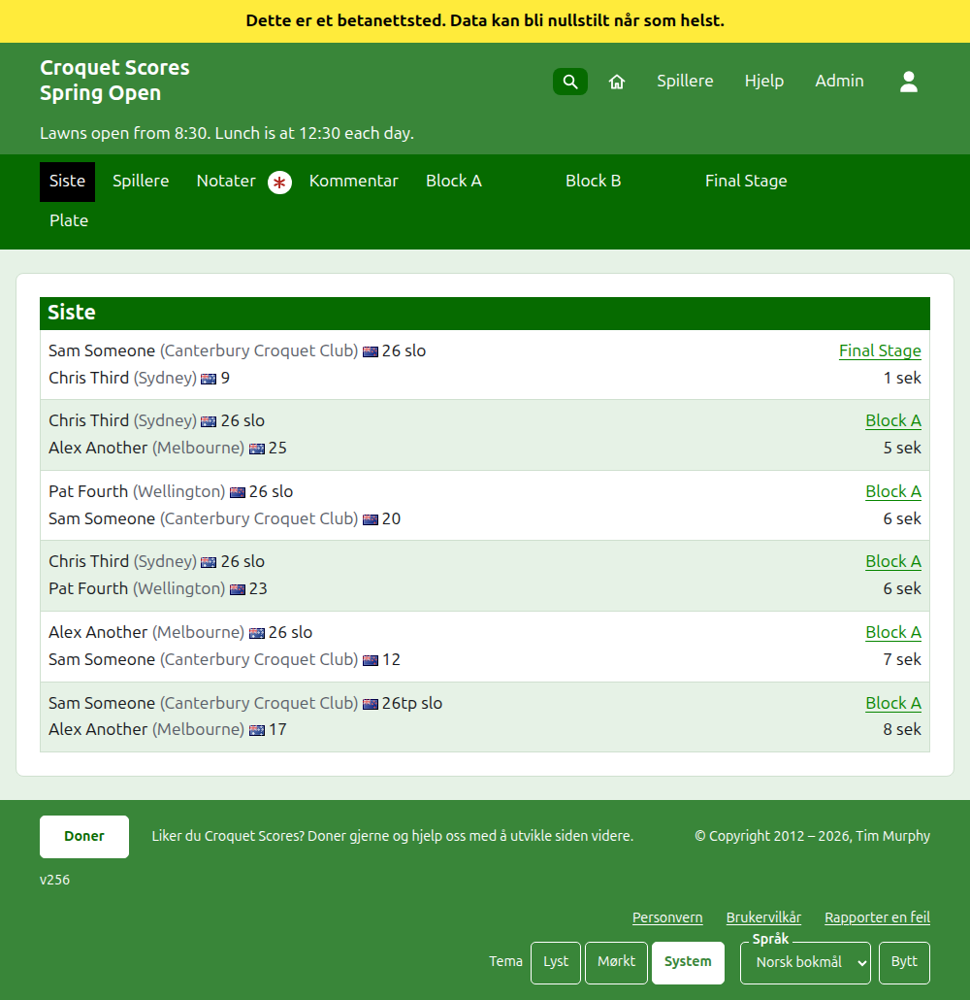
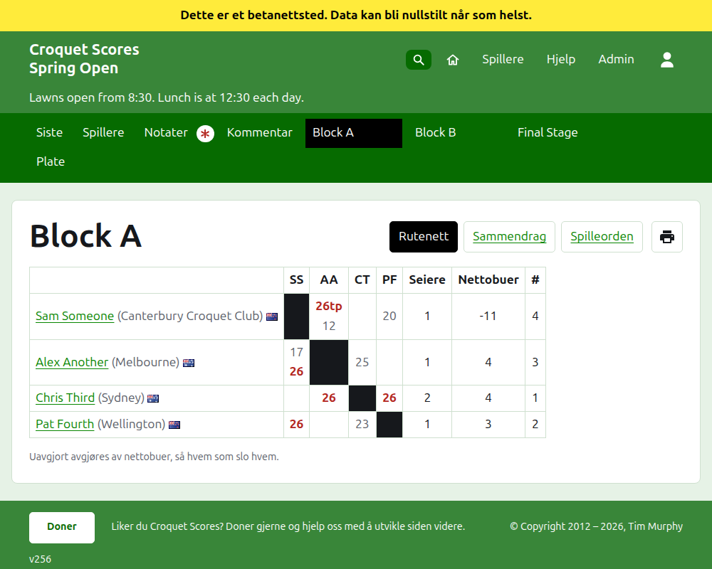
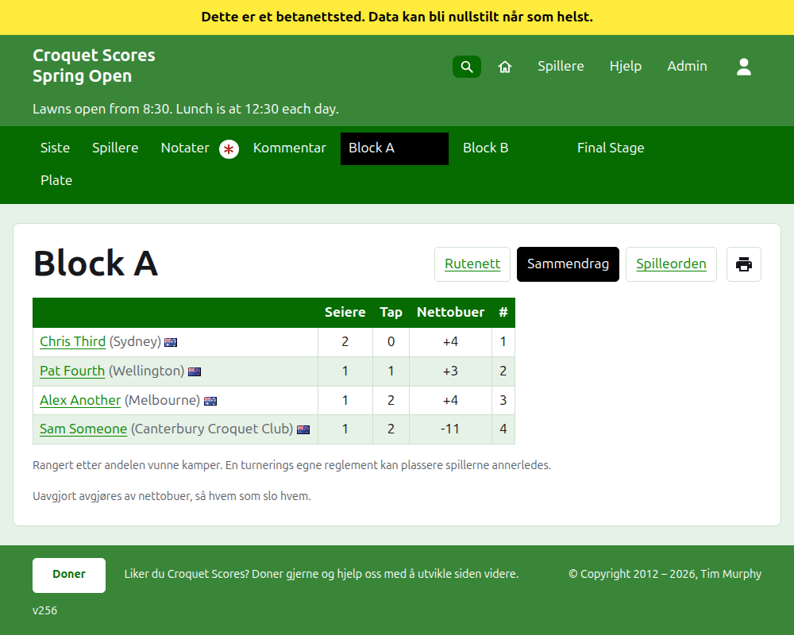
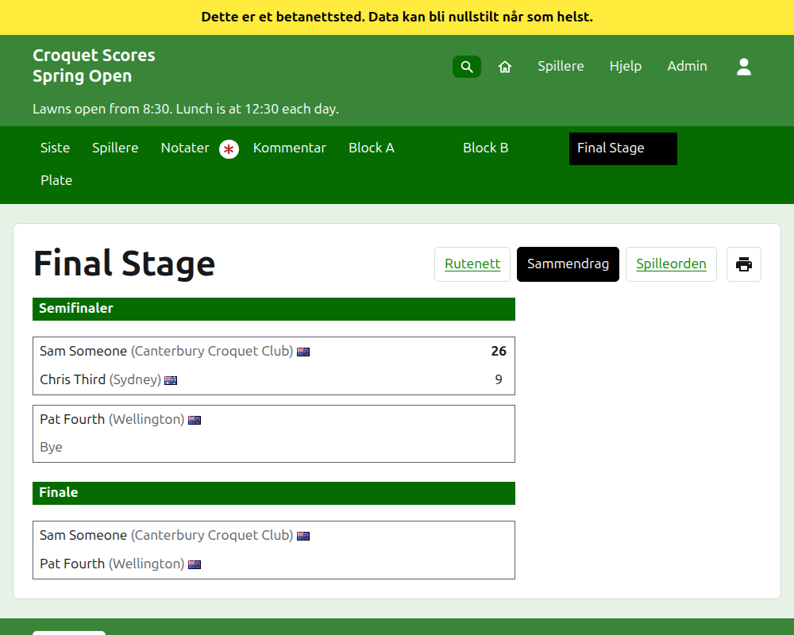
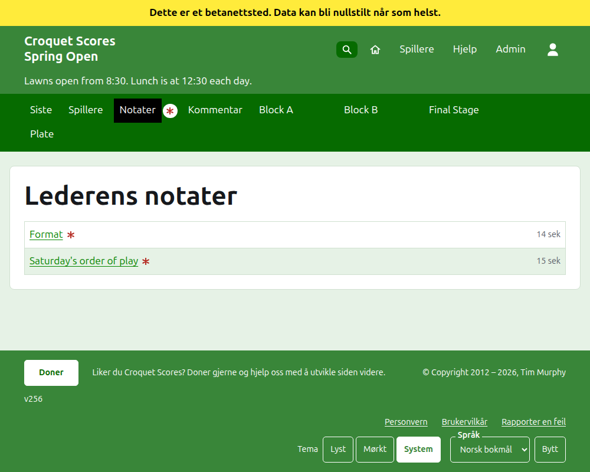

# Hva publikum ser

Ingenting publiseres: de offentlige sidene tegnes ut fra det admin holder, så et resultat som er lagt inn, står på dem med en gang. De trenger ingen konto og ingen skripting, og er lagt opp for en telefon.

## Turneringens side

Turneringens side ligger på året, idretten og navnet, som `/2026/ac/spring-open`. Den har turneringens navn som overskrift, med undertittelen under. Den viser hvert parti i bruk, det sist tilføyde først, slik at en leser som kommer tilbake, ser hva som har skjedd siden. Hvert parti sier vinneren, handicapet deres og det de representerer, flagget og resultatet deres, så taperen og deres, med konkurransen det ble spilt i og hvor lenge siden det ble lagt til.

Den mørkegrønne linjen tilbyr turneringens avsnitt: **Siste**, som er denne siden, **Spillere**, **Notater** og **Kommentar**, så hver konkurranse i bruk, i den rekkefølgen fanen Konkurranser har dem. Notater er markert med en rød stjerne så lenge det er et notat leseren ikke har lest.

## En blokk

En blokks side viser resultatene som et rutenett: en rad og en kolonne for hver spiller i blokkens rekkefølge, med partiene mellom to spillere der raden møter kolonnen, hvert merket som vunnet, tapt eller uavgjort for radens spiller. Etter spillernes kolonner kommer hver spillers summer. Der hver kamp er ett enkelt parti, er de seire og nettobuer; der en kamp er best av mer enn ett, er de kamper, nettopartier, partier og nettobuer. Den siste kolonnen, med overskriften **#**, er hver spillers plassering: 1 for den første, og =2 der spillere ikke kan skilles og deler andreplassen. Der noen spillere har vunnet samme andel av kampene sine, sier en linje under rutenettet hvordan de skilles, slik blokkens uavgjortregler har det (se Konkurranser).

En blokk, en utslagning og en sveitsisk vises hver på tre måter, tilbudt på linjen med konkurransens navn: **Rutenett**, **Sammendrag** og **Spilleorden**. Ved siden av dem er en skriverknapp, som skriver ut turneringens navn, konkurransens navn og resultatene dens, og ingenting annet. Sammendraget er det for en telefon: for en blokk, spillerne rangert, med seire, tap, nettobuer og plassering; for en utslagning, kampene oppført runde for runde; for en sveitsisk, rutenettets tabell uten resultatene. Spilleorden viser hvert parti, eldst først til å begynne med. Den har overskriftene **Parti** og **Dato**: å trykke på **Parti** sorterer partiene etter vinnerens navn og så taperens, og å trykke på **Dato** sorterer dem eldst eller nyest først, og å trykke på overskriften en liste er sortert etter, snur den. Måten en leser sorterte på, huskes på enheten deres. En leser som velger en visning, beholder den for hver konkurranse til de velger en annen.

En konkurranse spilt til et annet antall buer enn det vanlige for idretten, sier det under navnet sitt, som «Spilt til 14 buer» (se [Konkurranser](competitions.md#adding-a-competition)).

En trukket spillers rad sier det. Et trukket resultat vises strøket over og teller for ingenting. Et arkivert resultat vises ikke.

## En utslagning

En utslagnings side tegner trekningen runde for runde, en kolonne for hver runde fra den første til finalen, med hver kamps to sider over hverandre og en celle for hvert parti kampen er best av. En senere runde sin kamp står ved siden av de to kampene hvis vinnere den er mellom. På en telefon ruller trekningen sidelengs, med piler til finalen og tilbake.

## En sveitsisk

En sveitsisks side rangerer spillerne i en tabell: partiene deres, seirene deres, seiersprosenten deres og resultatene deres, hvert sagt som motstanderen og marginen, som «+4» for et parti vunnet med fire.

## Spillere

Siden Spillere viser hver spiller i turneringen som ikke er arkivert, i alfabetisk rekkefølge, med handicapet og det de representerer i parentes, og flagget.

## Notater

Siden Notater, med overskriften Lederens notater, viser turneringens notater, det sist skrevne først, hvert med en lenke til sin egen side og en angivelse av hvor lenge siden det ble skrevet. Et notat leseren ikke har lest, er markert med en rød stjerne til de åpner det. En turnering uten notater sier «Ingen notater ennå.»

## Hvor turneringen står oppført

En turnering står på hjemmesiden mens den spilles eller like før den starter. Årets side, som `/2026`, viser årets måneder, som hver, når den er trykket på, viser turneringene som starter i den. En kontroll under overskriften, **Vis alle** og så **Skjul alle**, åpner eller lukker hver måned. En turnering som er avkrysset som nasjonal eller internasjonal, settes med fet skrift langs raden.

## Adresser som flyttes

En turnering beholder adressen sin når navnet rettes. Der den flyttes, fordi året eller idretten endret seg, fører den gamle adressen til den nye, slik at en lenke beholdt fra før fortsatt fungerer. En arkivert turnerings sider finnes ikke før den gjenopprettes.
