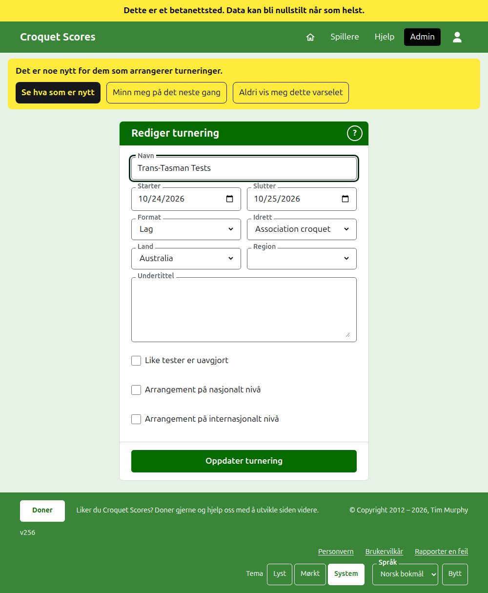
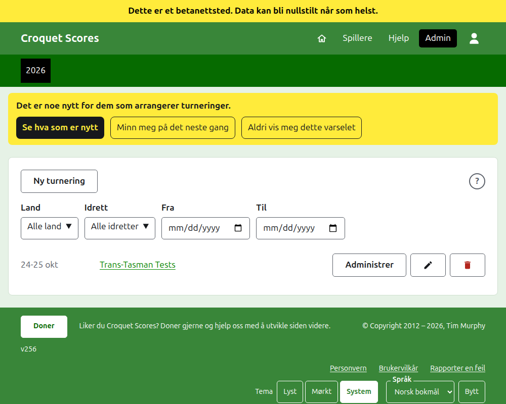

# Å endre, arkivere og gjenopprette en turnering

## Å endre turneringens detaljer

I listen over turneringer i admin trykker du på **Rediger** for turneringen. Skjemaet er det som opprettet den, begynt slik turneringen er. Endre det som er galt og trykk på **Oppdater turnering**.

Turneringens dager kan utvides her der en test trenger en dag utenfor dem, siden en test spilles innenfor turneringen. Når turneringen har noe lag eller noen test, arkiverte medregnet, kan **Format** ikke endres i det hele tatt: ikke til formatet Standard, som har spillere og konkurranser i stedet, og ikke til et annet format som spilles av lag, siden en test kan være i en gruppe som det andre formatet ikke har. Velg formatet når turneringen opprettes.

En turnering beholder adressen sin når navnet rettes, slik at en lenke noen allerede har sendt, fortsatt finner den. Den flytter seg bare når året den starter i eller idretten endres, og da fører den gamle adressen til den nye. Å lagre tar deg til turneringen der den nå finnes.

Bare en leder kan endre en turnering. En poengfører, eller noen annen, får beskjed om det i stedet for å se skjemaet.

## Listen over turneringer

Admin lister ett år om gangen, med dette året først, den nyeste turneringen først. Årene du har en turnering i, er faner i den mørkegrønne linjen, det nyeste først; der det er flere enn det er plass til på en telefon, ligger de eldste i en nedtrekksliste i enden av raden. Året står i adressen, så det kan lenkes til. Under knappene kan listen begrenses etter **Land**, **Region** og **Idrett**, og etter dagene den har turneringer i, **Fra** og **Til**. Et rundt **?** ved siden av **Ny turnering** fører til hjelpen.

## Å arkivere en turnering

**Arkiver** for en turnering i listen setter den til side. Den listes fortsatt, overstreket og etter turneringene i bruk, men tilbyr bare **Gjenopprett**: siden dens i admin, og de offentlige sidene dens, er stengt til den gjenopprettes. Arkivering spør ikke først, siden gjenoppretting angrer den.

Neste: [Hva publikum ser](what-the-public-sees.md).
