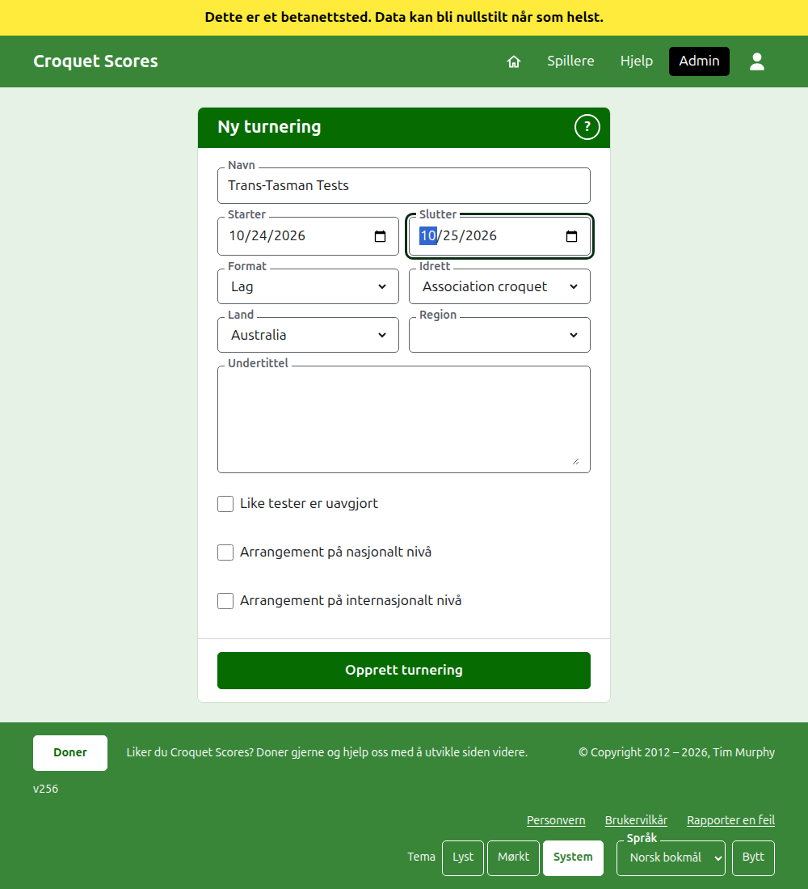
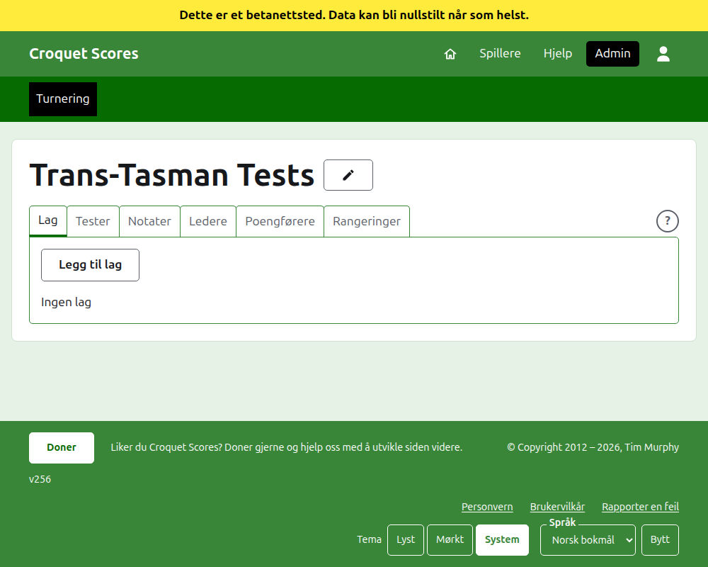

# Å opprette en turnering

Trykk på **Ny turnering** over listen over turneringer i admin. Den står over listen i stedet for under, slik at en lang liste ikke skyver den ut av en telefons skjerm.

Skjemaet ber om alt en turnering begynner med. Det som betyr mest her, er **Format**, som er det som gjør en turnering til en som spilles av lag.

## Hva skjemaet ber om

**Navn.** Det leserne leter etter for å finne turneringen, for eksempel «Trans-Tasman Tests». Det er mellom 3 og 254 tegn. Et navn helt med små bokstaver, eller helt med store, avvises, siden det ville se ut som en feil på hver side det vises på. To turneringer kan ha samme navn, siden den samme turneringen spilles hvert år.

**Starter** og **Slutter.** Dagene turneringen varer. Hver test spilles innenfor dem, så sett dem til å dekke hele arrangementet. En turnering kan ikke slutte før den starter, og kan ikke starte eller slutte senere enn utgangen av neste år. En turnering hører til året den starter i, som også er året i adressen.

**Format.** Velg et av formatene som spilles av lag:

- **Lag** er det generelle formatet for ethvert arrangement mellom lag.
- **Eire Cup**, **Interstate Shield** og **VM for lag i golfcroquet** er bestemte arrangementer, hvert holdt som et eget format slik at det kan drives slik det arrangementet drives.

Standard er det eneste formatet som ikke spilles av lag, og er ikke det du vil ha her. Gateball Scores tilbyr ikke noe format, siden hver turnering der er en standardturnering i gateball; en turnering som spilles av lag opprettes på Croquet Scores.

**Idrett.** Idrettene nettstedet tilbyr, i rekkefølgen dens: Association croquet, Golfcroquet, Amerikansk 6-buers croquet og Ricochet.

**Land** og **Region.** Hvor turneringen spilles. En region spørres det bare om der landet du velger er delt i regioner, som Australias delstater, og den trenger ikke velges selv da.

**Undertittel.** Alt du vil at leserne skal vite som ikke har et eget felt: hvor man parkerer, når det er lunsj, hvem man ringer. Den vises under turneringens navn på hver offentlige side. Den skrives i Markdown, så et ord kan gjøres fet med stjerner rundt og en liste lages med en strek først på hver linje. Den kan være opptil 2000 tegn, og kan stå tom.

Hvordan testene spilles og telles, om med handicap, med uavgjorte resultater, og mot verdensrangeringene, bestemmer hver test selv når den legges til.

**Like tester er uavgjort.** Det spørres om når et format som spilles av lag er valgt. En test der lagene vinner like mange kamper, avgjøres av nettopartiene deres, så nettobuene. Kryss av her, så er den uavgjort i stedet. Den er avkrysset til å begynne med bare for **VM for lag i golfcroquet**, som alltid har latt dem være uavgjort, og kan endres senere.

**Arrangement på nasjonalt nivå** og **Arrangement på internasjonalt nivå.** En turnering kan være det ene, det andre, eller ingen av dem, men aldri begge: å krysse av for det ene fjerner avkrysningen for det andre.

## Å opprette den

Trykk på **Opprett turnering**. Du tas til turneringens side i admin, åpen på fanen Lag, og du er dens første leder. Den listes i admin under året den starter i.

Turneringens offentlige adresse lages av året, idretten og navnet, som `/2026/ac/trans-tasman-tests`. Den beholder den adressen når navnet rettes senere, slik at en lenke som allerede er sendt fortsatt finner den; den flytter seg bare når året den starter i, eller idretten, endres.

## Hvis noe avvises

Det som avvises, sies under feltet det gjelder, og det du skrev, blir stående. Ingenting beholdes før hvert felt er godtatt. Det som oftest avvises, er et navn skrevet helt med små bokstaver, en slutt før starten, og et land som ikke er valgt.

Neste: [Lag](teams.md).
