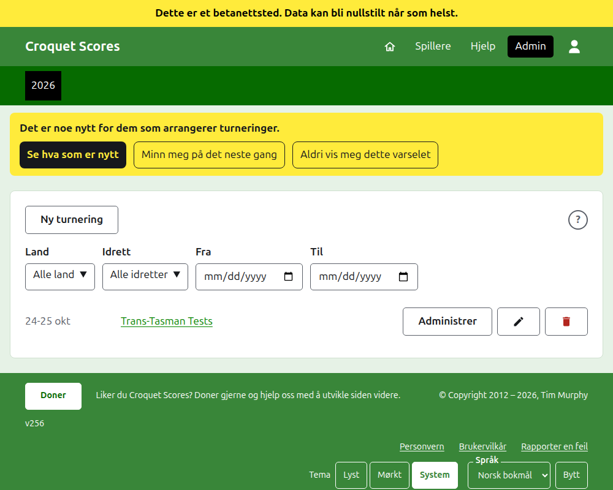
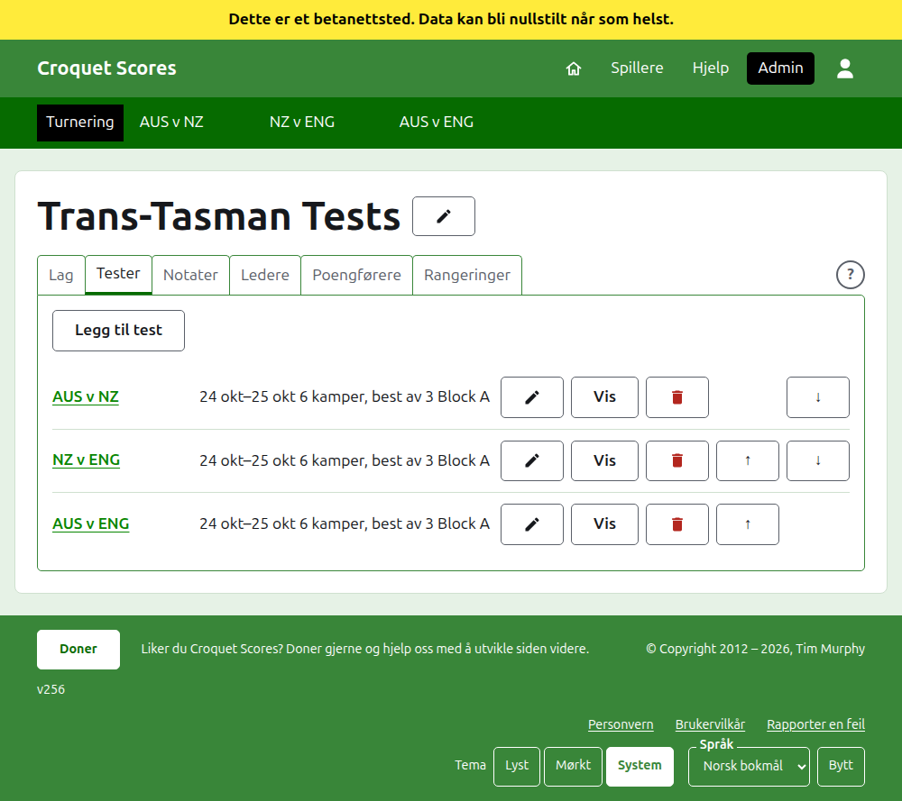

# Å drive en turnering som spilles av lag

En turnering som spilles av lag er en der sider møtes, i stedet for spillere som meldes på én og én: en testserie mellom to land, en interstate shield, et verdensmesterskap for lag. Lagene settes opp med spillerne sine, testene mellom lagene legges til, og hver tests partier legges inn etter hvert som de spilles. Denne veiledningen tar en leder fra innlogging til en turnering der resultatene er tilgjengelige for publikum.

Den står på egne bein. Ingenting i den avhenger av veiledningen for en standardturnering, som er skrevet for seg.

## Før du begynner

Du trenger en konto. Klikk [her](/account/register) for å registrere en konto.

Alt en leder gjør, gjøres i admin-delen av nettstedet. De offentlige sidene, der spillere og tilskuere følger turneringen, tegnes av det admin har, så ingenting må publiseres: et resultat som er skrevet inn, står på de offentlige sidene med en gang.

## Ordene

Et **lag** er en side, for eksempel Australia, med et navn, et kortnavn som «AUS», og et flagg. Et lag har egne **spillere**, som spiller for det og for ingen andre. En **test** er en kamp mellom to lag, kalt ved kortnavnene deres, som «AUS v ENG», bestående av et antall **kamper** mellom en spiller fra hvert lag, der hver kamp er best av et antall **partier**. Tester kan legges i **grupper**, som «Block A», der mange lag spiller seg imellom.

## Sidene i rekkefølge

1. [Å opprette en turnering](creating-a-tournament.md): navnet, dagene, idretten, formatet og hvor den spilles.
2. [Lag](teams.md): å legge til lagene, med kortnavn og flagg.
3. [Et lags spillere](team-players.md): å skrive inn hvert lags spillere på lagets egen side.
4. [Tester](tests.md): å legge til testene mellom lagene, dagene deres, hvor mange kamper hver har, og gruppene deres.
5. [Resultater](scores.md): å skrive inn en tests partier, rette dem, og sette til side dem som er skrevet inn ved en feil.
6. [Notater](notes.md): å fortelle spillerne det de trenger å vite mens turneringen pågår.
7. [Ledere og poengførere](managers-and-scorers.md): å dele driften av turneringen, og la noen skrive inn resultater uten å kunne endre noe annet.
8. [Rangeringer](rankings.md): filen verdensrangeringene sendes, og hva som er igjen for deg å fylle ut.
9. [Å endre, arkivere og gjenopprette en turnering](changing-and-archiving.md): å rette turneringens detaljer, og å sette en turnering til side.
10. [Hva publikum ser](what-the-public-sees.md): sidene spillerne dine følger, og hvordan det du skriver inn vises på dem.

## Slik er admin lagt opp

Admins inngangsdør lister turneringene du har en rolle i, ett år om gangen.

Å trykke på en turnerings navn, eller **Administrer**, åpner siden dens. Alt som skal drives, ligger i seks faner under navnet: **Lag**, **Tester**, **Notater**, **Ledere**, **Poengførere** og **Rangeringer**. Fanen **Rangeringer** er der bare når turneringen teller med i verdensrangeringene. Siden åpner på Lag, siden lagene er det første som settes opp.

Den mørkegrønne linjen under toppen er for å bevege seg mellom sider. På turneringens side og på en tests side fører den til turneringen, som **Turnering**, og til hver test ved navnet. På et lags side fører den i stedet til turneringen og til hvert lag ved kortnavnet, siden en leder på ett lags side skriver inn spillere lag for lag. Siden du er på, er merket med svart. Når tester legges til, endres, flyttes, arkiveres eller gjenopprettes på fanen Tester, følger linjen med med en gang.

## Ting som gjelder overalt

**Ingenting slettes helt bort unntatt et notat.** Lag, spillere, tester, resultater og selve turneringen arkiveres i stedet for å slettes: de settes til side, strekes over og listes under en egen overskrift, med **Gjenopprett** for å hente dem tilbake. Å arkivere, gjenopprette og flytte opp og ned ber deg aldri om å bekrefte, fordi hver av dem angres ved å trykke motsatt vei. Det som ikke kan angres, som å slette et notat eller fjerne en leder, spør først.

**En dialog over siden beholder ingenting før du trykker på knappen i den.** Avbryt, eller Escape-tasten, lukker den og lar alt stå som det var. Dialoger som legger til ting, som Legg til lag og Legg til resultat, blir åpne etter hver som er lagt til, slik at en liste kan skrives inn ett element etter et annet.

**Det som avvises, sies ved siden av feltet det gjelder.** Ingenting som avvises, beholdes, og det du skrev, blir stående, slik at det kan rettes i stedet for å skrives på nytt.

**Hjelp er et trykk unna.** Et rundt **?** står i tittellinjen på siden som oppretter eller endrer en turnering, i enden av raden med faner, ved siden av **Ny turnering**, og i hver dialog. Det åpner den delen av denne veiledningen som handler om det du ser på, i en annen fane, slik at det du holdt på med, beholdes.

**Admin fungerer på en telefon.** Hver knapp er stor nok til å trykkes på med en tommel, og ingenting er bredere enn skjermen.

Neste: [Å opprette en turnering](creating-a-tournament.md).
