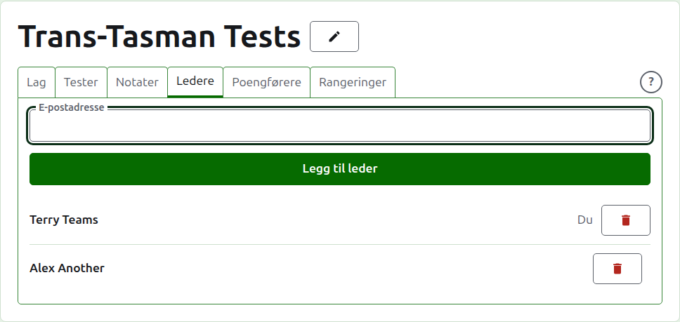
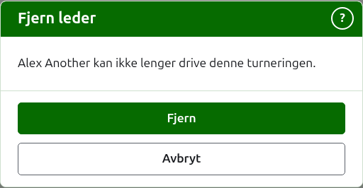
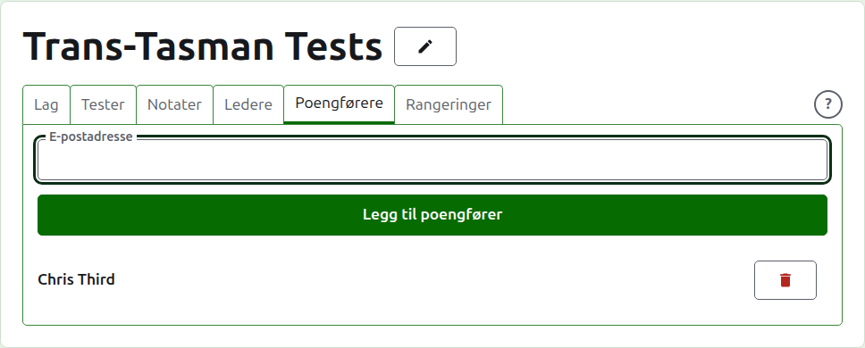
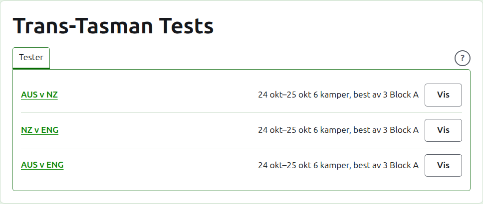

# Ledere og poengførere

En turnering har ledere, som kan gjøre alt som kan gjøres med den, og kan ha poengførere, som skriver inn resultatene og ingenting annet. Den som opprettet turneringen, er dens første leder.

## Ledere {#managers}

Fanen **Ledere** lister hvem som driver turneringen, i den rekkefølgen de ble gjort til ledere, med ditt eget navn merket som ditt. Det er her en turnering deles, eller gis videre.

Noen gjøres til leder ved e-postadressen sin. Skriv den inn i feltet over listen og trykk på **Legg til leder**. Adressen må høre til en konto som er registrert og bekreftet; en adresse uten en slik avvises under feltet, og nettstedet sier ikke mer om det enn det. En poengfører som gjøres til leder, slutter å være poengfører.

**Fjern** tar en leder bort. Ingenting beholdes om en fjernet leder, så Fjern spør først; de gjøres til leder igjen ved adressen sin hvis de skal tilbake. En turnering har alltid en leder, så den siste tilbys ikke Fjern.

Du kan ta deg selv bort. Spørsmålet sier da hva det betyr: du mister din egen vei tilbake til turneringen, og ingen på siden kan angre det for deg. En annen leder kan gjøre deg til leder igjen.

## Poengførere {#scorers}

Fanen **Poengførere** er fanen Ledere for poengførere, og virker på samme måte: en e-postadresse og **Legg til poengfører** over listen, og **Fjern** på hver.

En poengfører ser turneringen i sin egen liste i admin, med **Resultater** i stedet for Administrer, og tilbys bare testene dens: ingen lag, notater, ledere, poengførere eller rangeringer. De kan ikke åpne et lags side, siden hvem som spiller for et lag, er lederne å si. På en tests side kan de skrive inn, rette, arkivere, gjenopprette og endre rekkefølgen på resultater som en leder kan.

En leder gjøres ikke til poengfører, siden en leder allerede kan gjøre alt en poengfører kan. En turnering trenger ingen poengfører, så hver poengfører kan fjernes, også den siste.

Neste: [Rangeringer](rankings.md).
