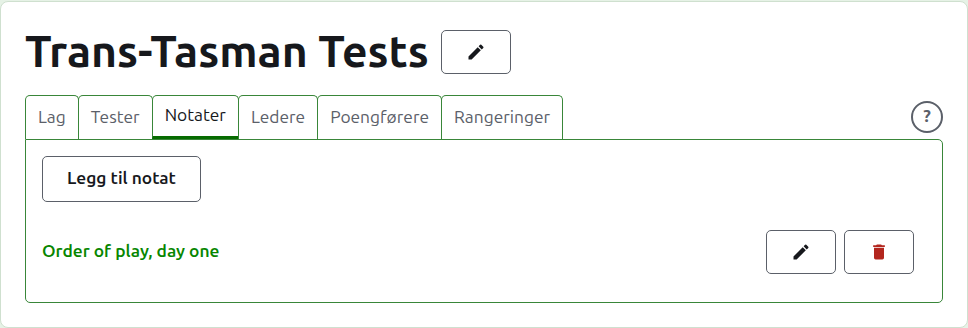
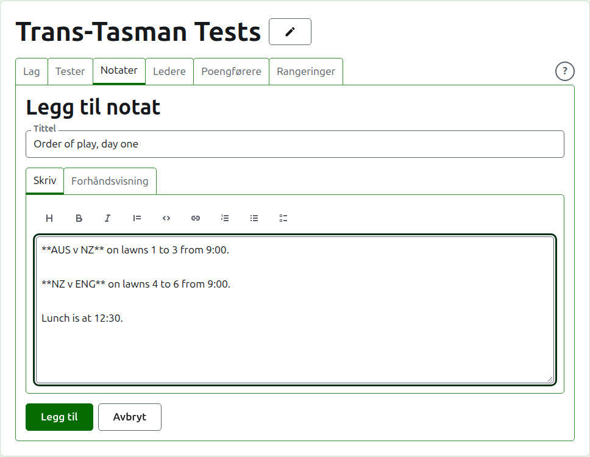
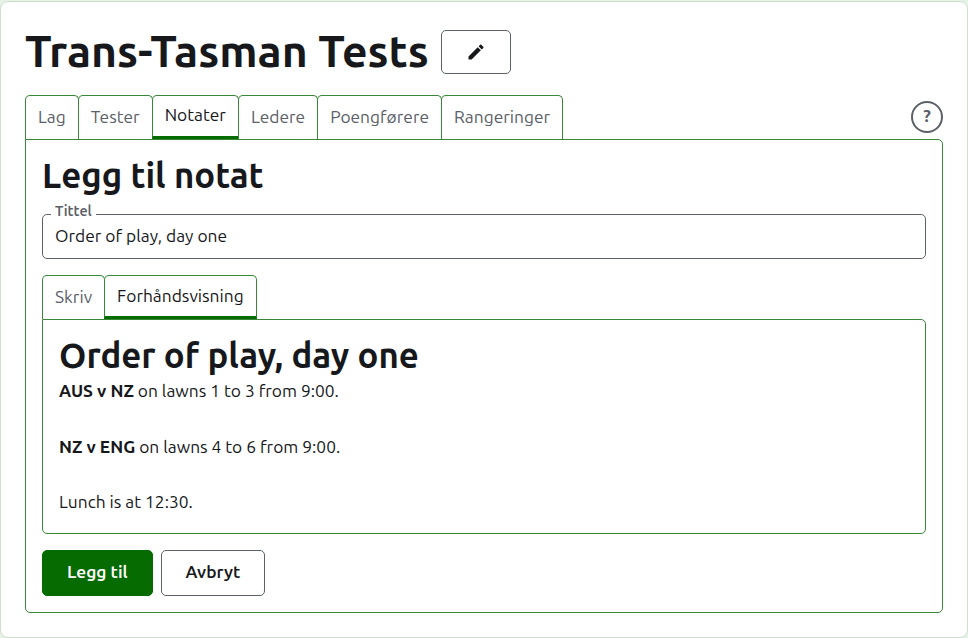
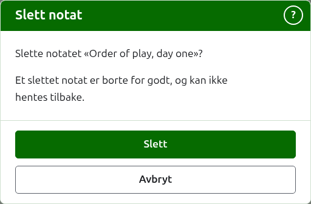

# Notater

Fanen **Notater** på en turnerings side er der lederne skriver det spillerne trenger å vite mens turneringen pågår: spilleorden, en endring på banene, tidspunktet for lunsj. Leserne finner dem på turneringens offentlige side Notater, og et notat de ikke har lest, er merket der med en rød stjerne, som også merker avsnittet Notater på hver side i turneringen til de åpner det.

## Å skrive et notat

Trykk på **Legg til notat**, over listen. Et panel tar listens plass, siden et notat skrives langt og trenger plassen.

**Tittel** er påkrevd, og er det notatet listes ved. Den er ren tekst.

**Beskrivelse** skrives i Markdown og kan stå tom der tittelen sier alt som skal sies. Verktøylinjen over boksen skriver Markdown for deg: Overskrift, Fet, Kursiv, Sitat, Kode, Lenke, Nummerert liste, Punktliste og Oppgaveliste. Hvert verktøy virker på det som er markert, eller først på hver markerte linje, eller setter markøren der ordene skal stå.

Et avsnitt skilles fra det forrige med en hel blank linje, slik at notatet leses som avsnitt.

**Forhåndsvisning** viser notatet slik en leser vil se det på siden sin.

Trykk på **Legg til**. Notatet beholdes, listen kommer tilbake med det øverst, og det står på den offentlige siden Notater med en gang.

## Å redigere et notat

Trykk på et notats tittel, eller **Rediger** for det, for å åpne panelet for det notatet. Trykk på **Lagre** for å beholde endringen. Et notat som er redigert siden en leser leste det, merkes for dem på nytt.

## Å slette et notat {#deleting-a-note}

Et notat som ikke lenger gjelder, slettes. Et slettet notat er borte for godt, så **Slett** spør først.

Neste: [Ledere og poengførere](managers-and-scorers.md).
