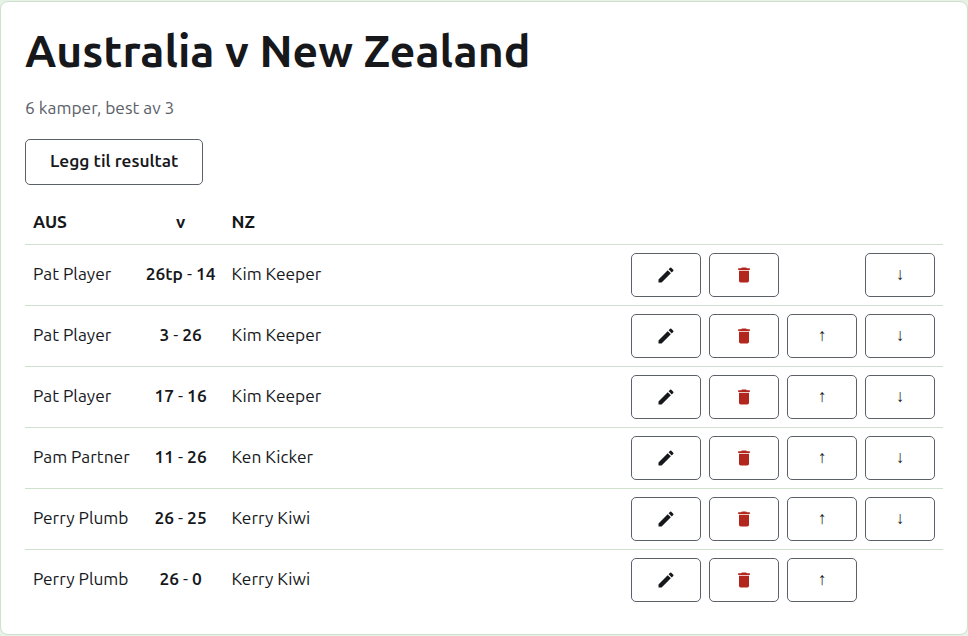
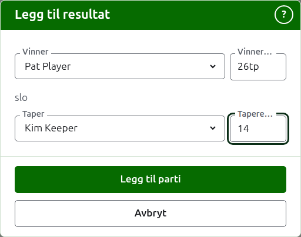

# Resultater

En tests side åpnes fra navnet på fanen Tester, eller fra den mørkegrønne linjen. Den har lagenes fulle navn som overskrift, som «Australia v New Zealand», med hvor mange kamper den forventes å ha og hva hver er best av under. Resultatene er siden, uten faner. En leder og en poengfører ser den samme siden, siden en poengfører kan gjøre alt med et resultat som en leder kan.

## Hvordan resultatene er lagt opp

Resultatene er lagt opp etter lag i stedet for etter hvem som vant, i en tabell med det første lagets kortnavn, «v», og det andre lagets som overskrift. Hvert resultat er en rad: det første lagets spiller, så begge poengsummene med det første lagets først, som «26tp - 14», så det andre lagets spiller, uansett hvem av dem som vant. De arkiverte resultatene er lagt opp på samme måte under.

## Å skrive inn et resultat {#entering-a-score}

Trykk på **Legg til resultat**, over listen. Dialogen leses slik et resultat sies høyt: vinneren og poengsummen deres, så «slo», så taperen og poengsummen deres.

Vinneren velges blant begge lagenes spillere i bruk, under hvert lags navn, det første lagets spillere først og hvert lags i lagets rekkefølge. Ingen er valgt til å begynne med. Når vinneren er valgt, tilbys taperen bare fra det andre laget, siden et parti mellom to spillere på samme lag ikke er et parti mellom lagene. En arkivert spiller tilbys ikke.

Et resultat skrives slik poengføreren skrev det ned: antallet poeng, og det som følger, som beholdes og vises slik det ble skrevet, som «26tp» for 26 buer og en trippel peel. Tallet er sifrene resultatet begynner med; et resultat som ikke begynner med et siffer, avvises.

Et parti vunnet på like poeng, som når det stoppes av tiden og avgjøres på en annen måte, sier hvem som vant det med et merke etter vinnerens poengsum: «6w» slo «6». Merkene er «w», «won» og «winner» (de engelske ordene, siden det er dem nettstedet kjenner igjen). En vinners poengsum må være høyere enn taperens, eller merket, med mindre turneringen tillater uavgjort, og da beholdes like poeng uten merke som uavgjort.

Hvis spillerne ikke kan leses, sier dialogen det over feltene, med «Spillerne kunne ikke leses. Lukk denne dialogen og åpne den igjen.», i stedet for å tilby ingen. Gjør som den sier.

Trykk på **Legg til parti**. Partiet legges til, dialogen sier hvilket, og feltene tømmes for det neste, siden resultater kommer i en bunke lest av en tavle ved slutten av en økt. Trykk på **Avbryt** når de alle er lagt inn.

## Kamper

To spillere som møtes, spiller en kamp av testens best av. Partiene mellom dem er partiene i den kampen, og et parti mellom to spillere der kampen allerede er avgjort, avvises: en av dem har vunnet flere partier enn den andre fortsatt kunne vinne, eller hvert parti i den er spilt.

En kamp er startet når de to spillerne har et parti i bruk. En test starter ikke flere kamper enn den forventes å ha: når like mange har startet, avvises et parti mellom to spillere som ikke har møttes, mens et nytt parti i en kamp som allerede er startet, godtas. Der testen skal ha flere kamper, endrer du den på fanen Tester til å forvente dem.

## Å rette et resultat {#correcting-a-score}

**Rediger** åpner den samme dialogen for det resultatet, med tittelen Rediger resultat, med spillerne valgt og poengsummene slik de ble skrevet. Spillerne kan endres i tillegg til poengsummene, valgt som når du legger til. Trykk på **Lagre** for å beholde rettelsen og lukke dialogen. En rettelse beholder resultatet: et vunnet parti forblir vunnet, og et uavgjort parti forblir uavgjort. Et parti der resultatet var galt, arkiveres og skrives inn på nytt.

## Å sette resultatene i rekkefølge

Resultater kommer i den rekkefølgen de skrives inn, så hvert resultat i bruk tilbyr **Opp** og **Ned**, som bytter det med resultatet ved siden av, slik at listen kan settes i rekkefølgen partiene ble spilt.

## Å arkivere et resultat

**Arkiver** setter et resultat til side slik at det ikke teller for noe. Det listes under **Arkiverte resultater**, overstreket, og tilbyr bare **Gjenopprett**. Ingen av dem spør først, siden hver angrer den andre. Hvert resultat i en test kan arkiveres, siden en test ikke har runder som avhenger av hverandre.

Et resultat der en spiller siden er arkivert, gjenopprettes ikke før spilleren er det, og siden sier det.

Neste: [Notater](notes.md).
