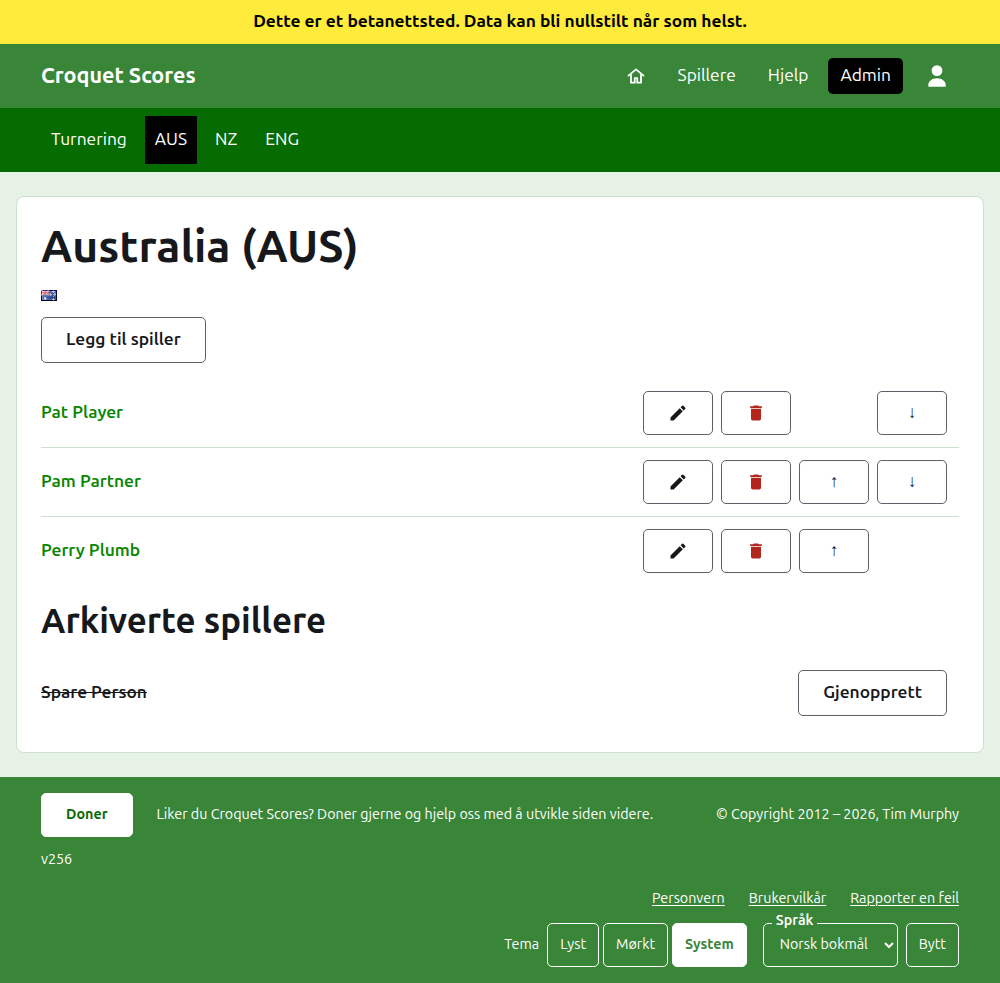
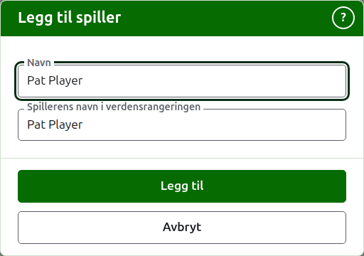

# Et lags spillere

Et lags side åpnes fra navnet, eller **Vis**, på fanen Lag. Den har lagets navn som overskrift med kortnavnet i parentes, og flagget, slik at en leder som kom til feil lag ser det med en gang. Den har én ting å vise, lagets spillere, så listen er siden.

Den mørkegrønne linjen på et lags side fører til turneringen og til hvert lag i bruk ved kortnavnet, slik at spillerne skrives inn lag for lag uten å gå tilbake til fanen Lag.

En spiller på et lag hører til det laget alene, representerer laget, og fører lagets flagg i stedet for et eget. Den samme personen som spiller for to lag, eller i to turneringer, er en spiller i hver.

## Å legge til en spiller {#adding-a-player}

Trykk på **Legg til spiller**, over listen. En dialog åpnes over siden.

**Navn** er påkrevd, mellom 3 og 254 tegn. To spillere på ett lag kan ikke ha samme navn, uansett hvordan det skrives med store og små bokstaver; en spiller på et annet lag kan ha det.

**Spillerens navn i verdensrangeringen** er navnet verdensrangeringene kjenner spilleren under. Det spørres bare om i en turnering i Association croquet eller Golfcroquet, de to idrettene verdensrangeringene fører en liste over spillere for. Spillerne i Amerikansk 6-buers croquet er kjent for rangeringene under sine egne navn, så det spørres ikke om der, og hver spillers verdensrangeringsnavn er alltid navnet deres. Mens du legger til en spiller, følger det navnet mens du skriver det, og slutter å følge når du skriver i det selv. Står det tomt, beholdes det som spillerens navn. Mens du skriver, tilbys spillerne verdensrangeringene kjenner der navnet begynner slik, og ved siden av verdensrangeringsnavnet sier et hakemerke at rangeringene kjenner navnet og et spørsmålstegn at de ikke gjør det. Det er bare et råd: et navn rangeringene ikke kjenner, beholdes like gjerne som et de kjenner.

En spiller kalles aldri «Bye» (det engelske ordet, siden det er det nettstedet selv avviser): et navn som er «Bye», eller «Bye» med et tall, som «Bye 2», «Bye-2» eller «Bye (2)», avvises. Et navn som bare begynner med ordet, som «Bye / Bassett» gjør, er en persons.

Trykk på **Legg til**. Spilleren legges til, dialogen sier det, og feltene tømmes for den neste, med markøren tilbake i navnet. Legg til hele laget på denne måten, og trykk så på **Avbryt** for å lukke dialogen.

## Å rette en spiller {#correcting-a-player}

Trykk på en spillers navn, eller **Rediger** for dem, for å åpne den samme dialogen for den spilleren, med tittelen Rediger spiller. Trykk på **Lagre** for å beholde endringen. En spiller der navnet rettes, beholder verdensrangeringsnavnet de hadde, unntatt i Amerikansk 6-buers croquet, der en spillers verdensrangeringsnavn alltid er navnet deres.

## Rekkefølge

Spillerne listes i lagets rekkefølge, som er rekkefølgen de tilbys i når en tests resultat skrives inn. **Opp** og **Ned** flytter en spiller ett sted innenfor laget.

## Å arkivere en spiller

**Arkiver** setter en spiller til side: skrevet inn ved en feil, eller ikke lenger med på laget. En arkivert spiller listes under **Arkiverte spillere**, overstreket, etter spillerne i bruk, og tilbyr bare **Gjenopprett**. Arkivering spør aldri først, siden en spiller på et lag ikke er skrevet inn i noe annet og gjenoppretting setter alt tilbake.

En spiller som har spilt noe parti i bruk i en test, kan ikke arkiveres, siden partiene da ville være mot noen som ikke lenger er der, så en slik spiller tilbys ikke Arkiver. En spiller som bare har arkiverte partier, kan arkiveres.

Neste: [Tester](tests.md).
