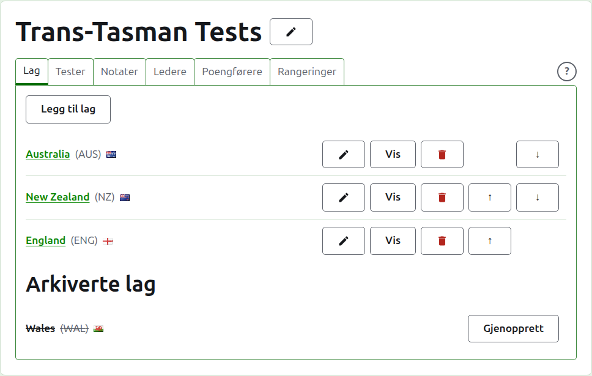
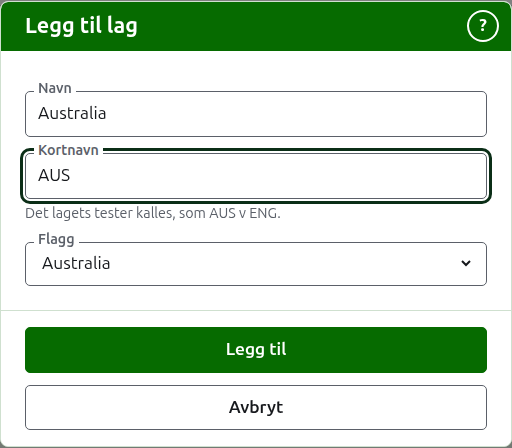
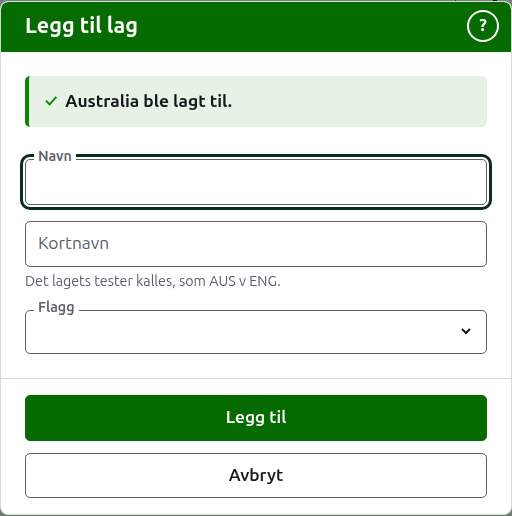
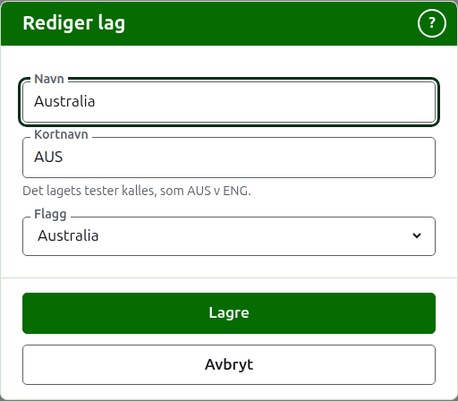

# Lag

Fanen **Lag** på en turnerings side er der lagene legges til, rettes, settes i rekkefølge og settes til side. Det er fanen siden åpner på, siden lagene er det første som settes opp. En test er mellom to lag, så minst to trengs før noen test kan legges til.

## Å legge til et lag {#adding-a-team}

Trykk på **Legg til lag**, over listen. En dialog åpnes over siden.

**Navn** er påkrevd: lagets fulle navn, som «Australia», som er overskrift på lagets side og i tabellene på de offentlige sidene. To lag i én turnering kan ikke ha samme navn.

**Kortnavn** er også påkrevd: det lagets tester kalles, som «AUS v ENG», og det den mørkegrønne linjen kaller laget. Det er høyst 10 tegn, og ikke lengre enn navnet, siden et kortnavn lengre enn navnet det forkorter er de to skrevet feil vei. To lag kan heller ikke ha samme kortnavn.

**Flagg** vises ved siden av lagets navn overalt det forekommer. Det kan stå som ingen, som for et lag fra en klubb eller en region.

Trykk på **Legg til**. Laget legges til, dialogen sier det, og feltene tømmes for det neste. Legg til hele listen på denne måten, og trykk så på **Avbryt** for å lukke dialogen. Avbryt beholder ingenting som ikke allerede er lagt til.

## Å rette et lag {#correcting-a-team}

Trykk på **Rediger** for et lag for å åpne den samme dialogen for det laget, med tittelen Rediger lag. Endre det som er galt og trykk på **Lagre**. Et lag der kortnavnet endres, kalles ved det nye overalt, så testene dens får nytt navn sammen med det.

## Rekkefølge

Lagene listes i turneringens rekkefølge, som er rekkefølgen de tilbys i når en test legges til, rekkefølgen den mørkegrønne linjen har dem i, og rekkefølgen den offentlige Spillere-siden lister dem i. **Opp** og **Ned**, pilene i enden av hver rad, flytter et lag ett sted.

## Å gå til et lag

Et lags navn, eller **Vis**, åpner lagets egen side, der spillerne skrives inn. Se [Et lags spillere](team-players.md).

## Å arkivere et lag

**Arkiver** setter et lag til side. Spillerne blir hos det og kommer tilbake når det gjenopprettes, så arkivering spør ikke først. Et arkivert lag listes under **Arkiverte lag**, overstreket, tilbyr bare **Gjenopprett**, og siden dets er stengt til det gjenopprettes.

Et lag som spiller i en test som er i bruk, kan ikke arkiveres, siden testen da ville være mot et lag som ikke lenger er der, så et slikt lag tilbys ikke Arkiver. Et lag som bare har arkiverte tester, kan arkiveres.

Neste: [Et lags spillere](team-players.md).
