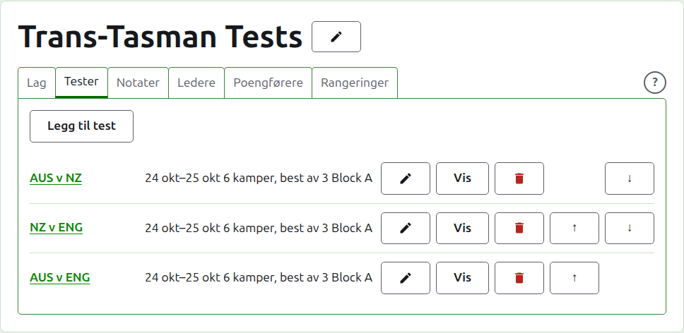
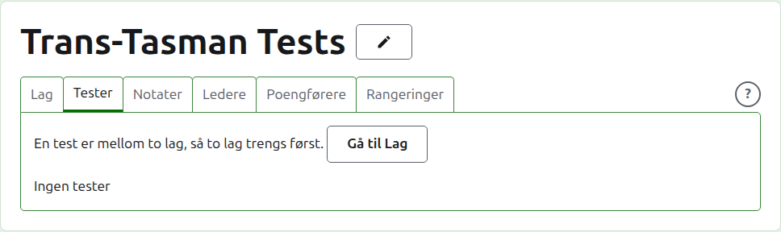
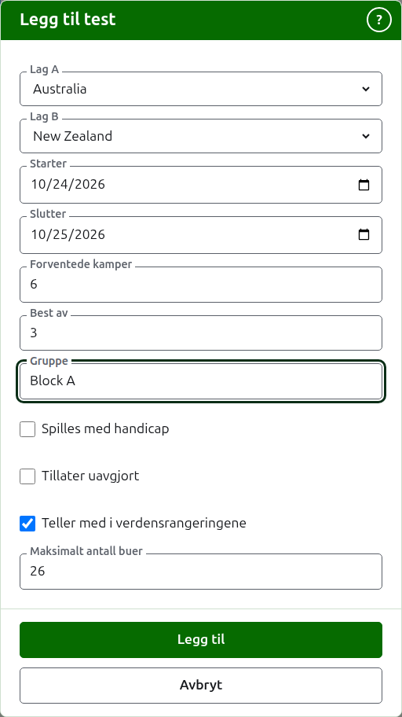
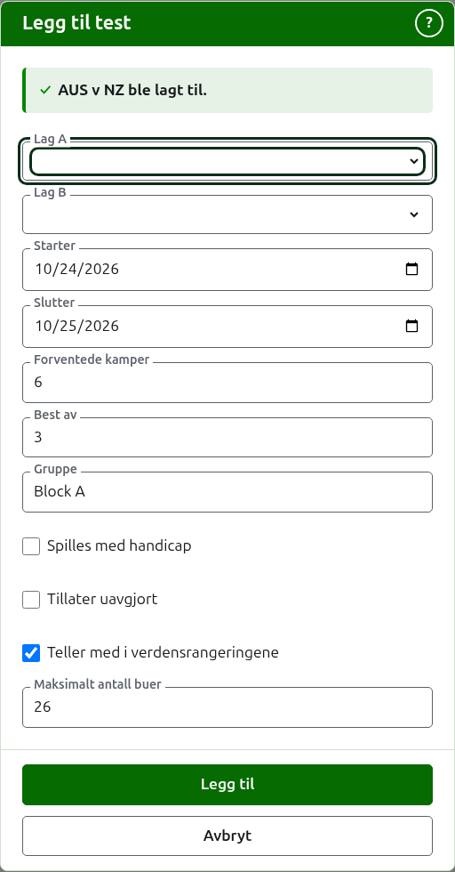
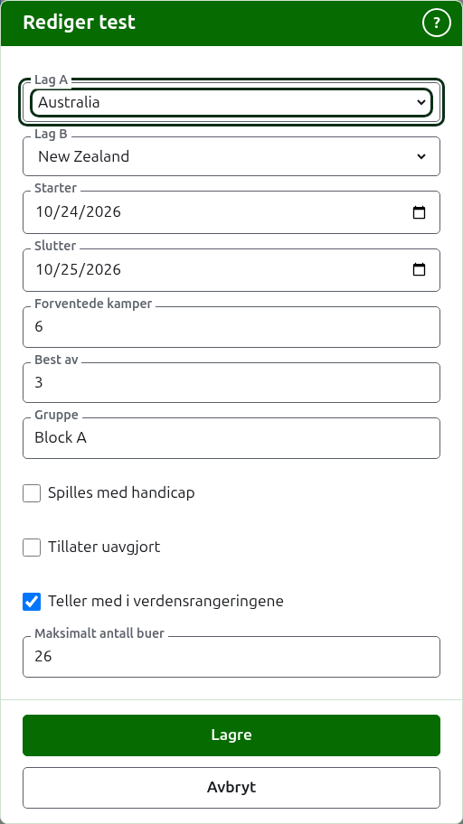

# Tester

Fanen **Tester** på en turnerings side er der testene mellom lagene legges til, endres, settes i rekkefølge og settes til side. En test er en av turneringens konkurranser: en kamp mellom to lag, kalt ved kortnavnene deres, som «AUS v NZ», spilt som et antall kamper mellom en spiller fra hvert lag. Hver test har en egen side, der resultatene skrives inn.

Hver test sier navnet sitt, dagene den spilles, hvor mange kamper den forventes å ha og hva hver er best av, som «6 kamper, best av 3», og gruppen sin der den er i en.

## To lag først

En test er mellom to lag i bruk, så mens turneringen har færre enn to, sier fanen det der Legg til test ville stått, og fører til fanen Lag.

## Å legge til en test {#adding-a-test}

Trykk på **Legg til test**, over listen. En dialog åpnes over siden, og leses i rekkefølgen en test sies høyt.

**Lag A** og **Lag B** velges hver blant turneringens lag i bruk, ved navn, i turneringens rekkefølge. Ingen er valgt til å begynne med, slik at en test aldri legges til mellom lag du ikke valgte. Lag B tilbyr alle lag unntatt det som er valgt som Lag A, siden et lag ikke spiller test mot seg selv. Lag A er det første laget: spillerne dens står til venstre på testens side og den offentlige siden. En test har ikke noe eget navn å skrive; den kalles ved lagenes kortnavn.

**Starter** og **Slutter** er dagene testen spilles, som begynner på turneringens første dag. En test spilles innenfor turneringen, så dager før turneringen starter eller etter den slutter, avvises.

**Forventede kamper** er hvor mange kamper testen skal ha, bestemt av arrangementet før den begynner, slik at den som leser resultatene kan se hvor langt den har kommet. Det er et helt tall fra 1 og opp. Det er også en grense: når like mange kamper har startet som testen forventes å ha, avvises et parti som ville startet en til, mens kampene som allerede har startet, spilles ferdig. En test som skal ha flere, endres til å forvente dem.

**Best av** er hva hver kamp er best av. Det kan være et partall, siden en kamp kan deles.

**Spilles med handicap**, **Tillater uavgjort** og **Teller med i verdensrangeringene** spørres om slik de gjøres for enhver konkurranse. Den siste spørres bare om der den kan telles: en test i Association croquet eller Golfcroquet som verken spilles med handicap eller tillater uavgjort. Den er avkrysset til å begynne med.

**Maksimalt antall buer** er det største antallet buer et parti i testen spilles til. Det begynner på det vanlige for idretten, 26, eller 13 i Golfcroquet. Tøm det for et parti som ikke spilles til et antall buer. Det må være et helt tall på minst 1.

**Gruppe** er gruppen testen er i, der arrangementet spilles i grupper, som «Block A». Den er valgfri: står den tom, er testen i ingen. Testene i en gruppe har en egen side på det offentlige nettstedet, som viser hvordan gruppens lag står. **Eire Cup** og **Interstate Shield** har ingen grupper, så dialogen spør ikke om en der.

Trykk på **Legg til**. Testen legges til, dialogen sier hvilken ved navnet, og lagene tømmes for den neste, mens dagene, de forventede kampene, best av og gruppen blir stående som de var: tester legges til en runde om gangen, mellom lag som møtes samme dag, så den neste testen i runden er bare de to lagene. Trykk på **Avbryt** når de alle er lagt inn.

## Å endre en test {#changing-a-test}

**Rediger** åpner den samme dialogen for testen, med tittelen Rediger test, begynt slik testen er. Trykk på **Lagre** for å beholde endringen.

En test med partier i bruk beholder lagene sine: dialogen viser dem, men de kan ikke endres. Resten kan endres, innenfor det som er spilt: færre forventede kamper enn kampene som allerede har startet avvises, og det samme gjelder en best av med færre partier enn det flest partier noen to spillere har spilt.

## Rekkefølge

Testene listes i turneringens rekkefølge, som er rekkefølgen de står i på de offentlige sidene og i den mørkegrønne linjen. **Opp** og **Ned** flytter en test ett sted.

## Å gå til en test

En tests navn, eller **Vis**, åpner siden dens, der resultatene skrives inn. Den mørkegrønne linjen fører dit også, fra turneringens side eller en annen tests.

## Å arkivere en test

**Arkiver** setter en test til side, og angres av **Gjenopprett**, så ingen av dem spør først. En arkivert test listes under **Arkiverte tester**, overstreket, tilbyr bare Gjenopprett, og er ikke på de offentlige sidene.

En test med partier i bruk er spilt, og kan ikke arkiveres før partiene er det. En test der alle partiene er arkivert, kan arkiveres, siden et arkivert parti ikke teller for noe. En test der laget siden er arkivert, gjenopprettes ikke før laget er det, og fanen sier det.

Neste: [Resultater](scores.md).
