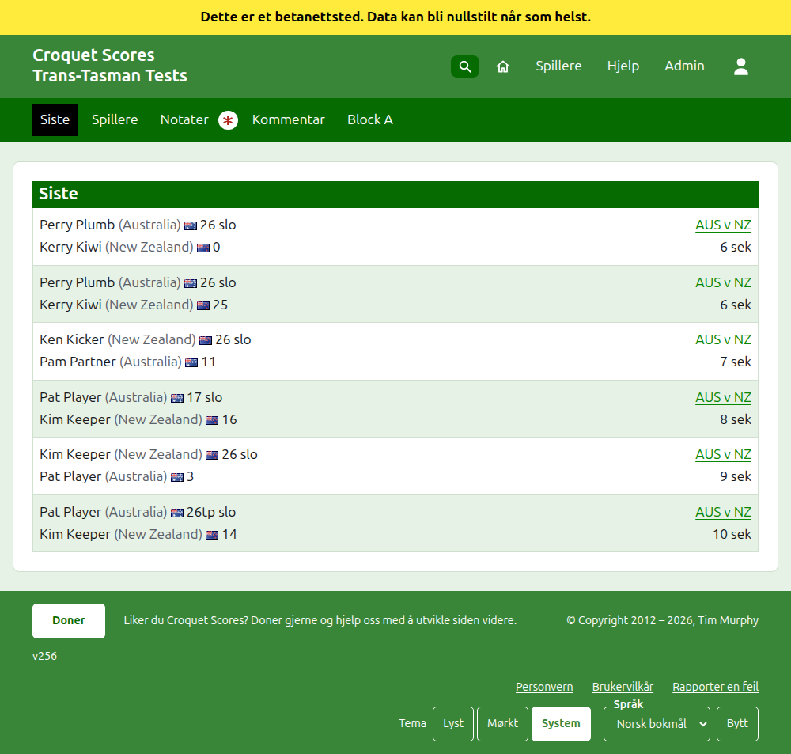
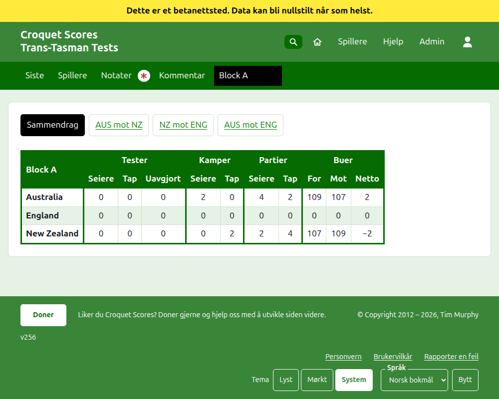
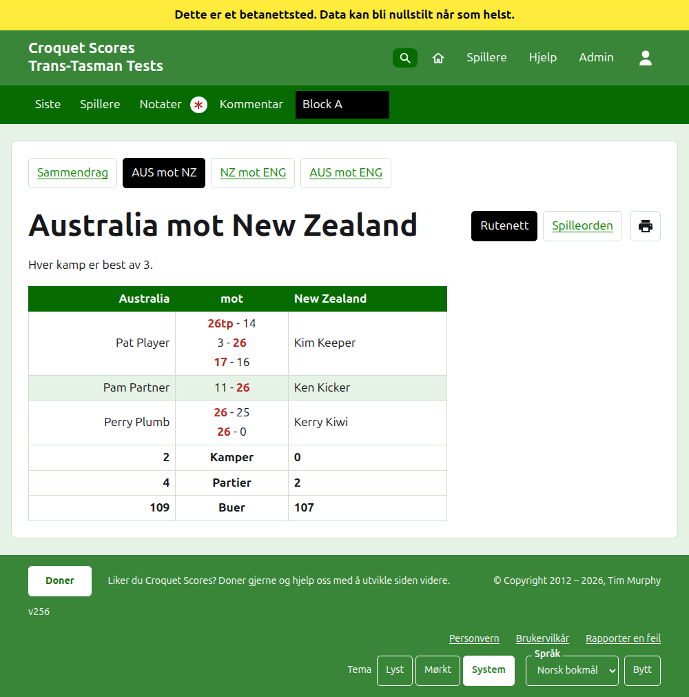
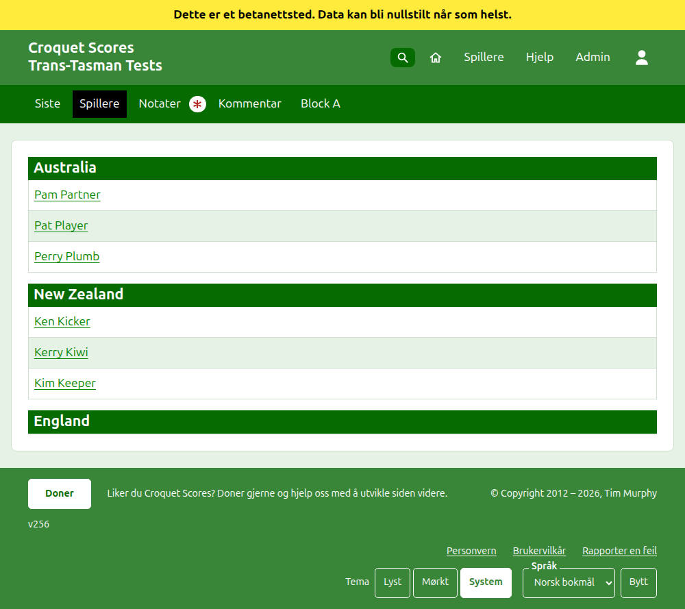

# Hva publikum ser

Ingenting publiseres: de offentlige sidene tegnes av det admin har, så et resultat som er skrevet inn, står på dem med en gang. De trenger ingen konto og ingen skripting, og er lagt opp for en telefon.

## Turneringens side

Turneringens side ligger på året, idretten og navnet, som `/2026/ac/trans-tasman-tests`. Den har turneringens navn som overskrift, med undertittelen under. Den lister hvert parti i bruk, det sist tillagte først, slik at en leser som kommer tilbake ser hva som har skjedd siden sist. Hvert parti sier vinneren, laget deres og poengsummen deres, så taperen og deres, med testen det ble spilt i og hvor lenge siden det ble lagt til.

Den mørkegrønne linjen tilbyr turneringens avsnitt: **Siste**, som er denne siden, **Sammendrag**, **Spillere**, **Notater** og **Kommentar**, så testene. En test sies som lagenes kortnavn med «mot» mellom, som «AUS mot NZ». Tester i en gruppe tilbys ikke én etter én: gruppen er ett avsnitt, kalt ved gruppens navn, som står der den første testen ville stått. Notater er merket med en rød stjerne mens det er et notat leseren ikke har lest.

## Sammendraget

En turnering der testene ikke er i noen gruppe, har et **Sammendrag**: én tabell over hvert lag, rangert, med testene det har vunnet, tapt og spilt uavgjort, partiene det har vunnet og tapt, og buene for, mot og netto. Der noen tests kamper er best av mer enn ett, kommer de vunne og tapte kampene etter testene. Lagene rangeres etter testene de har vunnet, så kampene de har vunnet, så nettopartiene, så nettobuene, og så etter turneringens rekkefølge. En test der lagene står likt på kamper, avgjøres av nettopartier, så nettobuer, eller er uavgjort der turneringen har krysset av for **Like tester er uavgjort**. Sammendraget er der en leser ser etter hvert lag som helhet.

I en **Interstate Shield** rangeres lagene etter testene vunnet, så nettokamper i stedet for vunne kamper, så nettopartier, så nettobuer. Lag som fortsatt står likt, settes i rekkefølge etter testene de vant mot hverandre. Sammendraget dens viser en kolonne **Netto** under Kamper og under Partier i tillegg til under Buer, og Shield spilles aldri i grupper.

En turnering med en test i en gruppe har ikke noe Sammendrag. Hver gruppes side viser i stedet hvordan lagene i den gruppen står, siden én tabell over lag på tvers av grupper som aldri har spilt mot hverandre ikke ville rangert noe.

## En gruppe

En gruppes side viser hvordan gruppens lag står, bare med gruppens tester, i tabellen sammendraget bruker. Over tabellen, i en egen rad, tilbyr den **Sammendrag**, som er denne siden, og hver av gruppens tester, som fører til testens side.

## En test

En tests side har lagenes fulle navn som overskrift, som «Australia mot New Zealand», og sier hva hver kamp er best av. Tabellen har de to lagene som overskrift, det første til venstre. Hver kamp som er spilt, er en rad, i den rekkefølgen den begynte, med det første lagets spiller til venstre, det andres til høyre, og kampens partier mellom dem, hver med den første sidens poengsum først og så den andres, vinnerens merket. Under kampene står hvert lags partier og buer, og, der hver kamp er best av mer enn ett, de vunne kampene, på sin egen side.

En test vises på to måter, tilbudt på linjen med navnet: **Rutenett**, som er denne tabellen, og **Spilleorden**, som lister hvert parti i testen i en tabell med **Parti** og **Dato** som overskrifter, eldst først til å begynne med. Å trykke på en overskrift sorterer etter den, og nettstedet husker hvordan leseren sist sorterte. Ved siden av visningene står en skriverknapp, vist der skripting er på, som skriver ut siden uten linjene. En test i en gruppe tilbyr gruppens Sammendrag og tester i en rad over overskriften, med denne testen merket.

## Spillere

Siden Spillere lister spillerne lag for lag: hvert lag under en overskrift med navnet, i turneringens rekkefølge for lagene, og spillerne under i alfabetisk rekkefølge.

## Notater

Siden Notater har overskriften **Lederens notater**, og sier «Ingen notater ennå.» mens det ikke er noen. Den lister turneringens notater, det sist skrevne først, hvert med en lenke til sin egen side og hvor lenge siden det ble skrevet. Et notat leseren ikke har lest, er merket med en rød stjerne til de åpner det.

## Adresser som flytter seg

En turnering beholder adressen sin når navnet rettes. Der den flytter seg, fordi året eller idretten endret seg, fører den gamle adressen til den nye, slik at en lenke som er beholdt fra før fortsatt virker. En arkivert turnerings sider finnes ikke før den gjenopprettes.
