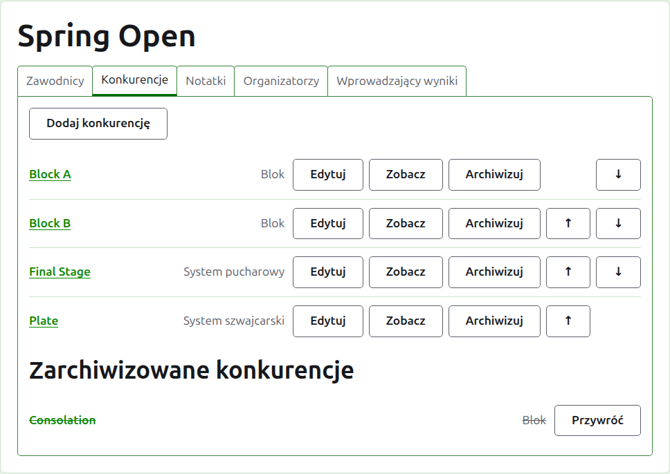
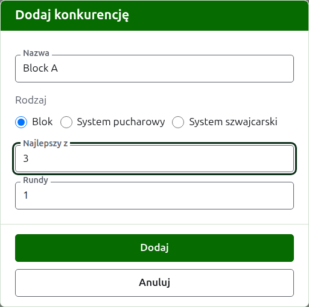
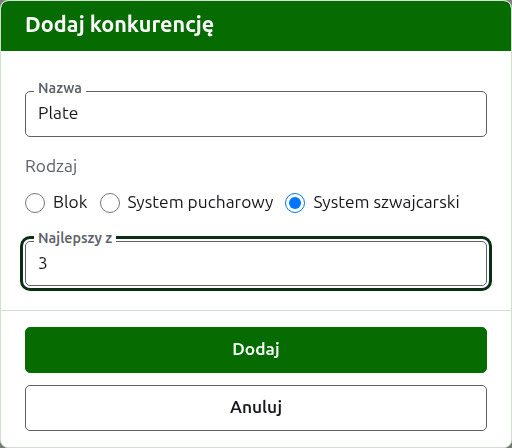
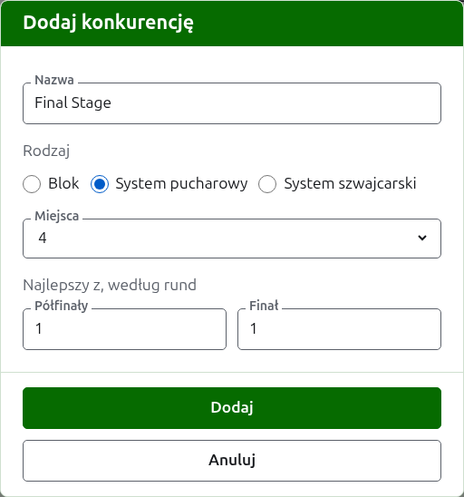

# Konkurencje

Karta **Konkurencje** na stronie turnieju to miejsce, gdzie dodaje się jego konkurencje, ustawia je w kolejności i odkłada na bok. Konkurencja jest grupowa, pucharowa albo szwajcarska. Każda ma własną stronę, na której zgłasza się jej zawodników i wprowadza jej wyniki.

## Dodawanie konkurencji {#adding-a-competition}

Naciśnij **Dodaj konkurencję**, nad listą. Nad stroną otwiera się okno dialogowe, które pyta o nazwę konkurencji, jej rodzaj i kształt, jaki ma ten rodzaj.

**Nazwa** to to, czego zawodnicy szukają na stronie turnieju, by znaleźć swoje gry. Ma od 1 do 254 znaków i wystarczy sama litera, bo konkurencję grupową często nazywa się jedną. Dwie konkurencje w jednym turnieju nie mogą mieć tej samej nazwy.

**Rodzaj** to Grupowa, Pucharowa albo Szwajcarska. Okno zaczyna na rodzaju Grupowa, którym jest większość konkurencji.

### Grupowa

Konkurencja grupowa pyta, z ilu gier każdy mecz jest najlepszy (pole **Do wygranych gier**) i w ilu rundach się go rozgrywa (pole **Rundy**).

**Do wygranych gier** zaczyna się na 1. Najlepszy z 3 wygrywa ten, kto wygra dwie gry. Może to być liczba parzysta, bo w konkurencji grupowej zawodnika szereguje się według wygranych gier, a mecz z dwóch gier podzielonych po jednej jest rezultatem jak każdy inny.

**Rundy** to liczba spotkań każdej pary zawodników w grupie, z jednym meczem w każdej rundzie. Zaczyna się na 1, a 1 to prawie zawsze to, czego grupa potrzebuje: każdy zawodnik gra z każdym innym raz. Zwiększ to tylko dla grupy, w której spotykają się ponownie, na przykład w podwójnym round robin, gdzie przy 2 każda para gra dwa mecze.

### Szwajcarska

Konkurencja szwajcarska pyta tylko, z ilu gier każdy mecz jest najlepszy (pole **Do wygranych gier**), co zaczyna się na 1, tak samo jak w grupowej. Najlepszy z 3 wygrywa ten, kto wygra dwie gry. Może to być liczba parzysta, bo w konkurencji szwajcarskiej zawodnika szereguje się według wygranych gier, a mecz z dwóch gier podzielonych po jednej jest rezultatem jak każdy inny.

### Pucharowa

Konkurencja pucharowa pyta, ile ma miejsc jej drabinka (pole **Miejsca**) i z ilu gier najlepsza jest każda runda. Miejsca są oferowane jako 2, 4, 8, 16, 32, 64 i 128, bo żadna inna liczba nie dzieliłaby się na pół runda po rundzie aż do finału, a okno zaczyna na 8. Miejsca pozostałe po zgłoszeniu zawodników wypełnia się Bye, które dodaje się tam, gdzie zawodników.

Drabinka ma tyle rund, ile trzeba, by zmniejszyć o połowę jej miejsca do jednego, więc drabinka o 8 miejscach ma trzy rundy. Okno pyta, z ilu gier najlepsza jest każda z nich, razem pod **Do wygranych gier w rundach**, w kolejności rozgrywania. Ostatnie trzy nazywają się tak, jak mówi się o rundach drabinki, **Ćwierćfinały**, **Półfinały** i **Finał**, a wcześniejsze – numerem, od Rundy 1. Wybranie więcej miejsc dodaje rundy na początku drabinki, a wybranie mniej odbiera je od początku, więc to, co wpisano dla finału, nadal należy do finału. Każda runda jest najlepsza z nieparzystej liczby gier, bo mecz pucharowy musi mieć zwycięzcę.

### Drabinka przegranych {#losers-knockout}

Drabinka pucharowa może wysłać tych, którzy przegrali rundę, do własnej drabinki, drabinki przegranych. Pod **Do wygranych gier w rundach** drabinki naciśnij **Dodaj drabinkę przegranych**. Okno dialogowe pyta o **Przegrani z**, czyli rundę, której przegrani grają dalej, spośród wszystkich rund oprócz finału, oraz o **Nazwa drabinki przegranych**. Naciśnij **Dodaj**, aby wstawić ją na listę pod przyciskiem, gdzie **Usuń** ją usuwa. Jest dodawana razem z drabinką, gdy ta jest dodawana, a jeśli któraś z nich zostanie odrzucona, nie zostanie dodana żadna.

Drabinka przegranych ma miejsce na każdy mecz tej rundy, a każda jej runda to best of 1, co można zmienić przyciskiem **Edytuj**. Jej zawodnicy są wstawiani w miarę rozstrzygania meczów tej rundy, w kolejności losowania, więc karta **Zawodnicy** tylko ich pokazuje. Jeśli gra zostanie poprawiona lub odłożona, przegrany jest przesuwany albo ponownie usuwany, chyba że już grał dalej.

W drabince już dodanej **Edytuj** pokazuje ten sam przycisk, a drabinka przegranych jest dodawana od razu. Drabinki, której przegranych przejmuje inna używana, nie można zarchiwizować ani zmienić jej miejsc: najpierw zarchiwizuj drabinkę przegranych.

### Jak jest rozgrywana i liczona

Każdy rodzaj pyta pod swoim kształtem o te same trzy rzeczy.

**Rozgrywany z handicapem.** Zaznacz to dla konkurencji rozgrywanej z handicapami.

**Dopuszcza remisy.** Zaznacz to tam, gdzie gra może skończyć się bez zwycięzcy. Większość konkurencji na to nie pozwala. Gdy jest zaznaczone, wynik wprowadzony z równymi punktami i bez oznaczenia jest zachowywany jako remis; gdy nie jest, gra na równych punktach musi mówić, kto ją wygrał, oznaczeniem po wyniku zwycięzcy, na przykład „6w". Mecz w konkurencji pucharowej zawsze ma zwycięzcę, więc zremisowana gra go nie rozstrzyga.

**Liczy się do rankingów światowych.** Pytanie pojawia się tylko tam, gdzie może się liczyć: w konkurencji krokieta klasycznego lub krokieta golfowego, która nie jest rozgrywana z handicapami ani nie dopuszcza remisów. Na początku jest zaznaczone, więc odznacz je dla konkurencji, która nie ma się liczyć.

### Dodawanie kilku naraz

Naciśnij **Dodaj**. Konkurencja zostaje dodana, okno o tym mówi, a nazwa jest opróżniana dla następnej, z rodzajem i jego kształtem pozostawionymi tak, jak były: konkurencje dodawane razem są przeważnie podobne, więc „Block B" po „Block A" to tylko jej nazwa. Naciśnij **Anuluj**, by zamknąć okno, gdy wszystkie są już dodane.

## Zmiana konkurencji {#changing-a-competition}

**Edytuj** otwiera to samo okno na konkurencji, zatytułowane Edytuj konkurencję, z jej nazwą, kształtem oraz sposobem rozgrywania i liczenia takimi, jakie są. O rodzaj nie pyta, bo konkurencji grupowej nie zmienia się w pucharową przez edycję: konkurencję niewłaściwego rodzaju archiwizuje się i dodaje ponownie. Naciśnij **Zapisz**, by zachować zmianę i zamknąć okno.

Konkurencja pucharowa, która ma grę, ma zawodników rozmieszczonych w drabince, a zmiana liczby miejsc przesunęłaby ich, więc po wprowadzeniu gry jest odrzucana. Liczbę gier w rundach nadal można zmieniać.

## Kolejność

Konkurencje są wymienione w kolejności turnieju, czyli w kolejności, w jakiej pojawiają się na stronach publicznych i na ciemnozielonym pasku. **W górę** i **W dół** przesuwają konkurencję o jedno miejsce.

## Przejście do konkurencji

Nazwa konkurencji albo **Zobacz** otwiera jej stronę, na której zgłasza się jej zawodników i wprowadza jej wyniki. Ciemnozielony pasek pod nagłówkiem też tam prowadzi, z każdej strony turnieju.

## Archiwizowanie konkurencji

**Archiwizuj** odkłada konkurencję na bok, niezależnie od tego, czy ma gry – są zachowywane razem z nią i wracają, gdy zostanie przywrócona. Zarchiwizowana konkurencja jest wymieniona pod **Zarchiwizowane konkurencje**, przekreślona, oferuje tylko **Przywróć** i nie ma jej na stronach publicznych. Archiwizowanie nie pyta najpierw, bo przywrócenie je cofa.

Dalej: [Zgłaszanie zawodników do konkurencji](entering-players-in-a-competition.md).
