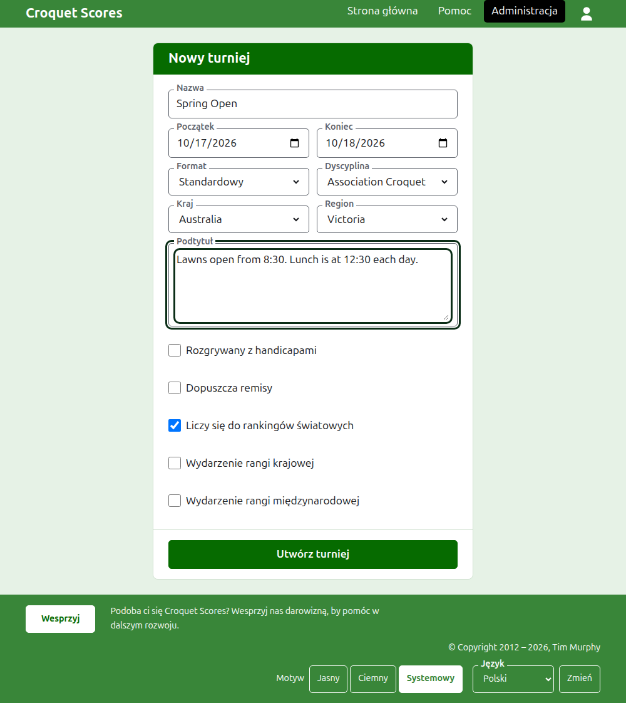

# Tworzenie turnieju

Naciśnij **Nowy turniej** nad listą turniejów w administracji. Przycisk jest nad listą, a nie pod nią, by długa lista nie zepchnęła go poza ekran telefonu.

Formularz pyta o wszystko, z czym turniej się zaczyna. Od turnieju zwyczajnego rodzaju dzielą cię nazwa, dwa dni i kraj: wszystko inne jest ustalone za ciebie i można to zmienić.

## O co pyta formularz

**Nazwa.** To, czego szukają czytelnicy, by znaleźć turniej, na przykład „Spring Open". Ma od 3 do 254 znaków. Nazwa napisana samymi małymi literami albo samymi wielkimi jest odrzucana, bo na każdej stronie, na której by się pojawiła, wyglądałaby jak pomyłka. Dwa turnieje mogą mieć tę samą nazwę, bo ten sam turniej rozgrywa się co roku.

**Początek** i **Koniec.** Dni, w których trwa turniej. Turniej nie może zakończyć się przed rozpoczęciem ani zacząć się czy skończyć później niż z końcem przyszłego roku. Turniej należy do roku, w którym się zaczyna, i ten rok jest też w jego adresie, więc turniej trwający przez Nowy Rok jest wymieniony w roku, w którym się zaczął.

**Formuła.** Wybierz **Standardowa** dla turnieju rozgrywanego między zawodnikami. Pozostałe formuły są dla turniejów rozgrywanych między drużynami, które mają własny przewodnik.

**Dyscyplina.** Dyscypliny, które oferuje strona, w jej kolejności: Krokiet klasyczny, Krokiet golfowy, Amerykański krokiet sześciobramkowy i Rykoszet na Croquet Scores. Gateball Scores nie pyta ani o dyscyplinę, ani o formułę, bo każdy turniej tam jest standardowym turniejem gateballa.

**Kraj** i **Region.** Gdzie rozgrywany jest turniej. O region pyta się tylko wtedy, gdy wybrany kraj dzieli się na regiony, jak stany Australii; kraj, który sam jest jednym regionem, o żaden nie pyta. Regionu nie trzeba wybierać nawet tam, gdzie jest oferowany.

**Podtytuł.** Wszystko, co chcesz przekazać czytelnikom, a co nie ma własnego pola: gdzie parkować, kiedy jest obiad, do kogo dzwonić. Jest pokazywany pod nazwą turnieju na każdej stronie publicznej. Pisze się go w Markdownie, więc słowo można pogrubić gwiazdkami wokół niego, a listę zrobić myślnikiem na początku każdego wiersza. Może mieć do 2000 znaków i można go zostawić pusty.

To, jak jego konkurencje są rozgrywane i liczone, czyli czy z handicapami, czy z remisami i czy do rankingów światowych, mówi każda konkurencja przy dodawaniu.

**Wydarzenie rangi krajowej** i **Wydarzenie rangi międzynarodowej.** Turniej może być jednym, drugim albo żadnym, ale nigdy obydwoma: zaznaczenie jednego odznacza drugie.

## Tworzenie

Naciśnij **Utwórz turniej**. Trafiasz na stronę turnieju w administracji, z której się go prowadzi, i jesteś jego pierwszym organizatorem. Jest wymieniony w administracji pod rokiem, w którym się zaczyna.

Publiczny adres turnieju składa się z jego roku, dyscypliny i nazwy, jak `/2026/ac/spring-open`. Turniej zachowuje ten adres, gdy jego nazwa zostanie później poprawiona, by już wysłany odsyłacz nadal go znajdował; przenosi się tylko wtedy, gdy zmieni się rok, w którym się zaczyna, albo jego dyscyplina.

## Jeśli coś zostanie odrzucone

To, co odrzucono, jest powiedziane pod polem, którego dotyczy, a to, co wpisano, pozostaje wpisane. Nic nie jest zachowywane, dopóki każde pole nie zostanie przyjęte. Najczęściej odrzucane są nazwa wpisana samymi małymi literami, koniec przed początkiem i niewybrany kraj.

Dalej: [Zawodnicy](players.md).
