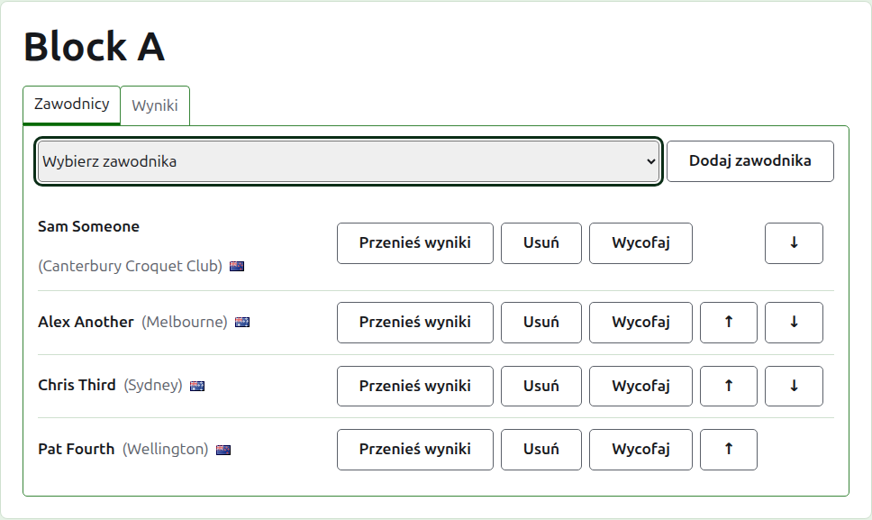
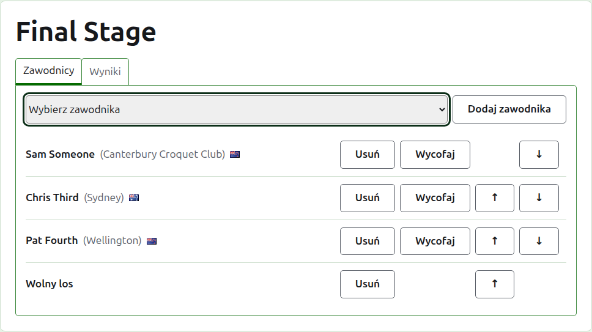
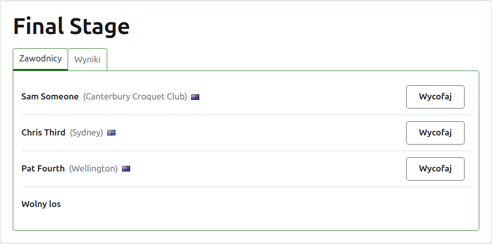
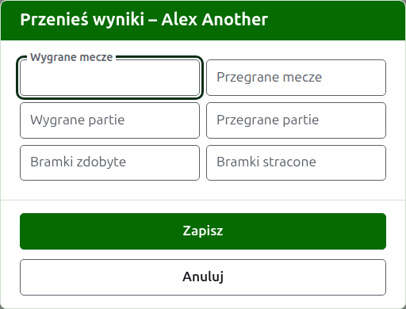
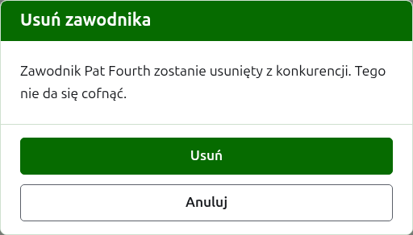
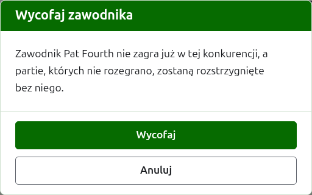
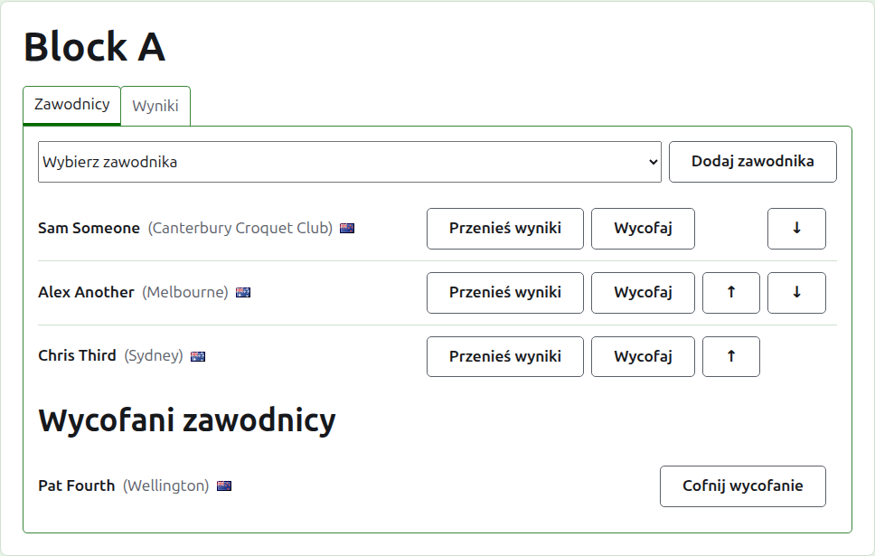

# Zgłaszanie zawodników do konkurencji

Stronę konkurencji otwiera się z jej nazwy na karcie Konkurencje albo z ciemnozielonego paska. Jej nagłówkiem jest nazwa konkurencji, a pod nim są dwie karty: **Zawodnicy** i **Wyniki**. Otwiera się na karcie Zawodnicy, bo zawodników zgłasza się, zanim cokolwiek zostanie rozegrane.

Zawodnik w konkurencji jest jednym z zawodników turnieju, więc zgłasza się go przez wybranie, a nie wpisanie. Wszystko, co go dotyczy, poza jego miejscem w konkurencji i tym, co do niej przenosi, zmienia się na karcie Zawodnicy turnieju.

## Dodawanie zawodnika

Nad listą lista rozwijana oferuje każdego zawodnika turnieju, który nie jest jeszcze w konkurencji, w kolejności turnieju. Wybierz jednego i naciśnij **Dodaj zawodnika**. Zawodnik trafia w kolejności turnieju między już zgłoszonych, lista rozwijana już go nie oferuje, a kursor wraca do listy rozwijanej, by następnego można było wybrać z klawiatury. Gdy każdy zawodnik turnieju jest w konkurencji, lista rozwijana nie jest pokazywana, a karta o tym mówi.

Zarchiwizowani zawodnicy turnieju nie są oferowani.

## Wolne losy w systemie pucharowym

System pucharowy rozgrywa się dopiero wtedy, gdy każde miejsce w jego drabince jest zajęte, a miejsca, których nie zajmują zawodnicy, wypełnia się wolnymi losami. Dlatego w systemie pucharowym lista rozwijana oferuje **Wolny los** jako pierwszy, przed zawodnikami, i oferuje go dalej niezależnie od tego, ile wolnych losów dodano, bo drabinka może potrzebować kilku.

Wolny los umieszcza się w drabince tak jak zawodnika: można go przesuwać w górę i w dół oraz usunąć, ale nie może się wycofać, bo nic nie gra. Zawodnik zgłoszony do systemu pucharowego, którego każde miejsce jest zajęte, jest odrzucany, a karta mówi o tym pod listą rozwijaną.

Kolejność zawodników systemu pucharowego jest jego drabinką. Pierwsze dwa miejsca spotykają się w pierwszym meczu, następne dwa w następnym, i tak dalej. Ustaw zawodników w kolejności, w jakiej drabinka ma być rozgrywana, zanim wprowadzisz jakikolwiek wynik, bo gdy system pucharowy ma partię w użyciu, jego zawodnicy są ustaleni: nikogo nie można dodać, usunąć ani przesunąć. Zawodnik nadal może się wycofać.

## Kolejność

Zawodnicy są wymienieni w kolejności konkurencji, czyli w kolejności, w jakiej losuje się system pucharowy i w jakiej blok jest wymieniony na swojej stronie publicznej. **W górę** i **W dół** przesuwają zawodnika o jedno miejsce.

## Przenoszenie wyników

**Przenieś wyniki** mówi, co zawodnik wnosi do konkurencji z gry, której tu nie zapisano: rezultaty wcześniejszego etapu albo partii rozegranych, zanim konkurencję zaczęto tu zapisywać. Jest oferowane w bloku i w systemie szwajcarskim, które mają klasyfikację, do której można to liczyć, a nie w systemie pucharowym.

Okno pyta o sześć liczb: wygrane i przegrane mecze, wygrane i przegrane partie oraz bramki zdobyte i stracone. Każda liczba jest opcjonalna. Liczba zostawiona pusta nie przenosi nic, co nie jest tym samym co przeniesienie 0, by ten, kto zmieni ją później, widział ją tak, jak została zostawiona. Naciśnij **Zapisz**, by zachować wszystkie sześć.

## Usuwanie zawodnika

**Usuń** zabiera zawodnika zgłoszonego przez pomyłkę. Pozostaje on jednym z zawodników turnieju i znów jest oferowany na liście rozwijanej, ale nic z jego miejsca w konkurencji nie jest zachowywane, więc Usuń najpierw pyta.

Zawodnika, który ma w konkurencji jakąkolwiek partię w użyciu, nie można usunąć, bo partie byłyby wtedy przeciwko komuś, kogo już nie ma, i nie oferuje mu się Usuń. Zawodnika, którego wszystkie partie są zarchiwizowane, można, a jego zarchiwizowane wyniki odchodzą razem z nim.

## Wycofywanie zawodnika

**Wycofaj** jest dla zawodnika, który nie zagra już w konkurencji. Pozostaje w niej, z partiami, które rozegrał, i jest wymieniony pod **Wycofani zawodnicy** po tych, którzy nadal grają. W systemie pucharowym jego przeciwnik w nierozstrzygniętym jeszcze meczu przechodzi dalej.

Wycofaj najpierw pyta, bo zmienia wynik konkurencji: partie, których zawodnik nie rozegrał, są rozstrzygane bez niego.

Wycofany zawodnik oferuje tylko **Cofnij wycofanie**, które przywraca go między grających, po tych, którzy zostali, bez pytania.

Dalej: [Wyniki](scores.md).
