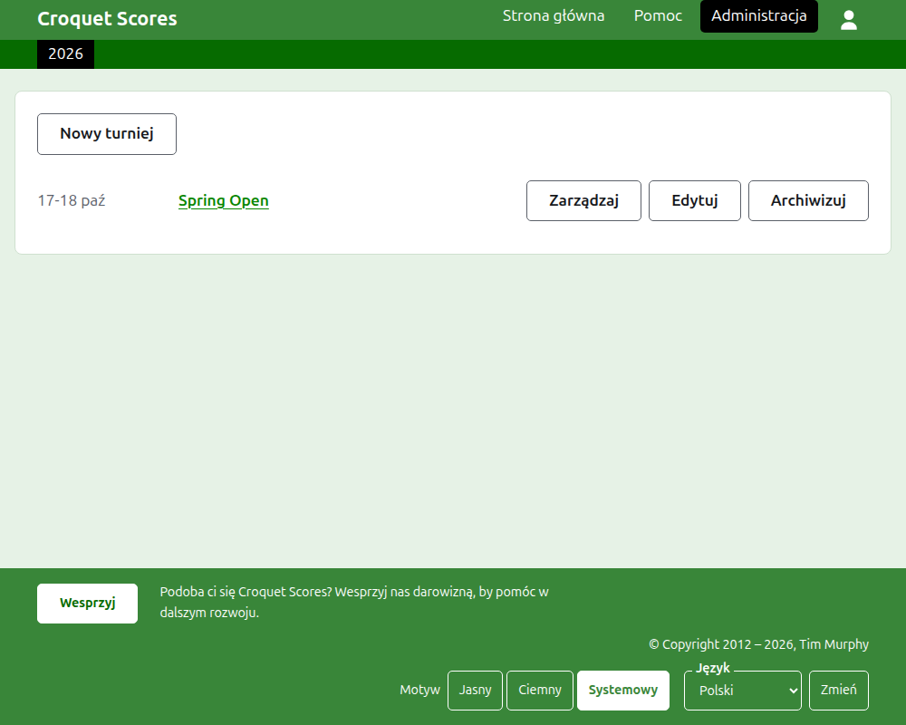
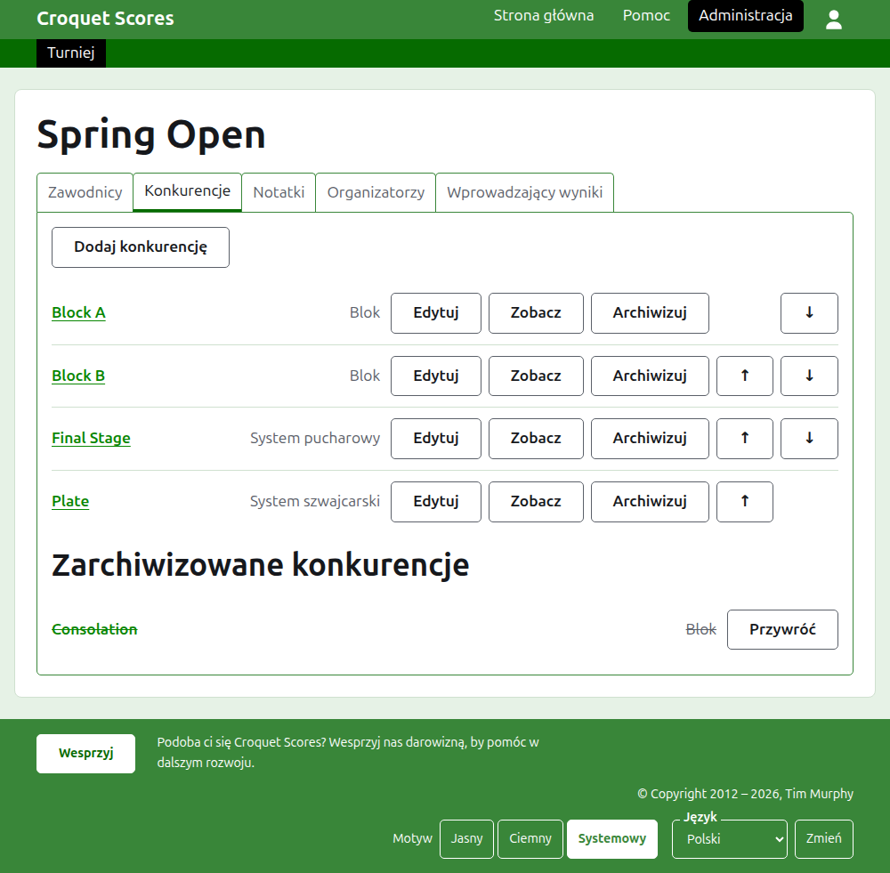

# Prowadzenie turnieju standardowego

Turniej standardowy to turniej rozgrywany między zawodnikami zgłaszanymi pojedynczo: weekend klubowy, turniej otwarty, mistrzostwa. Jego zawodników zgłasza się do bloków, systemów pucharowych i szwajcarskich, a wyniki pojawiają się na stronie w miarę rozgrywania partii. Ten przewodnik prowadzi organizatora od zalogowania aż po turniej, którego wyniki są dostępne publicznie.

Jest samodzielny. Nic w nim nie zależy od przewodnika do turnieju drużynowego, który napisano osobno.

## Zanim zaczniesz

Potrzebujesz konta. Kliknij [tutaj](/account/register), aby je zarejestrować.

Wszystko, co robi organizator, robi w sekcji administracji strony. Strony publiczne, na których zawodnicy i kibice śledzą turniej, są rysowane z tego, co przechowuje administracja, więc nic nie trzeba publikować: wprowadzony wynik jest na stronach publicznych od razu.

## Strony po kolei

1. [Tworzenie turnieju](creating-a-tournament.md): jego nazwa, dni, dyscyplina, miejsce rozgrywania i do czego się liczy.
2. [Zawodnicy](players.md): zgłaszanie zawodników turnieju, poprawianie ich i odkładanie na bok tych, których zgłoszono przez pomyłkę.
3. [Konkurencje](competitions.md): dodawanie bloków, systemów pucharowych i szwajcarskich oraz ustawianie ich w kolejności.
4. [Zgłaszanie zawodników do konkurencji](entering-players-in-a-competition.md): kto gra w której konkurencji, wolne losy w systemie pucharowym, przenoszenie wyników, usuwanie i wycofywanie.
5. [Wyniki](scores.md): wprowadzanie rezultatów, poprawianie ich i odkładanie na bok tych, które wprowadzono przez pomyłkę.
6. [Notatki](notes.md): przekazywanie zawodnikom tego, co muszą wiedzieć w trakcie turnieju.
7. [Organizatorzy i wprowadzający wyniki](managers-and-scorers.md): dzielenie się prowadzeniem turnieju i pozwalanie komuś na wprowadzanie wyników bez możliwości zmiany czegokolwiek innego.
8. [Zmiana, archiwizowanie i przywracanie turnieju](changing-and-archiving.md): poprawianie szczegółów turnieju i odkładanie turnieju na bok.
9. [Co widzą odbiorcy](what-the-public-sees.md): strony, które śledzą twoi zawodnicy, i to, jak pojawia się na nich to, co wprowadzasz.

## Jak zbudowana jest administracja

Strona wejściowa administracji wymienia turnieje, w których masz jakąś rolę, po jednym roku naraz.

Naciśnięcie nazwy turnieju albo **Zarządzaj** otwiera jego stronę. Wszystko, co jest do prowadzenia, mieści się w pięciu kartach pod jego nazwą: **Zawodnicy**, **Konkurencje**, **Notatki**, **Organizatorzy** i **Wprowadzający wyniki**. Strona otwiera się na karcie Zawodnicy, bo zawodnicy są pierwszą rzeczą, którą się wprowadza.

Ciemnozielony pasek pod nagłówkiem służy do przechodzenia między stronami. Prowadzi do turnieju, jako **Turniej**, i do każdej z jego konkurencji po nazwie, więc można przejść z turnieju do konkurencji i między konkurencjami bez wracania przez kartę Konkurencje. Strona, na której jesteś, jest zaznaczona na czarno.

## Zasady, które obowiązują wszędzie

**Nic poza notatką nie jest usuwane bezpowrotnie.** Zawodnicy, konkurencje, wyniki i sam turniej są archiwizowane, a nie usuwane: odkładane na bok, przekreślane i wymieniane pod osobnym nagłówkiem, z przyciskiem **Przywróć**, który je przywraca. Archiwizowanie, przywracanie i przesuwanie w górę i w dół nigdy nie proszą o potwierdzenie, bo każde z nich cofa się naciśnięciem w drugą stronę. To, czego nie da się cofnąć, na przykład usunięcie zawodnika z konkurencji albo usunięcie notatki, najpierw pyta.

**Okno dialogowe nad stroną nie zachowuje nic, dopóki nie naciśniesz jego przycisku.** Anuluj albo klawisz Escape zamyka je i zostawia wszystko tak, jak było. Okna, które coś dodają, jak Dodaj zawodnika i Dodaj wynik, pozostają otwarte po każdym dodaniu, by można było wpisać całą listę po kolei.

**To, co odrzucono, jest powiedziane obok pola, którego dotyczy.** Nic odrzuconego nie jest zachowywane, a to, co wpisano, pozostaje wpisane, by można było to poprawić, a nie wpisywać od nowa.

**Administracja działa na telefonie.** Każdy przycisk jest na tyle duży, by nacisnąć go kciukiem, i nic nie jest szersze niż ekran.

Dalej: [Tworzenie turnieju](creating-a-tournament.md).
