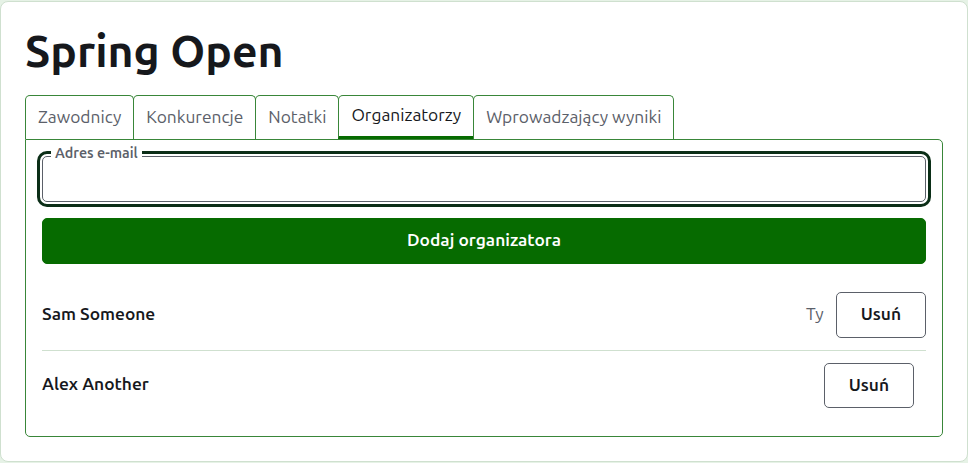
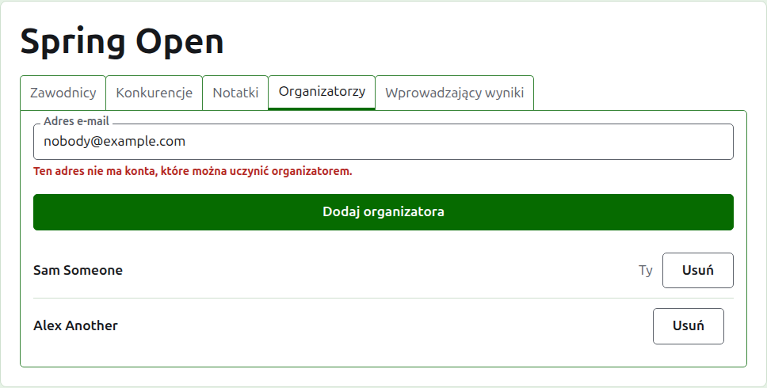
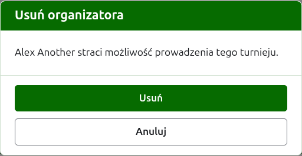
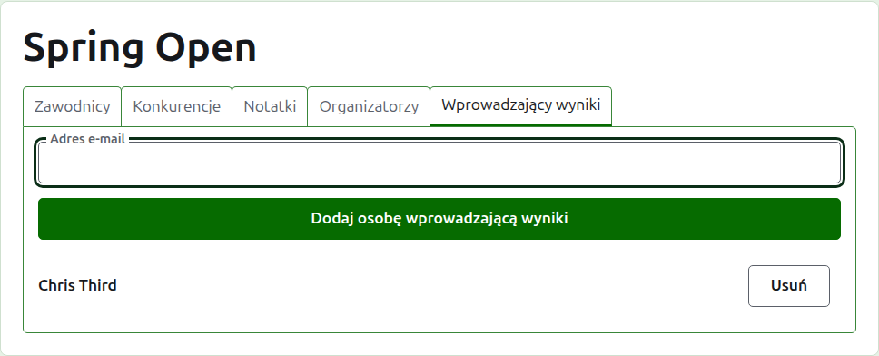
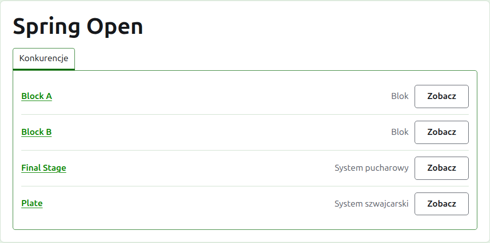

# Organizatorzy i wprowadzający wyniki

Turniej ma organizatorów, którzy mogą robić z nim wszystko, co można z nim zrobić, i może mieć wprowadzających wyniki, którzy wprowadzają jego wyniki i nic więcej. Ten, kto utworzył turniej, jest jego pierwszym organizatorem.

## Organizatorzy

Karta **Organizatorzy** wymienia, kto prowadzi turniej, w kolejności, w jakiej ich uczyniono organizatorami, z twoim własnym imieniem i nazwiskiem oznaczonym jako twoje. To tutaj dzieli się turniejem albo przekazuje go dalej.

Kogoś czyni się organizatorem przez jego adres e-mail. Wpisz go w pole nad listą i naciśnij **Dodaj organizatora**. Adres musi należeć do konta, które jest zarejestrowane i potwierdzone; adres bez takiego konta jest odrzucany pod polem, a strona nie mówi o tym nic więcej. Wprowadzający wyniki uczyniony organizatorem przestaje być wprowadzającym wyniki.

**Usuń** zabiera organizatora. Nic z usuniętego organizatora nie jest zachowywane, więc Usuń najpierw pyta; jeśli jest znów potrzebny, czyni się go organizatorem ponownie przez jego adres. Turniej zawsze ma organizatora, więc ostatniemu nie oferuje się Usuń.

Możesz usunąć samego siebie. Pytanie mówi wtedy, co to znaczy: tracisz własną drogę powrotu do turnieju i nikt na tej stronie nie może tego za ciebie cofnąć. Inny organizator może ponownie uczynić cię organizatorem.

## Wprowadzający wyniki

Karta **Wprowadzający wyniki** to karta Organizatorzy dla wprowadzających wyniki i działa tak samo: adres e-mail i **Dodaj osobę wprowadzającą wyniki** nad listą oraz **Usuń** przy każdym.

Wprowadzający wyniki widzi turniej na swojej własnej liście w administracji, z **Wyniki** w miejsce Zarządzaj, i oferowane są mu tylko jego konkurencje: żadnych zawodników, notatek, organizatorów, wprowadzających wyniki ani rankingów. Na stronie konkurencji widzi tylko kartę Wyniki, na której może wprowadzać, poprawiać, archiwizować i przywracać wyniki tak jak organizator. O tym, kto gra w konkurencji, decydują organizatorzy.

Organizatora nie czyni się wprowadzającym wyniki, bo organizator może już robić wszystko to, co wprowadzający wyniki. Turniej nie potrzebuje wprowadzającego wyniki, więc każdego z nich można usunąć, także ostatniego.

Dalej: [Rankingi](rankings.md).
