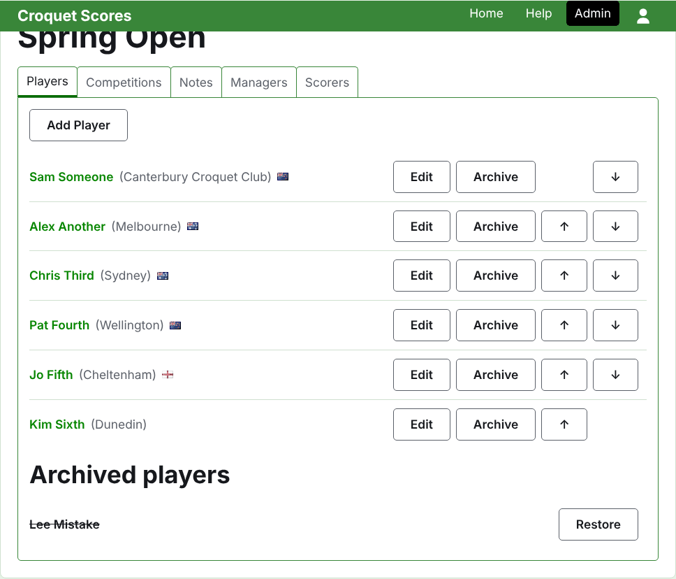
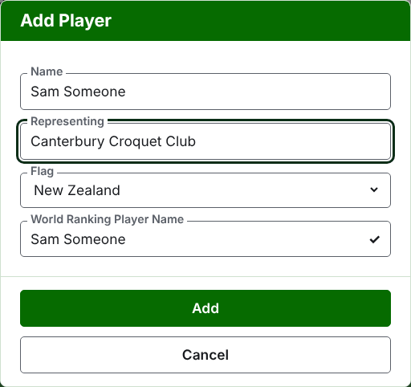
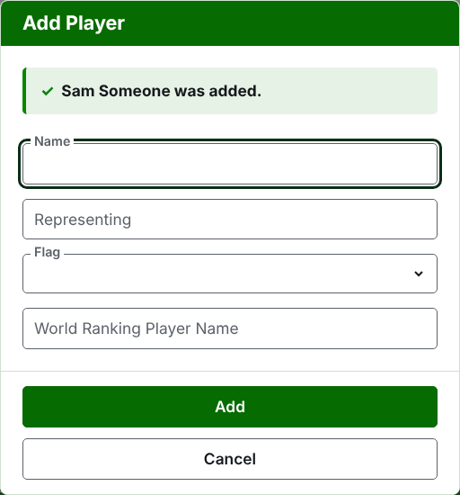
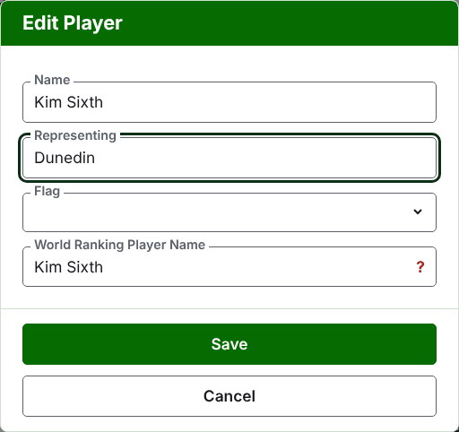
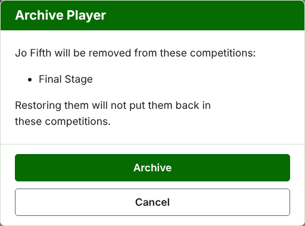

# Zawodnicy

Karta **Zawodnicy** na stronie turnieju to miejsce, gdzie zgłasza się jego zawodników, poprawia ich, ustawia w kolejności i odkłada na bok. To karta, na której otwiera się strona, bo zgłoszenie zawodników jest pierwszą rzeczą, jaką robi się z turniejem.

Zawodników zgłasza się tutaj raz, do turnieju. To, w których konkurencjach każdy gra, wybiera się potem, na stronie każdej konkurencji, spośród zawodników zgłoszonych tutaj. Zobacz [Zgłaszanie zawodników do konkurencji](entering-players-in-a-competition.md).

## Dodawanie zawodników

Naciśnij **Dodaj zawodnika**, nad listą. Nad stroną otwiera się okno dialogowe.

**Imię i nazwisko** jest wymagane. To nazwa zawodnika, jaka będzie pokazywana na każdej stronie, od 3 do 254 znaków. Dwóch zawodników w jednym turnieju nie może mieć tej samej nazwy, niezależnie od wielkości liter; gdy dwóch zawodników naprawdę nazywa się tak samo, odróżnij ich w samej nazwie, jak „Andrew Hobbs (2)".

**Reprezentuje** to to, dla czego zawodnik gra, napisane tak, jak powiedziałby to czytelnik: klub, region albo kraj, na przykład „Canterbury Croquet Club". Jest pokazywane w nawiasie po nazwie. Można je zostawić puste.

**Flaga** to flaga pokazywana obok nazwy zawodnika. Można zostawić brak flagi, jak u większości zawodników. To, kogo zawodnik reprezentuje, i to, pod jaką flagą gra, są trzymane osobno, bo zawodnik może grać dla klubu w jednym kraju i pod flagą innego.

**Nazwa zawodnika w rankingu światowym** to nazwa, pod którą zawodnika znają rankingi światowe. Pytanie o nią pojawia się tylko w turnieju Association Croquet lub Golf Croquet, dwóch dyscyplin z rankingami światowymi. Podczas dodawania zawodnika podąża ona za nazwą, którą wpisujesz, bo większość zawodników rankingi znają pod ich własną nazwą, i przestaje podążać, gdy wpiszesz w nią cokolwiek. Zostawiona pusta, jest zachowywana jako nazwa zawodnika.

Gdy wpisujesz nazwę, podpowiadani są zawodnicy znani rankingom światowym, których nazwy tak się zaczynają, by można było wziąć nazwę w pisowni rankingów, a nie wpisywać jej ręcznie. Obok nazwy w rankingu światowym znacznik mówi, że rankingi znają tę nazwę, a znak zapytania – że nie: nazwa może być źle zapisana albo zawodnik może być nowy w rankingach. To tylko podpowiedź. Nazwa nieznana rankingom jest zachowywana tak samo chętnie jak znana.

Naciśnij **Dodaj**. Zawodnik zostaje dodany, okno o tym mówi, a jego pola są opróżniane dla następnego zawodnika, z kursorem z powrotem w nazwie. Dodaj w ten sposób całą listę, a potem naciśnij **Anuluj**, by zamknąć okno. Anuluj nie zachowuje nic, co nie zostało już dodane.

Zawodnik nigdy nie nazywa się „Bye" (angielskie słowo na wolny los). Wolne losy systemu pucharowego dodaje się w samym systemie pucharowym, tam gdzie zgłasza się jego zawodników, więc nazwa, której pierwszym słowem jest „bye", jest odrzucana, a okno wyjaśnia dlaczego.

## Poprawianie zawodnika

Naciśnij nazwę zawodnika albo jego **Edytuj**, by otworzyć to samo okno na tym zawodniku, zatytułowane Edytuj zawodnika. Zmień to, co jest nie tak, i naciśnij **Zapisz**, co zachowuje zmianę i zamyka okno. Zawodnik, którego nazwę poprawiono, zachowuje nazwę w rankingu światowym, którą miał, bo rankingi nadal znają go pod nią.

Zawodnik poprawiony tutaj jest poprawiony wszędzie: w każdej konkurencji, w której jest, i na każdej stronie publicznej.

## Ustawianie zawodników w kolejności

Zawodnicy są wymienieni w kolejności turnieju, czyli w kolejności, w jakiej są oferowani przy zgłaszaniu do konkurencji, i w kolejności, w jakiej losuje się system pucharowy. **W górę** i **W dół**, strzałki na końcu każdego wiersza, przesuwają zawodnika o jedno miejsce. Pierwszemu zawodnikowi nie oferuje się W górę, a ostatniemu W dół.

## Archiwizowanie zawodnika

**Archiwizuj** odkłada zawodnika na bok: zgłoszonego przez pomyłkę albo wycofanego z całego turnieju. Zarchiwizowany zawodnik jest wymieniony pod **Zarchiwizowani zawodnicy**, przekreślony, po zawodnikach w użyciu, i oferuje tylko **Przywróć**. Zarchiwizowany zawodnik nie jest w żadnej konkurencji i nie pojawia się na żadnej stronie publicznej.

Zawodnika, który rozegrał jakąkolwiek partię, nie można zarchiwizować, bo partie byłyby wtedy przeciwko komuś, kogo już nie ma, więc takiemu zawodnikowi nie oferuje się Archiwizuj. Zawodnika, którego wszystkie partie są zarchiwizowane, można.

Archiwizowanie zawodnika, który nie jest w żadnej konkurencji, nie pyta najpierw, bo przywrócenie go przywraca wszystko. Archiwizowanie zawodnika, który jest w jakiejkolwiek konkurencji, najpierw pyta, bo archiwizowanie usuwa go z każdej konkurencji, w której jest, a przywrócenie go z powrotem nie wstawia.

Dalej: [Konkurencje](competitions.md).
