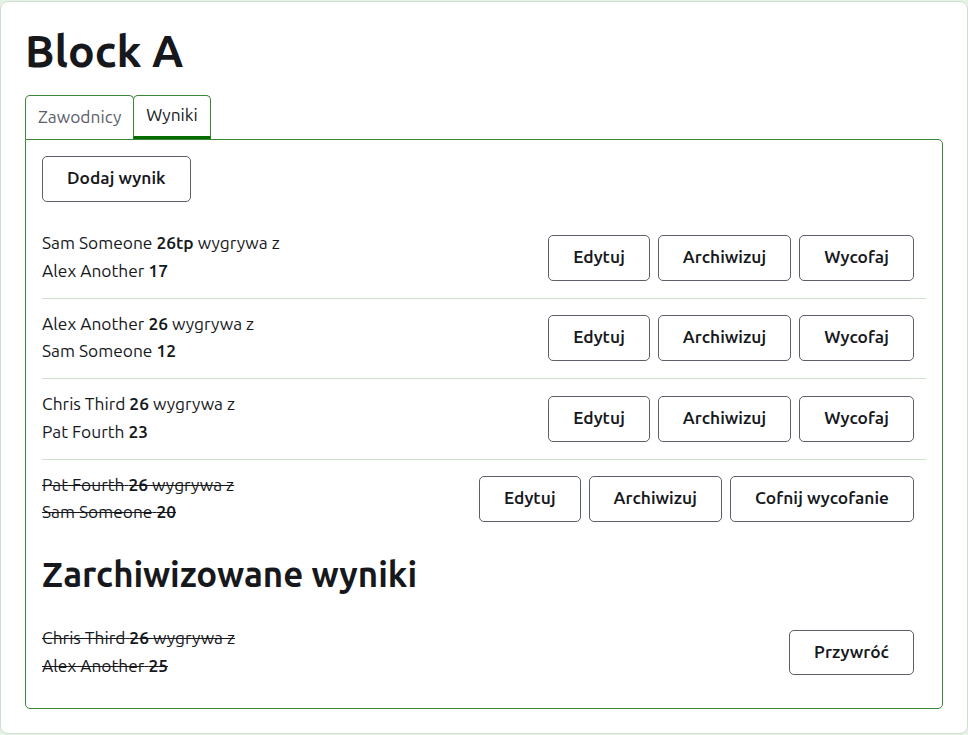
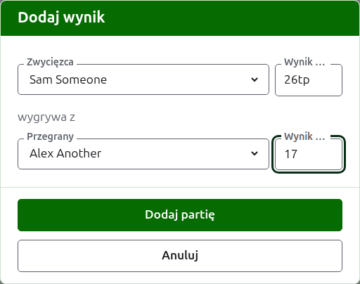
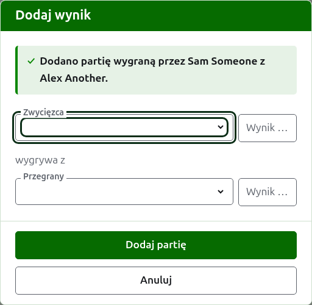
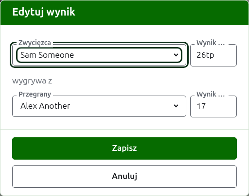

# Wyniki

Karta **Wyniki** na stronie konkurencji to miejsce, gdzie wprowadza się jej gry, poprawia je i odkłada na bok. Osoba wprowadzająca wyniki widzi tylko tę kartę i może na niej robić wszystko to, co organizator.

## Wprowadzanie wyniku {#entering-a-score}

Naciśnij **Dodaj wynik**, nad listą. Okno czyta się tak, jak mówi się rezultat na głos: zwycięzca i jego wynik, potem „wygrywa z", potem przegrany i jego wynik.

Zwycięzcę i przegranego wybiera się spośród grających zawodników konkurencji, w kolejności konkurencji. Na początku nikt nie jest wybrany, by gra nigdy nie została zapisana zawodnikowi, którego nie wybrano. W konkurencji pucharowej wybranie zwycięzcy wybiera jako przegranego tego, z kim jest rozlosowany, tam gdzie to widzisz i możesz wybrać innego.

Wynik wpisuje się tak, jak zapisał go sędzia: liczba punktów i to, co po niej następuje, co jest zachowywane i pokazywane tak, jak wpisano, jak „26tp" dla 26 bramek i triple peela. Liczba to cyfry, od których wynik się zaczyna; wynik, który nie zaczyna się od cyfry, jest odrzucany.

Gra wygrana przy równych punktach, jak wtedy, gdy przerwano ją z powodu czasu i rozstrzygnięto w inny sposób, mówi, kto ją wygrał, oznaczeniem po wyniku zwycięzcy: „6w" wygrywa z „6". Na Croquet Scores oznaczenia to „w", „won" i „winner"; Gateball Scores przyjmuje też „cb" i „so". Wynik zwycięzcy musi być wyższy niż przegranego albo oznaczony, chyba że turniej dopuszcza remisy – wtedy równe punkty bez oznaczenia są zachowywane jako remis.

Naciśnij **Dodaj grę**. Gra zostaje dodana, okno mówi która, a pola są opróżniane dla następnej, bo wyniki przychodzą grami, odczytane z tablicy na koniec rundy. Naciśnij **Anuluj**, gdy wszystkie są już wprowadzone.

To, co odrzucono, jest powiedziane pod polem, którego dotyczy: niewybrany zwycięzca lub przegrany, wynik niewpisany albo niezaczynający się od cyfry, ten sam zawodnik po obu stronach, wynik przegranego oznaczony jako wygrana albo wynik zwycięzcy niższy niż przegranego. W konkurencji pucharowej dwóch zawodników, którzy nie są rozlosowani do gry ze sobą, jest odrzucanych nad polami.

## Drabinka konkurencji pucharowej musi być najpierw zapełniona {#draw-filled-first}

Konkurencję pucharową rozgrywa się dopiero wtedy, gdy każde miejsce w jej drabince zajmuje zawodnik albo Bye. Do tego czasu Dodaj wynik wyjaśnia, dlaczego nie można dodać wyników, zamiast otwierać okno.

## Lista wyników

Wyniki w użyciu są wymienione w kolejności wprowadzania, od najstarszego, by lista czytała się tak, jak rozgrywano konkurencję. Każdy mówi zwycięzcę i jego wynik, potem przegranego i jego, i oferuje **Edytuj** oraz **Archiwizuj**.

## Poprawianie wyniku {#correcting-a-score}

**Edytuj** otwiera to samo okno na tym wyniku, zatytułowane Edytuj wynik, z wybranymi zawodnikami i wynikami takimi, jak je wpisano. Naciśnij **Zapisz**, by zachować poprawkę i zamknąć okno.

Poprawka zachowuje rezultat: wygrana gra pozostaje wygrana, a zremisowana – zremisowana. Grę, której rezultat był błędny, archiwizuje się i wprowadza ponownie.

Tam, gdzie wynik można by zarchiwizować, można zmienić zarówno jego zawodników, jak i wyniki. W konkurencji pucharowej wynik, którego zwycięzca już zagrał w następnej rundzie, zachowuje zawodników, bo zmiana tego, kto go wygrał, zostawiłaby następną grę rozegraną przez kogoś, kto tam nie dotarł; można poprawić tylko jego wyniki.

## Archiwizowanie wyniku

**Archiwizuj** odkłada wynik na bok, by nie liczył się do niczego. Jest wymieniony pod **Zarchiwizowane wyniki**, przekreślony, i oferuje tylko **Przywróć**. Żadne z nich nie pyta najpierw, bo każde cofa drugie.

W konkurencji pucharowej zwycięzca meczu przechodzi do następnej rundy, więc wynikowi meczu, którego zwycięzca zagrał w następnej rundzie, nie oferuje się Archiwizuj. Najpierw archiwizuje się grę z następnej rundy, a potem można te przed nią. Tam, gdzie runda jest najlepsza z 3 albo 5, każdą grę meczu traktuje się tak samo. Konkurencje grupowe i szwajcarskie nie mają rund zależnych od siebie, więc każdy wynik w nich można zarchiwizować.

## Wycofywanie wyniku

Zawodnika, który opuszcza konkurencję, zwykle wycofuje się z niej na karcie Zawodnicy i to wszystko, czego trzeba: nie gra już więcej, a gry, które rozegrał, pozostają, ale nie liczą się już do wygranych/przegranych ani bramek. Wycofanie wyniku jest dla rzadszego przypadku, gdy rozegrana gra nie ma się liczyć. Na przykład w australijskim President's Eights rezultaty pierwszej rundy pozostają, gdy zawodnik się wycofuje, a z rachunku wyłącza się tylko jego gry z drugiej rundy: te gry się wycofuje.

W konkurencji grupowej albo szwajcarskiej wynik, który rozegrano, ale który nie ma się liczyć, wycofuje się, a nie archiwizuje. **Wycofaj** zachowuje go wśród wyników w użyciu, na jego miejscu, ale przekreślony i nieliczący się do niczego na stronach publicznych. **Cofnij wycofanie** sprawia, że znów się liczy. Żadne z nich nie pyta najpierw. Wynikom konkurencji pucharowej nie oferuje się Wycofaj, bo tam wynik rozstrzyga więcej niż klasyfikację.

Dalej: [Notatki](notes.md).
