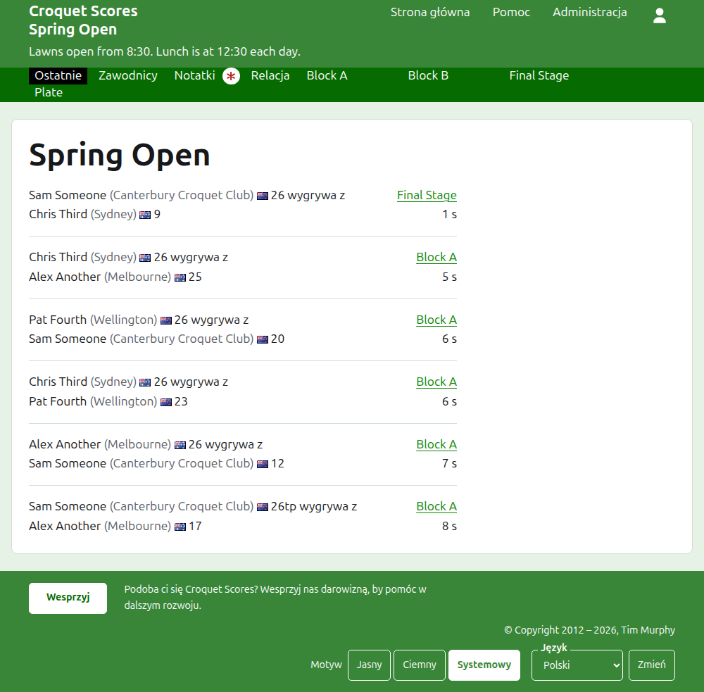
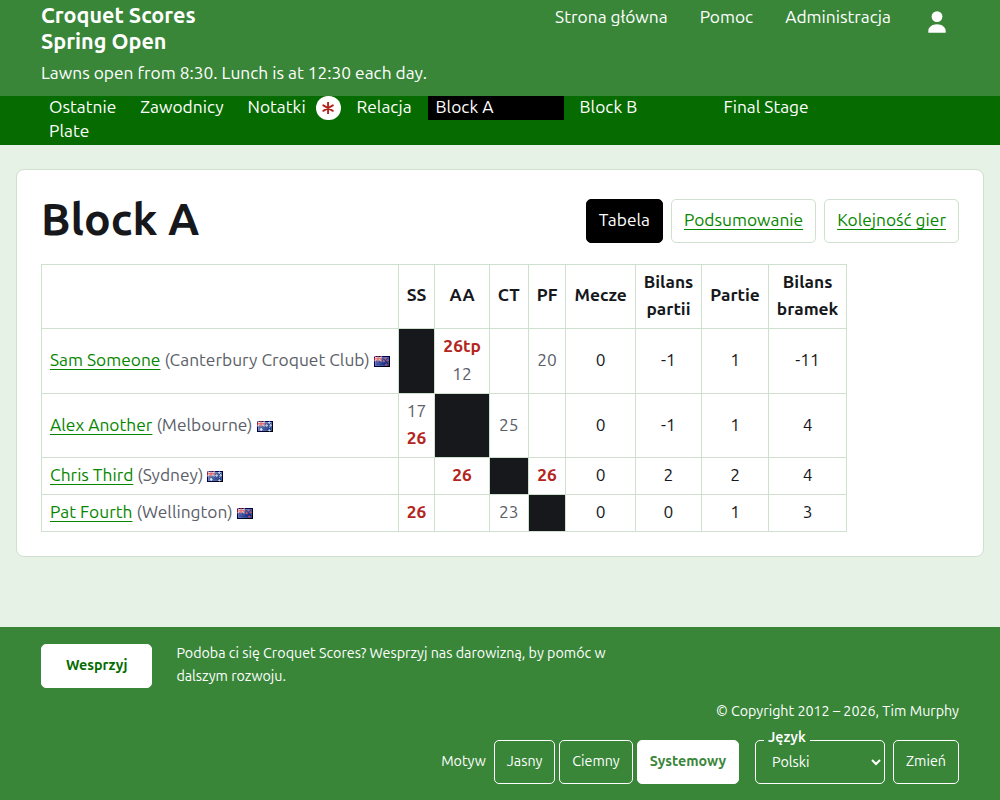
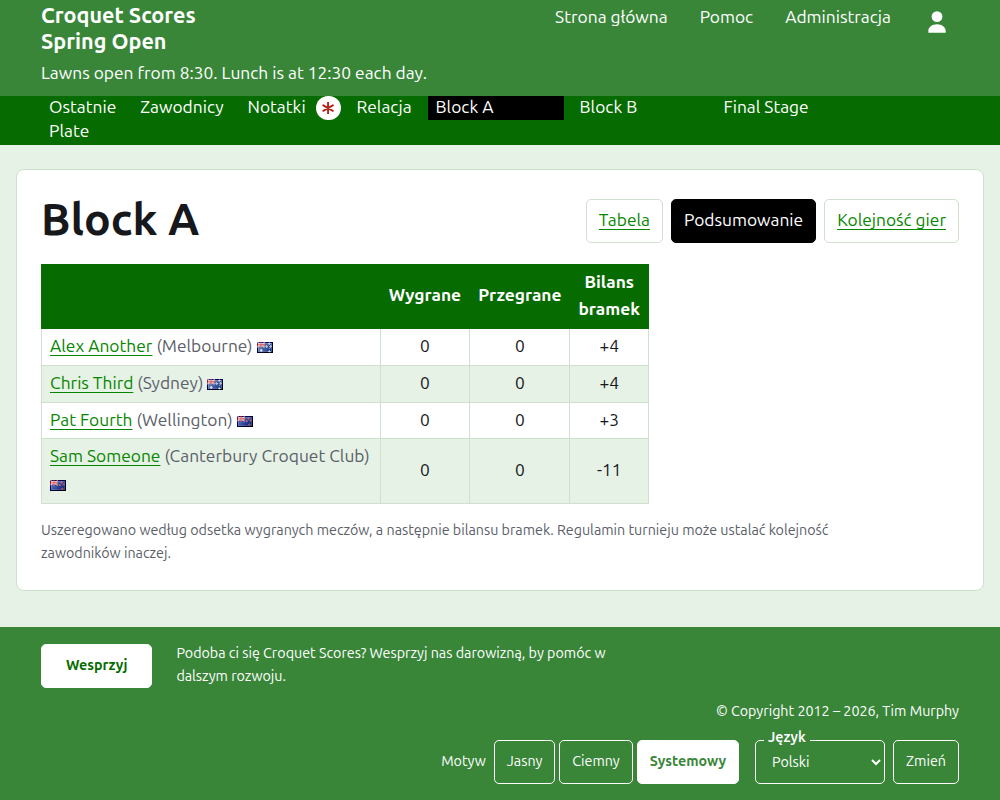
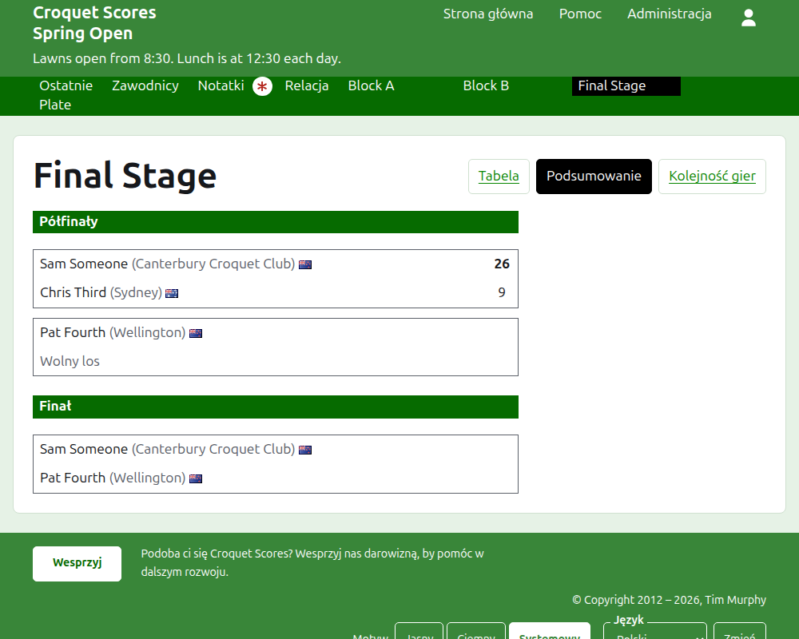
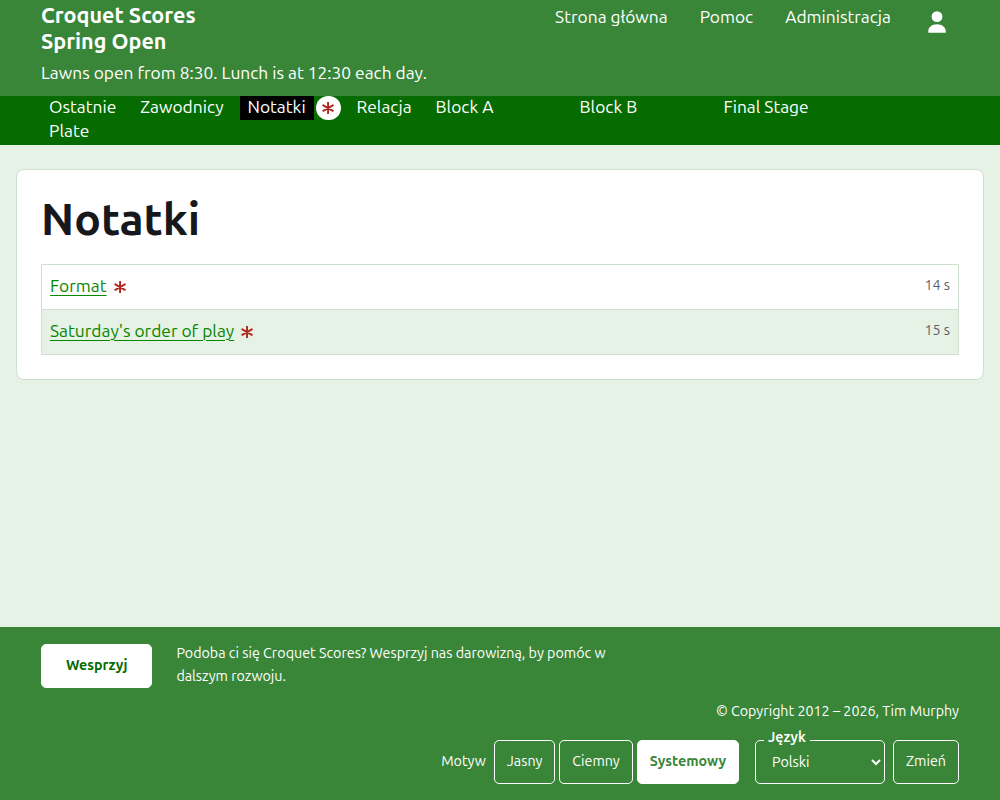

# Co widzą odbiorcy

Nic nie jest publikowane: strony publiczne są rysowane z tego, co przechowuje administracja, więc wprowadzony wynik jest na nich od razu. Nie wymagają konta ani skryptów i są ułożone pod telefon.

## Strona turnieju

Strona turnieju jest pod jego rokiem, dyscypliną i nazwą, jak `/2026/ac/spring-open`. Jej nagłówkiem jest nazwa turnieju, a pod nią podtytuł. Wymienia każdą grę w użyciu, od ostatnio dodanej, by czytelnik, który wraca, widział, co wydarzyło się od tego czasu. Każda gra mówi zwycięzcę, kogo reprezentuje, jego flagę i wynik, potem przegranego i jego, razem z konkurencją, w której rozegrano grę, i tym, jak dawno ją dodano.

Ciemnozielony pasek oferuje sekcje turnieju: **Ostatnie**, czyli tę stronę, **Zawodnicy**, **Notatki** i **Komentarz**, a potem każdą konkurencję w użyciu, w kolejności z karty Konkurencje. Notatki są oznaczone czerwoną gwiazdką, dopóki jest notatka, której czytelnik nie przeczytał.

## Konkurencja grupowa

Strona konkurencji grupowej pokazuje jej rezultaty jako tabelę: wiersz i kolumnę dla każdego zawodnika w kolejności konkurencji, z grami między dwoma zawodnikami tam, gdzie wiersz spotyka kolumnę, każdą oznaczoną jako wygrana, przegrana lub remis dla zawodnika z wiersza. Po kolumnach zawodników idą sumy każdego zawodnika. Gdy każdy mecz jest jedną grą, są to wygrane i bilans bramek; gdy mecz jest najlepszy z więcej niż jednej, są to mecze, bilans gier, gry i bilans bramek.

Konkurencja grupowa jest pokazywana na trzy sposoby, oferowane w wierszu z jego nazwą: **Siatka**, **Podsumowanie** i **Kolejność gier**. Podsumowanie jest widokiem na telefon: zawodnicy uszeregowani, z wygranymi, przegranymi i bilansem bramek. Kolejność gier wymienia każdą grę od najstarszej. Czytelnik, który wybierze widok, zachowuje go dla każdej konkurencji, dopóki nie wybierze innego.

Wiersz wycofanego zawodnika o tym mówi. Wycofany wynik jest pokazywany przekreślony i nie liczy się do niczego. Zarchiwizowany wynik nie jest pokazywany.

## Konkurencja pucharowa

Strona konkurencji pucharowej rysuje drabinkę runda po rundzie, kolumna na każdą rundę od pierwszej do finału, z dwiema stronami każdego meczu jedna nad drugą i komórką na każdą grę, z których mecz jest najlepszy. Mecz późniejszej rundy stoi obok dwóch meczów, między których zwycięzcami jest rozgrywany. Na telefonie drabinka przewija się w bok, ze strzałkami do finału i z powrotem.

## Konkurencja szwajcarska

Strona konkurencji szwajcarskiej szereguje zawodników w tabeli: ich gry, wygrane, procent wygranych i rezultaty, każdy podany jako przeciwnik i różnica, jak „+4" dla gry wygranej czterema.

## Zawodnicy

Strona Zawodnicy wymienia każdego niezarchiwizowanego zawodnika turnieju, w kolejności alfabetycznej, z tym, kogo reprezentuje, i jego flagą.

## Notatki

Strona Notatki wymienia notatki turnieju, od ostatnio napisanej, każda prowadzi do własnej strony i mówi, jak dawno ją napisano. Notatka, której czytelnik nie przeczytał, jest oznaczona czerwoną gwiazdką, dopóki jej nie otworzy.

## Adresy, które się przenoszą

Turniej zachowuje swój adres, gdy poprawia się jego nazwę. Gdy się przenosi, bo zmienił się jego rok albo dyscyplina, jego stary adres prowadzi do nowego, by zachowany wcześniej odsyłacz nadal działał. Stron zarchiwizowanego turnieju nie można znaleźć, dopóki nie zostanie przywrócony.
