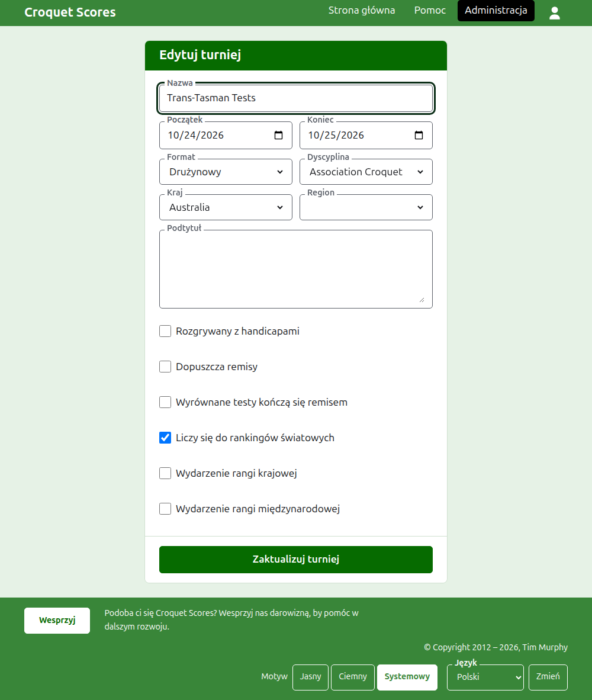
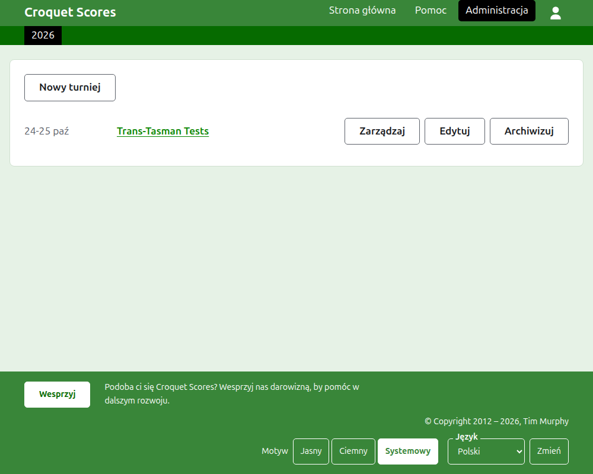

# Zmiana, archiwizowanie i przywracanie turnieju

## Zmiana szczegółów turnieju

Na liście turniejów w administracji naciśnij **Edytuj** przy turnieju. Formularz jest tym samym, który go utworzył, wypełniony tak, jak turniej wygląda teraz. Zmień to, co jest nie tak, i naciśnij **Zaktualizuj turniej**.

Dni turnieju można tu rozszerzyć, gdy test potrzebuje dnia poza nimi, bo test rozgrywa się w obrębie jego turnieju. Jeden format drużynowy można zmienić na inny, bo turniej w każdym z nich przechowuje to samo. Gdy turniej ma już jakąkolwiek drużynę lub test, licząc też zarchiwizowane, nie można go zmienić na format Standardowy, który zamiast tego ma zawodników i konkurencje.

Turniej zachowuje swój adres, gdy poprawia się jego nazwę, by link, który ktoś już wysłał, nadal go znajdował. Przenosi się tylko wtedy, gdy zmieni się rok, w którym się zaczyna, albo jego dyscyplina, a wtedy jego stary adres prowadzi do nowego. Zapisanie przenosi cię do turnieju tam, gdzie teraz się znajduje.

Turniej może zmienić tylko organizator. Wprowadzający wyniki, jak każdy inny, dowiaduje się o tym zamiast zobaczyć formularz.

## Lista turniejów

Administracja wymienia jeden rok naraz, zaczynając od bieżącego, od najnowszego turnieju. Lata, w których masz turniej, są kartami na ciemnozielonym pasku, od najnowszego; gdy jest ich więcej, niż mieści się na telefonie, najstarsze są na liście rozwijanej na końcu rzędu. Rok jest w adresie, więc do roku można podać link.

## Archiwizowanie turnieju

**Archiwizuj** przy turnieju na liście odkłada go na bok. Jest nadal wymieniony, przekreślony i po turniejach w użyciu, ale oferuje tylko **Przywróć**: jego strona w administracji i jego strony publiczne są zamknięte, dopóki nie zostanie przywrócony. Archiwizowanie nie pyta najpierw, bo przywrócenie je cofa.

Dalej: [Co widzą odbiorcy](what-the-public-sees.md).
