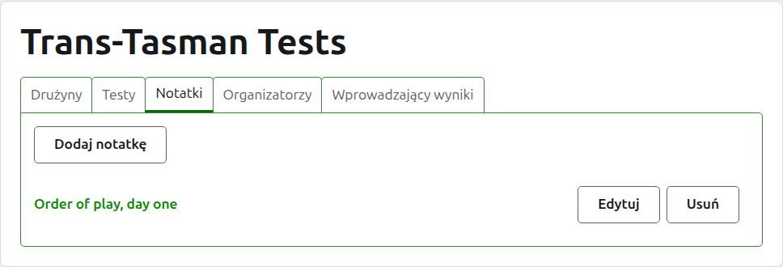
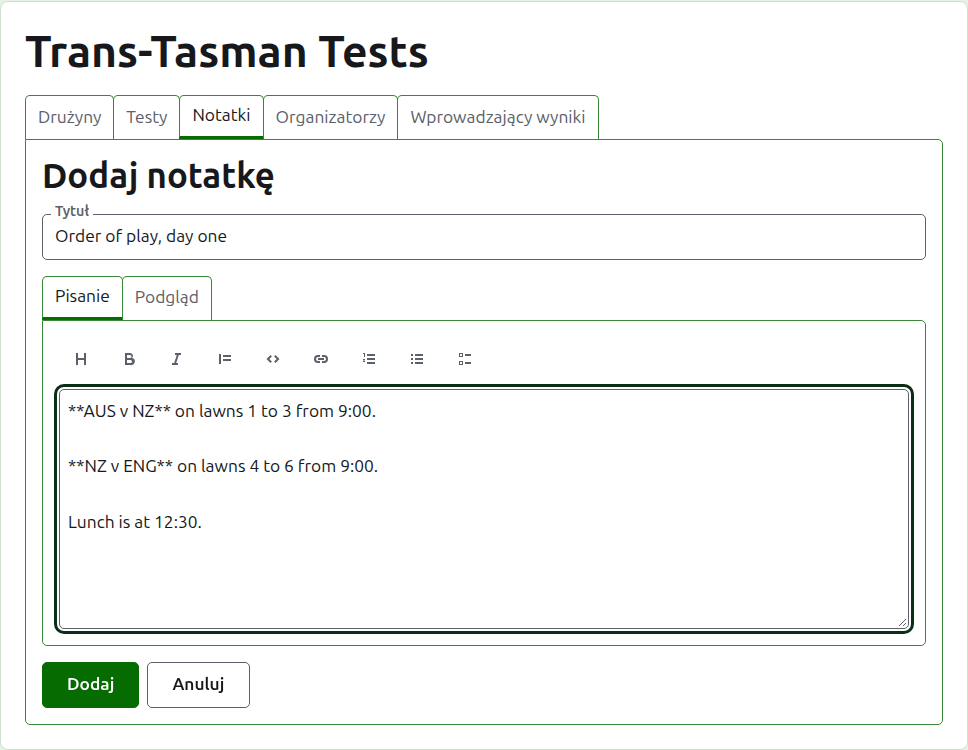
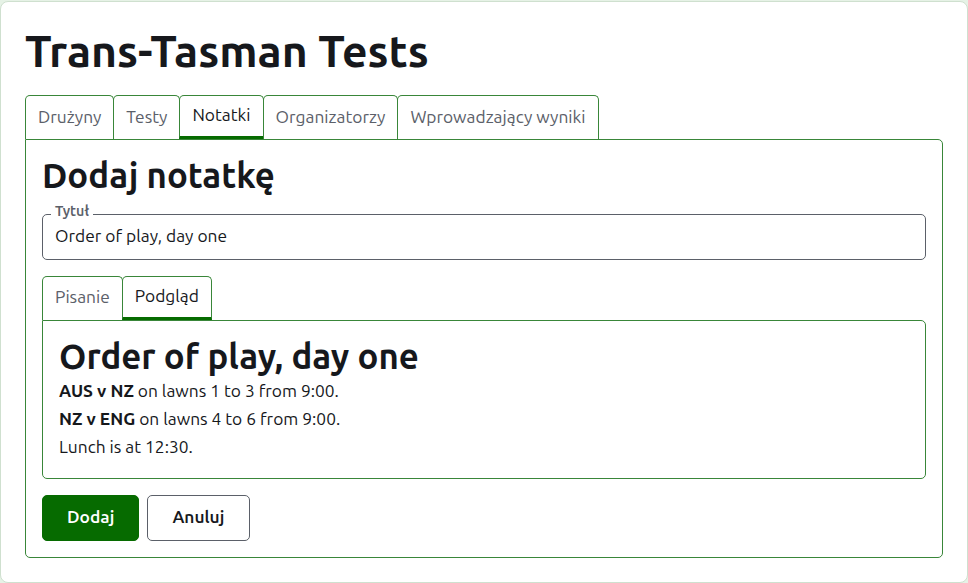
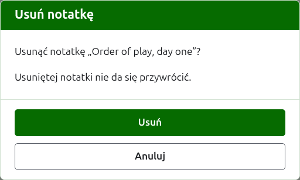

# Notatki

Karta **Notatki** na stronie turnieju to miejsce, gdzie jego organizatorzy piszą to, co zawodnicy muszą wiedzieć w trakcie turnieju: kolejność gier, zmianę kortów, godzinę obiadu. Czytelnicy znajdują je na publicznej stronie Notatki turnieju, a notatka, której nie przeczytali, jest tam oznaczona czerwoną gwiazdką, która oznacza też sekcję Notatki na każdej stronie turnieju, dopóki jej nie otworzą.

## Pisanie notatki

Naciśnij **Dodaj notatkę**, nad listą. Miejsce listy zajmuje panel, bo notatkę pisze się obszernie i potrzebuje ona miejsca.

**Tytuł** jest wymagany i to po nim notatka jest wymieniana. Jest zwykłym tekstem.

**Opis** pisze się w Markdownie i można go zostawić pusty, gdy tytuł mówi wszystko, co jest do powiedzenia. Pasek narzędzi nad polem pisze Markdown za ciebie: Nagłówek, Pogrubienie, Kursywa, Cytat, Kod, Link, Lista numerowana, Lista punktowana i Lista zadań. Każde działa na tym, co zaznaczono, albo na początku każdego zaznaczonego wiersza, albo ustawia kursor tam, gdzie mają trafić słowa.

**Podgląd** pokazuje notatkę tak, jak zobaczy ją czytelnik na jej stronie.

Naciśnij **Dodaj**. Notatka zostaje zachowana, lista wraca z nią na górze, a notatka jest od razu na publicznej stronie Notatki.

## Edytowanie notatki

Naciśnij tytuł notatki albo jej **Edytuj**, by otworzyć panel na tej notatce. Naciśnij **Zapisz**, by zachować zmianę. Notatka edytowana od czasu, gdy czytelnik ją przeczytał, jest dla niego oznaczana ponownie.

## Usuwanie notatki

Notatkę, która już nie obowiązuje, usuwa się. Usunięta notatka znika na dobre, więc **Usuń** najpierw pyta.

Dalej: [Organizatorzy i wprowadzający wyniki](managers-and-scorers.md).
